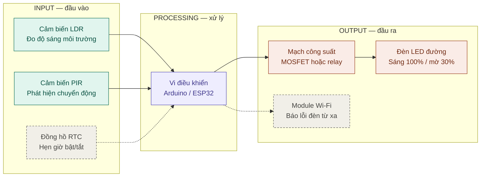
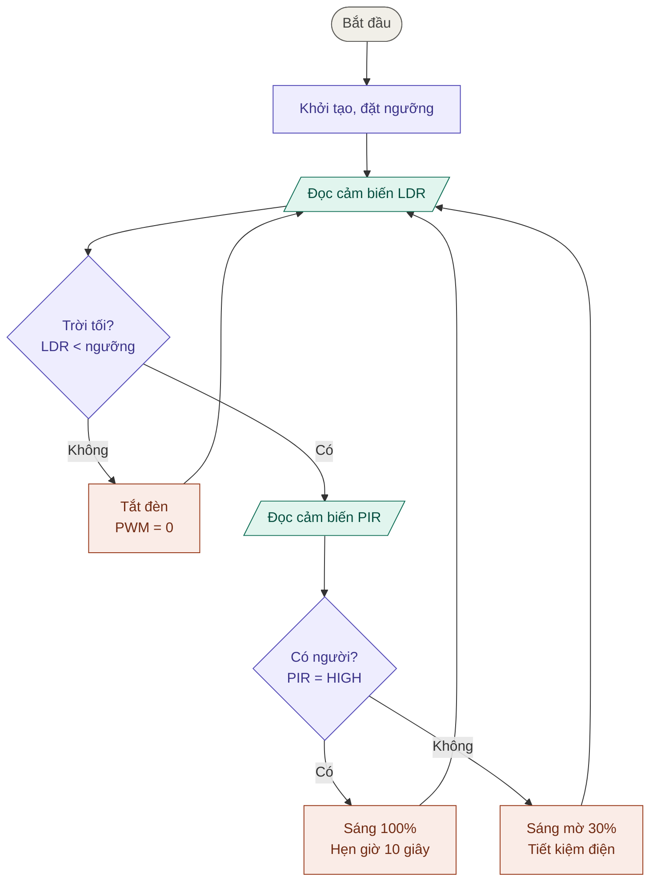

# BT1.2 — Phân tích thiết bị nhúng thực tế

## Bảng phân tích 3 thiết bị nhúng

| Thiết bị | Khối Input | Khối Processing | Khối Output |
|---|---|---|---|
| **Camera an ninh (IP camera)** | Cảm biến hình ảnh (CMOS), micro, cảm biến ánh sáng/cảm biến chuyển động (PIR), nút reset | SoC/vi điều khiển xử lý và nén hình ảnh (H.264/H.265), phân tích phát hiện chuyển động, quản lý kết nối mạng | Luồng video truyền qua Wi-Fi/Ethernet, lưu vào thẻ nhớ, đèn LED hồng ngoại ban đêm, loa, đèn báo trạng thái, gửi thông báo về điện thoại |
| **Điều hòa nhiệt độ** | Remote (cảm biến hồng ngoại), cảm biến nhiệt độ phòng, cảm biến nhiệt độ dàn lạnh | Vi điều khiển giải mã lệnh remote, chạy thuật toán so sánh nhiệt độ cài đặt với nhiệt độ thực tế | Máy nén (compressor), quạt dàn lạnh/nóng, cánh đảo gió (động cơ bước), màn hình hiển thị nhiệt độ |
| **Máy chiếu** | Nút trên thân máy/remote, cổng tín hiệu hình ảnh (HDMI/VGA), cảm biến nhiệt độ bên trong | Bộ xử lý (SoC/vi điều khiển) xử lý tín hiệu hình ảnh, điều khiển nguồn sáng và quản lý nhiệt (tăng/giảm tốc độ quạt theo nhiệt độ) | Nguồn sáng (đèn/LED/laser) và chip tạo hình, quạt tản nhiệt, động cơ lấy nét, loa, đèn báo trạng thái |

## Hai câu hỏi tư duy

Câu 1. Người dùng cuối có thể tự cài đặt ứng dụng mới vào thiết bị không?

Trong điều kiện sử dụng bình thường: Không.

Camera IMOU là thiết bị nhúng chuyên dụng, được thiết kế để làm một nhóm chức năng cố định: quay video, xoay 360°, phát hiện chuyển động, đàm thoại hai chiều, lưu trữ thẻ nhớ/đám mây.
Thiết bị không có kho ứng dụng và không có hệ điều hành mở cho bên thứ ba, nên người dùng không có cách chính thức để cài thêm phần mềm vào camera.
Thứ người dùng cài là app Imou Life trên điện thoại. Đây chỉ là phần mềm điều khiển từ xa, không chạy bên trong camera.
Việc duy nhất người dùng làm được với phần mềm bên trong là cập nhật firmware chính thức do hãng phát hành. Đó là thay phần mềm nền, không phải cài thêm ứng dụng.

Trường hợp ngoại lệ (cưỡng ép): camera thực chất là một SoC chạy Linux nhúng, nên người có chuyên môn và dụng cụ (cổng UART/JTAG, đọc ghi chip flash) vẫn có thể can thiệp, sửa hoặc thay hẳn firmware bằng bản mã nguồn mở. Tuy nhiên:

Thiết bị thường có khóa bootloader, firmware ký số, nên nhiều dòng không cho phép.
Tài nguyên (RAM, bộ nhớ, CPU) hạn chế, không chạy được ứng dụng nặng.
Rủi ro cao: hỏng thiết bị, mất bảo hành, mở lỗ hổng bảo mật.

Đây là hành vi can thiệp trái thiết kế, không phải cách dùng của người dùng cuối.

Câu 2. Nếu thay đổi firmware nạp trong vi điều khiển thì hành vi của thiết bị có thay đổi không?

Có.

Firmware là chương trình điều khiển phần cứng, được xem như “bộ não” của thiết bị. Phần cứng (cảm biến, động cơ, loa, đèn LED) giữ nguyên, nhưng cách chúng được điều khiển thay đổi theo firmware. Ví dụ với camera IMOU, đổi firmware có thể làm thay đổi:

Tính năng: thêm theo dõi chuyển động thông minh, nhận diện người.
Hiệu năng: tốc độ xoay, độ trễ video, thuật toán nén hình.
Bảo mật: vá lỗ hổng, thay đổi cách mã hóa và xác thực.
Kết nối: cách bắt tay Wifi, giao thức truyền dữ liệu.
Kết luận

Thiết bị nhúng là thiết bị chuyên dụng: chức năng do firmware quyết định, không như máy tính hay điện thoại đa dụng có thể cài app tùy ý. Vì vậy:

Người dùng cuối không tự cài thêm ứng dụng được (trừ khi cưỡng ép can thiệp sâu vào phần cứng và firmware).
Thay firmware làm thay đổi hành vi thiết bị, vì firmware là thứ quyết định thiết bị làm gì và làm như thế nào.

# BT1.3 — Hệ thống đèn đường thông minh

## 1. Sơ đồ khối (Block Diagram) — Input / Processing / Output

Chú thích: nét liền là chức năng chính, **nét đứt là tính năng mở rộng** (RTC, Wi-Fi).

---

## 2. Lưu đồ thuật toán (Flowchart)

Ký hiệu: hình bầu dục = Bắt đầu · hình bình hành = đọc dữ liệu vào · hình chữ nhật = xử lý/xuất · hình thoi = rẽ nhánh.

Mọi nhánh đều quay về bước **Đọc cảm biến LDR** — đây là vòng lặp phản hồi liên tục của hệ thống.

---

## 3. Gợi ý khi vẽ tay lên A4

- 3 màu bút tương ứng 3 khối: **teal = Input**, **tím = Processing**, **cam/đỏ = Output**.
- Khung nét đứt quanh mỗi khối, ghi nhãn Input / Processing / Output.
- Mỗi hình thoi phải có đủ nhãn **Có / Không** ở cả hai nhánh.
- Mũi tên không cắt ngang hộp; vòng lặp đi vòng bên phải rồi quay lại bước đọc LDR.

## 4. Ý chính cho phần trình bày 3 phút

- **Vì sao LDR:** đo độ sáng để tự bật đèn khi trời tối, không cần công tắc tay.
- **Vì sao PIR:** chỉ phát hiện người/xe, nên đèn chỉ sáng mạnh khi cần.
- **Vòng phản hồi:** đèn thay đổi thì cảm biến đọc lại ở vòng lặp kế tiếp, hệ thống luôn tự cập nhật.

## 5. Tính năng mở rộng (sáng tạo)

- **Đồng hồ RTC (Input mới):** hẹn giờ giảm độ sáng sau nửa đêm, dự phòng khi LDR bị che hoặc bẩn.
- **Module Wi-Fi (Output mới):** gửi cảnh báo đèn hỏng hoặc không phản hồi lên điện thoại để bảo trì nhanh hơn.
