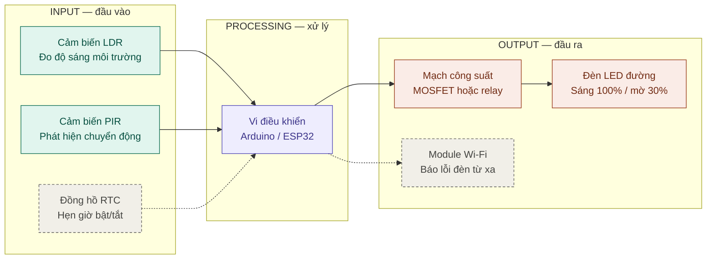
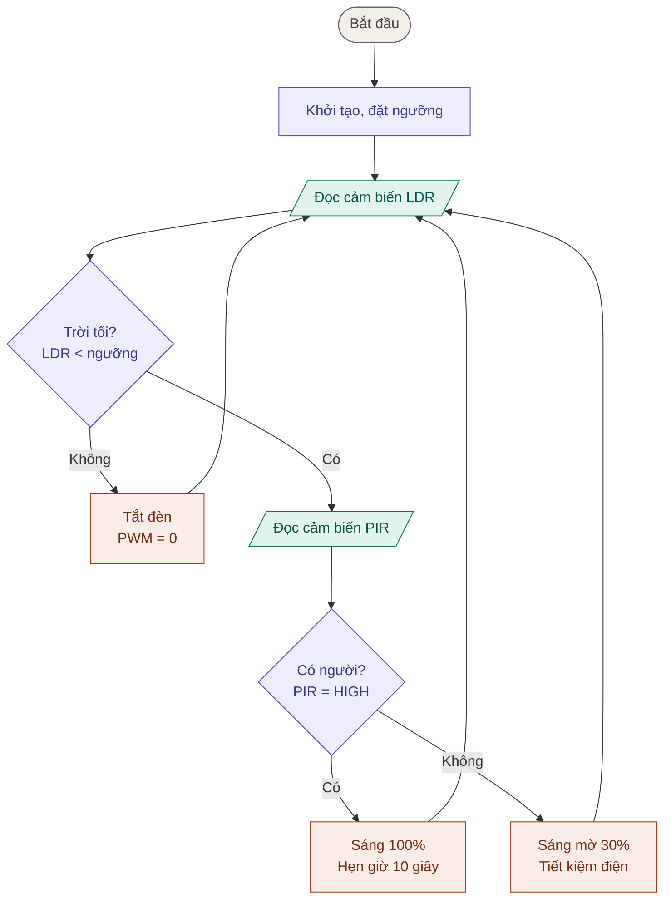

# BT1.2 — Phân tích thiết bị nhúng thực tế

## Bảng phân tích 3 thiết bị nhúng

| Thiết bị | Khối Input | Khối Processing | Khối Output |
|---|---|---|---|
| **Camera an ninh (IP camera)** | Cảm biến hình ảnh (CMOS), micro, cảm biến ánh sáng/cảm biến chuyển động (PIR), nút reset | SoC/vi điều khiển xử lý và nén hình ảnh (H.264/H.265), phân tích phát hiện chuyển động, quản lý kết nối mạng | Luồng video truyền qua Wi-Fi/Ethernet, lưu vào thẻ nhớ, đèn LED hồng ngoại ban đêm, loa, đèn báo trạng thái, gửi thông báo về điện thoại |
| **Điều hòa nhiệt độ** | Remote (cảm biến hồng ngoại), cảm biến nhiệt độ phòng, cảm biến nhiệt độ dàn lạnh | Vi điều khiển giải mã lệnh remote, chạy thuật toán so sánh nhiệt độ cài đặt với nhiệt độ thực tế | Máy nén (compressor), quạt dàn lạnh/nóng, cánh đảo gió (động cơ bước), màn hình hiển thị nhiệt độ |
| **Máy chiếu** | Nút trên thân máy/remote, cổng tín hiệu hình ảnh (HDMI/VGA), cảm biến nhiệt độ bên trong | Bộ xử lý (SoC/vi điều khiển) xử lý tín hiệu hình ảnh, điều khiển nguồn sáng và quản lý nhiệt (tăng/giảm tốc độ quạt theo nhiệt độ) | Nguồn sáng (đèn/LED/laser) và chip tạo hình, quạt tản nhiệt, động cơ lấy nét, loa, đèn báo trạng thái |

## Hai câu hỏi tư duy

### 1. Người dùng cuối có thể tự cài đặt ứng dụng mới vào thiết bị không?

Thông thường là **không**. Thiết bị nhúng là hệ thống chuyên dụng: firmware được nhà sản xuất nạp sẵn vào bộ nhớ (ROM/Flash) và chỉ làm một số chức năng cố định. Nó thường không có hệ điều hành mở, không có kho ứng dụng và không có giao diện để người dùng cài thêm phần mềm. Người dùng chỉ có thể chọn chế độ hoặc thay đổi thông số trong phạm vi nhà sản xuất cho phép.

Có hai ngoại lệ:

- Các thiết bị nhúng cao cấp như Smart TV hay smartwatch chạy hệ điều hành đầy đủ và cho phép cài ứng dụng.
- Nhà sản xuất có thể cập nhật firmware (ví dụ OTA), nhưng đó vẫn là cập nhật của hãng, không phải người dùng tự cài ứng dụng mới.

### 2. Nếu thay đổi firmware nạp trong vi điều khiển thì hành vi của thiết bị có thay đổi không?

**Có.** Phần cứng (cảm biến, relay, động cơ) chỉ là phần "tay chân", còn firmware quyết định cách vi điều khiển xử lý dữ liệu đầu vào và điều khiển đầu ra. Cùng một phần cứng, nếu đổi firmware thì có thể thay đổi:

- Thuật toán điều khiển, ví dụ nồi cơm đổi ngưỡng nhiệt và thời gian từng giai đoạn nấu.
- Chế độ hoạt động và logic xử lý, ví dụ máy giặt thêm chương trình mới hoặc đổi thứ tự giặt → vắt.
- Cách phản ứng khi có lỗi, ví dụ ngưỡng cảnh báo và ngắt an toàn.

Giới hạn là phần cứng hiện có: firmware không thể tạo ra chức năng cần cảm biến hoặc cơ cấu chấp hành mà thiết bị không có.

Đây chính là đặc điểm cốt lõi của hệ thống nhúng: **phần cứng + firmware = hành vi của thiết bị**.

# BT1.3 — Hệ thống đèn đường thông minh

## 1. Sơ đồ khối (Block Diagram) — Input / Processing / Output

Chú thích: nét liền là chức năng chính, **nét đứt là tính năng mở rộng** (RTC, Wi-Fi).

---

## 2. Lưu đồ thuật toán (Flowchart)

Ký hiệu: hình bầu dục = Bắt đầu · hình bình hành = đọc dữ liệu vào · hình chữ nhật = xử lý/xuất · hình thoi = rẽ nhánh.

Mọi nhánh đều quay về bước **Đọc cảm biến LDR** — đây là vòng lặp phản hồi liên tục của hệ thống.

---

## 3. Gợi ý khi vẽ tay lên A4

- 3 màu bút tương ứng 3 khối: **teal = Input**, **tím = Processing**, **cam/đỏ = Output**.
- Khung nét đứt quanh mỗi khối, ghi nhãn Input / Processing / Output.
- Mỗi hình thoi phải có đủ nhãn **Có / Không** ở cả hai nhánh.
- Mũi tên không cắt ngang hộp; vòng lặp đi vòng bên phải rồi quay lại bước đọc LDR.

## 4. Ý chính cho phần trình bày 3 phút

- **Vì sao LDR:** đo độ sáng để tự bật đèn khi trời tối, không cần công tắc tay.
- **Vì sao PIR:** chỉ phát hiện người/xe, nên đèn chỉ sáng mạnh khi cần.
- **Vòng phản hồi:** đèn thay đổi thì cảm biến đọc lại ở vòng lặp kế tiếp, hệ thống luôn tự cập nhật.

## 5. Tính năng mở rộng (sáng tạo)

- **Đồng hồ RTC (Input mới):** hẹn giờ giảm độ sáng sau nửa đêm, dự phòng khi LDR bị che hoặc bẩn.
- **Module Wi-Fi (Output mới):** gửi cảnh báo đèn hỏng hoặc không phản hồi lên điện thoại để bảo trì nhanh hơn.
