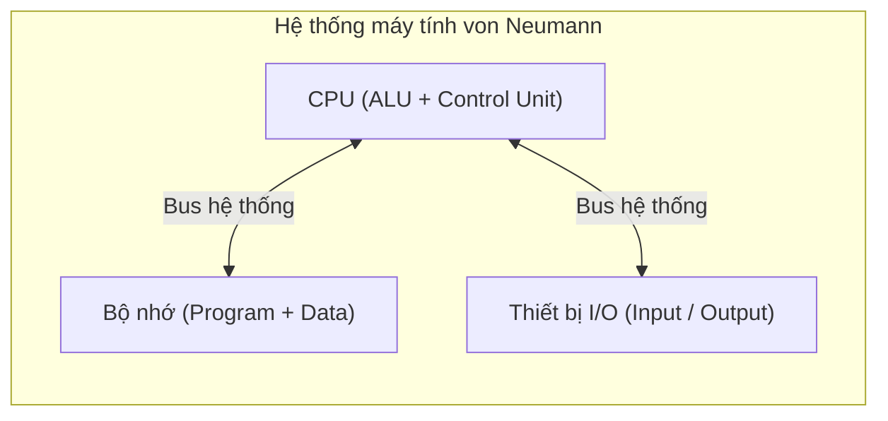
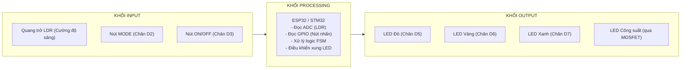

# CHƯƠNG 1: TỔNG QUAN HỆ THỐNG NHÚNG

**Học phần:** Nhập môn Hệ thống Nhúng  
**Tác giả:** Vũ Huy Lượng, Nguyễn Thành Trung  
**Địa điểm & Năm:** Thái Nguyên, 2026  
**Tài liệu:** Slide bài giảng (33 slides)

---

## Slide 1: Trang tiêu đề

### CHƯƠNG 1: Tổng quan Hệ thống Nhúng

- **Học phần:** Nhập môn Hệ thống Nhúng
- **Giảng viên:** Vũ Huy Lượng, Nguyễn Thành Trung
- Thái Nguyên, 2026

---

## Slide 2: Giới thiệu nội dung

### Mục tiêu chương

- Cấu trúc học phần, đánh giá, dự án xuyên suốt.
- Kiến trúc von Neumann và định luật Ohm $V = I \times R$.
- Định nghĩa và ba đặc trưng của hệ thống nhúng.
- Mô hình $\text{I} \to \text{P} \to \text{O}$, vòng phản hồi và vòng kín.
- Phân biệt MCU – MPU; phân tích hệ thống nhúng thành $\text{I} - \text{P} - \text{O}$.

### Nội dung chính

1. **Giới thiệu học phần, dự án và kiến thức nền tảng** (PI1.1)
2. **Khái niệm và kiến trúc hệ thống nhúng** (PI1.2)
3. **Thành phần chính của hệ thống nhúng** (PI1.3)
4. **Luồng xử lý Input $\to$ Processing $\to$ Output** (PI1.4)
5. **Kiểm tra nhanh** (PI1.5)

---

## Slide 3: Học phần: cấu trúc và cách học

- **Thời lượng học phần:** Nhập môn Hệ thống Nhúng: 3 tín chỉ (2 lý thuyết + 1 thực hành), 45 tiết, 9 buổi $\times$ 5 tiết (50 phút/tiết).
- **Định hướng phần cứng:** Cấu trúc hệ thống nhúng, điện tử cơ bản, ghép nối phần cứng và kỹ thuật debug.
- **Phương pháp học tập:**
  - Học qua dự án (*Project-Based Learning*)
  - Học qua thực hành (*Learning by Doing*)
  - Học từ lỗi (*Error-Based Learning*)
- **Cấu trúc mỗi buổi học:** Gồm ba phần: Lý thuyết nền tảng $\to$ Thực hành trên breadboard $\to$ Ôn tập kèm bài tập tự luyện.

> ### Dự án xuyên suốt: Smart Traffic Light System
>
> Bốn chế độ hoạt động: `Normal`, `Manual`, `Emergency`, `Night`. Mỗi buổi học hoàn thiện thêm một khối chức năng; sản phẩm hoàn chỉnh được kiểm thử và bảo vệ ở buổi cuối (Bài 9).

---

## Slide 4: Bốn thành phần đánh giá học phần

- **Năm mục tiêu CO1–CO5:** Kiến thức nền về cấu trúc và nguyên lý hoạt động; nguồn điện và an toàn điện; ghép nối, lắp ráp, vận hành mạch; debug; tích hợp hệ thống hoàn chỉnh.

### Bảng đánh giá học phần

| Thành phần | Tỷ lệ | Chuẩn đầu ra (CLO) |
| :--- | :---: | :--- |
| **Bài thực hành** (các buổi 2–8) | 30% | CLO2, CLO3, CLO4 |
| **Kiểm tra giữa kỳ** | 20% | CLO1–CLO3 (giới hạn Bài 1–5) |
| **Mini Project cuối kỳ** | 40% | CLO5 |
| **Chuyên cần và tham gia học tập** | 10% | – |

### Lịch kiểm tra

- Kiểm tra giữa kỳ theo lịch riêng của khoa, ngoài khung 45 tiết trên lớp.
- Trong các buổi học có bài kiểm tra nhanh trên lớp (đánh giá quá trình).

---

## Slide 5: Kiến trúc von Neumann: năm thành phần

Năm 1945, John von Neumann công bố kiến trúc đặt nền móng cho mọi hệ thống tính toán hiện đại, gồm năm thành phần:

1. **CPU:** “Bộ não” của máy tính, thực hiện phép toán số học và logic; chạy chu trình *Fetch–Decode–Execute*.
2. **Bộ nhớ (Memory):** Lưu cả chương trình và dữ liệu trong cùng một không gian bộ nhớ — điểm khác biệt quan trọng của von Neumann.
3. **Thiết bị Nhập / Xuất (I/O):** Trong hệ thống nhúng, nhập là cảm biến, nút nhấn; xuất là LED, motor, relay, màn hình, loa.
4. **Bus hệ thống:** Các đường dẫn điện kết nối CPU, bộ nhớ và thiết bị I/O.



### Chu trình trong CPU

$$\text{Fetch (Nạp lệnh từ PC)} \longrightarrow \text{Decode (Giải mã lệnh)} \longrightarrow \text{Execute (Thực thi)}$$

---

## Slide 6: Ba đại lượng điện cơ bản

- **Điện áp (Voltage, $V$, đơn vị Volt):** Hiệu điện thế giữa hai điểm, “áp lực” đẩy electron — tương tự áp suất nước trong đường ống.
- **Dòng điện (Current, $I$, đơn vị Ampere):** Điện tích dịch chuyển qua tiết diện dây trong một đơn vị thời gian — tương tự lưu lượng nước; trong mạch nhúng thường đo bằng $\text{mA}$ hoặc $\mu\text{A}$.
- **Điện trở (Resistance, $R$, đơn vị Ohm, $\Omega$):** Mức cản trở dòng điện — tương tự đường ống bị thu hẹp.

### Mức điện áp phổ biến trong hệ thống nhúng

- **1,8 V:** Lõi một số dòng MCU siêu tiết kiệm năng lượng.
- **3,3 V:** Mức logic chuẩn của các MCU hiện đại (STM32, ESP32).
- **5 V:** Mức logic kinh điển (Arduino Uno, cổng USB, chuẩn TTL).
- **12 V và 24 V:** Thiết bị công nghiệp, động cơ, relay công suất.

---

## Slide 7: Định luật Ohm: $V = I \times R$

$$V = I \times R$$

- **Công thức quan trọng nhất** trong toàn bộ khóa học.
- **Hai hệ quả cần thuộc lòng:**
  $$I = \frac{V}{R} \quad \text{và} \quad R = \frac{V}{I}$$
- **Ý nghĩa theo phép so sánh với nước:**
  - Áp suất ($V$) càng cao $\to$ lưu lượng ($I$) càng lớn.
  - Ống càng hẹp (điện trở $R$ lớn) $\to$ dòng chảy ($I$) càng yếu.

### Cách dùng trong môn học

Định luật Ohm là công cụ tính toán mạch xuyên suốt:

- Tính điện trở hạn dòng cho LED (Bài 3).
- Tính dòng tải và chọn transistor kéo tải (Bài 5).

---

## Slide 8: Dừng ngắn: kiểm tra nền tảng
>
> **Thời gian:** 2 phút – Không sử dụng tài liệu. Trả lời bằng lời trước khi sang phần tiếp theo.
>
> 1. Kể tên năm thành phần của kiến trúc von Neumann. Thành phần nào là “bộ não” của máy tính?
> 2. Chu trình Fetch–Decode–Execute gồm những bước nào?
> 3. Trong một mạch có điện áp nguồn không đổi: khi tăng điện trở tải, dòng điện trong mạch thay đổi thế nào? Giải thích bằng định luật Ohm.

---

## Slide 9: Hệ thống nhúng là gì?

> ### Định nghĩa: Hệ thống Nhúng (Embedded System)
>
> Hệ thống nhúng là một hệ thống điện tử hoặc cơ-điện tử được thiết kế để thực hiện một **chức năng chuyên biệt**, là sự kết hợp chặt chẽ giữa **phần cứng (hardware)** và **phần sụn (firmware/software)**.
> *(Theo giáo trình Embedded Systems Design – MREC, 2025)*

### Ví dụ điển hình

- Đồ chơi điện tử
- Điện thoại di động
- Máy giặt, tủ lạnh, điều hòa không khí
- Hệ thống điều khiển ô tô (ECU, ABS, túi khí)
- Đầu thu TV, đầu DVD, router Wi-Fi

---

## Slide 10: Ba đặc trưng của hệ thống nhúng

1. **Tính chuyên dụng (Dedicated Function):**
   - Thiết kế để thực hiện một hoặc một nhóm tác vụ xác định trước.
   - Firmware thường được nạp cố định vào bộ nhớ Flash tại nhà máy, người dùng cuối không tự ý cài thêm ứng dụng khác.
2. **Tính thời gian thực (Real-Time Operation):**
   - Phải phản hồi sự kiện bên ngoài trong một khoảng thời gian xác định (*deadline*).
   - **Hard Real-Time:** Deadline tuyệt đối, trễ là gây thảm họa nguy hiểm (túi khí ô tô, hệ thống phanh ABS, điều khiển bay).
   - **Soft Real-Time:** Cho phép thỉnh thoảng trễ hạn với chất lượng suy giảm nhẹ (streaming video, màn hình hiển thị nhiệt độ).
3. **Ràng buộc tài nguyên (Resource Constraints):**
   - Bộ nhớ hạn chế: RAM từ vài KB đến vài MB, Flash vài chục KB đến vài chục MB.
   - Năng lượng: nhiều thiết bị chạy pin hàng tháng đến hàng năm.
   - Kích thước nhỏ gọn, chi phí sản xuất cực kỳ nhạy cảm (tính từng xu khi nhân lên hàng triệu sản phẩm).

---

## Slide 11: So sánh Hệ thống nhúng và Máy tính đa năng

| Tiêu chí | Hệ thống Nhúng (Embedded System) | Máy tính Đa năng (General-Purpose PC) |
| :--- | :--- | :--- |
| **Mục đích** | Chuyên dụng, thực hiện tác vụ cố định | Đa năng, chạy nhiều ứng dụng khác nhau |
| **Hệ điều hành** | Có thể có hoặc không; nếu có thường là RTOS (FreeRTOS, Zephyr) | Luôn có hệ điều hành hoàn chỉnh (Windows, Linux, macOS) |
| **Thay đổi phần mềm** | Firmware nạp sẵn, người dùng không tự cài thêm app | Cài đặt / gỡ bỏ phần mềm tùy ý |
| **Thời gian thực** | Bắt buộc đối với nhiều hệ thống (Hard Real-Time) | Đa số không yêu cầu thời gian thực ngặt nghèo |
| **Chi phí** | Rất nhạy cảm về giá (tối ưu khi sản xuất hàng loạt) | Ít nhạy cảm hơn, ưu tiên năng lực tính toán |

> *(Nguồn: ESD Notes, MREC – trích 5 tiêu chí cốt lõi)*

---

## Slide 12: Ba ví dụ thực tế điển hình

- **Máy giặt — Tính chuyên dụng:**
  - Nút nhấn & cảm biến mực nước, nhiệt độ $\to$ MCU $\to$ motor đảo lồng giặt, relay mở van nước, bơm xả, còi báo, LED hiển thị.
  - Firmware nạp cố định tại nhà máy, chỉ làm nhiệm vụ giặt đồ.
- **Hệ thống phanh ABS — Tính thời gian thực:**
  - Cảm biến hiệu ứng Hall đo tốc độ bánh xe lấy mẫu $\sim 100\text{ Hz}$.
  - MCU phải tính toán và điều chỉnh áp suất dầu phanh trong thời gian dưới $10\text{ ms}$ để bánh xe không bị bó cứng khi phanh gấp.
- **Máy tạo nhịp tim (Pacemaker) — Ràng buộc tài nguyên:**
  - Dòng điện tiêu thụ ở mức cực thấp ($< 10\ \mu\text{A}$).
  - Hoạt động liên tục, tin cậy tuyệt đối từ 7 đến 10 năm chỉ với một viên pin lithium nhỏ cấy trong lồng ngực bệnh nhân.

---

## Slide 13: Vi điều khiển: máy tính trên một chip

> Theo Valvano (2019): **Vi điều khiển (Microcontroller Unit - MCU)** là một máy tính hoàn chỉnh được tích hợp trọn vẹn trên **một vi mạch duy nhất**.

### Các thành phần tích hợp trong MCU

- **Lõi CPU:** Xử lý tập lệnh.
- **Bộ nhớ chương trình (Flash ROM):** Lưu trữ firmware.
- **Bộ nhớ dữ liệu (SRAM):** Lưu các biến tạm thời trong quá trình chạy.
- **Ngoại vi phong phú:** GPIO, bộ biến đổi tương tự - số ADC, bộ định thời Timer, các khối truyền thông UART, SPI, $\text{I}^2\text{C}$, PWM...

### Vì sao hệ thống nhúng ưu tiên dùng MCU?

- **Tiết kiệm không gian:** Gói gọn trong 1 chip thay vì 5–10 chip rời.
- **Chi phí thấp:** Từ 0,5 đến 5 USD (so với 20–50 USD cho cụm MPU).
- **Tiết kiệm năng lượng:** Tiêu thụ vài chục mA thay vì vài Ampe.
- **Thiết kế mạch đơn giản:** Ít đường dây bus ngoài, hạn chế lỗi phần cứng.
- **Độ tin cậy cao:** Ít mối hàn, giảm nguy cơ hỏng hóc vật lý.

---

## Slide 14: Phân biệt MCU và MPU

| Đặc điểm | Vi xử lý - MPU (Microprocessor) | Vi điều khiển - MCU (Microcontroller) |
| :--- | :--- | :--- |
| **Cấu trúc** | Chỉ chứa lõi CPU; RAM, ROM và ngoại vi phải gắn ngoài | Tích hợp CPU + RAM + ROM + ngoại vi trên 1 chip |
| **Hình tượng** | Giống “bộ não không có thân thể” | Giống “bộ não có đầy đủ tay chân” |
| **Hệ thống hỗ trợ** | Cần bo mạch phức tạp (motherboard, chipset, RAM rời) | Chỉ cần cấp nguồn và vài linh kiện thụ động cơ bản |
| **Ứng dụng** | Máy tính cá nhân (PC), Laptop, Server, Smartphone | Thiết bị gia dụng, xe máy, ô tô, đồ chơi, cảm biến IoT |
| **Ví dụ tiêu biểu** | Intel Core i7, AMD Ryzen, Apple M-series | STM32F103 (Cortex-M3), ESP32, ATmega328P (AVR) |

---

## Slide 15: Cấu trúc bên trong MCU STM32F103C8T6

Tất cả nằm trong một chip duy nhất, kết nối thông qua hệ thống Bus nội bộ:

- **Lõi CPU:** ARM 32-bit Cortex-M3, tần số xung nhịp tối đa $72\text{ MHz}$.
- **Bộ nhớ:**
  - Flash ROM: $64\text{ KB}$ (chứa firmware).
  - SRAM: $20\text{ KB}$ (dữ liệu biến tạm thời).
- **Ngoại vi tích hợp:**
  - $37$ chân GPIO (vào/ra kỹ thuật số).
  - Bộ biến đổi ADC 12-bit (đọc điện áp tương tự).
  - Bộ định thời đa năng (Timer) và điều chế độ rộng xung (PWM).
  - Các giao tiếp: UART, SPI, $\text{I}^2\text{C}$, CAN bus, USB.

---

## Slide 16: Lựa chọn MCU: bốn dòng phổ biến

| Thông số | ATmega328P | STM32F103 (Blue Pill) | ESP32 | MSP430G |
| :--- | :--- | :--- | :--- | :--- |
| **CPU / Tần số** | AVR 8-bit / $16\text{ MHz}$ | ARM Cortex-M3 / $72\text{ MHz}$ | Xtensa 32-bit dual / $240\text{ MHz}$ | MSP430 16-bit / $16\text{ MHz}$ |
| **Flash / SRAM** | $32\text{ KB} / 2\text{ KB}$ | $64\text{ KB} / 20\text{ KB}$ | $4\text{ MB} / 520\text{ KB}$ | $16\text{ KB} / 512\text{ B}$ |
| **GPIO / ADC** | 23 GPIO / ADC 10-bit | 37 GPIO / ADC 12-bit | 34 GPIO / ADC 12-bit | 16 GPIO / ADC 10-bit |
| **Điện áp hoạt động** | $5\text{ V}$ | $3,3\text{ V}$ | $3,3\text{ V}$ | $1,8 - 3,6\text{ V}$ |
| **Kết nối** | UART, SPI, $\text{I}^2\text{C}$ | UART $\times 3$, SPI $\times 2$, CAN | Wi-Fi, Bluetooth BLE | UART, SPI, $\text{I}^2\text{C}$ |
| **Giá tham khảo** | $\sim 45.000\text{ VNĐ}$ | $\sim 65.000\text{ VNĐ}$ | $\sim 85.000\text{ VNĐ}$ | $\sim 30.000\text{ VNĐ}$ |
| **Ứng dụng tối ưu** | Mới học, DIY, Arduino Uno | Điều khiển công nghiệp, cơ điện tử | Thiết bị IoT kết nối mạng không dây | Thiết bị chạy pin siêu tiết kiệm điện |

---

## Slide 17: Dừng ngắn: chọn MCU cho hệ thống
>
> **Thời gian:** 2 phút – Không dùng tài liệu.
>
> 1. Bạn cần thiết kế một **khóa cửa thông minh chạy pin, kết nối Bluetooth**. Nên chọn MCU nào trong bốn loại trên? Tại sao?
> 2. Phân biệt MCU và MPU. Tại sao hệ thống nhúng lại dùng MCU?

---

## Slide 18: Cảm biến thông dụng

| Tên cảm biến | Đại lượng đo | Phân loại | Đặc tính kỹ thuật |
| :--- | :--- | :---: | :--- |
| **LM35** | Nhiệt độ | Analog | Độ nhạy $10\text{ mV}/^\circ\text{C}$, dải đo $-55^\circ\text{C} \to +150^\circ\text{C}$ |
| **DHT11** | Nhiệt độ & Độ ẩm | Digital | Đo nhiệt độ $0–50^\circ\text{C}$, độ ẩm $20–90\%\text{ RH}$, giao tiếp 1-Wire |
| **LDR (Quang trở)** | Cường độ ánh sáng | Analog | Khi tối $R \approx 1\text{ M}\Omega$, khi sáng $R \approx 1\text{ k}\Omega$ |
| **HC-SR04** | Khoảng cách | Digital | Sóng siêu âm $40\text{ kHz}$, đo từ $2\text{ cm} - 400\text{ cm}$ |
| **MPU6050** | Gia tốc & Con quay hồi chuyển | Digital ($\text{I}^2\text{C}$) | Cảm biến quán tính 6 bậc tự do (6-DoF), dải đo $\pm 2/4/8/16\text{ g}$ |
| **MQ-2** | Khí gas, khói | Analog | Thay đổi điện trở suất theo nồng độ khí dễ cháy trong không khí |

---

## Slide 19: Cơ cấu chấp hành thông dụng

| Tên linh kiện | Tác động | Phân loại | Đặc tính kỹ thuật |
| :--- | :--- | :---: | :--- |
| **LED** | Phát tín hiệu ánh sáng | Digital | Dòng $5–20\text{ mA}$, điện áp thuận $V_f = 1,8–3,6\text{ V}$ |
| **Buzzer (Còi chíp)** | Phát âm thanh cảnh báo | PWM / Digital | Điện áp $5\text{ V}$, dòng $\sim 15\text{ mA}$ |
| **Relay 5V** | Đóng/ngắt mạch cách ly | Digital + BJT | Cuộn hút $5\text{ V} / 70\text{ mA}$, tiếp điểm chịu tới $250\text{ V} / 10\text{ A}$ |
| **Động cơ DC** | Quay liên tục | PWM (Cầu H) | Điện áp $3–12\text{ V}$, dòng tải $100\text{ mA} - 2\text{ A}$ |
| **Servo SG90** | Quay góc chính xác ($0–180^\circ$) | PWM ($50\text{ Hz}$) | Tín hiệu xung $1–2\text{ ms}$, nguồn $5\text{ V}$, dòng tới $\sim 500\text{ mA}$ |
| **LCD 16×2** | Hiển thị văn bản / thông số | $\text{I}^2\text{C}$ / Song song | Nguồn $5\text{ V}$, dòng $\sim 20\text{ mA}$ |

---

## Slide 20: Nguyên tắc kết nối cảm biến và cơ cấu chấp hành

- **Kết nối cảm biến:**
  - Cảm biến Analog (LM35, LDR): Phải nối vào chân **ADC** của MCU để chuyển điện áp liên tục thành giá trị số.
  - Cảm biến Digital (DHT11, HC-SR04): Nối trực tiếp vào chân **GPIO** hoặc cổng giao tiếp nối tiếp ($\text{I}^2\text{C}$, SPI).
- **Kết nối cơ cấu chấp hành:**
  - Cơ cấu tiêu thụ dòng nhỏ ($< 20\text{ mA}$, ví dụ LED đơn): Nối trực tiếp vào chân GPIO (kèm điện trở hạn dòng).
  - Cơ cấu tiêu thụ dòng lớn ($> 20\text{ mA}$, như động cơ, relay, còi công suất): **Tuyệt đối không cấp trực tiếp từ chân MCU**; bắt buộc phải dùng qua tầng đệm bán dẫn như **BJT hoặc MOSFET** (Bài 5).

---

## Slide 21: Mô hình Input $\to$ Processing $\to$ Output

```mermaid
flowchart LR
    subgraph INPUT ["Khối INPUT (Giác quan)"]
        direction TB
        S1["Cảm biến (LDR, LM35...)"]
        S2["Nút nhấn, công tắc"]
        S3["Giao tiếp nối tiếp"]
    end

    subgraph PROCESSING ["Khối PROCESSING (Bộ não)"]
        direction TB
        MCU["Vi điều khiển (MCU)"]
        FW["Firmware & Thuật toán"]
    end

    subgraph OUTPUT ["Khối OUTPUT (Cơ bắp)"]
        direction TB
        A1["Cơ cấu chấp hành (Motor, Relay)"]
        A2["Hiển thị (LED, LCD)"]
        A3["Còi báo, Truyền thông"]
    end

    INPUT -->|Tín hiệu vào| PROCESSING
    PROCESSING -->|Lệnh điều khiển| OUTPUT
    OUTPUT -.->|Vòng phản hồi (Feedback Loop)| INPUT
```

- Mọi hệ thống nhúng, từ đơn giản đến phức tạp, đều vận hành theo mô hình ba khối này.
- Đây là “chiếc la bàn” giúp kỹ sư phân tích và phân rã bất kỳ thiết bị nhúng nào.

---

## Slide 22: Khối INPUT: giác quan của hệ thống

- **Tín hiệu môi trường:** Cảm biến chuyển đổi đại lượng vật lý (nhiệt độ, ánh sáng, áp suất, khoảng cách, khí gas) thành tín hiệu điện.
- **Tín hiệu người dùng:** Nút nhấn, công tắc gạt, bàn phím ma trận, màn hình cảm ứng, encoder quay.
- **Giao tiếp dữ liệu:** UART, $\text{I}^2\text{C}$, SPI, CAN; tín hiệu đồng hồ thời gian thực (RTC), tín hiệu ngắt từ bộ đếm.

> ### Nguyên tắc quan trọng
>
> Mọi tín hiệu Input đều phải được chuyển hóa thành mức điện áp hoặc chuỗi số trước khi MCU đọc.
>
> - Tín hiệu tương tự (Analog: LM35, LDR) cần qua bộ biến đổi **ADC** (Bài 6).
> - Tín hiệu số (Digital: nút bấm, DHT11) đọc trực tiếp qua **GPIO** hoặc giao thức truyền thông.

---

## Slide 23: Khối PROCESSING: bộ não xử lý

1. **Đọc dữ liệu Input:** Qua GPIO, ADC hoặc module giao tiếp nối tiếp. Tần suất lấy mẫu phải thỏa mãn định lý Nyquist:
   $$f_{\text{sample}} \ge 2 \times f_{\text{signal}}$$
2. **Xử lý và tính toán:** Từ so sánh ngưỡng đơn giản, đếm sự kiện, trễ thời gian cho đến lọc số, thuật toán PID, biến đổi FFT — đây là nơi trí thông minh của hệ thống được thực thi.
3. **Ra quyết định điều khiển:** Quyết định bật/tắt LED, thay đổi vận tốc động cơ, chuyển đổi trạng thái máy FSM.
4. **Quản lý thời gian:** Đảm bảo hoàn thành mọi tác vụ trong thời hạn (*deadline*), ví dụ hệ thống phanh ABS phải phản hồi trong $< 10\text{ ms}$.

### Mô hình toán học tổng quát

$$Y(t) = \mathcal{F}\Big(X(t),\, S(t),\, \Theta\Big)$$

- $X(t)$: Tín hiệu đầu vào theo thời gian.
- $Y(t)$: Tín hiệu đầu ra điều khiển.
- $S(t)$: Trạng thái nội tại của hệ thống.
- $\Theta$: Tập hợp các tham số thiết kế đã lưu cố định trong firmware.

---

## Slide 24: Khối OUTPUT: cơ bắp tác động

1. **Quang học (Ánh sáng):** LED đơn, LED 7 đoạn, LED ma trận, LED RGB, màn hình LCD 16×2, màn hình OLED, đèn LED chiếu sáng công suất lớn.
2. **Cơ học (Chuyển động):** Động cơ DC (quay liên tục), động cơ servo (quay góc xác định), động cơ bước stepper (quay theo từng bước), cuộn hút solenoid (chuyển động tịnh tiến kéo/đẩy).
3. **Điện năng (Đóng/ngắt mạch):** Relay cơ điện, rơ-le bán dẫn (SSR), transistor BJT/MOSFET làm khóa chuyển mạch điện tử.
4. **Âm thanh:** Buzzer piezo, loa qua mạch khuếch đại, còi hú báo động.
5. **Truyền thông:** UART, $\text{I}^2\text{C}$, SPI, Bluetooth BLE, Wi-Fi.

> [!WARNING] Lưu ý về dòng tải
> Các chân GPIO của MCU chỉ có thể cung cấp dòng tối đa khoảng $20\text{ mA}$. Các phụ tải có dòng tiêu thụ lớn hơn bắt buộc phải dùng Transistor/MOSFET làm công tắc đệm (Bài 5). Tải điện lưới AC $220\text{ V}$ bắt buộc phải cách ly quang qua Optocoupler kết hợp Relay/TRIAC để đảm bảo an toàn.

---

## Slide 25: Vòng phản hồi và điều khiển vòng kín

**Vòng phản hồi (Feedback loop):** Tín hiệu đầu ra (Output) sau khi tác động lên môi trường được cảm biến (Input) đo lường trở lại để vi điều khiển hiệu chỉnh, tạo thành **hệ điều khiển vòng kín (closed-loop control)**:

1. **MCU đọc giá trị hiện tại** từ cảm biến: Nhiệt độ phòng đo được $T_{\text{thực}} = 28^\circ\text{C}$.
2. **So sánh với giá trị đặt (setpoint):** Nhiệt độ mong muốn cài đặt $T_{\text{cài đặt}} = 25^\circ\text{C}$.
3. **Tính sai lệch:** $e(t) = T_{\text{thực}} - T_{\text{cài đặt}} = +3^\circ\text{C}$.
4. **Ra lệnh điều khiển Output:** Kích hoạt máy nén lạnh chạy với công suất cao.
5. **Output làm biến đổi môi trường:** Nhiệt độ phòng hạ dần xuống.
6. **Cảm biến tiếp tục ghi nhận sự thay đổi** và lặp lại bước 1.

---

## Slide 26: Vòng hở và vòng kín khác nhau thế nào?

| Đặc điểm | Hệ điều khiển Vòng hở (Open-loop) | Hệ điều khiển Vòng kín (Closed-loop) |
| :--- | :--- | :--- |
| **Phản hồi** | Output không ảnh hưởng trở lại Input | Output ảnh hưởng trở lại Input qua cảm biến |
| **Ví dụ** | **Lò vi sóng:** Hẹn giờ 2 phút — thức ăn có thể đã nóng sau 1 phút nhưng lò vẫn tiếp tục quay đủ 2 phút | **Điều hòa nhiệt độ:** Đạt đủ $25^\circ\text{C}$, vi điều khiển tự động hạ công suất máy nén |
| **Ưu điểm** | Cấu trúc mạch đơn giản, chi phí rẻ | Độ chính xác cao, ổn định, tự thích nghi, tiết kiệm năng lượng |
| **Nhược điểm** | Không có khả năng tự sửa sai khi môi trường đổi khác | Cần thêm cảm biến, giải thuật phức tạp hơn |

> **Thảo luận:** Khi nào nên dùng vòng hở dù kém chính xác hơn?  
> *(Gợi ý: Khi hệ thống có đặc tính ổn định cao, tác vụ ngắn đơn giản, hoặc việc gắn thêm cảm biến phản hồi quá đắt đỏ và không cần thiết).*

---

## Slide 27: Ví dụ: điều hòa không khí và phanh ABS

| Tiêu chí | Điều hòa không khí (Soft Real-Time) | Hệ thống phanh ABS (Hard Real-Time) |
| :--- | :--- | :--- |
| **INPUT** | Cảm biến nhiệt trở NTC ($10\text{ k}\Omega$ ở $25^\circ\text{C}$); mắt nhận hồng ngoại IR | 4 cảm biến hiệu ứng Hall đo tốc độ từng bánh ($100\text{ mẫu/s}$); cảm biến áp suất dầu |
| **PROCESSING** | MCU 32-bit; thuật toán điều khiển PID hoặc Fuzzy | Vi điều khiển chuyên dụng ô tô đạt chuẩn an toàn, tính toán lực phanh độc lập |
| **OUTPUT** | Máy nén biến tần (Inverter), quạt gió, mô-tơ đảo hướng gió | Các van điện từ (Solenoid valve) trong bộ chấp hành thủy lực |
| **Tần suất lặp** | Chu kỳ cập nhật $1–10\text{ lần/giây}$ | Chu kỳ hiệu chỉnh $15–60\text{ lần/giây}$ |
| **Hạn thời gian** | Trễ $1\text{ giây}$ hoàn toàn chấp nhận được | Deadline $< 10\text{ ms}$; trễ là bánh xe bị trượt lết và tài xế mất lái |

---

## Slide 28: Case Study: yêu cầu hệ thống Smart Traffic Light

- **Nền tảng thực hiện:** Kit phát triển ESP32 hoặc STM32, hoàn thiện dần qua 9 bài thực hành.
- **Yêu cầu chức năng:**
  1. Điều khiển 3 LED báo hiệu: Đỏ, Vàng, Xanh.
  2. Hai chế độ vận hành: `AUTO` và `MANUAL`.
  3. Ở chế độ `AUTO`: Tự động nhận diện trời tối (qua cảm biến LDR) để bật đèn cảnh báo; trời sáng vận hành theo chu kỳ.
  4. Ở chế độ `MANUAL`: Sử dụng nút nhấn để chủ động chuyển đổi màu đèn.
  5. Có nút ấn bật/tắt toàn hệ thống (`ON/OFF`).
- **Yêu cầu phi chức năng:**
  - Nguồn cấp: $5\text{ V DC}$ chuẩn cổng USB.
  - Tổng dòng tiêu thụ toàn mạch: $< 200\text{ mA}$.
  - Thời gian phản hồi nút nhấn: $< 100\text{ ms}$.
  - Chi phí trọn bộ linh kiện: Dưới $150.000\text{ VNĐ}$.

---

## Slide 29: Sơ đồ khối Smart Traffic Light



### Lộ trình hoàn thiện qua 9 bài học

- **Bài 2:** Thiết kế nguồn cấp ổn định và an toàn điện.
- **Bài 3:** Tính toán điện trở hạn dòng $R$ cho các LED màu.
- **Bài 4:** Nút nhấn điều khiển, điện trở kéo lên Pull-up và chống rung nút (Debounce).
- **Bài 5:** Mạch khóa transistor MOSFET điều khiển LED công suất cao.
- **Bài 6:** Đọc cảm biến quang trở LDR qua bộ chuyển đổi ADC.
- **Bài 7:** Thiết kế sơ đồ nguyên lý (Schematic) và lắp ráp breadboard hoàn chỉnh.
- **Bài 8:** Kỹ thuật debug truy tìm và xử lý sự cố.
- **Bài 9:** Hoàn thiện sản phẩm, đo kiểm và báo cáo bảo vệ cuối khóa.

---

## Slide 30: Kiểm tra nhanh: máy bơm nước tự động

### Tình huống mô tả

- Cảm biến mực nước theo dõi mức chất lỏng trong bồn: Khi mực nước hạ xuống dưới ngưỡng thấp $\to$ Vi điều khiển đọc tín hiệu, xử lý và phát lệnh kích hoạt **máy bơm**.
- Khi mực nước chạm tới ngưỡng cao $\to$ Vi điều khiển phát lệnh **ngắt máy bơm**.
- Trong suốt thời gian máy bơm vận hành, một **đèn LED** trên bảng điều khiển sáng liên tục để chỉ báo.
- Nếu máy bơm đã kích hoạt chạy liên tục quá thời gian quy định mà nước vẫn không đầy (nguy cơ cạn nguồn nước vào) $\to$ **Còi báo động** kêu cảnh báo.

### Yêu cầu bài tập (5 phút – Không dùng tài liệu)

1. Liệt kê các thành phần chính của hệ thống và phân định vai trò: **Input (I)**, **Processing (P)**, hay **Output (O)**.
2. Mô tả luồng xử lý của hệ thống theo trình tự $\text{I} \to \text{P} \to \text{O}$.
3. Phân biệt thiết bị nào đóng vai trò là **cảm biến**, thiết bị nào là **cơ cấu chấp hành**?

---

## Slide 31: Đáp án gợi ý và mở rộng

### Đáp án bài tập Máy bơm nước tự động

1. **Phân loại thành phần:**
   - **Input (I):** Cảm biến mực nước.
   - **Processing (P):** Vi điều khiển (MCU).
   - **Output (O):** Động cơ máy bơm, đèn LED báo trạng thái, còi hú báo sự cố.
2. **Luồng xử lý:** Cảm biến đo mức nước gửi tín hiệu điện về MCU $\to$ MCU so sánh giá trị đọc với 2 ngưỡng cài đặt (thấp/cao) và đếm thời gian chạy $\to$ Ra lệnh đóng/cắt relay cấp điện cho máy bơm, bật/tắt LED báo trạng thái và kích còi khi xảy ra sự cố quá giờ.
3. **Phân loại bản chất:**
   - Cảm biến: Cảm biến mực nước (chuyển đổi đại lượng vật lý thành điện).
   - Cơ cấu chấp hành: Động cơ máy bơm, còi hú (tạo ra lực cơ học và âm thanh).
   - LED là thiết bị hiển thị/chỉ thị trạng thái.

### Mở rộng sang Smart Traffic Light

- **Input:** Cảm biến quang trở LDR, nút MODE, nút ON/OFF.
- **Processing:** Vi điều khiển đọc ADC và GPIO, điều khiển FSM.
- **Output:** Bộ 3 LED tín hiệu giao thông, LED công suất qua MOSFET.
- **Luồng sự kiện khi trời tối:** LDR giảm độ rọi $\to$ Điện trở tăng $\to$ Điện áp ngõ vào ADC giảm $\to$ MCU nhận diện giá trị dưới ngưỡng ngưỡng tối $\to$ Tự động chuyển đèn sang chế độ cảnh báo ban đêm (chớp vàng).

---

## Slide 32: Thực hành Bài 1

### Các nhiệm vụ thực hành

- **BT1.1 — Cài đặt và cấu hình Arduino IDE:**
  - Tải và cài đặt Arduino IDE phiên bản mới nhất từ `arduino.cc`.
  - Cài đặt driver nạp chip và gói board ESP32 / STM32.
  - Mở ví dụ mẫu `File -> Examples -> 01.Basics -> Blink`, biên dịch, nạp code vào kit và quan sát LED trên bo mạch nhấp nháy.
- **BT1.2 — Phân tích thiết bị nhúng thực tế (30 phút):**
  - Khảo sát các đồ dùng điện tử xung quanh phòng học hoặc tại nhà.
  - Chọn 3 thiết bị cụ thể và điền bảng phân tích: `Khối Input` | `Khối Processing` | `Khối Output`.
  - Trả lời 2 câu hỏi tư duy:
    1. Người dùng cuối có thể tự cài đặt ứng dụng mới vào thiết bị không?
    2. Nếu thay đổi firmware nạp trong vi điều khiển thì hành vi hoạt động của thiết bị có thay đổi không?
- **BT1.3 — Vẽ sơ đồ khối và lưu đồ thuật toán (45 phút):**
  - Chọn 1 trong các hệ thống: Máy bán nước tự động, cửa mở tự động siêu thị, máy sát khuẩn tay không chạm, hệ thống tưới cây tự động, hoặc hệ thống đèn đường thông minh.
  - Vẽ sơ đồ khối (Block Diagram) thể hiện rõ ràng 3 khối I - P - O.
  - Vẽ lưu đồ thuật toán (Flowchart) mô tả chu trình vận hành của hệ thống.

### Tiêu chí chấm điểm BT1.3 (Thang điểm 10)

- Sơ đồ khối đầy đủ, phân định chính xác Input / Processing / Output: **3 điểm**
- Flowchart logic, đúng cú pháp hình học, đầy đủ các bước rẽ nhánh: **3 điểm**
- Trình bày trực quan, khoa học, sạch đẹp: **2 điểm**
- Ý tưởng sáng tạo, đề xuất thêm tính năng mở rộng hữu ích: **2 điểm**

---

## Slide 33: Tổng kết chương

### 6 Điểm cốt lõi cần ghi nhớ

1. **Nền tảng lý thuyết:** Kiến trúc von Neumann (5 khối, chu trình Fetch–Decode–Execute), Định luật Ohm kinh điển ($V = I \times R$), và 3 đặc trưng cốt tử của hệ thống nhúng (chuyên dụng, thời gian thực, ràng buộc tài nguyên).
2. **Nguyên lý hoạt động tổng quát:** Mọi hệ thống nhúng đều vận hành theo luồng $\text{Input} \to \text{Processing} \to \text{Output}$. Mọi tín hiệu từ môi trường bắt buộc phải quy đổi về tín hiệu điện hoặc dữ liệu số.
3. **Cơ chế phản hồi:** Vòng phản hồi biến hệ thống thành vòng kín, có khả năng tự sửa lỗi và điều chỉnh; hệ vòng hở đơn giản hơn nhưng không có năng lực tự hiệu chỉnh sai lệch.
4. **Vi điều khiển (MCU):** Tích hợp CPU, Flash ROM, SRAM và hàng loạt ngoại vi trên cùng một chip silic. Lựa chọn MCU dựa trên: tập ngoại vi cần dùng, dung lượng bộ nhớ, tần số hoạt động, điện áp tương thích và giá thành.
5. **Giao tiếp ngoại vi:** Cảm biến là giác quan, cơ cấu chấp hành là cơ bắp. Các phụ tải tiêu thụ dòng lớn hơn $20\text{ mA}$ bắt buộc phải điều khiển gián tiếp qua Transistor/MOSFET.
6. **Mục tiêu đạt được sau Bài 1:** Tự tin phân tích bất kỳ thiết bị nhúng thực tế nào thành 3 khối I–P–O và nắm vững yêu cầu kiến trúc của Dự án Smart Traffic Light.
