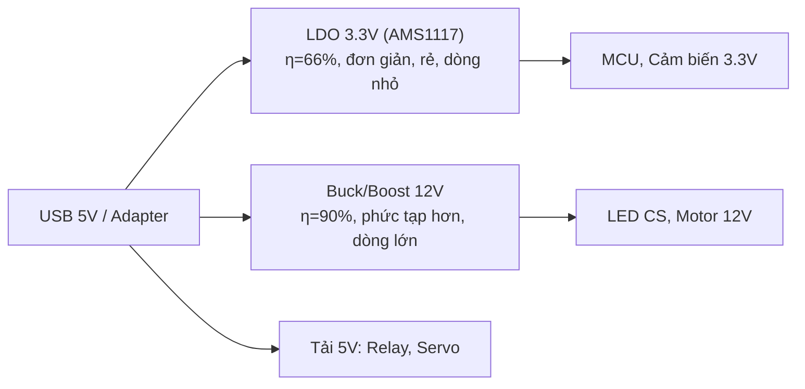

# CHƯƠNG 2: NGUỒN ĐIỆN VÀ AN TOÀN ĐIỆN TRONG HỆ THỐNG NHÚNG

**Học phần:** Nhập môn Hệ thống Nhúng  
**Tài liệu:** Giáo trình (13 trang)

---

## Mục tiêu chương

Sau khi học xong chương này, người học có thể:

- Phân biệt và tính toán được mối quan hệ giữa điện áp ($V$), dòng điện ($I$), công suất ($P$) qua $P = V \times I$; lựa chọn được LDO hoặc Buck converter phù hợp với nhu cầu dòng và hiệu suất.
- Nhận diện được các mức điện áp chuẩn trong HSN (1.8V, 3.3V, 5V, 12V) và ứng dụng của từng mức; giải thích được hậu quả khi cấp sai mức áp cho linh kiện.
- Giải thích được tầm quan trọng của GND chung (nguyên nhân số 1 gây lỗi cho người mới học) và kiểm tra được bằng chế độ Continuity.
- Sử dụng thành thạo đồng hồ vạn năng (Multimeter) để đo VDC, Continuity và dòng điện; bước đầu làm quen được ZOYI ZT-703S (DMM + Scope) để quan sát dạng sóng.
- Nhận diện được triệu chứng lỗi nguồn và các mối nguy hiểm (ngắn mạch, phân cực ngược, quá áp); tuân thủ được quy tắc an toàn điện, quy trình 5S và xử lý khẩn cấp đúng thứ tự.

---

## 2.1 Kiến thức Nền tảng

**Ôn lại từ Vật lý phổ thông:**

- **Định luật bảo toàn năng lượng:** năng lượng không tự sinh ra hoặc mất đi, chỉ chuyển hóa từ dạng này sang dạng khác (điện năng $\to$ nhiệt năng, quang năng, cơ năng).
- **Mạch điện kín:** dòng điện chỉ chạy khi mạch tạo thành vòng kín từ cực dương qua tải về cực âm của nguồn.
- **Định luật Ohm:** $V = I \times R$.
- **Đơn vị:** 1A = 1000mA; 1mA = 1000µA; 1kΩ = 1000Ω; 1MΩ = 1.000.000Ω.

---

## 2.2 Ba Đại lượng Cơ bản: Điện áp, Dòng điện, Công suất

**Hình 2.1: Phép so sánh với nước** — $V$ = Áp suất, $I$ = Lưu lượng, $R$ = Độ hẹp van.

| Điện | Nước |
|------|------|
| Điện áp $V$ | Áp suất (bể nước càng CAO $\to$ áp suất càng LỚN $\to$ nước chảy càng MẠNH) |
| Dòng điện $I$ | Lưu lượng nước trong ống dẫn |
| Điện trở $R$ | Van (van càng HẸP – $R$ lớn $\to$ nước chảy càng YẾU – $I$ nhỏ) |

### 2.2.1 Điện áp (Voltage: $V$)

Điện áp là hiệu điện thế giữa hai điểm, đặc trưng cho "áp lực" đẩy các electron di chuyển. Theo Scherz & Monk (2016, Chương 2), có thể hình dung điện áp như áp suất nước trong đường ống: áp suất càng cao, nước phun càng mạnh. Các mức điện áp trong HSN:

**Bảng 2.1: Các mức điện áp trong Hệ thống Nhúng**

| Mức áp | Dùng cho | Ví dụ cụ thể |
|--------|----------|--------------|
| 1.2–1.8V | Lõi CPU, RAM DDR | Điện áp nhân STM32F4, RAM DDR3 |
| 3.3V | MCU hiện đại | STM32, ESP32, ARM Cortex-M, Raspberry Pi Pico |
| 5V | Chuẩn cũ, USB, Arduino | ATmega328P, cảm biến, relay 5V |
| 12V | Thiết bị công nghiệp | LED dây, quạt, motor DC nhỏ |
| 24V | Tự động hóa | PLC, cảm biến công nghiệp, van điện từ |

> [!WARNING]
> **Quy tắc sống còn:** Tuyệt đối không cấp điện áp 5V vào chân MCU được thiết kế cho 3.3V! Điều này sẽ **phá hủy vĩnh viễn** cổng vào/ra của chip. Luôn kiểm tra datasheet trước khi cấp nguồn cho bất kỳ linh kiện nào.

### 2.2.2 Dòng điện (Current: $I$)

Dòng điện là lượng điện tích dịch chuyển qua tiết diện dây dẫn trong một đơn vị thời gian. Trong phép so sánh với nước, dòng điện tương đương với **lưu lượng nước** chảy qua ống. Dòng tiêu thụ điển hình:

**Bảng 2.2: Dòng tiêu thụ điển hình của các thành phần**

| Linh kiện | Dòng | Ghi chú |
|-----------|------|---------|
| MCU STM32F103 (Active, 72MHz) | 25mA | Tất cả ngoại vi bật |
| MCU STM32F103 (Standby) | 2µA | Wake từ Reset |
| ESP32 (WiFi, phát tối đa) | 160–260mA | Đỉnh khi phát WiFi |
| ESP32 (Deep Sleep) | 10µA | RTC + ULP |
| LED đỏ (qua R hạn dòng) | 5–20mA | Tùy giá trị R |
| Servo SG90 (có tải) | 200–750mA | Phụ thuộc mô-men |
| Relay 5V (SRD-05VDC) | 70mA | Dòng cuộn hút |
| Module Bluetooth HC-05 | 30mA (paired) | 8mA (standby) |

### 2.2.3 Công suất (Power: $P$)

Công suất cho biết linh kiện tiêu thụ năng lượng nhanh hay chậm: $P = V \times I$ (Watt).

Hệ quả (kết hợp định luật Ohm): $P = I^2 \times R = V^2 / R$.

> [!NOTE]
> **Ví dụ: Tính công suất và thời gian chạy pin**
>
> MCU STM32F103 hoạt động ở 3.3V, dòng 25mA: $P = 3.3 \times 0.025 = 82.5\text{mW}$.
>
> Với pin Li-Po 3.7V/2000mAh qua LDO hiệu suất 89%: dòng từ pin $\approx 25 \times (3.3/3.7) / 0.89 \approx 25.1\text{mA}$. Thời gian: $T = 2000 / 25.1 \approx 79.7$ giờ $\approx$ **3.3 ngày**.
>
> Nếu chuyển sang Standby (2µA): thời gian lý thuyết lên đến **hàng năm** (chỉ giới hạn bởi tuổi thọ pin).

> [!TIP]
> **Tự kiểm tra: Công suất**
>
> Một LED đỏ ($V_f = 2.0\text{V}$) được cấp dòng 15mA. Tính $P_{LED}$. Nếu R hạn dòng là 220Ω và nguồn 5V, tính $P_R$. Gợi ý: $P_R = I^2 \times R$.

---

## 2.3 Hệ thống Nguồn: Nguồn DC và Bộ ổn áp

### 2.3.1 Các loại nguồn DC phổ biến: Pin, Adapter, USB

Trong thực hành hệ thống nhúng, ba loại nguồn một chiều (DC) phổ biến nhất là pin, adapter và USB:

- **Pin** (9V loại 6F22 hoặc 1.5V AA/AAA): tiện mang theo, không phụ thuộc ổ điện, nhưng dòng cấp nhỏ và điện áp tụt dần khi cạn pin; thích hợp cho mạch rời đơn giản.
- **Adapter** (biến đổi điện lưới xoay chiều thành DC 5V/12V, dòng cấp 1–2A): nguồn cố định cho breadboard, động cơ DC và LED công suất. Khi dùng phải kiểm tra đúng điện áp, dòng định mức và cực tính của jack cắm.
- **USB** (chuẩn 5V, dòng từ 500mA (USB 2.0) đến 2A trở lên ở cổng sạc): nguồn tiện dụng nhất cho kit vi điều khiển (Arduino Uno, ESP32 DevKit); có thể lấy từ máy tính, cục sạc điện thoại hoặc pin dự phòng.

Dù chọn loại nguồn nào, mạch nhúng cũng cần điện áp ổn định (mục tiếp theo) và GND chung cho toàn hệ thống (Mục 2.5 GND và Nối đất Chung).

### 2.3.2 Bộ ổn áp: LDO và Buck Converter

Một HSN cần nhiều mức điện áp. Thay vì dùng nhiều nguồn, kỹ sư dùng **bộ ổn áp (Voltage Regulator)**:

**LDO (Low Dropout Regulator, Ổn áp tuyến tính):** Giảm áp bằng cách "đốt" năng lượng dư thành nhiệt. $\eta = V_{OUT} / V_{IN} \times 100\%$. LDO 5V $\to$ 3.3V: $\eta = 66\%$.

- **Ưu điểm:** cực kỳ đơn giản (1 chip + 2 tụ), rẻ (AMS1117-3.3 giá ~3.000 VNĐ), điện áp ra rất "sạch" (ít nhiễu).
- **Nhược điểm:** hiệu suất thấp, không tăng áp được, dòng tải < 1A.

**Buck Converter (Ổn áp xung):** Đóng cắt ở tần số cao (hàng trăm kHz $\to$ MHz), tích trữ năng lượng trong cuộn cảm và tụ. $\eta = 85\text{–}95\%$.

- **Dùng khi:** dòng > 500mA, chạy pin, chênh lệch áp lớn.
- **Nhược điểm:** phức tạp hơn, có nhiễu đóng cắt.

**Hình 2.2: Hệ thống phân phối nguồn trong Hệ thống Nhúng**



**Bảng 2.3: So sánh LDO và Buck Converter**

| Tiêu chí | LDO | Buck Converter |
|----------|-----|----------------|
| Hiệu suất | 60–75% | 85–95% |
| Độ phức tạp | Rất đơn giản (1 chip + 2 tụ) | Phức tạp hơn (cuộn cảm, diode, tụ) |
| Nhiễu đầu ra | Rất ít (lý tưởng cho analog) | Có nhiễu tại tần số đóng cắt |
| Dòng tải tối đa | < 1A | Vài A đến vài chục A |
| Giá thành | Rẻ (3–10k VNĐ) | Trung bình (20–50k VNĐ) |
| Tăng áp được? | KHÔNG (chỉ giảm áp) | CÓ (dùng biến thể Boost) |

---

## 2.4 Giao tiếp giữa Mức điện áp 3.3V và 5V

Hệ thống nhúng hiện đại thường phối hợp linh kiện ở hai mức logic phổ biến: **5V** (Arduino Uno, cảm biến, module relay) và **3.3V** (ESP32, STM32). Vấn đề nảy sinh khi tín hiệu đi giữa hai mức:

- **Chiều 3.3V $\to$ 5V:** phần lớn linh kiện logic 5V vẫn đọc được mức 3.3V là HIGH, vì ngưỡng điện áp HIGH ($V_{IH}$) của chúng thấp hơn 3.3V; tuy nhiên với một số linh kiện "khó tính" cần kiểm tra datasheet trước khi nối thẳng.
- **Chiều 5V $\to$ 3.3V: NGUY HIỂM:** chân I/O của MCU 3.3V thường chỉ chịu tối đa khoảng 3.6V ($V_{DD} + 0.3\text{V}$). Cấp thẳng tín hiệu 5V vào chân 3.3V có thể phá hủy chip.

Vì vậy khi nối thiết bị 5V vào MCU 3.3V, phải hạ mức tín hiệu bằng một trong hai cách:

**(1) Mạch phân áp hai điện trở:** $V_{OUT} = V_{IN} \times R_2 / (R_1 + R_2)$. Chọn $R_1 = 1\text{k}\Omega$, $R_2 = 2\text{k}\Omega$ thì tín hiệu 5V được hạ xuống $5 \times 2/3 \approx 3.3\text{V}$.

- **Ưu điểm:** rẻ, chỉ hai linh kiện.
- **Nhược điểm:** làm yếu tín hiệu, chỉ hợp với tín hiệu thay đổi chậm (đọc cảm biến, nút nhấn), không hợp tốc độ cao.

**(2) Module chuyển mức (Logic Level Shifter):** dùng MOSFET (thường là BSS138) đóng cắt hai chiều, cho phép truyền tín hiệu hai chiều 5V $\leftrightarrow$ 3.3V với tốc độ cao. Đây là giải pháp chuẩn khi giao tiếp I²C, SPI hoặc UART giữa MCU 3.3V và thiết bị 5V.

**Bảng 2.4: Lựa chọn giải pháp tương thích 3.3V–5V**

| Tình huống | Giải pháp | Lưu ý |
|------------|-----------|-------|
| Đọc tín hiệu chậm từ cảm biến 5V | Phân áp 2 điện trở | Chọn R sao cho $V_{OUT} \le 3.3\text{V}$ |
| Giao tiếp I²C/SPI/UART hai chiều | Module level shifter (BSS138) | Cấp đủ cả hai nguồn 5V và 3.3V |
| Tín hiệu 3.3V đưa vào input 5V | Nối thẳng | Kiểm tra $V_{IH}$ của thiết bị 5V |

> [!IMPORTANT]
> **Nguyên tắc cần nhớ:** luôn kiểm tra mức điện áp cho phép ở chân I/O trước khi nối, đây là một trong các nguyên nhân "âm thầm" phá hủy linh kiện khi mở rộng hệ thống.

---

## 2.5 GND và Nối đất Chung

**GND (Ground)** là điểm tham chiếu 0V của toàn bộ mạch điện. Mọi điện áp đều được đo so với điểm GND này.

> [!WARNING]
> **Quy tắc số 1 của kỹ sư nhúng:** Tất cả các thành phần trong cùng một hệ thống phải có chung GND. Nếu MCU và cảm biến không chung GND, tín hiệu giữa chúng sẽ bị hiểu sai hoàn toàn. Đây là nguyên nhân số 1 gây lỗi cho người mới học.

**Giải thích trực quan:** Hai người đo chiều cao cùng một tòa nhà. Người A đo từ mặt đất (GND của A), người B đo từ tầng hầm (GND của B). Cả hai đều báo "10 mét" nhưng thực tế là hai con số khác nhau vì điểm tham chiếu khác nhau. Tương tự, MCU đọc tín hiệu so với GND của MCU; cảm biến xuất tín hiệu so với GND của cảm biến. Nếu hai GND không nối với nhau, giá trị đọc được là vô nghĩa.

**Cách kiểm tra:** Multimeter chế độ Continuity (biểu tượng âm thanh). Chạm que đo vào GND của MCU và GND của cảm biến: nếu kêu "bíp" là đã chung GND.

---

## 2.6 Hướng dẫn Sử dụng Đồng hồ Vạn năng (Multimeter)

Multimeter là công cụ **QUAN TRỌNG NHẤT** của kỹ sư nhúng. Ba phép đo cơ bản:

1. **Đo điện áp DC (VDC):** Que ĐỎ $\to$ lỗ V/Ω/mA, que ĐEN $\to$ COM. Vặn núm sang thang V (VDC). Chạm 2 que vào 2 điểm cần đo (**MẮC SONG SONG**). Nếu không biết áp khoảng bao nhiêu, bắt đầu từ thang cao nhất (600V) rồi giảm dần.
2. **Đo thông mạch (Continuity):** Vặn núm sang biểu tượng âm thanh. Chạm 2 que vào 2 điểm: nếu kêu "bíp" liên tục = thông mạch tốt (điện trở < ~50Ω). Dùng để kiểm tra: dây có đứt không, chân linh kiện nối đúng không, GND có chung không.
3. **Đo dòng điện DC (A-DC):** Chuyển que ĐỎ sang lỗ 10A (dòng lớn) hoặc mA (dòng nhỏ). Vặn núm sang A-DC. **MẮC NỐI TIẾP** với tải (phải ngắt mạch, chèn đồng hồ vào).

> [!CAUTION]
> KHÔNG BAO GIỜ đo dòng khi que đo đang cắm ở lỗ V/Ω: sẽ gây chập mạch và nổ cầu chì!

### 2.6.1 Thiết bị Đo Tiên tiến: ZOYI ZT-703S (Oscilloscope + Multimeter)

Trong phòng thực hành, sinh viên được trang bị thiết bị đo **ZOYI ZT-703S**, thiết bị 2-trong-1 kết hợp đồng hồ vạn năng số (DMM) và máy hiện sóng (Oscilloscope) trong cùng một máy cầm tay. Thiết bị đo được cả giá trị tĩnh (điện áp, dòng, trở) lẫn dạng sóng, tức là sự biến thiên của tín hiệu theo thời gian.

**Thông số chính của ZT-703S:**

- **Băng thông:** 50MHz, đủ để quan sát hầu hết tín hiệu trong hệ thống nhúng (PWM, UART, I²C, SPI)
- **Tốc độ lấy mẫu:** 280MS/s, tức 280 triệu mẫu mỗi giây
- **Chế độ DMM:** Đo VDC, VAC, Ω, Continuity, Diode, Capacitance, A-DC/AC (tương đương Multimeter chuẩn)
- **Chế độ Scope:** Hiển thị dạng sóng theo thời gian, đo tự động tần số, chu kỳ, duty cycle, $V_{pp}$, $V_{max}$, $V_{min}$
- **Màn hình:** LCD màu 2.8 inch, hiển thị rõ ràng dạng sóng và thông số

**Khi nào dùng DMM, khi nào dùng Scope?**

**Bảng 2.5: DMM và Scope: Khi nào dùng chế độ nào**

| Tình huống | Dùng DMM | Dùng Scope |
|------------|----------|------------|
| Kiểm tra nguồn 5V/3.3V | Đo VDC (nhanh, chính xác) | Xem có nhiễu/ripple không |
| Kiểm tra dây nối | Continuity test (bíp) | Không cần |
| Đo dòng tiêu thụ | A-DC mắc nối tiếp | Không đo được trực tiếp |
| Xem PWM | Chỉ đo được $V_{avg}$ (sai!) | Xem dạng sóng vuông, đo duty cycle |
| Xem tín hiệu UART | Không đo được | Bắt được từng bit truyền |
| Kiểm tra button bounce | Không thấy được | Thấy rõ các xung nhiễu khi nhấn |
| Đo điện trở/tụ điện | Đo trực tiếp | Không đo được |

> [!NOTE]
> **Ví dụ: Khi nào DMM đánh lừa bạn (PWM)**
>
> GPIO xuất PWM 50% duty cycle ở 5V. DMM đo chế độ VDC hiển thị $\approx 2.5\text{V}$. Điều này đúng về mặt trung bình nhưng **sai về bản chất**: tín hiệu thực tế là các xung vuông 0V–5V, KHÔNG phải là 2.5V DC ổn định. Scope sẽ hiển thị chính xác dạng sóng vuông với chu kỳ và duty cycle thực tế. Đây là lý do cần Scope khi làm việc với tín hiệu số.

---

## 2.7 Liên hệ Dự án: Khảo sát Nguồn cho Đèn giao thông

> [!NOTE]
> **Case Study: Thiết kế Nguồn cho Smart Traffic Light**
>
> **Phân tích nhu cầu nguồn:** MCU (ESP32): 3.3V, ~40mA khi WiFi; 3 LED thường: 5V, ~15mA/LED $\to$ 45mA; **Tổng dòng: ~85mA**. Nguồn USB 5V/500mA đủ công suất (margin > 80%). Đặt tụ lọc 100µF // 100nF tại đầu vào nguồn. Khi thêm LED công suất 12V (Bài 5): cần nguồn 12V riêng hoặc boost converter.

---

## 2.8 Quy tắc An toàn Điện trong Phòng Thực hành

An toàn điện là kỹ năng sống còn đối với kỹ sư nhúng. Theo Scherz & Monk (2016, Chương 1), phần lớn tai nạn trong phòng thí nghiệm điện tử đến từ sự chủ quan và thiếu hiểu biết về các mối nguy hiểm tiềm ẩn. Dù điện áp trong phòng thực hành HSN (3.3V–12V) không gây sốc điện nghiêm trọng như điện lưới 220VAC, nhưng các rủi ro về cháy nổ linh kiện, bỏng, và hư hỏng thiết bị vẫn hiện hữu nếu không tuân thủ quy tắc an toàn.

### 2.8.1 Nguyên tắc An toàn Cơ bản

**1. Không chạm tay trần vào dây dẫn trần hoặc mối hàn đang có điện**

Dù 5V hay 12V DC không gây giật nguy hiểm đến tính mạng, dòng điện qua cơ thể vẫn có thể gây bỏng tại điểm tiếp xúc nếu dòng đủ lớn (> 100mA). Quan trọng hơn, phản xạ giật mình khi chạm vào điện có thể khiến bạn đánh rơi thiết bị hoặc va vào vật nguy hiểm.

**2. Kiểm tra kỹ trước khi cấp nguồn**

Quy trình 3 bước trước khi cắm nguồn:

1. **Nhìn:** kiểm tra trực quan toàn bộ mạch (dây có bị đứt không, linh kiện có cắm đúng chiều không, có dây nào chạm vào nhau không)
2. **Đo:** dùng Multimeter chế độ Continuity kiểm tra GND $\to$ VCC có bị ngắn mạch không (nếu kêu "bíp" khi đo giữa VCC và GND $\to$ có chập!), các kết nối quan trọng đã thông chưa
3. **Xác nhận:** kiểm tra lần cuối điện áp nguồn đúng chưa, cực tính đúng chưa

**3. Rút nguồn trước khi thay đổi mạch**

Tuyệt đối không tháo/lắp linh kiện, dây nối khi mạch đang có điện. Hành động này có thể gây: (a) ngắn mạch tạm thời khi rút/cắm, (b) hỏng chân MCU do điện áp ngược từ việc cắm ngược, (c) hỏng cổng USB của máy tính nếu nguồn từ máy tính.

**4. Một tay khi làm việc với điện áp cao**

Khi đo đạc hoặc thao tác với điện áp > 30V, chỉ dùng MỘT TAY, tay kia để trong túi quần hoặc sau lưng. Quy tắc này (theo *The Art of Electronics*, Horowitz & Hill) đảm bảo dòng điện nếu có cũng không chạy qua tim (từ tay này sang tay kia).

**5. Giữ khu vực làm việc khô ráo và gọn gàng**

Nước và hơi ẩm làm tăng độ dẫn điện của da (điện trở da người giảm từ ~100kΩ xuống ~1kΩ khi ướt). Không đặt đồ uống gần khu vực thực hành. Dụng cụ, dây nối cần được sắp xếp gọn gàng để tránh vướng, đổ.

### 2.8.2 Các Mối nguy Hiểm Thường gặp trong Phòng Lab

> [!CAUTION]
> **NHẬN DIỆN NGUY HIỂM: 5 TÌNH HUỐNG GÂY CHÁY NỔ PHỔ BIẾN NHẤT**

**1. Ngắn mạch (Short Circuit)**

Khi VCC chạm trực tiếp vào GND mà không qua tải, dòng điện có thể tăng vọt lên hàng chục Ampe trong tích tắc. Hậu quả: cháy dây dẫn, nổ pin, hỏng nguồn, cháy breadboard.

- **Dấu hiệu cảnh báo:** dây hoặc linh kiện nóng bất thường, mùi nhựa cháy, khói nhẹ.
- **Xử lý:** RÚT NGUỒN NGAY LẬP TỨC, không chạm tay vào chỗ nóng.

**Hình 2.3: Ngắn mạch** — VCC nối trực tiếp xuống GND, dòng tăng đột biến: $I_{SC} \to \infty$. Dòng ngắn mạch $I_{SC} = V / R_{dây} \approx 5 / 0.1 = 50\text{A}$!

**2. Phân cực ngược (Reverse Polarity)**

Cắm ngược cực dương (VCC) và cực âm (GND) vào mạch. Nhiều linh kiện bán dẫn (MCU, IC, diode) KHÔNG có bảo vệ phân cực ngược và sẽ bị phá hủy vĩnh viễn ngay khi cấp nguồn ngược.

- **Phòng tránh:** luôn kiểm tra màu dây (ĐỎ = VCC, ĐEN = GND); dùng diode bảo vệ phân cực ngược nếu cần.

**3. Cấp quá áp (Overvoltage)**

Cấp 5V vào chân MCU chịu tối đa 3.3V $\to$ chết MCU. Cấp 12V vào LED $\to$ nổ LED. Cấp điện áp vượt quá điện áp danh định của tụ hóa $\to$ nổ tụ.

- **Phòng tránh:** kiểm tra datasheet; đo điện áp nguồn bằng Multimeter TRƯỚC KHI cắm vào mạch.

**4. Cháy nổ pin Li-Po / Li-Ion**

Pin lithium khi bị: ngắn mạch, quá dòng, đâm thủng, hoặc sạc quá áp có thể phát nổ và bốc cháy dữ dội (nhiệt độ lên đến 500°C). **Quy tắc tuyệt đối:**

- Không bao giờ để pin lithium không giám sát khi đang sạc
- Không sạc pin bị phồng, méo, hoặc có mùi lạ
- Dùng mạch sạc chuyên dụng có bảo vệ (TP4056 + DW01)
- Sạc pin lithium trong túi chống cháy (Li-Po safe bag)

**5. Nổ tụ hóa (Electrolytic Capacitor)**

Tụ hóa khi: cắm ngược chiều, quá áp, hoặc quá nhiệt có thể phát nổ. Vỏ tụ bắn ra như mảnh đạn, chất điện phân bắn tung tóe.

- **Phòng tránh:** tụ hóa có đánh dấu cực âm (dải màu trên thân); luôn cắm đúng chiều; chọn tụ có điện áp danh định > 1.5 × điện áp làm việc. Khi tháo tụ khỏi mạch, dùng điện trở 100–1kΩ/5W để xả điện trước (tụ lớn có thể tích trữ điện hàng chục giây sau khi ngắt nguồn).

### 2.8.3 An toàn khi Sử dụng Đồng hồ Vạn năng (Multimeter)

- **Chọn đúng thang đo TRƯỚC KHI chạm que đo:** đo áp $\to$ thang VDC, đo dòng $\to$ thang A-DC. Sai thang đo có thể gây chập mạch hoặc hỏng đồng hồ.
- **Không đo điện trở khi mạch đang có điện:** thang đo Ohm (và Continuity) sử dụng pin trong đồng hồ để tạo dòng; nếu mạch đang có điện ngoài, kết quả đo sai và có thể hỏng đồng hồ.
- **Không đo dòng điện song song với tải:** Ampe kế phải mắc NỐI TIẾP. Mắc song song = ngắn mạch qua đồng hồ $\to$ nổ cầu chì hoặc cháy đồng hồ.
- **Bắt đầu từ thang đo cao nhất:** nếu không biết khoảng giá trị, luôn bắt đầu từ thang cao nhất (VDC: 600V; A-DC: 10A) rồi giảm dần để tránh quá tải.
- **Kiểm tra que đo trước khi dùng:** que đo bị đứt ngầm, lớp cách điện bị nứt có thể gây giật khi đo điện áp cao.

### 2.8.4 Quy trình Khẩn cấp

Khi xảy ra sự cố, thực hiện các bước sau theo ĐÚNG thứ tự:

1. **Ngắt nguồn ngay lập tức:** rút cáp USB, tắt nguồn DC, hoặc ngắt aptomat. Đây là hành động ĐẦU TIÊN và QUAN TRỌNG NHẤT.
2. **Báo cáo** cho giảng viên hoặc kỹ thuật viên phòng lab NGAY LẬP TỨC.
3. **Không hoảng loạn:** giữ bình tĩnh, tránh các hành động vội vàng có thể gây thêm sự cố.
4. **Không chạm vào nạn nhân đang bị điện giật:** nếu có người bị giật bởi điện áp cao, tuyệt đối không chạm trực tiếp vào họ (bạn sẽ trở thành nạn nhân thứ hai). Dùng vật cách điện (gỗ khô, nhựa) để đẩy nạn nhân ra khỏi nguồn điện, hoặc ngắt nguồn trước khi tiếp cận.
5. **Dập lửa đúng cách:** cháy thiết bị điện tử $\to$ dùng bình chữa cháy CO₂ hoặc bột (KHÔNG dùng nước!). Cháy pin lithium $\to$ dùng bình chữa cháy loại D (cho kim loại) hoặc cát, KHÔNG dùng nước (nước phản ứng với lithium).

### 2.8.5 Quy tắc Vàng 5S cho Phòng Thực hành

> [!IMPORTANT]
> **QUY TẮC VÀNG TRƯỚC KHI CẤP NGUỒN CHO MẠCH: KIỂM TRA 5S**
>
> 1. **Source (Nguồn):** Điện áp nguồn đúng chưa? Cực tính đúng không? Đã kiểm tra bằng Multimeter chưa?
> 2. **Short (Ngắn mạch):** Đo Continuity giữa VCC và GND: có "bíp" không? (Nếu có = SHORT, không được cấp nguồn!)
> 3. **Schematic (Sơ đồ):** Mạch lắp có đúng với sơ đồ không? Kiểm tra từng kết nối một.
> 4. **Semiconductor (Linh kiện bán dẫn):** IC, diode, tụ hóa đã cắm đúng chiều chưa? MCU có đúng hướng không?
> 5. **Supervise (Giám sát):** Khi cấp nguồn lần đầu, quan sát kỹ trong 5–10 giây đầu. Nếu thấy khói, mùi lạ, hoặc linh kiện nóng $\to$ NGẮT NGUỒN NGAY.

---

## Ôn tập cuối chương

### Tóm tắt kiến thức cần nhớ

- Điện áp $V$ (áp lực đẩy electron), dòng điện $I$ (lượng điện tích qua dây trong một giây) và công suất $P = V \times I$; hệ quả kết hợp định luật Ohm: $P = I^2 \times R = V^2 / R$.
- Các mức điện áp chuẩn trong HSN: 1.8V (lõi CPU/RAM), 3.3V (MCU hiện đại), 5V (Arduino/USB), 12V (motor, LED dây), 24V (công nghiệp); tuyệt đối không cấp 5V vào chân MCU 3.3V.
- Bộ ổn áp: LDO đơn giản, đầu ra "sạch", hiệu suất thấp ($\eta = V_{OUT} / V_{IN}$, LDO 5V $\to$ 3.3V chỉ 66%), dòng < 1A; Buck hiệu suất cao (85–95%) dùng khi dòng lớn, chạy pin hoặc cần tăng áp (Boost).
- GND là điểm tham chiếu 0V của toàn mạch; mọi thành phần phải chung GND; đây là nguyên nhân số 1 gây lỗi cho người mới học. Kiểm tra bằng chế độ Continuity (kêu "bíp").
- Multimeter: đo VDC mắc SONG SONG (que đỏ lỗ V/Ω/mA), đo dòng A-DC mắc NỐI TIẾP (chuyển que đỏ sang lỗ 10A/mA), Continuity để kiểm tra thông mạch và GND chung.
- ZOYI ZT-703S kết hợp DMM và Scope (50MHz, 280MS/s): DMM đo giá trị tĩnh và trung bình (PWM 50% đo VDC chỉ ra ≈2.5V, sai bản chất); Scope quan sát dạng sóng thật (tần số, chu kỳ, duty cycle).
- Năm mối nguy hiểm phổ biến: ngắn mạch (VCC chạm GND, dòng tăng đột biến), phân cực ngược, quá áp, cháy nổ pin Li-Po và nổ tụ hóa; xử lý khẩn cấp theo thứ tự: ngắt nguồn $\to$ báo cáo $\to$ giữ bình tĩnh.
- Trước khi cấp nguồn luôn kiểm tra 5S: Source (đúng áp, đúng cực), Short (đo Continuity VCC–GND), Schematic (đúng sơ đồ), Semiconductor (đúng chiều linh kiện), Supervise (giám sát 5–10 giây đầu).

### Câu hỏi ôn tập

1. Liệt kê 4 mức điện áp thường gặp trong HSN và ứng dụng của mỗi mức.
2. MCU 3.3V tiêu thụ 30mA. Tính công suất tiêu thụ. Nếu dùng LDO 5V $\to$ 3.3V, công suất tổn hao trên LDO là bao nhiêu?
3. Hệ thống: MCU 3.3V/25mA + Servo 5V/500mA + 2 LED (5V, 15mA/LED). USB 5V/1A có đủ không?
4. Khi nào dùng LDO, khi nào dùng Buck? Thiết bị đeo chạy pin nên dùng loại nào? Tại sao?
5. Tại sao GND chung là bắt buộc? Điều gì xảy ra nếu MCU và cảm biến không chung GND?
6. GPIO xuất PWM 50% duty cycle ở mức 5V. Đo bằng đồng hồ VDC được ≈2.5V. Kết quả này đúng hay sai? Giải thích và cho biết công cụ đo phù hợp.
7. Nêu quy trình 3 bước trước khi cấp nguồn cho mạch (Nhìn, Đo, Xác nhận); bước nào phát hiện được ngắn mạch VCC–GND?
8. Phát hiện pin Li-Po bị phồng khi đang sạc. Nêu 3 hành động đúng và 2 hành động sai theo các quy tắc an toàn đã học.

---

## Bài tập thực hành

### Thực hành BT2.1: Làm quen Multimeter (30 phút)

- **Bước 1:** Đo điện áp USB: cắm cáp vào máy tính (KHÔNG cắm kit). Đo VCC-GND của đầu USB. Có đúng 5.0V không?
- **Bước 2:** Đo các chân nguồn trên kit: cắm USB vào kit. Đo: (a) 5V-GND, (b) 3.3V-GND, (c) 5V-3.3V (≈1.7V).
- **Bước 3:** Đo pin 9V, pin AA (1.5V). Pin cũ có điện áp thấp hơn danh định không?
- **Bước 4:** Kiểm tra continuity: cắm dây vào breadboard, test 2 đầu dây. Nghe "bíp" không?
- **Bước 5:** Kiểm tra GND chung: chạm que vào 2 điểm GND bất kỳ trên breadboard.

### Thực hành BT2.2: Thiết kế Nguồn (20 phút)

Hệ thống: MCU 3.3V/30mA + 2 LED đỏ (2V/20mA) + Servo 5V/500mA. Nguồn USB 5V/1A. Vẽ sơ đồ cấp nguồn. Tính dòng tổng. USB có đủ không? Nếu thay bằng pin 9V, cần thêm linh kiện gì?

### Thực hành BT2.3: Làm quen ZOYI ZT-703S, Chế độ Scope (30 phút)

**Mục tiêu:** Làm quen với thiết bị ZT-703S, chuyển đổi giữa chế độ DMM và Oscilloscope, thực hiện phép đo dạng sóng đầu tiên.

**Bước 1: Khởi động và Chuyển chế độ**

- Bật nguồn ZT-703S (nhấn giữ nút POWER 2 giây)
- Mặc định thiết bị ở chế độ **DMM** (màn hình hiển thị số). Quan sát giao diện: giá trị đo chính giữa, đơn vị, thang đo. So sánh với Multimeter thông thường.
- Nhấn nút **SCOPE** để chuyển sang chế độ Oscilloscope. Màn hình chuyển sang lưới tọa độ với trục ngang (thời gian) và trục dọc (điện áp).
- Nhấn nút **DMM** để quay lại chế độ đo số. Thực hành chuyển qua lại 3–5 lần cho quen.

**Bước 2: Đo tín hiệu PWM đầu tiên**

- Cắm que đo Scope vào kênh CH1 trên ZT-703S
- Kết nối Arduino Uno với máy tính, nạp code xuất PWM 50% trên chân D9:

```cpp
void setup() {
  pinMode(9, OUTPUT);
  analogWrite(9, 128); // 50% duty cycle
}
void loop() {}
```

- Kẹp que đo CH1 vào chân D9 (tín hiệu) và GND. **Lưu ý:** Kẹp GND của que đo PHẢI nối với GND của Arduino; nếu không, tín hiệu hiển thị sẽ là nhiễu!
- Nhấn nút **AUTO** trên ZT-703S, thiết bị tự động điều chỉnh thang thời gian và thang áp để hiển thị tín hiệu rõ nhất.

**Bước 3: Đọc thông số trên Scope**

- Quan sát dạng sóng vuông trên màn hình. Xác định: mức CAO (HIGH) = ?V, mức THẤP (LOW) = ?V.
- Đọc các thông số tự động đo được (thường hiển thị ở cạnh dưới hoặc cạnh phải màn hình): **Tần số (Frequency)** = ?Hz, **Chu kỳ (Period)** = ?ms, **Duty Cycle** = ?%.
- Ghi lại: $f \approx 490\text{Hz}$ (tần số PWM mặc định của Arduino Uno chân D9), Duty Cycle ≈ 50%.

**Bước 4: Thay đổi Duty Cycle và Quan sát**

- Thay đổi `analogWrite(9, 64)` (25%), nạp lại code. Quan sát sự thay đổi của dạng sóng: thời gian HIGH ngắn lại, thời gian LOW dài ra. Đọc Duty Cycle mới.
- Thử với 25% (64), 50% (128), 75% (192), 100% (255, lúc này là DC 5V, không còn xung!).
- Ghi kết quả vào bảng:

| analogWrite | Duty Cycle (Scope) | Dạng sóng |
|-------------|--------------------|-----------|
| 64 | ~25% | Xung hẹp |
| 128 | ~50% | Xung đối xứng |
| 192 | ~75% | Xung rộng |
| 255 | 100% (DC) | Đường thẳng 5V |

**Bước 5: Khám phá tự do (5 phút)**

Thử nhấn các nút điều khiển trên ZT-703S: thay đổi thang thời gian (TIME/DIV), thang điện áp (VOLT/DIV), di chuyển dạng sóng lên/xuống. Làm quen với việc "bắt" tín hiệu; kỹ năng này sẽ dùng xuyên suốt các bài sau.

---

## Câu hỏi thảo luận

1. LDO 5V $\to$ 3.3V "đốt" khoảng 34% năng lượng thành nhiệt. Với Smart Traffic Light chạy pin kết hợp năng lượng mặt trời, nhánh 3.3V cho MCU nên dùng LDO hay Buck? Vì sao?
2. Trong phòng lab, một mạch đo được 5.02V giữa VCC và GND nhưng không hoạt động và MCU nóng bất thường. Hãy đề xuất trình tự kiểm tra bằng Multimeter (thang đo nào, đo ở đâu) để tìm nguyên nhân.
3. Quy tắc "một tay" chỉ bắt buộc khi làm việc với điện áp > 30V, trong khi phòng lab HSN chỉ dùng 3.3–12V. Vì sao phòng lab vẫn cần đầy đủ quy tắc an toàn điện như đã học?
