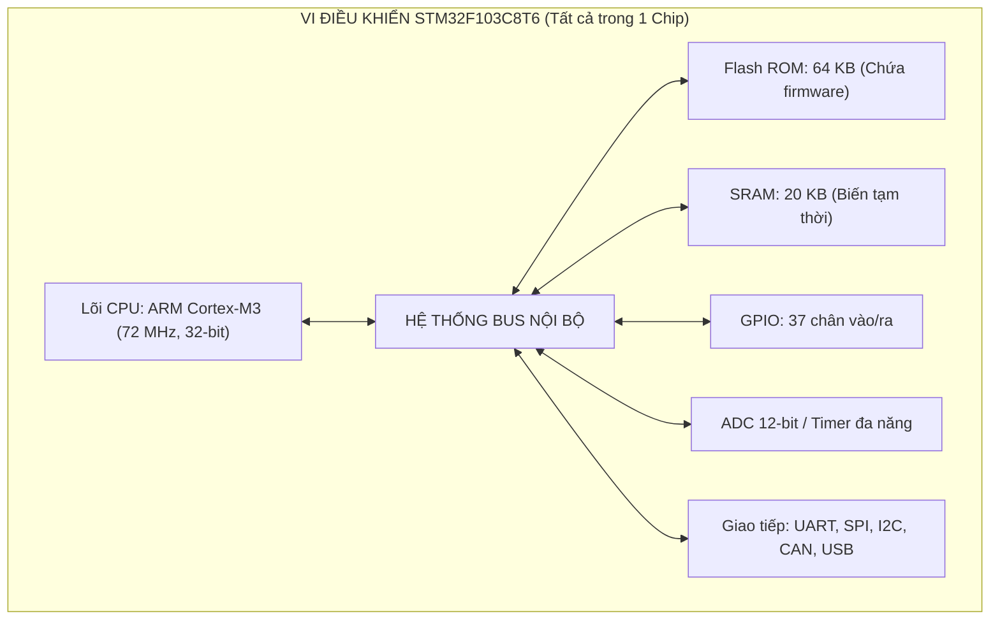
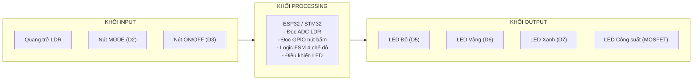
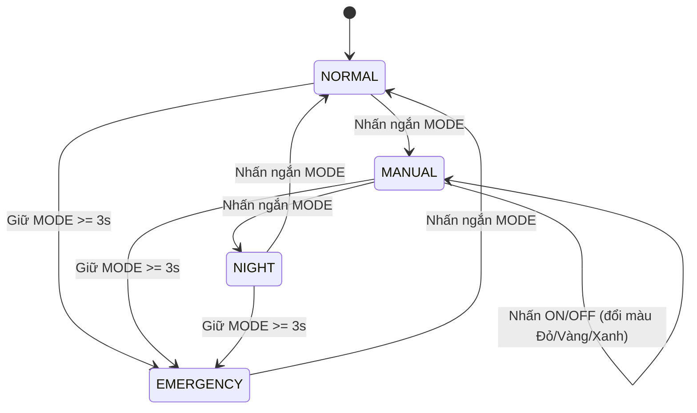
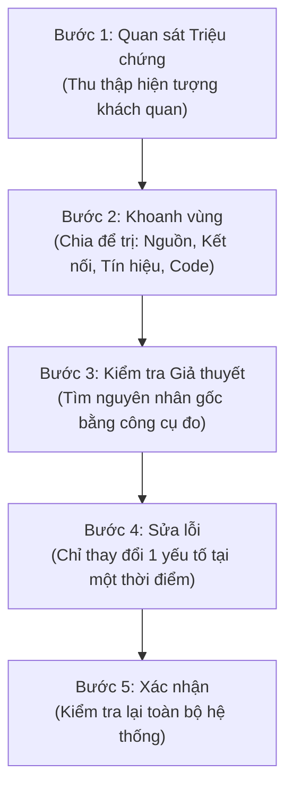
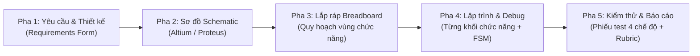

# GIÁO TRÌNH NHẬP MÔN HỆ THỐNG NHÚNG

**Tác giả:** Vũ Huy Lượng, Nguyễn Thành Trung  
**Địa điểm & Năm:** Thái Nguyên, 2026  
**Thời lượng học phần:** 3 tín chỉ (2 lý thuyết + 1 thực hành), 45 tiết, 9 buổi × 5 tiết  
**Dự án xuyên suốt:** Hệ thống Đèn giao thông Thông minh (Smart Traffic Light System)

---

## LỜI NÓI ĐẦU

Giáo trình này được biên soạn dành cho sinh viên năm thứ hai, lần đầu tiếp xúc với hệ thống nhúng. Nội dung bám sát đề cương học phần “Nhập môn Hệ thống Nhúng” (3 tín chỉ, 45 tiết), đồng thời tham khảo từ các tài liệu kinh điển: *Practical Electronics for Inventors* (Scherz & Monk, 2016), *Designing Embedded Hardware* (Catsoulis, 2005), *Embedded Systems: Introduction to ARM Cortex-M Microcontrollers* (Valvano, 2019), *Electronics for Beginners* (Bartlett, 2020), và *Make: Electronics* (Platt, 2015).

Giáo trình đi theo triết lý **“Hiểu phần cứng trước khi viết phần mềm.”** Mỗi bài gồm: Mục tiêu, Nội dung lý thuyết (giải thích chi tiết từng khái niệm, kèm ví dụ minh họa), Case Study xuyên suốt, Tự kiểm tra, Tóm tắt, Câu hỏi ôn tập, và Hướng dẫn Thực hành từng bước.

*Trân trọng,*  
*Thái Nguyên, 2026*  
*Nhóm tác giả*

---

## CHUẨN ĐẦU RA HỌC PHẦN (CLO)

- **CLO1: Kiến trúc Hệ thống Nhúng (PI1.1, PI1.2):** Trình bày và giải thích được cấu trúc, nguyên lý hoạt động của một hệ thống nhúng cơ bản. Xác định đúng các thành phần và phân tích được mối liên hệ giữa chúng.
- **CLO2: Linh kiện Điện tử và Nguồn điện (PI2.1–PI2.3):** Nhận diện, phân tích chức năng, lựa chọn giá trị phù hợp và sử dụng đúng kỹ thuật các linh kiện điện tử cơ bản; nhận biết được các mức điện áp chuẩn, nguyên tắc Common Ground và thực hiện được thao tác đo kiểm nguồn bằng đồng hồ vạn năng. Phát hiện và giải thích được lỗi liên quan đến linh kiện.
- **CLO3: Đọc hiểu Sơ đồ, Lắp ráp và Vận hành (PI3.1–PI3.3):** Đọc hiểu sơ đồ nguyên lý, nhận diện đúng ký hiệu điện tử tiêu chuẩn, chuyển đổi sang mạch breadboard và lắp ráp mạch đúng kỹ thuật; lập trình được các chức năng vào/ra cơ bản (GPIO, ADC, PWM, FSM) và vận hành được mạch đã lắp ráp.
- **CLO4: Debug và Khắc phục sự cố (PI4.1, PI4.2):** Áp dụng quy trình debug có hệ thống, phân loại đúng lỗi, sử dụng thành thạo công cụ debug, xác định nguyên nhân gốc và khắc phục được các lỗi phổ biến.
- **CLO5: Tích hợp và Vận hành Hệ thống (PI5.1–PI5.3):** Tích hợp đầy đủ các khối thành hệ thống đèn giao thông thông minh hoàn chỉnh đáp ứng yêu cầu; kiểm thử và vận hành được tất cả các chế độ (Normal, Manual, Emergency, Night); trình bày được nguyên lý hoạt động của từng khối và xử lý được các lỗi phát sinh.

---

## DANH MỤC TỪ VIẾT TẮT

| Từ viết tắt | Tiếng Anh | Giải thích tiếng Việt |
| :--- | :--- | :--- |
| **AC** | Alternating Current | Dòng điện xoay chiều |
| **ADC** | Analog-to-Digital Converter | Bộ chuyển đổi tương tự sang số |
| **ASIC** | Application-Specific Integrated Circuit | Vi mạch tích hợp chuyên dụng |
| **BJT** | Bipolar Junction Transistor | Transistor lưỡng cực (NPN/PNP) |
| **BOM** | Bill of Materials | Danh sách linh kiện định mức |
| **CAN** | Controller Area Network | Mạng truyền thông chuyên dụng trên ô tô |
| **CLO** | Course Learning Outcome | Chuẩn đầu ra học phần |
| **CMOS** | Complementary MOS | Công nghệ bán dẫn kim loại-oxit bổ sung |
| **CPU** | Central Processing Unit | Đơn vị xử lý trung tâm (bộ vi xử lý) |
| **CTR** | Current Transfer Ratio | Tỷ số truyền dòng (của Optocoupler) |
| **DC** | Direct Current | Dòng điện một chiều |
| **DIP** | Dual In-line Package | Dạng chân cắm xuyên lỗ song song (IC) |
| **DMA** | Direct Memory Access | Bộ truy cập bộ nhớ trực tiếp không qua CPU |
| **DRC** | Design Rule Check | Kiểm tra quy tắc thiết kế bo mạch (PCB) |
| **DSP** | Digital Signal Processor | Bộ xử lý tín hiệu số |
| **EEPROM** | Electrically Erasable PROM | Bộ nhớ chỉ đọc xóa bằng điện |
| **EMI** | Electromagnetic Interference | Nhiễu điện từ trường |
| **ERC** | Electrical Rule Check | Kiểm tra quy tắc điện trên sơ đồ nguyên lý |
| **ESD** | Electrostatic Discharge | Phóng điện tĩnh |
| **FPGA** | Field-Programmable Gate Array | Mảng cổng logic lập trình được dạng trường |
| **FSM** | Finite State Machine | Máy trạng thái hữu hạn |
| **GND** | Ground | Điểm nối đất: mốc tham chiếu điện thế 0V |
| **GPIO** | General Purpose Input/Output | Chân vào/ra đa năng của vi điều khiển |
| **GPOS** | General Purpose Operating System | Hệ điều hành đa năng (Windows, Linux, macOS) |
| **HSN** | Hệ thống Nhúng | Embedded System (ES) |
| **I2C** | Inter-Integrated Circuit | Giao thức truyền thông nối tiếp đồng bộ 2 dây |
| **IC** | Integrated Circuit | Vi mạch tích hợp (chíp bán dẫn) |
| **IDE** | Integrated Development Environment | Môi trường phát triển tích hợp (phần mềm viết code) |
| **IoT** | Internet of Things | Mạng lưới vạn vật kết nối Internet |
| **IR** | Infrared | Bức xạ hồng ngoại |
| **ISR** | Interrupt Service Routine | Hàm phục vụ ngắt |
| **LCD** | Liquid Crystal Display | Màn hình tinh thể lỏng |
| **LDO** | Low Dropout Regulator | Bộ ổn áp tuyến tính độ sụt áp thấp |
| **LED** | Light Emitting Diode | Đi-ốt phát quang |
| **LDR** | Light Dependent Resistor | Quang trở (điện trở biến thiên theo ánh sáng) |
| **LSB** | Least Significant Bit | Bit có trọng số nhỏ nhất (trong bộ chuyển đổi ADC) |
| **MCU** | Microcontroller Unit | Vi điều khiển |
| **MOSFET** | Metal-Oxide-Semiconductor FET | Transistor hiệu ứng trường kim loại-oxit |
| **MPU** | Microprocessor Unit | Bộ vi xử lý |
| **PCB** | Printed Circuit Board | Bảng mạch in |
| **PI** | Performance Indicator | Chỉ số đánh giá kết quả thực hiện CLO |
| **PWM** | Pulse Width Modulation | Điều chế độ rộng xung |
| **RAM** | Random Access Memory | Bộ nhớ truy cập ngẫu nhiên |
| **ROM** | Read-Only Memory | Bộ nhớ chỉ đọc |
| **RTC** | Real-Time Clock | Đồng hồ đếm thời gian thực |
| **RTOS** | Real-Time Operating System | Hệ điều hành thời gian thực |
| **SoC** | System on Chip | Hệ thống trọn vẹn tích hợp trên một vi mạch |
| **SPI** | Serial Peripheral Interface | Giao thức truyền thông nối tiếp đồng bộ 4 dây |
| **SRAM** | Static RAM | RAM tĩnh |
| **SWD** | Serial Wire Debug | Giao thức nạp và debug chip qua 2 dây của ARM |
| **TTL** | Transistor-Transistor Logic | Mức chuẩn logic điện áp 5V |
| **UART** | Universal Asynchronous Rx/Tx | Giao thức truyền thông nối tiếp bất đồng bộ |
| **USB** | Universal Serial Bus | Chuẩn bus nối tiếp vạn năng |
| **VCC** | Voltage Common Collector | Cực cấp nguồn điện áp dương |
| **VDD** | Voltage Drain Drain | Cực cấp nguồn cho mạch bán dẫn trường |
| **VDC** | Voltage Direct Current | Điện áp một chiều |

---

## MỤC LỤC TỔNG THỂ

1. [Chương 1: Tổng quan Hệ thống Nhúng](#chương-1-tổng-quan-hệ-thống-nhúng)
2. [Chương 2: Nguồn điện và An toàn điện trong Hệ thống Nhúng](#chương-2-nguồn-điện-và-an-toàn-điện-trong-hệ-thống-nhúng)
3. [Chương 3: Điện trở và LED: Những Linh kiện Đầu tiên](#chương-3-điện-trở-và-led-những-linh-kiện-đầu-tiên)
4. [Chương 4: Tín hiệu Số và Công tắc](#chương-4-tín-hiệu-số-và-công-tắc)
5. [Chương 5: Transistor và Điều khiển Tải](#chương-5-transistor-và-điều-khiển-tải)
6. [Chương 6: Tín hiệu Tương tự và Cảm biến](#chương-6-tín-hiệu-tương-tự-và-cảm-biến)
7. [Chương 7: Đọc Sơ đồ Nguyên lý và Lắp ráp Hệ thống](#chương-7-đọc-sơ-đồ-nguyên-lý-và-lắp-ráp-hệ-thống)
8. [Chương 8: Debug Hệ thống Nhúng: Nghệ thuật Truy tìm Sự cố](#chương-8-debug-hệ-thống-nhúng-nghệ-thuật-truy-tìm-sự-cố)
9. [Chương 9: Mini Project Tích hợp: Hệ thống Đèn giao thông Thông minh](#chương-9-mini-project-tích-hợp-hệ-thống-đèn-giao-thông-thông-minh)
10. [Công thức Quan trọng](#công-thức-quan-trọng)
11. [Kết luận và Định hướng Mở rộng](#kết-luận-và-định-hướng-mở-rộng)
12. [Tài liệu Tham khảo](#tài-liệu-tham-khảo)

---

---

## CHƯƠNG 1: TỔNG QUAN HỆ THỐNG NHÚNG

### Mục tiêu Chương 1

Sau khi học xong chương này, người học có thể:

- Nắm được cấu trúc tổng thể của học phần, các hình thức đánh giá và yêu cầu của dự án xuyên suốt Smart Traffic Light
- Mô tả được kiến trúc von Neumann và giải thích được mối quan hệ giữa điện áp, dòng điện và điện trở qua định luật Ohm
- Định nghĩa được hệ thống nhúng và phân biệt được với máy tính đa năng qua ba đặc trưng: chuyên dụng, thời gian thực và ràng buộc tài nguyên
- Giải thích được mô hình hoạt động Input → Processing → Output, vai trò của vòng phản hồi; phân biệt được điều khiển vòng hở và vòng kín
- Phân biệt được MCU và MPU; đọc được các thông số cơ bản (Flash, SRAM, GPIO, ADC, điện áp) để lựa chọn MCU phù hợp
- Nhận diện được cảm biến và cơ cấu chấp hành thông dụng; phân tích được một thiết bị nhúng thực tế và hệ thống Smart Traffic Light thành các khối I–P–O
- Nhận diện đúng các thành phần chính và mô tả đúng luồng xử lý I–P–O của một hệ thống nhúng cho trước, qua bài kiểm tra nhanh trên lớp

### 1.1 Giới thiệu Học phần và Dự án Smart Traffic Light

Thông tin chung: học phần Nhập môn Hệ thống Nhúng gồm 3 tín chỉ (2 lý thuyết + 1 thực hành), tổng cộng 45 tiết, tổ chức trong 9 buổi, mỗi buổi 5 tiết (50 phút/tiết). Học phần cung cấp kiến thức nền tảng về hệ thống nhúng theo định hướng phần cứng, tập trung vào cấu trúc hệ thống nhúng, điện tử cơ bản, ghép nối phần cứng và kỹ thuật debug. Thông qua dự án xuyên suốt “Hệ thống đèn giao thông thông minh” (Smart Traffic Light), người học từng bước xây dựng một hệ thống nhúng hoàn chỉnh: từ phân tích kiến trúc, lựa chọn linh kiện, lắp ráp phần cứng đến kiểm thử và khắc phục lỗi. Mục tiêu học phần:

- CO1: kiến thức cơ bản về cấu trúc và nguyên lý hoạt động của hệ thống nhúng.
- CO2: kiến thức về nguồn điện, an toàn điện và các linh kiện điện tử cơ bản (điện trở, tụ điện, LED) cùng định luật Ohm.
- CO3: kiến thức và kỹ năng thiết kế, ghép nối phần cứng, lắp ráp và vận hành các mạch nhúng cơ bản.
- CO4: kiến thức về debug hệ thống nhúng.
- CO5: phát triển năng lực tích hợp và vận hành hệ thống nhúng hoàn chỉnh. Dự án xuyên suốt: Smart Traffic Light System: hệ thống đèn giao thông thông minh với bốn chế độ hoạt động Normal, Manual, Emergency và Night. Mỗi buổi học hoàn thiện thêm một khối chức năng của dự án; sản phẩm hoàn chỉnh được kiểm thử

và bảo vệ ở buổi cuối (Bài 9). Yêu cầu chi tiết của dự án được trình bày ở Mục “Case Study” cuối chương này. Phương pháp học tập: học tập qua dự án (Project-Based Learning), học qua thực hành (Learning by Doing) và học từ lỗi (Error-Based Learning). Mỗi buổi học gồm ba phần: lý thuyết nền tảng, thực hành trên breadboard và ôn tập kèm bài tập tự luyện. Đánh giá học phần:

**Bảng 1.1:** Các thành phần đánh giá học phần

| Thành phần | Tỷ lệ | Chuẩn đầu ra được đánh giá |
| :--- | :---: | :--- |
| **Bài thực hành** (các buổi 2–8) | 30% | CLO2, CLO3, CLO4 |
| **Kiểm tra giữa kỳ** | 20% | CLO1, CLO2, CLO3 (giới hạn Bài 1–5) |
| **Mini Project cuối kỳ** | 40% | CLO5 |
| **Chuyên cần và tham gia học tập** | 10% | – |

> [!IMPORTANT]
> **Lưu ý: kiểm tra giữa kỳ được tổ chức theo lịch riêng của khoa, ngoài khung 45 tiết**

trên lớp; trong các buổi học còn có các bài kiểm tra nhanh trên lớp (xem Mục “Kiểm tra nhanh trên lớp” cuối chương) mang tính đánh giá quá trình.

### 1.2 Kiến thức Nền tảng

#### 1.2.1 Kiến trúc Máy tính von Neumann

Năm 1945, nhà toán học John von Neumann công bố một kiến trúc máy tính đặt nền móng cho mọi hệ thống tính toán hiện đại, gồm năm thành phần cơ bản:

1. Đơn vị Xử lý Trung tâm (CPU, Central Processing Unit): Đây là “bộ não” của máy tính, nơi thực hiện các phép toán số học (cộng, trừ, nhân, chia) và logic (AND, OR, NOT, so sánh). CPU hoạt động theo một chu trình lặp đi lặp lại gọi là chu trình Fetch-Decode-Execute:

- Fetch (Nạp lệnh): CPU đọc lệnh tiếp theo từ bộ nhớ, được trỏ bởi thanh ghi Program Counter (PC)
- Decode (Giải mã): CPU phân tích lệnh để xác định thao tác cần thực hiện và các toán hạng liên quan
- Execute (Thực thi): CPU thực hiện thao tác (tính toán, đọc/ghi bộ nhớ, hoặc nhảy đến địa chỉ khác)

1. Bộ nhớ (Memory): Lưu trữ cả chương trình (tập lệnh) và dữ liệu. Đây là điểm khác biệt quan trọng của kiến trúc von Neumann: chương trình và dữ liệu được lưu trong cùng một không gian bộ nhớ.
2. Thiết bị Nhập (Input): Đưa thông tin từ thế giới bên ngoài vào máy tính. Trong hệ thống nhúng, đó là các cảm biến, nút nhấn, tín hiệu từ các hệ thống khác.
3. Thiết bị Xuất (Output): Đưa thông tin đã xử lý ra thế giới bên ngoài. Trong hệ thống nhúng: LED, motor, relay, màn hình, loa.
4. Bus Hệ thống: Tập hợp các đường dẫn điện kết nối CPU, Bộ nhớ và các thiết bị I/O, cho phép dữ liệu và địa chỉ di chuyển qua lại giữa chúng.

### Tự kiểm tra: Kiến trúc von Neumann

Kể tên 5 thành phần của kiến trúc von Neumann. Thành phần nào là “bộ não” của máy tính? Chu trình Fetch-Decode-Execute là gì?

#### 1.2.2 Các Khái niệm Điện Cơ bản

Theo Practical Electronics for Inventors (Scherz & Monk, 2016, Chương 2), ba đại lượng điện cơ bản nhất cần nắm vững là:

- Điện áp (Voltage, ký hiệuV , đơn vị Volt): Điện áp là hiệu điện thế giữa hai điểm, đặc trưng cho “áp lực” hoặc “sức đẩy” làm các electron di chuyển trong dây dẫn. Scherz & Monk đưa ra phép so sánh trực quan với nước: điện áp giống như áp suất nước trong đường ống: áp suất càng cao, nước phun ra càng mạnh. Các mức điện áp phổ biến trong hệ thống nhúng bao gồm: 1.8V (lõi CPU một số MCU),

### 3.3 V (MCU hiện đại như STM32, ESP32), 5V (Arduino Uno, USB, logic TTL)

12V và 24V (thiết bị công nghiệp).

- Dòng điện (Current, ký hiệu I, đơn vị Ampere): Dòng điện là lượng điện tích dịch chuyển qua tiết diện dây dẫn trong một đơn vị thời gian. Trong phép so sánh với nước, dòng điện tương đương với lưu lượng nước chảy qua ống. Trong hệ thống nhúng, dòng điện thường được đo bằng mA (1 A = 1000 mA) hoặc µA (1 A = 1.000.000 µA).
- Điện trở (Resistance, ký hiệu R, đơn vị Ohm ( Ω)): Điện trở là đại lượng đặc trưng cho sự cản trở dòng điện của vật liệu. Trong phép so sánh với nước, điện trở giống như đường ống bị thu hẹp: ống càng hẹp, cùng một áp suất, nước chảy càng yếu. Mối quan hệ giữa ba đại lượng này được mô tả bởi Định luật Ohm, công thức quan trọng nhất trong toàn bộ khóa học: V = I × R (1.1) Từ đó suy ra hai hệ quả: I = V /R và R = V /I. Sinh viên cần thuộc lòng cả ba dạng và thành thạo cách áp dụng chúng trong tính toán mạch điện.

### 1.3 Hệ thống Nhúng là gì?

#### 1.3.1 Định nghĩa và Đặc điểm

Theo giáo trình Embedded Systems Design (MREC, 2025), hệ thống nhúng được định nghĩa như sau: Định nghĩa: Hệ thống Nhúng Hệ thống nhúng (Embedded System) là một hệ thống điện tử hoặc cơ-điện tử được thiết kế để thực hiện một chức năng chuyên biệt, là sự kết hợp của cả phần cứng (hardware) và phần sụn (firmware/software). Ví dụ điển hình: đồ chơi điện tử, điện thoại di động, máy giặt, điều hòa không khí, hệ thống điều khiển ô tô, đầu thu TV , đầu DVD, v.v. Hệ thống nhúng có ba đặc trưng cốt lõi phân biệt với máy tính đa năng:

1. Tính chuyên dụng (Dedicated Function): Mỗi hệ thống nhúng được thiết kế để thực hiện một hoặc một nhóm chức năng xác định trước , không thay đổi trong suốt vòng đời sản phẩm. Firmware được nạp cố định vào bộ nhớ Flash tại nhà máy và người dùng cuối không thể thay đổi. Ngược lại, máy tính đa năng cho phép cài đặt và gỡ bỏ ứng dụng tùy ý.
2. Tính thời gian thực (Real-Time Operation): Nhiều hệ thống nhúng phải phản hồi các sự kiện bên ngoài trong một khoảng thời gian xác định (deadline). Hệ thống Hard Real-Time(như túi khí ô tô, hệ thống điều khiển bay) yêu cầu deadline tuyệt đối: trễ deadline có thể dẫn đến hậu quả thảm khốc. Hệ thống Soft RealTime (như streaming video) có thể chấp nhận thỉnh thoảng trễ deadline với chất lượng giảm nhẹ.
3. Ràng buộc Tài nguyên (Resource Constraints): Hệ thống nhúng bị giới hạn nghiêm ngặt về: bộ nhớ (vài KB đến vài MB), năng lượng (phải chạy bằng pin hàng tháng đến hàng năm), kích thước vật lý, và chi phí sản xuất (mỗi cent đều được tính toán khi sản xuất hàng triệu đơn vị).

#### 1.3.2 Phân biệt Hệ thống Nhúng và Máy tính Đa năng

**Bảng 1.2:** So sánh Hệ thống Nhúng và Máy tính Đa năng (Nguồn: ESD Notes, MREC)

| Tiêu chí | Hệ thống Nhúng (Embedded System) | Máy tính Đa năng (General Purpose Computer) |
| :--- | :--- | :--- |
| **Mục đích** | Chuyên dụng, thực hiện tác vụ cố định | Đa năng, chạy nhiều ứng dụng khác nhau |
| **Hệ điều hành** | Có thể có hoặc không; nếu có thường là RTOS | Luôn có (Windows, Linux, macOS) |
| **Khả năng thay đổi** | Firmware nạp sẵn, người dùng không thay đổi được | Cài đặt / gỡ bỏ ứng dụng tùy ý |
| **Thời gian thực** | Bắt buộc với nhiều hệ thống (Hard Real-Time) | Đa số không yêu cầu khắt khe |
| **Chi phí** | Rất nhạy cảm về giá (tối ưu khi sản xuất hàng loạt) | Ít nhạy cảm hơn, ưu tiên năng lực tính toán |

Mục đích Chuyên dụng, thực hiện tác vụ cố định Đa năng, chạy nhiều ứng dụng Hệ điều hành Có thể có hoặc không; nếu có thường là RTOS Luôn có (Windows, Linux, macOS) Khả năng thay đổi Firmware nạp sẵn, không thay đổi được Cài đặt/gỡ bỏ ứng dụng tùy ý Tiêu chí thiết kế Yêu cầu ứng dụng cụ thể (công suất, giá, kích thước) Hiệu năng “càng nhanh càng tốt” Quản lý năng lượng Tối ưu cao, nhiều chế độ tiết kiệm điện Ít chú trọng Thời gian thực Bắt buộc với một số loại (Hard Real-Time) Không yêu cầu Tính xác định Hành vi xác định (deterministic) Hành vi không xác định Chi phí Rất nhạy cảm (sản xuất hàng triệu chiếc) Ít nhạy cảm hơn

#### 1.3.3 Các Ví dụ Thực tế

Ví dụ 1: Máy giặt Máy giặt là một hệ thống nhúng điển hình trong gia đình. MCU bên trong nhận lệnh từ nút nhấn (chọn chế độ giặt, nhiệt độ nước), đọc dữ liệu từ cảm biến mực nước và cảm biến nhiệt độ, xử lý theo chương trình đã lập sẵn, và điều khiển motor quay lồng giặt, relay mở/đóng van nước, bơm xả và màn hình LED hiển thị thời gian còn lại. Firmware của máy giặt được nạp một lần tại nhà máy và không bao giờ thay đổi. Ví dụ 2: Hệ thống phanh ABS ABS (Anti-lock Braking System) là ví dụ điển hình của Hard Real-Time. Hệ thống liên tục đọc tốc độ quay của từng bánh xe thông

qua cảm biến Hall (tần số lấy mẫu ∼100 Hz). Khi phát hiện bánh xe sắp bị bó cứng (tốc độ giảm đột ngột), MCU phải ra lệnh điều chỉnh áp suất dầu phanh trong vòng dưới 10 mili-giây. Nếu chậm hơn, bánh xe sẽ trượt trên mặt đường, tài xế mất lái, và tai nạn có thể xảy ra. Ví dụ 3: Máy tạo nhịp tim (Pacemaker) Đây là thiết bị y tế cấy ghép vào cơ thể, liên tục theo dõi nhịp tim và phát xung điện khi phát hiện rối loạn nhịp. Yêu cầu kỹ thuật cực kỳ khắt khe: dòng tiêu thụ dưới 10 µA, hoạt động liên tục 7–10 năm chỉ với một viên pin nhỏ, và độ tin cậy gần như tuyệt đối.

### 1.4 Mô hình Hoạt động Input → Processing → Output

#### 1.4.1 Nguyên lý Cơ bản

Theo Embedded Systems Design (MREC, 2025) và V alvano (2019, Chương 1), mọi hệ thống nhúng, từ đơn giản nhất đến phức tạp nhất, đều vận hành theo một mô hình ba khối cơ bản. Đây là “la bàn” giúp kỹ sư phân tích bất kỳ thiết bị nhúng nào: INPUT Cảm biến Nút nhấn, Công tắc Tín hiệu ngoại vi Giao tiếp (UART, I2C) PROCESSING Vi điều khiển (MCU) Firmware Thuật toán xử lý Logic điều khiển OUTPUT Cơ cấu chấp hành Màn hình hiển thị Truyền thông Lưu trữ dữ liệu Vòng phản hồi (Feedback Loop)

**Hình 1.1:** Mô hình Input → Processing → Output: Nền tảng của mọi Hệ thống Nhúng

```mermaid
flowchart LR
    INPUT["Khối INPUT
(Cảm biến, Nút nhấn)"] --> PROCESSING["Khối PROCESSING
(Vi điều khiển MCU)"]
    PROCESSING --> OUTPUT["Khối OUTPUT
(LED, Động cơ, Relay)"]
    OUTPUT -.->|Vòng phản hồi (Feedback Loop)| INPUT
```

#### 1.4.2 Khối INPUT: “Giác quan” của Hệ thống Nhúng

Khối Input có nhiệm vụ thu thập thông tin từ thế giới bên ngoài và chuyển đổi thành tín hiệu điện, ngôn ngữ duy nhất mà MCU có thể “hiểu.” Theo Catsoulis (2005, Chương 4), các thành phần Input bao gồm:

1. Cảm biến (Sensors): Biến đổi đại lượng vật lý thành tín hiệu điện. Mỗi loại cảm biến được thiết kế cho một đại lượng cụ thể:

- Nhiệt độ: LM35 (10 mV/◦C, analog), DS18B20 (digital, 1-Wire), DHT11 (nhiệt độ + độ ẩm)
- Ánh sáng: LDR, quang trở (điện trở thay đổi theo ánh sáng), photodiode, cảm biến màu TCS3200
- Khoảng cách: HC-SR04 (siêu âm, 2 cm–4 m), VL53L0X (laser ToF,±1 mm), cảm biến hồng ngoại Sharp GP2Y0A
- Chuyển động: PIR HC-SR501 (phát hiện người), MPU6050 (gia tốc 3 trục + con quay 3 trục)
- Áp suất: BMP280 (áp suất khí quyển, I 2C/SPI)
- Khí gas: MQ-2 (LPG, khói), MQ-135 (CO 2, benzen)

1. Tín hiệu người dùng: Nút nhấn, công tắc, bàn phím ma trận, màn hình cảm ứng, rotary encoder
2. Giao tiếp dữ liệu: UART, I2C, SPI, CAN (nhận dữ liệu từ MCU khác hoặc module ngoại vi)
3. Tín hiệu thời gian: RTC (Real-Time Clock), tín hiệu ngắt từ timer Nguyên tắc quan trọng: Tất cả các tín hiệu Input, dù là nhiệt độ, ánh sáng, âm thanh hay lực nhấn, đều phải được chuyển đổi thành điện áp hoặc tín hiệu số trước khi MCU có thể đọc. Đối với tín hiệu analog (cảm biến LM35, LDR), cần qua bộ ADC (sẽ học ở Bài 6). Đối với tín hiệu digital (nút nhấn, DHT11), có thể đọc trực tiếp qua chân GPIO hoặc giao thức truyền thông.

#### 1.4.3 Khối PROCESSING: “Bộ não” của Hệ thống Nhúng

Khối Processing là trung tâm xử lý, nơi vi điều khiển (MCU) thực thi firmware để biến đổi dữ liệu Input thành quyết định điều khiển Output. Theo V alvano (2019), hoạt động của khối Processing bao gồm:

1. Đọc dữ liệu Input: MCU liên tục đọc giá trị từ các cảm biến và nút nhấn thông qua GPIO, ADC, hoặc giao tiếp nối tiếp. Tần suất đọc (sampling rate) phải đủ nhanh để không bỏ lỡ sự kiện (định lý Nyquist: fsample ≥ 2 × fsignal).
2. Xử lý và Tính toán: Firmware thực hiện các thuật toán, từ đơn giản (so sánh ngưỡng, đếm, delay) đến phức tạp (PID, lọc số, FFT). Đây là nơi “trí thông minh” của hệ thống được định nghĩa.
3. Ra quyết định: Dựa trên kết quả xử lý, MCU quyết định hành động tiếp theo: bật/tắt LED, thay đổi tốc độ motor, gửi dữ liệu, chuyển trạng thái...
4. Quản lý thời gian: Nhiều hệ thống nhúng yêu cầu tác vụ phải hoàn thành trong khoảng thời gian xác định (deadline). Ví dụ: hệ thống phanh ABS phải phản hồi trong < 10 ms. Mô hình Toán học của Khối Processing: Một cách tổng quát, quan hệ giữa Input và Output có thể được biểu diễn bằng hàm truyền: Y(t) = F (X(t), S(t), Θ ) Trong đó Y(t) là vector tín hiệu đầu ra, X(t) là vector tín hiệu đầu vào, S(t) là vector trạng thái nội tại của hệ thống, Θ là tập tham số thiết kế (được xác định tại thời điểm thiết kế và không thay đổi trong quá trình vận hành), và F(·) là hàm xử lý được hiện thực bởi firmware. Sinh viên không cần ghi nhớ công thức này, chỉ cần hiểu ý tưởng: hệ thống nhúng biến đổi Input thành Output một cách có quy luật, theo chương trình đã được định sẵn trong firmware.

#### 1.4.4 Khối OUTPUT: “Cơ bắp” của Hệ thống Nhúng

Khối Output tác động trở lại thế giới vật lý theo quyết định của khối Processing. Theo Catsoulis (2005, Chương 5), các cơ cấu chấp hành phổ biến:

1. Quang (Ánh sáng): LED đơn, LED 7 đoạn, LED matrix, LED RGB, LCD 16×2, màn hình OLED, đèn LED công suất
2. Cơ (Chuyển động): Động cơ DC (quay liên tục), Servo motor (quay góc chính xác), Stepper motor (quay từng bước), solenoid (đẩy/kéo)

3. Điện (Đóng/ngắt): Relay (cơ), Solid State Relay (bán dẫn), MOSFET/BJT làm công tắc
4. Âm thanh: Buzzer (piezo), loa (qua amplifier), còi báo động
5. Truyền thông: UART, I2C, SPI, Bluetooth, WiFi (gửi dữ liệu ra thiết bị khác) Đối với tải có dòng điện lớn hơn khả năng cấp của GPIO ( > 20 mA), cần sử dụng transistor hoặc MOSFET như “công tắc điện tử” (sẽ học chi tiết ở Bài 5). Đối với tải AC (xoay chiều 220V), cần relay hoặc TRIAC kết hợp với optocoupler để đảm bảo an toàn cách ly.

#### 1.4.5 Vòng Phản hồi (Feedback Loop): Trái tim của Hệ thống Điều khiển

Vòng phản hồi là cơ chế Output ảnh hưởng trở lại Input, tạo thành hệ thống điều khiển vòng kín (closed-loop control) . Cơ chế hoạt động:

1. MCU đọc giá trị hiện tại từ cảm biến (Input), ví dụ: nhiệt độ phòng = 28 ◦C
2. MCU so sánh với giá trị mục tiêu (setpoint), ví dụ: nhiệt độ cài đặt = 25 ◦C
3. MCU tính sai lệch (error): e(t) = Tthực − Tcài đặt = +3 ◦C
4. MCU ra lệnh điều khiển Output dựa trên sai lệch, ví dụ: bật máy nén với công suất cao
5. Output tác động vào môi trường, nhiệt độ phòng giảm 6. Cảm biến (Input) ghi nhận sự thay đổi, quay lại bước 1 Phân biệt Điều khiển Vòng hở và Vòng kín:

- Vòng hở (Open-loop): Output không ảnh hưởng Input. Ví dụ: lò vi sóng hẹn giờ 2 phút, dù thức ăn đã nóng sau 1 phút, lò vẫn chạy đủ 2 phút. Đơn giản nhưng không chính xác.
- Vòng kín (Closed-loop): Output ảnh hưởng Input qua cảm biến. Ví dụ: điều hòa, khi nhiệt độ phòng đạt 25 ◦C, MCU tự động giảm/tắt máy nén. Phức tạp hơn nhưng chính xác và tiết kiệm năng lượng.

Ví dụ: Phân tích Hệ thống Điều hòa Không khí theo Mô hình I-P-O INPUT:

- Cảm biến nhiệt độ phòng (thermistor 10 kΩ ở 25◦C): đo nhiệt độ không khí tại dàn lạnh, gửi về MCU qua ADC
- Cảm biến nhiệt độ dàn nóng và dàn lạnh: theo dõi hiệu suất trao đổi nhiệt, bảo vệ quá nhiệt
- Remote hồng ngoại (IR): nhận lệnh từ người dùng: nhiệt độ cài đặt, chế độ (làm mát/sưởi ấm/quạt), tốc độ quạt, hướng gió
- Cảm biến độ ẩm (tùy chọn): điều chỉnh chế độ hút ẩm PROCESSING:
- MCU 32-bit (thường là dòng Renesas RX, Toshiba TXZ, hoặc STM32) chạy firmware
- Thuật toán PID (Proportional-Integral-Derivative): Tính toán tần số máy nén tối ưu dựa trên sai lệch nhiệt độ. Thành phần P (tỷ lệ): phản ứng nhanh với sai lệch hiện tại. Thành phần I (tích phân): bù trừ sai số tích lũy theo thời gian. Thành phần D (đạo hàm): dự đoán xu hướng thay đổi
- Logic bảo vệ: nếu cảm biến dàn nóng báo quá nhiệt thì giảm tần số máy nén; nếu mất tín hiệu cảm biến thì dừng máy và báo lỗi OUTPUT:
- Máy nén (Compressor): Thiết bị tiêu thụ điện chính (70–80% tổng công suất). Điều khiển qua relay (máy thường, ON/OFF) hoặc biến tần Inverter (máy đời mới, điều chỉnh vô cấp 0–100%)
- Motor quạt dàn lạnh: 3–5 tốc độ, thổi hơi lạnh vào phòng
- Motor quạt dàn nóng: Tản nhiệt cho dàn nóng
- Cánh đảo gió: Điều khiển bằng stepper motor, quạt gió lên/xuống trái/phải
- Màn hình LED/LCD: Hiển thị nhiệt độ cài đặt, nhiệt độ phòng, chế độ hoạt động Vòng phản hồi: Nhiệt độ phòng (Input) → MCU so sánh với setpoint → điều chỉnh máy nén (Output) → nhiệt độ thay đổi → cảm biến ghi nhận (Input) → lặp lại. Tần suất lặp: 1–10 lần/giây. Đây chính là lý do điều hòa Inverter tiết kiệm điện hơn điều hòa thường: Inverter điều chỉnh liên tục thay vì bật/tắt đột ngột. Ví dụ: Phân tích Hệ thống Phanh ABS theo Mô hình I-P-O INPUT: 4 cảm biến tốc độ bánh xe (cảm biến Hall, 100 lần/giây mỗi bánh), cảm biến áp suất dầu phanh, công tắc bàn đạp phanh. PROCESSING: MCU chuyên dụng (thường là Infineon TriCore hoặc Renesas RH850) chạy firmware. Khi phát hiện bánh xe giảm tốc đột ngột (dấu hiệu bó cứng), MCU tính toán áp suất phanh tối ưu cho từng bánh. OUTPUT: Các van solenoid trong bộ chấp hành thủy lực (Hydraulic Control Unit): mở/đóng van để tăng/giảm/giữ áp suất dầu phanh đến từng bánh xe. Tần suất điều chỉnh: 15–60 lần/giây. Vòng phản hồi: Đây là hệ thống Hard Real-Time: deadline < 10 ms. Nếu chậm hơn, bánh xe trượt, tài xế mất lái. Sự khác biệt với điều hòa: điều hòa trễ 1 giây vẫn chấp nhận được (Soft Real-Time); ABS trễ 10 ms có thể gây tai nạn (Hard RealTime).

### 1.5 Vi điều khiển: Trái tim của Hệ thống Nhúng

Theo V alvano (2019, Chương 1), Vi điều khiển (Microcontroller, MCU) là một máy tính hoàn chỉnh được tích hợp trên một vi mạch duy nhất . Nó bao gồm: lõi CPU (xử lý lệnh), bộ nhớ chương trình Flash ROM (lưu firmware), bộ nhớ dữ liệu SRAM (lưu biến tạm thời), và các ngoại vi (GPIO, ADC, Timer, UART, SPI, I 2C, PWM...), tất cả trong cùng một gói. Phân biệt MCU và MPU:

- Vi xử lý (MPU, Microprocessor): chỉ chứa lõi CPU. Cần RAM, ROM và ngoại vi gắn bên ngoài. Giống như “bộ não không có thân thể.” Ví dụ: Intel Core i7, AMD Ryzen. Dùng trong PC, laptop, server.
- Vi điều khiển (MCU, Microcontroller): Tích hợp sẵn CPU + RAM + ROM + ngoại vi. Giống như “bộ não có đầy đủ tay chân.” Ví dụ: STM32F103 (ARM Cortex-M3), ESP32 (Xtensa Dual), A Tmega328P (A VR 8-bit). Tại sao HSN dùng MCU? Năm lý do chính: (1) Tiết kiệm không gian: 1 chip thay vì 5–10 chip; (2) Tiết kiệm chi phí: 0.5–5 USD so với 20–50 USD cho MPU; (3) Tiết kiệm năng lượng: vài chục mA so với vài A; (4) Đơn giản hóa thiết kế: ít linh kiện → ít lỗi; (5) Độ tin cậy cao hơn: ít mối hàn, ít điểm kết nối.

**Bảng 1.3:** Các dòng MCU phổ biến (Nguồn: V alvano, 2019)

| Thông số | ATmega328P | STM32F103 (Blue Pill) | ESP32 | MSP430G |
| :--- | :--- | :--- | :--- | :--- |
| **CPU** | AVR 8-bit | ARM Cortex-M3 32-bit | Xtensa 32-bit Dual-core | MSP430 16-bit |
| **Tần số** | 16 MHz | 72 MHz | 240 MHz | 16 MHz |
| **Flash / SRAM** | 32 KB / 2 KB | 64 KB / 20 KB | 4 MB / 520 KB | 16 KB / 512 B |
| **GPIO / ADC** | 23 / 10-bit | 37 / 12-bit | 34 / 12-bit | 16 / 10-bit |
| **Điện áp** | 5 V | 3.3 V | 3.3 V | 1.8–3.6 V |
| **Kết nối** | UART, SPI, I2C | UART × 3, SPI × 2, CAN | Wi-Fi, Bluetooth BLE | UART, SPI, I2C |
| **Giá (2025)** | ~45.000 VNĐ | ~65.000 VNĐ | ~85.000 VNĐ | ~30.000 VNĐ |
| **Dùng khi** | Mới học, DIY, Arduino Uno | Công nghiệp, điều khiển chính xác | IoT, kết nối không dây | Siêu tiết kiệm pin |

### Tự kiểm tra: Lựa chọn MCU

Bạn cần thiết kế một khóa cửa thông minh chạy pin, kết nối Bluetooth. Nên chọn MCU nào trong 4 loại trên? Tại sao?

### 1.6 Cảm biến và Cơ cấu Chấp hành

Cảm biến (Sensor) và cơ cấu chấp hành (Actuator) là cầu nối giữa MCU và thế giới vật lý. Cảm biến là “giác quan” của hệ thống: biến đổi các đại lượng vật lý (nhiệt độ, ánh sáng, khoảng cách, áp suất, gia tốc) thành tín hiệu điện mà MCU có thể đọc. Cơ cấu chấp hành là “cơ bắp”: nhận tín hiệu điện từ MCU và biến đổi thành hành động vật lý (ánh sáng, chuyển động, âm thanh, nhiệt). Nguyên tắc kết nối: Cảm biến analog (LM35, LDR) nối vào chân ADC của MCU.

VI ĐIỀU KHIỂN (MCU): Tất cả trong MỘT chip Lõi CPU ARM Cortex-M3, 72 MHz 32-bit RISC + NVIC Flash ROM: 64 KB (lưu firmware) SRAM: 20 KB (dữ liệu tạm) GPIO 37 chân Input/Output ADC 12-bit, Timer UART/SPI/I2C CAN, USB BUS HỆ THỐNG

**Hình 1.2:** Cấu trúc bên trong Vi điều khiển STM32F103C8T6



**Bảng 1.4:** Cảm biến và Cơ cấu Chấp hành thông dụng

| Tên linh kiện | Đại lượng đo / Tác động | Phân loại | Đặc tính kỹ thuật |
| :--- | :--- | :---: | :--- |
| **Cảm biến (Sensors)** | | | |
| LM35 | Nhiệt độ | Analog | 10 mV/°C, -55 → +150°C |
| DHT11 | Nhiệt độ + Độ ẩm | Digital | 0–50°C, 20–90% RH, giao tiếp 1-Wire |
| LDR (Quang trở) | Cường độ ánh sáng | Analog | Khi tối ~1 MΩ, khi sáng ~1 kΩ |
| HC-SR04 | Khoảng cách | Digital | Sóng siêu âm, 2 cm – 4 m |
| MPU6050 | Gia tốc + Con quay hồi chuyển | Digital (I2C) | 3 trục, ±2/4/8/16 g |
| MQ-2 | Khí gas, khói | Analog | Điện trở thay đổi theo nồng độ khí |
| **Cơ cấu chấp hành (Actuators)** | | | |
| LED | Phát tín hiệu ánh sáng | Digital | 5–20 mA, Vf = 1.8–3.6 V |
| Buzzer | Phát âm thanh cảnh báo | PWM | 5 V, ~15 mA |
| Relay 5V | Đóng/ngắt mạch cách ly | Digital + BJT | Cuộn hút 5 V / 70 mA, tiếp điểm 250 V / 10 A |
| Động cơ DC | Quay liên tục | PWM (Cầu H) | 3–12 V, 100 mA – 2 A |
| Servo SG90 | Quay góc chính xác 0–180° | PWM 50 Hz | 5 V, ~500 mA (khi có tải) |
| LCD 16×2 | Hiển thị ký tự | I2C / Song song | 5 V, ~20 mA |

Cảm biến digital (DHT11, HC-SR04) nối vào chân GPIO hoặc cổng giao tiếp (I 2C, SPI). Cơ cấu chấp hành dòng nhỏ ( <20 mA như LED) nối trực tiếp vào GPIO. Cơ cấu dòng lớn (>20 mA như Relay, động cơ) cần đi qua transistor (Bài 5).

### 1.7 Case Study: Hệ thống Đèn giao thông Thông minh

### Case Study: Phân tích Yêu cầu (Bài 1)

Xuyên suốt 9 bài, sinh viên xây dựng Smart Traffic Light System sử dụng ESP32/STM32. Yêu cầu Chức năng: (1) 3 LED (Đỏ, Vàng, Xanh); (2) 2 chế độ AUTO/MANUAL; (3) AUTO: tối → bật, sáng → tắt; (4) MANUAL: nút nhấn chọn màu; (5) Nút ON/OFF. Yêu cầu Phi chức năng: Nguồn 5V DC (USB), tổng dòng < 200 mA, phản hồi nút nhấn < 100 ms, chi phí linh kiện < 150.000 VNĐ. INPUT LDR (ánh sáng) Nút MODE (D2) Nút ON/OFF (D3) PROCESSING ESP32 / STM32 Firmware: - Đọc ADC (LDR) - Đọc GPIO (nút) - Logic chế độ - Điều khiển LED OUTPUT LED Đỏ (D5) LED Vàng (D6) LED Xanh (D7) LED CS (MOSFET)

**Hình 1.3:** Sơ đồ khối Smart Traffic Light System (Phiên bản Bài 1)



Phát triển qua 9 bài: Bài 2: thiết kế nguồn; Bài 3: tính R cho LED; Bài 4: nút nhấn + pull-up; Bài 5: MOSFET cho LED CS; Bài 6: LDR + ADC; Bài 7: schematic + breadboard; Bài 8: debug; Bài 9: hoàn thiện + báo cáo.

### 1.8 Kiểm tra nhanh trên lớp

Phần này kiểm tra nhanh khả năng nhận diện thành phần và mô tả luồng xử lý của một hệ thống nhúng cho trước, củng cố kiến thức về mô hình I →P→O và vi điều khiển. Giảng viên đọc đề, sinh viên trả lời nhanh trong 5–10 phút, không dùng tài liệu.

Đề kiểm tra nhanh: Máy bơm nước tự động (5 phút) Một hệ thống nhúng điều khiển máy bơm nước như sau: cảm biến mực nước báo mức nước trong bồn; khi mực nước xuống dưới mức thấp, vi điều khiển đọc tín hiệu cảm biến, xử lý và phát lệnh bật máy bơm; khi nước đạt mức cao, vi điều khiển phát lệnh tắt máy bơm. Khi bơm chạy, một đèn LED báo trạng thái sáng; nếu bơm chạy quá lâu mà nước không lên (nghi mất nước), còi báo động kêu.

1. Kể tên các thành phần chính của hệ thống và gán vai trò I (Input), P (Processing), O (Output) cho mỗi thành phần.

2. Mô tả luồng xử lý của hệ thống theo mô hình I →P→O.

3. Thiết bị nào là cảm biến, thiết bị nào là cơ cấu chấp hành ? Đáp án gợi ý: (1) Cảm biến mực nước: Input; vi điều khiển: Processing; máy bơm, LED, còi: Output. (2) Cảm biến đọc mực nước → MCU so sánh với hai ngưỡng (thấp/cao) → MCU phát lệnh bật/tắt bơm, bật LED, kích còi. (3) Cảm biến: cảm biến mực nước; cơ cấu chấp hành: máy bơm, còi (LED là thiết bị hiển thị trạng thái). Tự kiểm tra thêm với hệ thống Smart Traffic Light ở mục Case Study: chỉ ra Input (LDR, nút MODE, nút ON/OFF), Processing (MCU) và Output (LED đỏ/vàng/xanh, LED công suất qua MOSFET), rồi mô tả luồng xử lý khi trời tối dần (LDR đọc giá trị ánh sáng thấp → MCU xử lý → chuyển chế độ hoạt động theo điều kiện ánh sáng). Ôn tập cuối chương Tóm tắt kiến thức cần nhớ

- Kiến trúc von Neumann gồm năm thành phần: CPU (chu trình Fetch–Decode– Execute), bộ nhớ, thiết bị nhập, thiết bị xuất và bus hệ thống.
- Ba đại lượng điện cơ bản: điện áp V (V olt), dòng điện I (Ampere), điện trở R (Ohm); định luật Ohm V = I × R với hai hệ quả I = V /R và R = V /I.
- Hệ thống nhúng là hệ thống chuyên dụng kết hợp phần cứng và firmware; ba đặc trưng phân biệt với máy tính đa năng: tính chuyên dụng, tính thời gian thực và ràng buộc tài nguyên.
- Mọi hệ thống nhúng vận hành theo mô hình I →P→O; mọi tín hiệu đầu vào đều phải được chuyển thành tín hiệu điện hoặc tín hiệu số trước khi MCU đọc.
- Vòng phản hồi tạo nên điều khiển vòng kín (tự điều chỉnh theo sai lệch); điều khiển vòng hở đơn giản hơn nhưng không tự hiệu chỉnh theo kết quả.
- MCU tích hợp CPU, Flash ROM, SRAM và ngoại vi trong một chip; lựa chọn MCU dựa trên tài nguyên, ngoại vi, điện áp hoạt động, năng lượng và chi phí.
- Cảm biến là “giác quan” (chuyển đại lượng vật lý thành tín hiệu điện), cơ cấu chấp hành là “cơ bắp” của hệ thống; tải lớn hơn 20 mA cần đi qua transistor/MOSFET.
- Smart Traffic Light (Bài 1) xác định: Input (LDR, nút MODE, nút ON/OFF), Processing (ESP32/STM32) và Output (LED đỏ/vàng/xanh, LED công suất qua MOSFET) cùng các ràng buộc phi chức năng: nguồn 5 V , tổng dòng < 200 mA, phản hồi nút nhấn < 100 ms, chi phí < 150k VNĐ. Câu hỏi ôn tập

1. Định nghĩa hệ thống nhúng. Cho 3 ví dụ thiết bị nhúng gặp trong ngày.

2. Giải thích ba đặc trưng của hệ thống nhúng (chuyên dụng, thời gian thực, ràng buộc tài nguyên); mỗi đặc trưng lấy một ví dụ chưa xuất hiện trong chương.
3. Một mạch có điện áp nguồn không đổi. Khi tăng điện trở tải, dòng điện trong mạch thay đổi thế nào? Giải thích bằng định luật Ohm.
4. Phân biệt MCU và MPU. Tại sao HSN dùng MCU?

5. Phân tích nồi cơm điện theo mô hình I →P→O. 6. Phân biệt điều khiển vòng hở và vòng kín; nêu một thiết bị trong nhà thuộc mỗi loại và giải thích lý do. 7. Tra datasheet STM32F103C8T6: GPIO, ADC, Flash, SRAM, tần số. 8. “Smartphone có phải HSN không?” Lập luận cả hai quan điểm. Bài tập thực hành Thực hành BT1.1: Cài đặt Arduino IDE Tải Arduino IDE từ arduino.cc → Kết nối kit → Mở File→Examples→Blink → Nạp → Quan sát LED nhấp nháy. Thực hành BT1.2: Phân tích Thiết bị Nhúng (30 phút) Mục tiêu: Áp dụng mô hình I →P→O để phân tích các thiết bị nhúng trong đời sống. Bước 1: Khảo sát (10 phút) Đi quanh nhà/phòng, liệt kê tất cả thiết bị điện tử. Đánh dấu thiết bị nào là HSN. Bước 2: Phân tích I →P→O (15 phút) Chọn 3 thiết bị. Với mỗi thiết bị, điền vào bảng: Thiết bị Input Processing Output Ví dụ: Máy giặt Nút nhấn, cảm biến nước MCU điều khiển Motor, LED, relay Bước 3: Câu hỏi suy nghĩ (5 phút) Với mỗi thiết bị: (a) Người dùng có cài được ứng dụng mới không? (b) Nếu thay đổi firmware, thiết bị có hoạt động khác không?

#### Thực hành BT1.3: Vẽ Sơ đồ Khối và Luồng Hoạt động cho Hệ thống Nhúng (45

phút) Mục tiêu: Rèn luyện kỹ năng phân tích hệ thống nhúng qua việc vẽ sơ đồ khối chức năng (block diagram) và sơ đồ luồng hoạt động (flowchart). Dụng cụ: Giấy A4, bút chì, thước kẻ, bút màu (3 màu). Phần A: Phân tích Hệ thống cho trước (20 phút) Chọn một trong các hệ thống sau để phân tích:

1. Máy bán nước tự động: Nhận tiền xu, chọn loại nước, xuất nước, trả tiền thừa
2. Cửa tự động siêu thị: Phát hiện người đến gần, mở cửa, giữ cửa, đóng cửa
3. Máy rửa tay tự động: Phát hiện tay, bơm xà phòng, xả nước, sấy khô
4. Hệ thống tưới cây tự động: Đo độ ẩm đất, bật/tắt bơm, hẹn giờ
5. Đèn đường tự động: Cảm biến ánh sáng, bật/tắt đèn, tiết kiệm năng lượng Yêu cầu vẽ và nộp:
6. Sơ đồ khối Chức năng (Block Diagram):

- Vẽ các khối chính: INPUT (tất cả cảm biến, nút nhấn, tín hiệu vào), PROCESSING (MCU/MPU), OUTPUT (cơ cấu chấp hành, hiển thị)
- Dùng Mũi tên nối các khối để chỉ hướng dữ liệu
- Dùng Mũi tên đứt nét chỉ vòng phản hồi (nếu có)
- Ghi rõ tên từng thành phần trong mỗi khối

1. Sơ đồ Luồng Hoạt động (Flowchart):

- Bắt đầu bằng hình oval “BẮT ĐẦU”
- Dùng hình chữ nhật cho các bước xử lý (“Đọc cảm biến,” “So sánh ngưỡng,” “Bật motor”)
- Dùng hình thoi cho các bước quyết định (“Độ ẩm < 30%?,” “Có người không?”)
- Dùng mũi tên chỉ luồng thực thi
- Kết thúc bằng hình oval “KẾT THÚC” hoặc vòng lặp về bước đầu Phần B: Trình bày và Đánh giá chéo (25 phút)

1. Trình bày (5 phút/SV): Mỗi sinh viên trình bày sơ đồ của mình trong 3 phút. Giải thích: (a) Tại sao chọn các thành phần đó? (b) Vòng phản hồi hoạt động thế nào? (c) Nếu thêm một tính năng mới, cần thêm Input/Output gì?

2. Đánh giá chéo (5 phút): SV khác nhận xét: (a) Sơ đồ có thiếu thành phần nào không? (b) Luồng hoạt động có logic không? (c) Có điểm nào cần cải thiện? Tiêu chí đánh giá:

- Sơ đồ khối đầy đủ Input/Processing/Output (3đ)
- Flowchart logic, đúng các bước (3đ)
- Trình bày rõ ràng, trả lời được câu hỏi (2đ)
- Sáng tạo, đề xuất được tính năng mở rộng (2đ) Câu hỏi thảo luận

1. Lò vi sóng (vòng hở) và điều hòa Inverter (vòng kín) đều điều khiển nhiệt. Trong tình huống nào lựa chọn vòng hở vẫn hợp lý dù kém chính xác hơn?
2. Giả sử Smart Traffic Light cần thêm yêu cầu: “đèn vàng nhấp nháy cảnh báo khi

có người đi bộ qua đường”. Hãy xác định Input/Output cần bổ sung và mô tả luồng xử lý.

1. Máy tạo nhịp tim hoạt động nhiều năm với dòng tiêu thụ rất nhỏ, còn smartphone cần pin lớn sạc hàng ngày. Hãy giải thích sự khác biệt về ràng buộc tài nguyên giữa hai thiết bị.

---

## CHƯƠNG 2: NGUỒN ĐIỆN VÀ AN TOÀN ĐIỆN TRONG HỆ THỐNG NHÚNG

NHÚNG Mục tiêu chương Sau khi học xong chương này, người học có thể:

- Phân biệt và tính toán được mối quan hệ giữa điện áp ( V ), dòng điện ( I), công suất (P ) qua P = V × I; lựa chọn được LDO hoặc Buck converter phù hợp với nhu cầu dòng và hiệu suất
- Nhận diện được các mức điện áp chuẩn trong HSN (1.8V , 3.3V , 5V , 12V) và ứng dụng của từng mức; giải thích được hậu quả khi cấp sai mức áp cho linh kiện
- Giải thích được tầm quan trọng của GND chung (nguyên nhân số 1 gây lỗi cho người mới học) và kiểm tra được bằng chế độ Continuity
- Sử dụng thành thạo đồng hồ vạn năng (Multimeter) để đo VDC, Continuity và dòng điện; bước đầu làm quen được ZOYI ZT-703S (DMM + Scope) để quan sát dạng sóng
- Nhận diện được triệu chứng lỗi nguồn và các mối nguy hiểm (ngắn mạch, phân cực ngược, quá áp); tuân thủ được quy tắc an toàn điện, quy trình 5S và xử lý khẩn cấp đúng thứ tự

### 2.1 Kiến thức Nền tảng

Ôn lại từ Vật lý phổ thông: Định luật bảo toàn năng lượng : năng lượng không tự sinh ra hoặc mất đi, chỉ chuyển hóa từ dạng này sang dạng khác (điện năng → nhiệt năng, quang năng, cơ năng). Mạch điện kín : dòng điện chỉ chạy khi mạch tạo thành vòng kín từ cực dương qua tải về cực âm của nguồn. Định luật Ohm: V = I × R. Đơn vị: 1 A = 1000 mA; 1 mA = 1000 µA; 1 kΩ = 1000 Ω; 1 MΩ = 1.000.000 Ω.

### 2.2 Ba Đại lượng Cơ bản: Điện áp, Dòng điện, Công suất

BỂ NƯỚC Ống dẫn Áp suất = V Lưu lượng = I V an = R Bể càng CAO → áp suất càng LỚN → nước chảy càng MẠNH V an càng HẸP (R lớn) → nước chảy càng YẾU ( I nhỏ)

**Hình 2.1:** Phép so sánh với nước: V = Áp suất, I = Lưu lượng, R = Độ hẹp van

#### 2.2.1 Điện áp (V oltage: V )

Điện áp là hiệu điện thế giữa hai điểm, đặc trưng cho “áp lực” đẩy các electron di chuyển. Theo Scherz & Monk (2016, Chương 2), có thể hình dung điện áp như áp suất nước trong đường ống: áp suất càng cao, nước phun càng mạnh. Các mức điện áp trong HSN:

**Bảng 2.1:** Các mức điện áp trong Hệ thống Nhúng

| Mức áp | Dùng cho | Ví dụ cụ thể |
| :--- | :--- | :--- |
| **1.2–1.8V** | Lõi CPU, RAM DDR | Điện áp nhân STM32F4, RAM DDR3 |
| **3.3V** | MCU hiện đại | STM32, ESP32, ARM Cortex-M, Raspberry Pi Pico |
| **5V** | Chuẩn kinh điển, USB, Arduino | ATmega328P, cảm biến TTL, relay 5V |
| **12V** | Thiết bị công nghiệp, động cơ nhỏ | LED dây 12V, quạt tản nhiệt, motor DC nhỏ |
| **24V** | Tự động hóa công nghiệp | PLC, cảm biến công nghiệp, van điện từ khí nén |

### 1.2 –1.8V Lõi CPU, RAM DDR Điện áp nhân STM32F4, RAM DDR3

### 3.3 V MCU hiện đại STM32, ESP32, ARM Cortex-M

Raspberry Pi Pico 5V Chuẩn cũ, USB, Arduino A Tmega328P , cảm biến, relay 5V 12V Thiết bị công nghiệp LED dây, quạt, motor DC nhỏ 24V Tự động hóa PLC, cảm biến công nghiệp, van điện từ Cảnh báo Quan trọng: Quy tắc sống còn: Tuyệt đối không cấp điện áp 5V vào chân MCU được thiết kế cho

### 3.3 V! Điều này sẽ phá hủy vĩnh viễn cổng vào/ra của chip. Luôn kiểm tra datasheet

trước khi cấp nguồn cho bất kỳ linh kiện nào.

#### 2.2.2 Dòng điện (Current: I)

Dòng điện là lượng điện tích dịch chuyển qua tiết diện dây dẫn trong một đơn vị thời gian. Trong phép so sánh với nước, dòng điện tương đương với lưu lượng nước chảy qua ống. Dòng tiêu thụ điển hình:

**Bảng 2.2:** Dòng tiêu thụ điển hình của các thành phần

| Linh kiện | Dòng tiêu thụ | Ghi chú |
| :--- | :--- | :--- |
| **MCU STM32F103** (Active, 72MHz) | ~25 mA | Tất cả ngoại vi bật |
| **MCU STM32F103** (Standby) | ~2 µA | Đánh thức từ chân Reset hoặc RTC |
| **ESP32** (Wi-Fi, phát tối đa) | 160–260 mA | Đỉnh khi phát sóng vô tuyến |
| **ESP32** (Deep Sleep) | ~10 µA | Chỉ chạy bộ đếm RTC + ULP |
| **LED đỏ** (qua điện trở hạn dòng) | 5–20 mA | Tùy thuộc giá trị R |
| **Servo SG90** (có tải cơ học) | 200–750 mA | Phụ thuộc vào mô-men cản |
| **Relay 5V** (cuộn hút đóng) | ~70 mA | Cần transistor đệm dòng |
| **Cảm biến DHT11** (khi đo) | ~1.5 mA | Rất tiết kiệm |

#### 2.2.3 Công suất (Power: P )

Công suất cho biết linh kiện tiêu thụ năng lượng nhanh hay chậm. P = V × I (Watt). Hệ quả (kết hợp định luật Ohm): P = I 2 × R = V 2/R.

Ví dụ: Tính công suất và thời gian chạy pin MCU STM32F103 hoạt động ở 3.3V , dòng 25 mA: P = 3.3 × 0.025 = 82 .5 mW. Với pin Li-Po 3.7V/2000 mAh qua LDO hiệu suất 89%: dòng từ pin ≈ 25 × (3.3/3.7) / 0.89 ≈ 25.1 mA. Thời gian: T = 2000/25.1 ≈ 79.7 giờ ≈ 3.3 ngày. Nếu chuyển sang Standby (2 µA): thời gian lý thuyết lên đến hàng năm (chỉ giới hạn bởi tuổi thọ pin). Tự kiểm tra: Công suất Một LED đỏ (Vf =2.0V) được cấp dòng 15 mA. Tính PLED. Nếu R hạn dòng là 220 Ω và nguồn 5V , tínhPR. Gợi ý: PR = I 2 × R.

### 2.3 Hệ thống Nguồn: Nguồn DC và Bộ ổn áp

#### 2.3.1 Các loại nguồn DC phổ biến: Pin, Adapter, USB

Trong thực hành hệ thống nhúng, ba loại nguồn một chiều (DC) phổ biến nhất là pin, adapter và USB:

- Pin (9V loại 6F22 hoặc 1.5V AA/AAA): tiện mang theo, không phụ thuộc ổ điện, nhưng dòng cấp nhỏ và điện áp tụt dần khi cạn pin; thích hợp cho mạch rời đơn giản.
- Adapter (biến đổi điện lưới xoay chiều thành DC 5V/12V , dòng cấp 1–2A): nguồn cố định cho breadboard, động cơ DC và LED công suất. Khi dùng phải kiểm tra đúng điện áp, dòng định mức và cực tính của jack cắm.
- USB (chuẩn 5V , dòng từ 500 mA (USB 2.0) đến 2A trở lên ở cổng sạc): nguồn tiện dụng nhất cho kit vi điều khiển (Arduino Uno, ESP32 DevKit); có thể lấy từ máy tính, cục sạc điện thoại hoặc pin dự phòng. Dù chọn loại nguồn nào, mạch nhúng cũng cần điện áp ổn định (mục tiếp theo) và GND chung cho toàn hệ thống (Mục GND và Nối đất Chung).

#### 2.3.2 Bộ ổn áp: LDO và Buck Converter

Một HSN cần nhiều mức điện áp. Thay vì dùng nhiều nguồn, kỹ sư dùng bộ ổn áp (Voltage Regulator): LDO (Low Dropout Regulator, Ổn áp tuyến tính): Giảm áp bằng cách “đốt” năng lượng dư thành nhiệt. η = VOU T /VIN × 100%. LDO 5V →3.3V: η = 66 %. Ưu điểm: cực kỳ đơn giản (1 chip + 2 tụ), rẻ (AMS1117-3.3 giá ∼3.000 VNĐ), điện áp ra rất “sạch” (ít nhiễu). Nhược: hiệu suất thấp, không tăng áp được, dòng tải < 1A. Buck Converter (Ổn áp xung): Đóng cắt ở tần số cao (hàng trăm kHz →MHz), tích trữ năng lượng trong cuộn cảm và tụ. η = 85 − 95%. Dùng khi: dòng > 500 mA, chạy pin, chênh lệch áp lớn. Nhược: phức tạp hơn, có nhiễu đóng cắt.

### 2.4 Giao tiếp giữa Mức điện áp 3.3V và 5V

Hệ thống nhúng hiện đại thường phối hợp linh kiện ở hai mức logic phổ biến: 5V (Arduino Uno, cảm biến, module relay) và 3.3V (ESP32, STM32). Vấn đề nảy sinh khi tín hiệu đi giữa hai mức:

USB 5V / Adapter LDO 3.3V (AMS1117) MCU, Cảm biến

### 3.3 V

Buck 12V (Boost) LED CS, Motor 12V Tải 5V Relay, Servo η=66% Đơn giản, rẻ Dòng nhỏ η=90% Phức tạp hơn Dòng lớn

**Hình 2.2:** Hệ thống phân phối nguồn trong Hệ thống Nhúng

**Bảng 2.3:** So sánh LDO và Buck Converter

| Tiêu chí | Bộ ổn áp Tuyến tính LDO (ví dụ AMS1117) | Bộ ổn áp Xung Buck Converter (ví dụ LM2596) |
| :--- | :--- | :--- |
| **Hiệu suất** | Thấp: 60–75% (năng lượng thừa biến thành nhiệt) | Rất cao: 85–95% (tỏa nhiệt ít) |
| **Độ phức tạp** | Rất đơn giản (1 IC + 2 tụ điện gốm) | Phức tạp hơn (IC, cuộn cảm, diode Schottky, tụ lọc) |
| **Nhiễu đầu ra** | Cực thấp (lý tưởng cho mạch ADC / tương tự) | Có gợn sóng nhiễu tại tần số đóng cắt (ripple) |
| **Dòng tải tối đa** | Nhỏ: < 1 A (bị giới hạn do quá nhiệt) | Lớn: từ vài A đến vài chục A |
| **Giá thành** | Rất rẻ (3.000 – 10.000 VNĐ) | Trung bình (20.000 – 50.000 VNĐ) |
| **Khả năng tăng áp** | KHÔNG (chỉ có thể hạ áp) | CÓ (nếu dùng cấu hình Boost Converter) |

- Chiều 3.3V → 5V: phần lớn linh kiện logic 5V vẫn đọc được mức 3.3V là HIGH, vì ngưỡng điện áp HIGH ( VIH ) của chúng thấp hơn 3.3V; tuy nhiên với một số linh kiện “khó tính” cần kiểm tra datasheet trước khi nối thẳng.
- Chiều 5V → 3.3V: NGUY HIỂM: chân I/O của MCU 3.3V thường chỉ chịu tối đa khoảng 3.6V ( VDD + 0.3 V). Cấp thẳng tín hiệu 5V vào chân 3.3V có thể phá hủy chip. Vì vậy khi nối thiết bị 5V vào MCU 3.3V , phải hạ mức tín hiệu bằng một trong hai cách: (1) Mạch phân áp hai điện trở: VOU T = VIN × R2/(R1 + R2). Chọn R1 = 1 kΩ, R2 = 2 kΩ thì tín hiệu 5V được hạ xuống 5 × 2/3 ≈ 3.3 V . Ưu điểm: rẻ, chỉ hai linh kiện. Nhược điểm: làm yếu tín hiệu, chỉ hợp với tín hiệu thay đổi chậm (đọc cảm biến, nút nhấn), không hợp tốc độ cao. (2) Module chuyển mức (Logic Level Shifter):dùng MOSFET (thường là BSS138) đóng cắt hai chiều, cho phép truyền tín hiệu hai chiều 5V ↔ 3.3V với tốc độ cao. Đây là giải pháp chuẩn khi giao tiếp I 2C, SPI hoặc UART giữa MCU 3.3V và thiết bị 5V .

**Bảng 2.4:** Lựa chọn giải pháp tương thích 3.3V–5V

| Tình huống kết nối | Giải pháp khuyên dùng | Lưu ý kỹ thuật |
| :--- | :--- | :--- |
| **Đọc tín hiệu chậm từ cảm biến 5V vào MCU 3.3V** | Cầu phân áp 2 điện trở (ví dụ 1kΩ và 2kΩ) | Rẻ, đơn giản, chỉ truyền 1 chiều (5V → 3.3V) |
| **MCU 3.3V điều khiển LED / Relay 5V** | Transistor BJT NPN hoặc MOSFET Logic-Level | GPIO chỉ cấp dòng kích base/gate, tải nối nguồn 5V |
| **Giao tiếp 2 chiều tốc độ cao (I2C, SPI, UART)** | Mạch chuyển đổi mức logic chuyên dụng (Logic Level Shifter như BSS138) | Hỗ trợ 2 chiều, bảo toàn tốc độ xung và biên độ |
| **MCU 5V đọc tín hiệu từ cảm biến 3.3V** | Đọc trực tiếp nếu mức HIGH > 2.5V | Mức HIGH của 3.3V đủ kích hoạt logic HIGH của 5V TTL |

thống.

### 2.5 GND và Nối đất Chung

GND (Ground) là điểm tham chiếu 0V của toàn bộ mạch điện. Mọi điện áp đều được đo so với điểm GND này. Cảnh báo Quan trọng: Quy tắc số 1 của kỹ sư nhúng: Tất cả các thành phần trong cùng một hệ thống phải có chung GND. Nếu MCU và cảm biến không chung GND, tín hiệu giữa chúng sẽ bị hiểu sai hoàn toàn. Đây là nguyên nhân số 1 gây lỗi cho người mới học. Giải thích trực quan: Hai người đo chiều cao cùng một tòa nhà. Người A đo từ mặt đất (GND của A), người B đo từ tầng hầm (GND của B). Cả hai đều báo “10 mét” nhưng thực tế là hai con số khác nhau vì điểm tham chiếu khác nhau. Tương tự, MCU đọc tín hiệu so với GND của MCU; cảm biến xuất tín hiệu so với GND của cảm biến. Nếu hai GND không nối với nhau, giá trị đọc được là vô nghĩa. Cách kiểm tra: Multimeter chế độ Continuity (biểu tượng âm thanh). Chạm que đo vào GND của MCU và GND của cảm biến: nếu kêu “bíp” là đã chung GND.

### 2.6 Hướng dẫn Sử dụng Đồng hồ Vạn năng (Multimeter)

Multimeter là công cụ QUAN TRỌNG NHẤT của kỹ sư nhúng. Ba phép đo cơ bản:

1. Đo điện áp DC (VDC): Que ĐỎ → lỗ V/Ω/mA, que ĐEN → COM. Vặn núm sang thang V (VDC). Chạm 2 que vào 2 điểm cần đo (MẮC SONG SONG). Nếu không biết áp khoảng bao nhiêu, bắt đầu từ thang cao nhất (600V) rồi giảm dần.
2. Đo thông mạch (Continuity): Vặn núm sang biểu tượng âm thanh. Chạm 2 que vào 2 điểm: nếu kêu “bíp” liên tục = thông mạch tốt (điện trở < ∼50 Ω). Dùng để kiểm tra: dây có đứt không, chân linh kiện nối đúng không, GND có chung không.
3. Đo dòng điện DC (A-DC): Chuyển que ĐỎ sang lỗ 10A (dòng lớn) hoặc mA (dòng nhỏ). Vặn núm sang A-DC. MẮC NỐI TIẾP với tải (phải ngắt mạch, chèn đồng hồ vào). Cảnh báo: KHÔNG BAO GIỜ đo dòng khi que đo đang cắm ở lỗ V/ Ω: sẽ gây chập mạch và nổ cầu chì!

#### 2.6.1 Thiết bị Đo Tiên tiến: ZOYI ZT-703S (Oscilloscope + Multimeter)

Trong phòng thực hành, sinh viên được trang bị thiết bị đo ZOYI ZT-703S, thiết bị 2-trong-1 kết hợp đồng hồ vạn năng số (DMM) và máy hiện sóng (Oscilloscope) trong cùng một máy cầm tay. Thiết bị đo được cả giá trị tĩnh (điện áp, dòng, trở) lẫn dạng sóng, tức là sự biến thiên của tín hiệu theo thời gian. Thông số chính của ZT-703S:

- Băng thông: 50 MHz, đủ để quan sát hầu hết tín hiệu trong hệ thống nhúng (PWM, UART, I2C, SPI)
- Tốc độ lấy mẫu: 280 MS/s, tức 280 triệu mẫu mỗi giây
- Chế độ DMM: Đo VDC, V AC, Ω, Continuity, Diode, Capacitance, A-DC/AC (tương đương Multimeter chuẩn)
- Chế độ Scope: Hiển thị dạng sóng theo thời gian, đo tự động tần số, chu kỳ, duty cycle, Vpp, Vmax, Vmin
- Màn hình: LCD màu 2.8 inch, hiển thị rõ ràng dạng sóng và thông số Khi nào dùng DMM, khi nào dùng Scope?

**Bảng 2.5:** DMM và Scope: Khi nào dùng chế độ nào

| Tình huống đo kiểm | Chế độ đo Multimeter (DMM) | Chế độ đo Oscilloscope (Scope) |
| :--- | :--- | :--- |
| **Kiểm tra thông mạch, đứt dây** | Continuity Test (tiếng kêu 'bíp') | Không phù hợp |
| **Đo điện áp nguồn DC tĩnh** | VDC (chính xác đến mV) | Xem được độ sụt áp và gợn sóng nhiễu |
| **Đo tần số và độ rộng xung PWM** | Không đo được dạng sóng | Xem trực quan dạng sóng, đo tần số và Duty Cycle |
| **Phát hiện rung nút nhấn (Bounce)** | Không thể thấy được | Bắt trọn các gai xung rung động trong 5–20 ms |
| **Kiểm tra linh kiện hỏng** | Diode test, đo điện trở Ω | Kiểm tra méo dạng tín hiệu |

Ví dụ: Khi nào DMM đánh lừa bạn (PWM) GPIO xuất PWM 50% duty cycle ở 5V . DMM đo chế độ VDC hiển thị ≈2.5V . Điều này đúng về mặt trung bình nhưng sai về bản chất: tín hiệu thực tế là các xung vuông 0V–5V , KHÔNG phải là 2.5V DC ổn định. Scope sẽ hiển thị chính xác dạng sóng vuông với chu kỳ và duty cycle thực tế. Đây là lý do cần Scope khi làm việc với tín hiệu số.

### 2.7 Liên hệ Dự án: Khảo sát Nguồn cho Đèn giao thông

### Case Study: Thiết kế Nguồn cho Smart Traffic Light

Phân tích nhu cầu nguồn: MCU (ESP32): 3.3V , ∼40 mA khi WiFi; 3 LED thường: 5V ,∼15 mA/LED → 45 mA; Tổng dòng: ∼85 mA. Nguồn USB 5V/500 mA đủ công suất (margin > 80%). Đặt tụ lọc 100 µF // 100 nF tại đầu vào nguồn. Khi thêm LED công suất 12V (Bài 5): cần nguồn 12V riêng hoặc boost converter.

### 2.8 Quy tắc An toàn Điện trong Phòng Thực hành

An toàn điện là kỹ năng sống còn đối với kỹ sư nhúng. Theo Scherz & Monk (2016, Chương 1), phần lớn tai nạn trong phòng thí nghiệm điện tử đến từ sự chủ quan và thiếu hiểu biết về các mối nguy hiểm tiềm ẩn. Dù điện áp trong phòng thực hành HSN (3.3V–12V) không gây sốc điện nghiêm trọng như điện lưới 220V AC, nhưng các rủi ro về cháy nổ linh kiện, bỏng, và hư hỏng thiết bị vẫn hiện hữu nếu không tuân thủ quy tắc an toàn.

#### 2.8.1 Nguyên tắc An toàn Cơ bản

1. Không chạm tay trần vào dây dẫn trần hoặc mối hàn đang có điện Dù 5V hay 12V DC không gây giật nguy hiểm đến tính mạng, dòng điện qua cơ thể vẫn có thể gây bỏng tại điểm tiếp xúc nếu dòng đủ lớn ( > 100 mA). Quan trọng hơn, phản xạ giật mình khi chạm vào điện có thể khiến bạn đánh rơi thiết bị hoặc va vào vật nguy hiểm.
2. Kiểm tra kỹ trước khi cấp nguồn Quy trình 3 bước trước khi cắm nguồn:
3. Nhìn: kiểm tra trực quan toàn bộ mạch (dây có bị đứt không, linh kiện có cắm đúng chiều không, có dây nào chạm vào nhau không)
4. Đo: dùng Multimeter chế độ Continuity kiểm tra GND →VCC có bị ngắn mạch không (nếu kêu “bíp” khi đo giữa VCC và GND → có chập!), các kết nối quan trọng đã thông chưa
5. Xác nhận: kiểm tra lần cuối điện áp nguồn đúng chưa, cực tính đúng chưa
6. Rút nguồn trước khi thay đổi mạch Tuyệt đối không tháo/lắp linh kiện, dây nối khi mạch đang có điện. Hành động này có thể gây: (a) ngắn mạch tạm thời khi rút/cắm, (b) hỏng chân MCU do điện áp ngược từ việc cắm ngược, (c) hỏng cổng USB của máy tính nếu nguồn từ máy tính.
7. Một tay khi làm việc với điện áp cao Khi đo đạc hoặc thao tác với điện áp > 30V , chỉ dùng MỘT TAY , tay kia để trong túi

quần hoặc sau lưng. Quy tắc này (theo The Art of Electronics, Horowitz & Hill) đảm bảo dòng điện nếu có cũng không chạy qua tim (từ tay này sang tay kia). 5. Giữ khu vực làm việc khô ráo và gọn gàng Nước và hơi ẩm làm tăng độ dẫn điện của da (điện trở da người giảm từ ∼100 kΩ xuống ∼1 kΩ khi ướt). Không đặt đồ uống gần khu vực thực hành. Dụng cụ, dây nối cần được sắp xếp gọn gàng để tránh vướng, đổ.

#### 2.8.2 Các Mối nguy Hiểm Thường gặp trong Phòng Lab

> [!IMPORTANT]
> **Cảnh báo Quan trọng:**

NHẬN DIỆN NGUY HIỂM: 5 TÌNH HUỐNG GÂY CHÁY NỔ PHỔ BIẾN NHẤT

1. Ngắn mạch (Short Circuit) Khi VCC chạm trực tiếp vào GND mà không qua tải, dòng điện có thể tăng vọt lên hàng chục Ampe trong tích tắc. Hậu quả: cháy dây dẫn, nổ pin, hỏng nguồn, cháy breadboard. Dấu hiệu cảnh báo: dây hoặc linh kiện nóng bất thường, mùi nhựa cháy, khói nhẹ. Xử lý: RÚT NGUỒN NGAY LẬP TỨC, không chạm tay vào chỗ nóng. 5V ISC → ∞ Dòng ngắn mạchISC = V /Rdây ≈ 5/0.1 = 50 A!

**Hình 2.3:** Ngắn mạch: VCC nối trực tiếp xuống GND, dòng tăng đột biến

1. Phân cực ngược (Reverse Polarity) Cắm ngược cực dương (VCC) và cực âm (GND) vào mạch. Nhiều linh kiện bán dẫn (MCU, IC, diode) KHÔNG có bảo vệ phân cực ngược và sẽ bị phá hủy vĩnh viễn ngay khi cấp nguồn ngược. Phòng tránh: luôn kiểm tra màu dây (ĐỎ = VCC, ĐEN = GND); dùng diode bảo vệ phân cực ngược nếu cần.
2. Cấp quá áp (Overvoltage) Cấp 5V vào chân MCU chịu tối đa 3.3V → chết MCU. Cấp 12V vào LED → nổ LED. Cấp điện áp vượt quá điện áp danh định của tụ hóa → nổ tụ. Phòng tránh: kiểm tra datasheet; đo điện áp nguồn bằng Multimeter TRƯỚC KHI cắm vào mạch.
3. Cháy nổ pin Li-Po / Li-Ion Pin lithium khi bị: ngắn mạch, quá dòng, đâm thủng, hoặc sạc quá áp có thể phát nổ và bốc cháy dữ dội (nhiệt độ lên đến 500°C). Quy tắc tuyệt đối:

- Không bao giờ để pin lithium không giám sát khi đang sạc
- Không sạc pin bị phồng, méo, hoặc có mùi lạ
- Dùng mạch sạc chuyên dụng có bảo vệ (TP4056 + DW01)
- Sạc pin lithium trong túi chống cháy (Li-Po safe bag)

1. Nổ tụ hóa (Electrolytic Capacitor) Tụ hóa khi: cắm ngược chiều, quá áp, hoặc quá nhiệt có thể phát nổ. Vỏ tụ bắn ra như mảnh đạn, chất điện phân bắn tung tóe. Phòng tránh: tụ hóa có đánh dấu cực âm (dải

màu trên thân); luôn cắm đúng chiều; chọn tụ có điện áp danh định > 1.5× điện áp làm việc. Khi tháo tụ khỏi mạch, dùng điện trở 100–1k Ω/5W để xả điện trước (tụ lớn có thể tích trữ điện hàng chục giây sau khi ngắt nguồn).

#### 2.8.3 An toàn khi Sử dụng Đồng hồ Vạn năng (Multimeter)

- Chọn đúng thang đo TRƯỚC KHI chạm que đo: đo áp → thang VDC, đo dòng → thang A-DC. Sai thang đo có thể gây chập mạch hoặc hỏng đồng hồ.
- Không đo điện trở khi mạch đang có điện: thang đo Ohm (và Continuity) sử dụng pin trong đồng hồ để tạo dòng; nếu mạch đang có điện ngoài, kết quả đo sai và có thể hỏng đồng hồ.
- Không đo dòng điện song song với tải: Ampe kế phải mắc NỐI TIẾP . Mắc song song = ngắn mạch qua đồng hồ → nổ cầu chì hoặc cháy đồng hồ.
- Bắt đầu từ thang đo cao nhất: nếu không biết khoảng giá trị, luôn bắt đầu từ thang cao nhất (VDC: 600V; A-DC: 10A) rồi giảm dần để tránh quá tải.
- Kiểm tra que đo trước khi dùng: que đo bị đứt ngầm, lớp cách điện bị nứt có thể gây giật khi đo điện áp cao.

#### 2.8.4 Quy trình Khẩn cấp

Khi xảy ra sự cố, thực hiện các bước sau theo ĐÚNG thứ tự:

1. Ngắt nguồn ngay lập tức : rút cáp USB, tắt nguồn DC, hoặc ngắt aptomat. Đây là hành động ĐẦU TIÊN và QUAN TRỌNG NHẤT.

2. Báo cáo cho giảng viên hoặc kỹ thuật viên phòng lab NGAY LẬP TỨC.

3. Không hoảng loạn: giữ bình tĩnh, tránh các hành động vội vàng có thể gây thêm sự cố.
4. Không chạm vào nạn nhân đang bị điện giật : nếu có người bị giật bởi điện áp cao, tuyệt đối không chạm trực tiếp vào họ (bạn sẽ trở thành nạn nhân thứ hai). Dùng vật cách điện (gỗ khô, nhựa) để đẩy nạn nhân ra khỏi nguồn điện, hoặc ngắt nguồn trước khi tiếp cận.
5. Dập lửa đúng cách: cháy thiết bị điện tử → dùng bình chữa cháy CO 2 hoặc bột (KHÔNG dùng nước!). Cháy pin lithium → dùng bình chữa cháy loại D (cho kim loại) hoặc cát, KHÔNG dùng nước (nước phản ứng với lithium).

#### 2.8.5 Quy tắc Vàng 5S cho Phòng Thực hành

> [!IMPORTANT]
> **Cảnh báo Quan trọng:**

QUY TẮC VÀNG TRƯỚC KHI CẤP NGUỒN CHO MẠCH: KIỂM TRA 5S

1. Source (Nguồn): Điện áp nguồn đúng chưa? Cực tính đúng không? Đã kiểm tra bằng Multimeter chưa?
2. Short (Ngắn mạch): Đo Continuity giữa VCC và GND: có “bíp” không? (Nếu có = SHORT, không được cấp nguồn!)
3. Schematic (Sơ đồ): Mạch lắp có đúng với sơ đồ không? Kiểm tra từng kết nối một.
4. Semiconductor (Linh kiện bán dẫn): IC, diode, tụ hóa đã cắm đúng chiều chưa? MCU có đúng hướng không?
5. Supervise (Giám sát): Khi cấp nguồn lần đầu, quan sát kỹ trong 5–10 giây đầu. Nếu thấy khói, mùi lạ, hoặc linh kiện nóng → NGẮT NGUỒN NGAY . Ôn tập cuối chương Tóm tắt kiến thức cần nhớ

- Điện áp V (áp lực đẩy electron), dòng điện I (lượng điện tích qua dây trong một giây) và công suất P = V × I; hệ quả kết hợp định luật Ohm: P = I 2 × R = V 2/R.
- Các mức điện áp chuẩn trong HSN: 1.8V (lõi CPU/RAM), 3.3V (MCU hiện đại), 5V (Arduino/USB), 12V (motor, LED dây), 24V (công nghiệp); tuyệt đối không cấp 5V vào chân MCU 3.3V .
- Bộ ổn áp: LDO đơn giản, đầu ra “sạch”, hiệu suất thấp ( η = VOU T /VIN , LDO 5V→3.3V chỉ 66%), dòng < 1A; Buck hiệu suất cao (85–95%) dùng khi dòng lớn, chạy pin hoặc cần tăng áp (Boost).
- GND là điểm tham chiếu 0V của toàn mạch; mọi thành phần phải chung GND; đây là nguyên nhân số 1 gây lỗi cho người mới học. Kiểm tra bằng chế độ Continuity (kêu “bíp”).
- Multimeter: đo VDC mắc SONG SONG (que đỏ lỗ V/ Ω/mA), đo dòng A-DC mắc NỐI TIẾP (chuyển que đỏ sang lỗ 10A/mA), Continuity để kiểm tra thông mạch và GND chung.
- ZOYI ZT-703S kết hợp DMM và Scope (50 MHz, 280 MS/s): DMM đo giá trị tĩnh và trung bình (PWM 50% đo VDC chỉ ra ≈2.5V , sai bản chất); Scope quan sát dạng sóng thật (tần số, chu kỳ, duty cycle).
- Năm mối nguy hiểm phổ biến: ngắn mạch (VCC chạm GND, dòng tăng đột biến), phân cực ngược, quá áp, cháy nổ pin Li-Po và nổ tụ hóa; xử lý khẩn cấp theo thứ tự: ngắt nguồn → báo cáo → giữ bình tĩnh.
- Trước khi cấp nguồn luôn kiểm tra 5S: Source (đúng áp, đúng cực), Short (đo Continuity VCC–GND), Schematic (đúng sơ đồ), Semiconductor (đúng chiều linh kiện), Supervise (giám sát 5–10 giây đầu). Câu hỏi ôn tập

1. Liệt kê 4 mức điện áp thường gặp trong HSN và ứng dụng của mỗi mức.

2. MCU 3.3V tiêu thụ 30 mA. Tính công suất tiêu thụ. Nếu dùng LDO 5V →3.3V , công suất tổn hao trên LDO là bao nhiêu?

3. Hệ thống: MCU 3.3V/25mA + Servo 5V/500mA + 2 LED (5V , 15mA/LED). USB 5V/1A có đủ không? 4. Khi nào dùng LDO, khi nào dùng Buck? Thiết bị đeo chạy pin nên dùng loại nào? Tại sao? 5. Tại sao GND chung là bắt buộc? Điều gì xảy ra nếu MCU và cảm biến không chung GND? 6. GPIO xuất PWM 50% duty cycle ở mức 5V . Đo bằng đồng hồ VDC được≈2.5V . Kết quả này đúng hay sai? Giải thích và cho biết công cụ đo phù hợp. 7. Nêu quy trình 3 bước trước khi cấp nguồn cho mạch (Nhìn, Đo, Xác nhận); bước nào phát hiện được ngắn mạch VCC–GND? 8. Phát hiện pin Li-Po bị phồng khi đang sạc. Nêu 3 hành động đúng và 2 hành động sai theo các quy tắc an toàn đã học. Bài tập thực hành Thực hành BT2.1: Làm quen Multimeter (30 phút) Bước 1: Đo điện áp USB: cắm cáp vào máy tính (KHÔNG cắm kit). Đo VCC-GND của đầu USB. Có đúng 5.0V không? Bước 2: Đo các chân nguồn trên kit: cắm USB vào kit. Đo: (a) 5V-GND, (b) 3.3VGND, (c) 5V-3.3V (≈1.7V). Bước 3: Đo pin 9V , pin AA (1.5V). Pin cũ có điện áp thấp hơn danh định không? Bước 4: Kiểm tra continuity: cắm dây vào breadboard, test 2 đầu dây. Nghe “bíp” không? Bước 5: Kiểm tra GND chung: chạm que vào 2 điểm GND bất kỳ trên breadboard. Thực hành BT2.2: Thiết kế Nguồn (20 phút) Hệ thống: MCU 3.3V/30mA + 2 LED đỏ (2V/20mA) + Servo 5V/500mA. Nguồn USB 5V/1A. Vẽ sơ đồ cấp nguồn. Tính dòng tổng. USB có đủ không? Nếu thay bằng pin 9V , cần thêm linh kiện gì? Thực hành BT2.3: Làm quen ZOYI ZT-703S, Chế độ Scope (30 phút) Mục tiêu: Làm quen với thiết bị ZT-703S, chuyển đổi giữa chế độ DMM và Oscilloscope, thực hiện phép đo dạng sóng đầu tiên. Bước 1: Khởi động và Chuyển chế độ

- Bật nguồn ZT-703S (nhấn giữ nút POWER 2 giây)
- Mặc định thiết bị ở chế độ DMM (màn hình hiển thị số). Quan sát giao diện: giá trị đo chính giữa, đơn vị, thang đo. So sánh với Multimeter thông thường.
- Nhấn nút SCOPE để chuyển sang chế độ Oscilloscope. Màn hình chuyển sang lưới tọa độ với trục ngang (thời gian) và trục dọc (điện áp).
- Nhấn nút DMM để quay lại chế độ đo số. Thực hành chuyển qua lại 3–5 lần cho quen. Bước 2: Đo tín hiệu PWM đầu tiên
- Cắm que đo Scope vào kênh CH1 trên ZT-703S
- Kết nối Arduino Uno với máy tính, nạp code xuất PWM 50% trên chân D9: void setup() {

pinMode(9, OUTPUT); analogWrite(9, 128); // 50% duty cycle } void loop() {} Thực hành BT2.3 (tiếp theo)

- Kẹp que đo CH1 vào chân D9 (tín hiệu) và GND. Lưu ý: Kẹp GND của que đo PHẢI nối với GND của Arduino; nếu không, tín hiệu hiển thị sẽ là nhiễu!
- Nhấn nút AUTO trên ZT-703S, thiết bị tự động điều chỉnh thang thời gian và thang áp để hiển thị tín hiệu rõ nhất. Bước 3: Đọc thông số trên Scope
- Quan sát dạng sóng vuông trên màn hình. Xác định: mức CAO (HIGH) = ?V , mức THẤP (LOW) = ?V .
- Đọc các thông số tự động đo được (thường hiển thị ở cạnh dưới hoặc cạnh phải màn hình): Tần số (Frequency) = ?Hz, Chu kỳ (Period) = ?ms, Duty Cycle = ?%.
- Ghi lại: f ≈ 490 Hz (tần số PWM mặc định của Arduino Uno chân D9), Duty Cycle ≈ 50%. Bước 4: Thay đổi Duty Cycle và Quan sát
- Thay đổi analogWrite(9,64) (25%), nạp lại code. Quan sát sự thay đổi của dạng sóng: thời gian HIGH ngắn lại, thời gian LOW dài ra. Đọc Duty Cycle mới.
- Thử với 25% (64), 50% (128), 75% (192), 100% (255, lúc này là DC 5V , không còn xung!).
- Ghi kết quả vào bảng: | analogWrite | Duty Cycle (Scope) | Dạng sóng | |------------|-------------------|-------------------| | 64 | ~25% | Xung hẹp | | 128 | ~50% | Xung đối xứng | | 192 | ~75% | Xung rộng | | 255 | 100% (DC) | Đường thẳng 5V | Thực hành BT2.3 (tiếp theo) Bước 5: Khám phá tự do (5 phút) Thử nhấn các nút điều khiển trên ZT-703S: thay đổi thang thời gian (TIME/DIV), thang điện áp (VOLT/DIV), di chuyển dạng sóng lên/xuống. Làm quen với việc “bắt” tín hiệu; kỹ năng này sẽ dùng xuyên suốt các bài sau. Câu hỏi thảo luận

1. LDO 5V →3.3V “đốt” khoảng 34% năng lượng thành nhiệt. Với Smart Traffic Light chạy pin kết hợp năng lượng mặt trời, nhánh 3.3V cho MCU nên dùng LDO hay Buck? Vì sao?
2. Trong phòng lab, một mạch đo được 5.02V giữa VCC và GND nhưng không hoạt động và MCU nóng bất thường. Hãy đề xuất trình tự kiểm tra bằng Multimeter (thang đo nào, đo ở đâu) để tìm nguyên nhân.

3. Quy tắc “một tay” chỉ bắt buộc khi làm việc với điện áp > 30V , trong khi phòng lab HSN chỉ dùng 3.3–12V . Vì sao phòng lab vẫn cần đầy đủ quy tắc an toàn điện như đã học?

---

## CHƯƠNG 3: ĐIỆN TRỞ VÀ LED: NHỮNG LINH KIỆN ĐẦU TIÊN

### Mục tiêu Chương 3

Sau khi học xong chương này, người học có thể:

- Đọc chính xác giá trị điện trở từ mã màu 4 vạch theo chuẩn EIA
- Áp dụng thành thạo Định luật Ohm ( V = I × R) ba dạng để tính dòng, áp, trở
- Tính được điện trở tương đương của mạch mắc nối tiếp/song song và biết cách ghép trở trong mạch thực tế
- Phân biệt được các loại tụ điện (tụ hóa, tụ gốm, tụ film), đọc được giá trị trên thân tụ và tính được điện dung tương đương khi mắc nối tiếp/song song
- Tính được điện trở hạn dòng cho LED, chọn giá trị chuẩn gần nhất và kiểm tra được công suất định mức của điện trở
- Phân biệt được các loại LED theo điện áp rơi Vf và chọn điện trở phù hợp với từng màu; giải thích được hậu quả khi không dùng điện trở hạn dòng
- Lắp ráp được mạch LED trên breadboard, đo kiểm các thông số thực tế bằng Multimeter và áp dụng được vào 3 LED của Smart Traffic Light

### 3.1 Định luật Ohm: “Công thức Vàng”

Đây là công thức quan trọng nhất trong toàn bộ khóa học. Sinh viên sẽ dùng nó hàng trăm lần: V I R Che đại lượng cần tìm Công thức hiện ra! I = V R R = V I

**Hình 3.1:** Tam giác Định luật Ohm: Công cụ ghi nhớ ba dạng

> [!IMPORTANT]
> **Định nghĩa: Định luật Ohm**

V = I × R I = V R R = V I

Hình dung trực quan: V (điện áp) = áp suất nước trong ống; I (dòng điện) = lưu

lượng nước chảy; R (điện trở) = độ hẹp của ống. Ống càng hẹp ( R lớn), cùng áp suất, nước chảy càng yếu ( I nhỏ). Ví dụ: Áp dụng Định luật Ohm (a) Tính dòng: Nguồn 5V ,R = 220 Ω → I = 5 220 = 0.0227 A = 22.7 mA. (b) Tính áp: Dòng 15 mA qua R = 330 Ω → V = 0.015 × 330 = 4.95 V. (c) Tính trở: Cần dòng 10 mA từ nguồn 3.3 V → R = 3.3 0.010 = 330 Ω.

#### 3.1.1 Công suất điện

Khi dòng điện chạy qua linh kiện, linh kiện tiêu thụ công suất P (đơn vị Watt, W). Nhờ định luật Ohm, công thức công suất có ba dạng tương đương: P = V × I P = I 2 × R P = V 2 R Dạng P = I 2 × R thuận tiện khi biết dòng (tính công suất tỏa trên điện trở), dạng P = V 2/R khi biết điện áp. Ví dụ: Tính công suất (a) LED sáng với dòng 20 mA từ nguồn 5V: P = 5 × 0.02 = 0.1 W = 100 mW. (b) Điện trở R = 220 Ω có dòng 22.7 mA chạy qua: P = I 2R = 0 .02272 × 220 ≈ 0.113 W. Chọn điện trở có công suất định mức Pmax = 1/4 W là an toàn (margin gần gấp đôi). Tự kiểm tra: Công suất Nguồn 12V cấp cho tải có dòng 0.5 A. Công suất tải bằng bao nhiêu? Nếu điện áp tăng gấp đôi (24V) mà điện trở tải không đổi, công suất tăng mấy lần? Tự kiểm tra: Định luật Ohm Nguồn 9V nối với R = 470 Ω. Dòng điện bằng bao nhiêu mA? Nếu muốn dòng 10 mA từ nguồn 9V , cầnR bao nhiêu?

### 3.2 Điện trở (Resistor): Linh kiện Thụ động Cơ bản

Điện trở là linh kiện thụ động phổ biến nhất, có chức năng hạn chế dòng điện. Hai thông số quan trọng: Giá trị (R, Ohm/k Ω/MΩ) và Công suất định mức (Pmax, 1/8W, 1/4W, 1/2W...). Chọn Pmax dựa trên P = I 2 × R với margin ít nhất 50%.

#### 3.2.1 Đọc Mã màu Điện trở

Ví dụ: Đỏ-Đỏ-Nâu-Vàng nhũ = 2-2- ×10-±5% = 220 Ω. Nâu-Đen-Đỏ-Vàng nhũ = 1-0- ×100 = 1 kΩ. Vàng-Tím-Cam-Vàng nhũ = 4-7- ×1000 = 47 kΩ. Mẹo ghi nhớ: “Bà Năm Đi Ra Chợ Vàng, Xanh Dương Tím Xám Trắng” = Đen(0)→Trắng(9).

**Bảng 3.1:** Bảng mã màu điện trở 4 vạch (Chuẩn EIA)

| Màu sắc | Vạch 1 (Chữ số 1) | Vạch 2 (Chữ số 2) | Vạch 3 (Hệ số nhân) | Vạch 4 (Sai số) |
| :--- | :---: | :---: | :---: | :---: |
| **Đen** | 0 | 0 | $10^0 = 1$ | – |
| **Nâu** | 1 | 1 | $10^1 = 10$ | $\pm 1\%$ |
| **Đỏ** | 2 | 2 | $10^2 = 100$ | $\pm 2\%$ |
| **Cam** | 3 | 3 | $10^3 = 1.000$ (1k) | – |
| **Vàng** | 4 | 4 | $10^4 = 10.000$ (10k) | – |
| **Xanh lá** | 5 | 5 | $10^5 = 100.000$ (100k) | $\pm 0.5\%$ |
| **Xanh dương** | 6 | 6 | $10^6 = 1.000.000$ (1M) | $\pm 0.25\%$ |
| **Tím** | 7 | 7 | $10^7$ | $\pm 0.1\%$ |
| **Xám** | 8 | 8 | $10^8$ | $\pm 0.05\%$ |
| **Trắng** | 9 | 9 | $10^9$ | – |
| **Vàng kim (Nhũ vàng)** | – | – | $10^{-1} = 0.1$ | $\pm 5\%$ |
| **Bạc (Nhũ bạc)** | – | – | $10^{-2} = 0.01$ | $\pm 10\%$ |

**Hình 3.2:** Điện trở 220 Ω: Mã màu Đỏ-Đỏ-Nâu-Vàng nhũ

Điện trở 5 vạch (sai số nhỏ): ba vạch đầu là chữ số, vạch thứ tư là hệ số nhân, vạch thứ năm là sai số. Ví dụ: Nâu-Đen-Đen-Đen-Nâu = 1-0-0- ×1-±1% = 100 Ω ±1%; Đỏ-Đỏ-Đen-Đỏ-Nâu = 2-2-0- ×100-±1% = 22 kΩ ±1%. Điện trở 5 vạch thường là loại màng kim loại chính xác cao.

#### 3.2.2 Các loại Điện trở Phổ biến

- Điện trở màng than (Carbon Film): rẻ tiền, dung sai ±5%, loại phổ biến nhất trên breadboard của người mới học.
- Điện trở màng kim loại (Metal Film): chính xác cao ( ±1% hoặc tốt hơn), ít nhiễu, dùng khi mạch cần đúng giá trị thiết kế.
- Điện trở công suất (vỏ xi măng): công suất vài W đến vài chục W, thân to và tỏa nhiệt, dùng cho tải lớn, LED công suất.
- Biến trở (Potentiometer): giá trị thay đổi được khi xoay hoặc trượt, dùng chỉnh độ sáng LED, chỉnh ngưỡng cảm biến.
- Quang trở (LDR): giá trị thay đổi theo ánh sáng chiếu vào, linh kiện chính cho chế độ Night của dự án đèn giao thông (Bài 7).

#### 3.2.3 Mắc Nối tiếp và Song song

Trong mạch thực tế hiếm khi chỉ có một điện trở: các linh kiện được mắc nối tiếp (đầu nọ nối đuôi kia) hoặc song song (hai đầu nối chung với nhau). Khi đó cần tính điện trở tương đương Rtđ, giá trị của một điện trở duy nhất có thể thay thế cho cả cụm mà không làm thay đổi dòng, áp của mạch. Nối tiếp: dòng qua mọi điện trở bằng nhau, điện áp chia theo tỉ lệ giá trị trở:

Rtđ = R1 + R2 + R3 + . . . Song song: áp trên mọi điện trở bằng nhau, dòng chia ngược theo giá trị trở (trở càng nhỏ “gánh” dòng càng lớn): 1 Rtđ = 1 R1 + 1 R2 + 1 R3 + . . . Trường hợp riêng hay gặp (hai điện trở song song): Rtđ = R1 × R2 R1 + R2 (“tích trên tổng”). Điện trở tương đương của cụm song song luôn nhỏ hơn điện trở nhỏ nhất trong cụm. Ví dụ: Tính Điện trở Tương đương (a) Nối tiếp: 1 kΩ + 2.2 kΩ + 330 Ω: Rtđ = 1000 + 2200 + 330 = 3.53 kΩ. (b) Song song: hai điện trở 10 k Ω: 1/Rtđ = 1/10 k + 1/10k = 2/10 k ⇒ Rtđ = 5 kΩ, bằng đúng một nửa. (c) Song song: 1 kΩ // 3 kΩ: Rtđ = (1 k × 3k)/(1k + 3k) = 3/4 = 0.75 kΩ, nhỏ hơn cả 1 kΩ. Ứng dụng: (1) Cần 2.5 kΩ mà chỉ có loại chuẩn? Mắc hai điện trở 5.1 k Ω song song. (2) Cần chịu công suất gấp đôi? Mắc hai điện trở bằng nhau song song: dòng chia đôi, công suất tổng nhân đôi. (3) Mạch phân áp cho cảm biến (Bài 6) chính là hai điện trở nối tiếp. Tự kiểm tra: Nối tiếp và Song song Tính Rtđ khi mắc: (a) 470 Ω nối tiếp 1 kΩ; (b) 470 Ω song song 1 kΩ. Trường hợp nào cho Rtđ nhỏ hơn 470 Ω? Vì sao?

### 3.3 Tụ điện (Capacitor): “Bể chứa” Điện tích

Sau điện trở, tụ điện là linh kiện thụ động phổ biến thứ hai. Tụ điện tích trữ năng lượng dưới dạng điện trường giữa hai bản cực ngăn cách bởi lớp điện môi. Ba tính chất quan trọng nhất: (1) không tiêu thụ công suất (lý tưởng); (2) chặn dòng một chiều (DC) nhưng cho dòng xoay chiều (AC) đi qua; (3) chống lại sự thay đổi đột ngột của điện áp. Chính tính chất thứ ba khiến tụ điện trở thành “vệ sĩ” của nguồn điện trong mọi mạch nhúng.

#### 3.3.1 Đơn vị và Quy đổi

Đơn vị của điện dung là Farad (F), quá lớn so với mạch điện tử, nên thực tế dùng các ước số: Ví dụ: Quy đổi 100 nF = 0.1 µF = 100.000 pF: cùng một giá trị, ba cách viết. Khi tra datasheet, luôn đưa về cùng một đơn vị trước khi so sánh.

**Bảng 3.2:** Quy đổi Đơn vị Điện dung

| Đơn vị | Ký hiệu | Giá trị tương đương Farad (F) | Ứng dụng phổ biến trong mạch nhúng |
| :--- | :---: | :--- | :--- |
| **Picofarad** | pF | $1    ext{ pF} = 10^{-12}    ext{ F}$ | Mạch dao động thạch anh (15–22 pF) |
| **Nanofarad** | nF | $1    ext{ nF} = 10^{-9}    ext{ F} = 1.000    ext{ pF}$ | Lọc nhiễu cao tần, mạch lọc RC |
| **Microfarad** | $\mu    ext{F}$ | $1\ \mu    ext{F} = 10^{-6}    ext{ F} = 1.000    ext{ nF}$ | Tụ thoát nhiễu nguồn (0.1 µF), lọc nguồn (10–100 µF) |
| **Millifarad** | mF | $1    ext{ mF} = 10^{-3}    ext{ F} = 1.000\ \mu    ext{F}$ | Tụ lọc sau biến áp nguồn chỉnh lưu |
| **Farad** | F | $1    ext{ F}$ (Siêu tụ điện - Supercapacitor) | Lưu trữ năng lượng dự phòng thay pin RTC |

#### 3.3.2 Phân loại và Ký hiệu

(a) Tụ thường không phân cực (b) Tụ hóa dấu + chỉ cực dương + (c) Tụ biến đổi mũi tên = chỉnh được

**Hình 3.3:** Ký hiệu tụ điện: (a) tụ thường (không phân cực); (b) tụ hóa (phân cực); (c) tụ biến đổi

**Bảng 3.3:** Phân loại Tụ điện Thông dụng

| Loại tụ điện | Phân cực | Dải điện dung phổ biến | Đặc điểm và ứng dụng chính |
| :--- | :---: | :--- | :--- |
| **Tụ gốm (Ceramic)** | Không | $1    ext{ pF} - 1\ \mu    ext{F}$ | Kích thước nhỏ, đáp ứng tần số cao rất tốt; dùng làm tụ thoát nhiễu 100nF (104) đặt sát chân VCC vi điều khiển |
| **Tụ hóa (Electrolytic)** | **CÓ** (cực +/-) | $1\ \mu    ext{F} - 10.000\ \mu    ext{F}$ | Điện dung lớn; lọc phẳng điện áp nguồn DC sau bộ ổn áp (chú ý cắm ngược cực sẽ nổ) |
| **Tụ Tantalum** | **CÓ** (vạch dấu +) | $0.1\ \mu    ext{F} - 470\ \mu    ext{F}$ | Kích thước nhỏ gọn, ESR thấp, độ ổn định cao; dùng cho thiết bị di động, mạch vi xử lý cao cấp |
| **Tụ màng (Film)** | Không | $1    ext{ nF} - 10\ \mu    ext{F}$ | Chịu điện áp cao, độ bền tuyệt hảo; dùng trong mạch lọc AC, âm thanh hi-fi |

Không 1 pF–1 µF Nhỏ, rẻ, đáp ứng tần số cao. Khử nhiễu, bypass, lọc nhiễu nguồn Tụ film (Polyester) Không 1 nF–1 µF Ổn định, chính xác, chịu áp cao. Mạch lọc tín hiệu, mạch tần số Nhận dạng bằng mắt: tụ hóa dạng trụ đứng, trên thân in giá trị + điện áp, có dải màu đánh dấu chân âm; tụ gốm dạng đĩa/nhúm nhỏ màu cam-nâu; tụ film dạng hộp dẹt màu xanh/vàng.

#### 3.3.3 Cách Đọc Giá trị Tụ điện

- Tụ hóa: in giá trị trực tiếp, ví dụ “100 µF 25 V”: 100 µF là điện dung, 25 V là điện áp danh định (tối đa cho phép). Luôn chọn áp danh định > áp mạch: mạch 12V nên chọn tụ 25V , không chọn 16V trở xuống.
- Tụ gốm (mã 3 chữ số): hai số đầu nhân với 10số thứ ba , đơn vị pF: “104” = 10 × 104 = 100.000 pF = 100 nF; “222” = 2.200 pF = 2.2 nF; “471” = 470 pF.
- Tụ gốm (mã 2 chữ số): giá trị pF trực tiếp (“22” = 22 pF).
- Tụ film: ký hiệu chuẩn kiểu “2A104J”: 2A = áp 100 V , 104 = 100 nF, J = sai số ±5% (tra bảng khi cần, không cần thuộc lòng).

### Tự kiểm tra: Đọc tụ điện

Tụ gốm ghi “104” có giá trị bao nhiêu nF? Tụ hóa ghi “470 µF 25 V”: có dùng được cho mạch 12V không? Mạch 30V thì sao?

#### 3.3.4 Mắc Nối tiếp và Song song

Công thức của tụ điện NGƯỢC với điện trở: Song song: Ctđ = C1 + C2 + C3 + . . . Nối tiếp: 1 Ctđ = 1 C1 + 1 C2 + 1 C3 + . . . Nghĩa là: mắc song song làm tăng điện dung (hay gặp: 100 nF // 100 µF để lọc nguồn); mắc nối tiếp làm giảm điện dung nhưng tăng điện áp chịu đựng (hiếm dùng). Cảnh báo Quan trọng: Đừng nhầm với điện trở! Điện trở: nối tiếp thì cộng, song song thì “tích trên tổng”. Tụ điện: ngược lại, song song thì cộng, nối tiếp mới “tích trên tổng”. Hai tụ 10 µF: song song → 20 µF; nối tiếp → 5 µF.

#### 3.3.5 Ứng dụng trong Mạch Nhúng

1. Lọc nguồn (bypass/decoupling): tụ gốm 100 nF lắp sát chân VCC–GND của mỗi IC để “ngắn mạch” nhiễu tần số cao xuống GND. Tụ hóa 100–470 µF gần nguồn làm “bể đệm”: khi LED/tải đóng ngắt làm dòng thay đổi đột ngột, tụ lập tức xả ra bù vào, giữ điện áp nguồn ổn định.
2. Khử nhiễu: nhiễu từ động cơ (Bài 5) lan theo đường nguồn: cặp tụ gốm 100 nF song song tụ hóa 100 µF lọc được cả nhiễu tần số cao lẫn sụt áp tần số thấp. Sẽ thấy rõ tác dụng ở Bài 8 khi debug nhiễu nguồn bằng Scope.
3. Tách AC/DC (coupling): chặn thành phần DC, chỉ cho tín hiệu AC đi qua; chỉ cần nhớ khái niệm, sẽ gặp lại trong các mạch tín hiệu nâng cao. Liên hệ dự án: trong Smart Traffic Light, tụ 100 µF lắp gần nguồn breadboard giúp các đèn không bị nhấp nháy yếu khi nhiều LED bật cùng lúc. Tự kiểm tra: Ứng dụng (a) Hai tụ 47 µF mắc song song cho Ctđ bao nhiêu? Nối tiếp thì sao? (b) Vì sao tụ bypass 100 nF phải lắp SÁT chân VCC của IC mà không lắp xa?

### 3.4 LED (Light Emitting Diode)

LED biến đổi dòng điện thành ánh sáng, cơ cấu chấp hành đơn giản và phổ biến nhất. Phân cực LED: Anode (+)chân DÀI hơn → nối về VCC. Cathode (-) chân NGẮN hơn, có cạnh vát → nối về GND. LED CHỈ dẫn dòng một chiều: Anode → Cathode. Hai thông số quan trọng:

1. Điện áp rơi thuận ( Vf ): Phụ thuộc MÀU SẮC (Đỏ 1.8–2.0V , Vàng 2.0–2.2V ,

Xanh lá 2.2–2.4V , Xanh dương 3.0–3.2V , Trắng 3.2–3.6V). 2. Dòng định mức ( If ): LED thường: 15–20 mA; LED siêu sáng: 5–10 mA; LED công suất: 300–700 mA.

#### 3.4.1 Công thức Điện trở Hạn dòng: “Công thức VÀNG”

> [!IMPORTANT]
> **Định nghĩa: Điện trở Hạn dòng cho LED**

R = VCC − Vf If Cảnh báo Quan trọng: TẠI SAO CẦN ĐIỆN TRỞ HẠN DÒNG? LED có điện trở nội rất nhỏ khi dẫn (vài Ω). Nếu cắm thẳng vào 5V không có R: I ≈ (5 − 2)/5 = 0 .6 A = 600 mA → vượt If max (30 mA) gấp 20 lần → LED CHÁY NGAY LẬP TỨC (kèm tiếng “bụp” và mùi khét)! Ví dụ: Tính R hạn dòng, Các tình huống (a) LED đỏ, nguồn 5V , 15mA: R = (5 − 2.0)/0.015 = 200 Ω → chọn 220 Ω. Ithực = (5 − 2.0)/220 = 13 .6 mA. (b) LED xanh dương, nguồn 5V , 10mA: R = (5 − 3.2)/0.01 = 180 Ω . Với nguồn

### 3.3 V: R = (3.3 − 3.2)/0.01 = 10 Ω : quá nhỏ, không nên dùng

(c) LED trắng, nguồn 9V , 20mA: R = (9 − 3.4)/0.02 = 280 Ω → chọn 270 Ω. PR = 0.022 × 270 = 108 mW → chọn R 1/4W. (d) 3 LED đỏ nối tiếp, nguồn 12V , 20mA: ∑ Vf = 6 .0 V .R = (12 − 6)/0.02 = 300 Ω → chọn 330 Ω. Chỉ cần 1 R cho 3 LED, tiết kiệm năng lượng!

### 3.5 Liên hệ Dự án: Tính R cho Đèn giao thông

### Case Study: Tính Điện trở cho 3 LED

Smart Traffic Light dùng nguồn 5V , mỗi LED cần 15 mA: LED Đỏ ( Vf =2.0V) → R=220 Ω, I=13.6 mA; LED Vàng ( Vf =2.1V) → R=220 Ω, I=13.2 mA; LED Xanh lá (Vf =2.3V) → R=180 Ω, I=15.0 mA. Tất cả chọn R 1/4W (an toàn: Pmax=40.8 mW < 250 mW). Ôn tập cuối chương Tóm tắt kiến thức cần nhớ

- Định luật Ohm ba dạng: V = I × R, I = V /R, R = V /I, dùng tam giác Ohm để ghi nhớ (che đại lượng cần tìm, công thức hiện ra).
- Điện trở có chức năng hạn chế dòng điện ; hai thông số quan trọng: giá trị R (Ohm/kΩ/MΩ) và công suất định mức Pmax (chọn theo P = I 2 × R với margin ít nhất 50%).
- Mã màu 4 vạch chuẩn EIA: vạch 1&2 là hai chữ số, vạch 3 là hệ số nhân, vạch 4 là sai số (vàng nhũ ±5%, bạc ±10%); ví dụ Đỏ-Đỏ-Nâu-Vàng nhũ = 220 Ω.

- Mắc điện trở: nối tiếp Rtđ = R1 + R2 + . . .; song song 1/Rtđ = 1/R1 + 1/R2 + . . . (hai trở song song: “tích trên tổng”). Cụm song song luôn nhỏ hơn trở nhỏ nhất.
- Tụ điện tích năng lượng dưới dạng điện trường: chặn DC, cho AC đi qua, chống lại thay đổi đột ngột của điện áp; vì vậy dùng để lọc nguồn và khử nhiễu. Công thức mắc tụ NGƯỢC với điện trở: song song thì cộng, nối tiếp thì “tích trên tổng”.
- Đọc tụ: tụ hóa in giá trị + áp danh định (“100 µF 25 V”); tụ gốm mã 3 số, hai số đầu ×10số thứ ba (pF): “104” = 100 nF; chọn áp danh định > áp mạch. Tụ hóa mắc ngược cực sẽ nóng, phồng, nổ.
- LED chỉ dẫn dòng một chiều từ Anode (chân dài, về VCC) sang Cathode (chân ngắn, có cạnh vát, về GND).
- Điện áp rơi thuận Vf phụ thuộc màu: Đỏ 1.8–2.0V; Vàng 2.0–2.2V; Xanh lá 2.2–

### 2.4 V; Xanh dương 3.0–3.2V; Trắng 3.2–3.6V . Dòng định mức LED thường 15–

20 mA.

- Công thức hạn dòng cho LED: R = ( VCC − Vf )/If ; sau đó chọn giá trị R chuẩn gần nhất và tính lại dòng thực tế. Không có R: I ≈ 600 mA → LED cháy ngay.
- Smart Traffic Light (nguồn 5V , 15 mA): LED Đỏ ( Vf =2.0V) và Vàng ( Vf =2.1V) dùng R = 220 Ω; LED Xanh lá ( Vf =2.3V) dùng R = 180 Ω; tất cả chọn R 1/4W.
- Kiểm chứng bằng đo: VR + VLED ≈ VCC và I = VR/Rđo, so sánh giá trị đo với tính toán lý thuyết. Câu hỏi ôn tập

1. Đọc mã màu: Nâu-Đen-Đỏ-Vàng nhũ = ? Ω. Cam-Cam-Nâu-Vàng nhũ = ? Ω.

2. Tính Rtđ khi mắc: (a) 1 k Ω nối tiếp 3.3 kΩ; (b) 1 kΩ song song 3.3 kΩ. Cụm song song có Rtđ nhỏ hơn 1 kΩ không? Vì sao?

3. Tụ gốm ghi “104” có giá trị bao nhiêu nF? Hai tụ 10 µF mắc song song và mắc nối tiếp cho Ctđ bao nhiêu? 4. Vì sao mạch nhúng luôn đặt tụ gốm 100 nF sát chân VCC của IC? Tụ hóa 100 µF gần nguồn đóng vai trò gì khác? 5. LED xanh dương ( Vf =3.1V), nguồn 5V , muốn 12 mA. Tính R, chọn R chuẩn, tính PR. 6. Có 3 LED đỏ ( Vf =2.0V , 20mA) và nguồn 12V . Nên mắc nối tiếp hay song song? Tính R cho mỗi cách. 7. Tại sao không nên dùng chung 1 điện trở cho 3 LED song song có màu khác nhau? 8. Một sinh viên quên gắn điện trở hạn dòng, cắm thẳng LED vào 5V . Điều gì xảy ra? Giải thích bằng tính toán. 9. Điện trở 220 Ω chịu dòng 30 mA. Tính công suất tỏa nhiệt và chọn công suất định mức phù hợp: 1/8W, 1/4W hay 1/2W? 10. LED đỏ (Vf =2.0V) nối nguồn 3.3V qua R=100 Ω. Tính dòng thực tế và nhận xét độ sáng so với định mức 15 mA. 11. Với LED xanh dương ( Vf =3.2V) và nguồn 3.3V , công thức cho R chỉ ≈10 Ω. Vì sao không nên dùng cách này? Đề xuất phương án khác.

Bài tập thực hành Thực hành BT3.1: Đọc và Đo Điện trở (30 phút) Lấy 10 điện trở khác màu. Với mỗi điện trở: đọc mã màu → ghi giá trị lý thuyết → đo bằng Multimeter (thang Ω) → tính sai số %. Điện trở nào sai số > 5%? Quan sát kích thước: R 1/4W và R 1W khác nhau thế nào? Thực hành BT3.2: Lắp mạch LED và Đo kiểm (45 phút) Bước 1: Chuẩn bị 1 LED đỏ, 1 R 220 Ω, breadboard. Bước 2: Lắp mạch: 5V → R 220 Ω → Anode LED (+) → Cathode LED (-) → GND. Bước 3: Đo VR và VLED, kiểm tra VR + VLED ≈ 5 V .Bước 4: Tính dòng thực tế I = VR/Rđo, so sánh với lý thuyết 13.6 mA. Bước 5: Thay R=220 Ω bằng R=1 k Ω: LED sáng hơn hay tối hơn? Thay bằng R=10 Ω (CẨN THẬN: LED sẽ nóng và có thể cháy). Thực hành BT3.3: Nhận diện và Đo Tụ điện (30 phút) Bước 1: Lấy 5 tụ khác loại (2 tụ hóa, 2 tụ gốm, 1 tụ film). Đọc giá trị trên thân, xác định loại và phân cực. Bước 2: Đo điện dung thực tế bằng thang đo C của ZT703S/Multimeter, so sánh với giá trị ghi trên thân. Bước 3: Mắc hai tụ 10 µF song song rồi nối tiếp, đo lại Ctđ và đối chiếu với công thức. Bước 4: Lắp tụ 100 µF gần nguồn của mạch LED ở BT3.2, quan sát LED khi rút cắm dây nguồn đột ngột, nhận xét vai trò “bể đệm” của tụ. Câu hỏi thảo luận

1. Trong Smart Traffic Light, LED xanh lá cần R=180 Ω còn LED đỏ/vàng dùng 220 Ω. Nếu thay tất cả bằng 220 Ω thì độ sáng và tuổi thọ của LED xanh lá thay đổi thế nào?
2. LED công suất (300–700 mA) không thể hạn dòng bằng điện trở thường vì P = I 2 × R quá lớn. Hãy đề xuất hướng điều khiển dòng và dự đoán nội dung khóa học nào sẽ giải quyết vấn đề này.
3. Điện trở thực tế luôn có sai số (vàng nhũ 5%, bạc 10%). Sai số này ảnh hưởng thế nào đến dòng qua LED và các thiết kế đã tính trong chương?

---

## CHƯƠNG 4: TÍN HIỆU SỐ VÀ CÔNG TẮC

### Mục tiêu Chương 4

Sau khi học xong chương này, người học có thể:

- Phân biệt chính xác hai trạng thái HIGH (1) và LOW (0) trên vi điều khiển; nhận diện được các chế độ GPIO (Output, Input, Input pull-up) và giới hạn dòng của từng dòng MCU
- Đọc hiểu được sơ đồ nguyên lý mạch nút nhấn với pull-up/pull-down (ký hiệu nguồn, điện trở, công tắc, GND)
- Giải thích được hiện tượng “floating input” (“ma nhấn”) và vai trò của điện trở pull-up/pull-down; lựa chọn được giá trị R phù hợp
- Giải thích được hiện tượng bounce của nút nhấn và áp dụng được chống rung (debounce) 50 ms bằng phần mềm
- Giải thích được khái niệm state/event/transition của máy trạng thái hữu hạn (FSM), vẽ được sơ đồ trạng thái và chuyển đổi được nó thành chương trình C dùng switch-case cho Đèn giao thông 4 chế độ
- Lắp ráp được mạch nút nhấn + LED đúng kỹ thuật; viết được chương trình đọc nút nhấn ( INPUT_PULLUP) điều khiển LED và tích hợp được 2 nút MODE/ONOFF cho Smart Traffic Light

### 4.1 Tín hiệu Số và GPIO của Vi điều khiển

Theo V alvano (2019, Chương 3), MCU chỉ hiểu ngôn ngữ nhị phân: HIGH (Logic 1) ≈ Vcc (3.3V hoặc 5V tùy MCU); LOW (Logic 0) ≈ 0V (GND). GPIO (General Purpose Input/Output) là chân đa năng, có thể cấu hình làm: Digital Output (xuất HIGH/LOW → điều khiển LED, relay); Digital Input (đọc tín hiệu → nút nhấn, cảm biến số); Input với Pull-up nội (tự nối lên Vcc qua R ∼30 kΩ bên trong MCU). Giới hạn dòng GPIO: Arduino Uno: 40 mA tuyệt đối (khuyến nghị 20 mA); STM32F103: 25 mA; ESP32: 40 mA. Quy tắc: nếu cần dòng > 20 mA thì dùng transistor (Bài 5).

### 4.2 Pull-up và Pull-down: Giải quyết “Ma nhấn”

#### 4.2.1 Vấn đề: Floating Input

Khi chân Input không được nối với điện áp xác định nào, nó ở trạng thái “floating” (trôi nổi). Chân này hoạt động như một ăng-ten thu nhiễu điện từ từ môi trường (sóng WiFi, điện thoại, từ trường 50 Hz...); MCU đọc được giá trị ngẫu nhiên, lúc HIGH lúc LOW. Hậu quả thực tế: LED tự bật/tắt dù không ai chạm nút, hiện tượng “ma nhấn” (ghost switching).

#### 4.2.2 Giải pháp: Điện trở Kéo (Pull Resistor)

Pull-up (Kéo lên): Nối chân Input vào Vcc qua R lớn (thường 10 k Ω). Khi không nhấn, chân được kéo lên Vcc và đọc HIGH. Khi nhấn, chân bị nối thẳng xuống GND và đọc LOW. Dòng qua R khi nhấn: I = VCC /R = 5/10000 = 0 .5 mA (rất nhỏ, không lãng phí). Pull-down (Kéo xuống): Nối chân Input xuống GND qua R 10 k Ω. Không nhấn = LOW, Nhấn = HIGH. PULL-UP (phổ biến nhất) 5 V 10 kΩ MCU Pin (Input) Không nhấn = HIGH, Nhấn = LOW PULL-DOWN 5 V 10 kΩ MCU Pin (Input) Không nhấn = LOW, Nhấn = HIGH

**Hình 4.1:** Mạch Pull-up và Pull-down với circuitikz

Pull-up phổ biến hơn vì: (1) Hầu hết MCU có pull-up nội sẵn ( ∼20–50 kΩ), kích hoạt bằng INPUT_PULLUP; (2) An toàn hơn (mặc định HIGH = không kích hoạt nhầm); (3) Tương thích chuẩn TTL cổ điển. Tự kiểm tra: Pull-up Một sinh viên dùng pinMode(pin,INPUT) thay vì INPUT_PULLUP, và quên gắn pull-up ngoài. Giải thích hiện tượng sẽ xảy ra khi đọc nút nhấn.

### 4.3 Debounce: Chống rung Nút nhấn

t Tín hiệu Lý tưởng (không rung) Thực tế (rung, bounce) 50 ms Debounce Sau Debounce (sạch)

**Hình 4.2:** Hiện tượng rung (bounce) và tác dụng của Debounce 50 ms

Khi nhấn nút cơ học, tiếp điểm kim loại rung (bounce) trong 5–20 ms, tạo ra hàng chục xung ON/OFF trước khi ổn định. MCU đọc đủ nhanh sẽ thấy 1 lần nhấn thành 10–50 lần! Giải pháp phần mềm (Software Debounce):

1. Phát hiện trạng thái nút thay đổi, ghi lại thời điểm ( millis())
2. Bỏ qua mọi thay đổi trong 50 ms (đủ để tiếp điểm ổn định)
3. Sau 50 ms, đọc lại; nếu vẫn giữ trạng thái mới thì xác nhận là nhấn thật

**Mã nguồn 4.1:** Code Toggle LED với Nút nhấn và Debounce

```c
// Mã nguồn 4.1: Code Toggle LED với Nút nhấn và Debounce
const int BUTTON = 2, LED = 13;
bool ledState = false, lastBtn = HIGH;
unsigned long lastDebounce = 0;
const unsigned long DEBOUNCE = 50;

void setup() {
  pinMode(BUTTON, INPUT_PULLUP);
  pinMode(LED, OUTPUT);
}

void loop() {
  bool reading = digitalRead(BUTTON);
  if (reading != lastBtn) {
    lastDebounce = millis();
  }
  if ((millis() - lastDebounce) > DEBOUNCE) {
    if (reading == LOW && lastBtn == HIGH) { // Nhấn hợp lệ (chuyển từ HIGH sang LOW)
      ledState = !ledState;
      digitalWrite(LED, ledState);
    }
  }
  lastBtn = reading;
}
```

### 4.4 Máy trạng thái hữu hạn (FSM)

Khi hệ thống ngày càng nhiều chức năng (Đèn giao thông Thông minh có tới 4 chế độ hoạt động), viết code bằng các khối if--else lồng nhau sẽ nhanh chóng trở thành “mì spaghetti”: khó đọc, khó sửa và rất dễ phát sinh lỗi logic (ví dụ đèn vừa đỏ vừa xanh cùng sáng). Giải pháp mà mọi kỹ sư nhúng sử dụng là tổ chức chương trình theo Máy trạng thái hữu hạn (Finite State Machine, FSM) . Định nghĩa: FSM Máy trạng thái hữu hạn là mô hình hệ thống gồm ba thành phần:

- State (trạng thái): tập hữu hạn các “tư thế” của hệ thống. Tại mỗi thời điểm, hệ thống luôn ở đúng một trạng thái.
- Event (sự kiện): tín hiệu kích hoạt từ bên ngoài (nhấn nút, cảm biến, hết thời gian...).
- Transition (chuyển trạng thái): quy tắc “khi đang ở trạng thái A, gặp sự kiện X thì chuyển sang trạng thái B”.

#### 4.4.1 Sơ đồ trạng thái (State Diagram)

Trước khi viết code, luôn vẽ sơ đồ trạng thái. Quy ước:

- Hình tròn/elip = trạng thái, ghi tên và mô tả ngắn việc hệ thống làm trong trạng thái đó.
- Mũi tên = transition, nhãn trên mũi tên là sự kiện gây ra chuyển trạng thái.
- Mũi tên từ chấm đen = trạng thái khởi đầu khi bật nguồn.

NORMAL Đỏ → Xanh → Vàng MANUAL Chọn màu bằng nút NIGHT Giảm độ sáng EMERGENCY Đỏ nhấp nháy nhấn MODE nhấn MODE nhấn MODE giữ MODE 3 s giữ MODE 3 s giữ MODE 3 s nhấn MODE bật nguồn

**Hình 4.3:** Sơ đồ trạng thái: 4 chế độ của Đèn giao thông Thông minh



**Bảng 4.1:** Bốn chế độ của Đèn giao thông Thông minh

| Chế độ | Ý nghĩa hoạt động | Trạng thái 3 LED tín hiệu |
| :--- | :--- | :--- |
| **NORMAL** | Vận hành đèn tự động theo thời gian định sẵn | Đỏ ($5    ext{s}$) $    o$ Xanh ($4    ext{s}$) $    o$ Vàng ($2    ext{s}$) $    o$ lặp lại |
| **MANUAL** | Người vận hành điều khiển thủ công qua nút nhấn | Cố định ở một màu; nhấn nút ON/OFF để chuyển màu kế tiếp |
| **NIGHT** | Tiết kiệm năng lượng ban đêm, cảnh báo từ xa | Đèn nhấp nháy vàng hoặc giảm độ sáng xuống $30\%$ (qua PWM) |
| **EMERGENCY** | Chế độ ưu tiên khẩn cấp (xe cứu hỏa, ưu tiên đoàn) | Tất cả đèn đỏ bật sáng liên tục hoặc nhấp nháy cảnh báo nguy hiểm |

#### 4.4.2 Từ Sơ đồ Trạng thái sang Code C: switch-case

Quy tắc chuyển đổi gồm 4 bước:

1. Mỗi trạng thái = một hằng số định danh: enum\{NORMAL,MANUAL,NIGHT,EMERGENCY\ }.
2. Một biến currentState lưu trạng thái hiện tại, khởi tạo bằng trạng thái khởi đầu trong setup().
3. Trong loop(), dùng switch(currentState): mỗi case là một trạng thái, bên trong vừa thực hiện hành động của trạng thái đó, vừa đọc sự kiện.
4. Chuyển trạng thái = một phép gán: currentState=MANUAL;, vòng lặp sau sẽ tự nhảy vào case mới.

**Mã nguồn 4.2:** FSM 4 chế độ cho Đèn giao thông Thông minh

```c
// Mã nguồn 4.2: FSM 4 chế độ cho Đèn giao thông Thông minh (Bài 4)
// Nút MODE (D2), nhấn ngắn: NORMAL -> MANUAL -> NIGHT -> NORMAL
// Nút MODE giữ 3 giây: chuyển từ bất kỳ chế độ nào sang EMERGENCY
// Nút ON/OFF (D3): trong chế độ MANUAL dùng để chọn màu đèn
// Chế độ NIGHT: độ sáng cố định 30% (Bài 6 thay bằng giá trị LDR)

enum { NORMAL, MANUAL, NIGHT, EMERGENCY };
int currentState = NORMAL; // trạng thái hiện tại của FSM
const int BTN_MODE = 2;    // nút MODE (INPUT_PULLUP)
const int BTN_ONOFF = 3;   // nút ON/OFF (INPUT_PULLUP)
const int LED_RED = 9, LED_YEL = 10, LED_GRN = 11;
unsigned long lastTick = 0; // mốc thời gian cho millis()
int phase = 0;             // pha hiện tại của chu kỳ NORMAL
int colorIndex = 0;        // màu đang chọn trong MANUAL
const int manualColor[3] = {LED_RED, LED_YEL, LED_GRN};

void setup() {
  pinMode(BTN_MODE, INPUT_PULLUP);
  pinMode(BTN_ONOFF, INPUT_PULLUP);
  pinMode(LED_RED, OUTPUT);
  pinMode(LED_YEL, OUTPUT);
  pinMode(LED_GRN, OUTPUT);
  digitalWrite(LED_RED, HIGH); // khởi động: NORMAL bắt đầu với đèn đỏ
}

void showColor(int pin) { // chỉ bật đúng 1 đèn
  digitalWrite(LED_RED, pin == LED_RED);
  digitalWrite(LED_YEL, pin == LED_YEL);
  digitalWrite(LED_GRN, pin == LED_GRN);
}

// Đọc nút MODE, trả về: 0 = không sự kiện, 1 = nhấn ngắn, 2 = giữ >= 3s
int readMode() {
  static bool last = HIGH;
  static unsigned long tPress = 0;
  bool now = digitalRead(BTN_MODE);
  int event = 0;
  if (last == HIGH && now == LOW) {
    tPress = millis(); // bắt đầu nhấn
  }
  if (last == LOW && now == HIGH) { // vừa nhả nút
    if (millis() - tPress < 50) {
      event = 0; // bỏ qua bounce
    } else if (millis() - tPress >= 3000) {
      event = 2; // giữ lâu >= 3 giây
    } else {
      event = 1; // nhấn ngắn
    }
  }
  last = now;
  return event;
}

// Đọc nút ON/OFF: trả về true đúng 1 lần cho mỗi lần nhấn (debounce 50 ms)
bool readOnOff() {
  static bool last = HIGH;
  static unsigned long t = 0;
  bool now = digitalRead(BTN_ONOFF);
  if (last == HIGH && now == LOW && millis() - t > 50) {
    t = millis();
    last = now;
    return true;
  }
  last = now;
  return false;
}

void runNormal() { // đỏ 5s -> xanh lá 4s -> vàng 2s -> lặp
  const unsigned long dur[3] = {5000, 4000, 2000};
  if (millis() - lastTick >= dur[phase]) {
    lastTick = millis();
    phase = (phase + 1) % 3;
    showColor(phase == 0 ? LED_RED : phase == 1 ? LED_GRN : LED_YEL);
  }
}

void runNight() { // giảm độ sáng 30% bằng PWM
  analogWrite(LED_RED, 77);
  analogWrite(LED_YEL, 77);
  analogWrite(LED_GRN, 77);
}

void runEmergency() { // đèn đỏ nhấp nháy 500 ms một lần
  if (millis() - lastTick >= 500) {
    lastTick = millis();
    digitalWrite(LED_RED, !digitalRead(LED_RED));
  }
}

void loop() {
  int modeEvent = readMode(); // đọc sự kiện nút MODE
  switch (currentState) {
    case NORMAL:
      runNormal();
      if (modeEvent == 2) currentState = EMERGENCY;
      if (modeEvent == 1) currentState = MANUAL;
      break;

    case MANUAL:
      showColor(manualColor[colorIndex]);
      if (readOnOff()) colorIndex = (colorIndex + 1) % 3; // đổi màu
      if (modeEvent == 2) { showColor(LED_RED); currentState = EMERGENCY; }
      if (modeEvent == 1) currentState = NIGHT;
      break;

    case NIGHT:
      runNight();
      if (modeEvent == 2) currentState = EMERGENCY;
      if (modeEvent == 1) currentState = NORMAL;
      break;

    case EMERGENCY:
      runEmergency();
      if (modeEvent == 1) { // thoát khẩn cấp, về NORMAL
        showColor(LED_RED);
        phase = 0;
        currentState = NORMAL;
      }
      break;
  }
}
```

> [!IMPORTANT]
> **Cảnh báo Quan trọng:**

- Không dùng delay() trong FSM : dùng millis() như Mục 4.3: nếu delay(5000) trong NORMAL, MCU “ngủ” 5 giây không đọc được nút nhấn → hệ thống như bị “treo” khi người dùng muốn chuyển chế độ.
- Thứ tự kiểm tra sự kiện quan trọng: ưu tiên sự kiện khẩn cấp (giữ 3 s) trước sự kiện thường (nhấn ngắn).
- Luôn xác định trạng thái khởi đầu , quên thì hệ thống khởi động ở trạng thái không xác định. Tự kiểm tra: FSM (a) Đang ở MANUAL, giữ MODE 3 giây rồi nhả: hệ thống đi qua những trạng thái nào? (b) Muốn thêm chế độ FLASH (đèn vàng nhấp nháy) kích hoạt khi giữ nút ON/OFF 3 giây: cần sửa những chỗ nào trong sơ đồ và trong code?

### 4.5 Liên hệ Dự án: Nút nhấn cho Đèn giao thông

### Case Study: Tích hợp Nút nhấn Người đi bộ

Smart Traffic Light cần 2 nút: Nút MODE (chân D2) chuyển chế độ AUTO/MANUAL và chọn màu; Nút ON/OFF (chân D3) bật/tắt hệ thống. Cả hai dùng INPUT_PULLUP nên không cần R ngoài. Debounce 50 ms mỗi nút. Logic: dùng biến trạng thái toàn cục, cập nhật khi phát hiện nhấn hợp lệ. Ôn tập cuối chương Tóm tắt kiến thức cần nhớ

- Tín hiệu số: HIGH (Logic 1) ≈ Vcc (3.3V hoặc 5V tùy MCU), LOW (Logic 0) ≈ 0V . GPIO có ba chế độ chính: Digital Output, Digital Input và Input với pull-up nội (∼20–50 kΩ).
- Giới hạn dòng GPIO: Arduino Uno 40 mA tuyệt đối (khuyến nghị 20 mA), STM32F103 25 mA, ESP32 40 mA. Cần dòng > 20 mA → dùng transistor (Bài 5).
- Floating input: chân Input không nối với điện áp xác định → hoạt động như ăng-

ten thu nhiễu → MCU đọc giá trị ngẫu nhiên, gây “ma nhấn” (LED tự bật/tắt).

- Pull-up: R 10 k Ω nối lên Vcc, không nhấn đọc HIGH, nhấn đọc LOW (dòng khi nhấn chỉ 0.5 mA); Pull-down nối xuống GND cho logic ngược lại. Pull-up phổ biến hơn nhờ INPUT_PULLUP có sẵn, mặc định HIGH an toàn và tương thích chuẩn TTL.
- Nút nhấn cơ học bị rung (bounce) 5–20 ms khi chuyển trạng thái: MCU đọc nhanh sẽ thấy 1 lần nhấn thành 10–50 lần.
- Software debounce ba bước: (1) phát hiện đổi trạng thái, ghi thời điểm bằng millis(); (2) bỏ qua mọi thay đổi trong 50 ms; (3) đọc lại sau 50 ms để xác nhận nhấn thật.
- FSM gồm ba thành phần: state (trạng thái), event (sự kiện), transition (chuyển trạng thái). Chuyển sơ đồ trạng thái sang C: mỗi trạng thái = một hằng enum + một case trong switch(currentState); chuyển trạng thái = một phép gán. Dùng millis() thay delay() để không bỏ lỡ sự kiện.
- Smart Traffic Light: Nút MODE (chân D2) và Nút ON/OFF (chân D3) đều dùng INPUT_PULLUP (không cần R ngoài), debounce 50 ms mỗi nút, cập nhật biến trạng thái toàn cục khi nhấn hợp lệ.
- Scope quan sát được bounce (0.5–1 ms với nút tốt, 3–10 ms với nút rẻ), hiện tượng mà Multimeter không thấy được; dùng kênh thứ hai đo LED debug để chứng minh hiệu quả debounce. Câu hỏi ôn tập

1. Tại sao chân Input không được để floating? Hiện tượng gì xảy ra?
2. So sánh pull-up và pull-down. Tại sao pull-up phổ biến hơn?
3. Viết code nhấn nút 1 lần thì LED sáng, nhấn lần nữa thì LED tắt, có debounce 50 ms.

4. Chọn giá trị R pull-up: 1 k Ω, 10 kΩ, hay 100 kΩ? Phân tích ưu/nhược từng loại. 5. Giải thích giới hạn dòng GPIO của Arduino Uno và STM32F103. Nếu tải cần 100 mA thì phải xử lý thế nào? 6. Một nút nhấn bounce 15 ms và chương trình chỉ debounce một lần rồi xác nhận. Nếu người dùng giữ nút 3 giây, chương trình đếm được mấy lần nhấn? Đề xuất cách sửa để mỗi lần nhấn chỉ được tính một lần. 7. Vẽ sơ đồ mạch nút nhấn dùng INPUT_PULLUP; chỉ ra đường đi của dòng điện khi nhấn và khi không nhấn. 8. Vẽ sơ đồ trạng thái 4 chế độ của Đèn giao thông Thông minh. Đang ở EMERGENCY , những sự kiện nào có thể xảy ra và dẫn đến trạng thái nào? 9. Tại sao FSM không nên dùng delay()? Cho ví dụ hậu quả cụ thể trong chế độ NORMAL kéo dài 5 giây.

Bài tập thực hành Thực hành BT4.1: Lắp mạch Nút nhấn + LED (45 phút) Bước 1: Lắp mạch: 1 nút nhấn + R pull-up 10 kΩ + 1 LED + R 220 Ω vào breadboard. Bước 2: Code đơn giản: digitalRead nút → digitalWrite LED. Nhấn = sáng, nhả = tắt. Không debounce. Bước 3: Tháo R pull-up, đổi code sang INPUT (không _PULLUP). Quan sát hiện tượng “ma nhấn”: LED tự sáng/tắt. Chạm tay vào chân Input thì hiện tượng rõ hơn. Bước 4: Khôi phục INPUT_PULLUP. Thêm debounce 50 ms. So sánh độ ổn định. Bước 5 (Nâng cao): Viết code Toggle LED (nhấn 1 lần = ON, nhấn lần nữa = OFF). Thêm: nhấn giữ 1 giây thì LED nhấp nháy nhanh.

#### Thực hành BT4.2: Quan sát Button Bounce trên Oscilloscope (30 phút)

Mục tiêu: Dùng ZT-703S chế độ Scope để quan sát hiện tượng “dội” (bounce) của nút nhấn cơ học, một hiện tượng không thể thấy bằng mắt thường hoặc Multimeter thông thường. Bước 1: Lắp mạch và Chuẩn bị

- Lắp mạch: 1 nút nhấn + R pull-up 10 k Ω vào chân D2 (như BT4.1)
- Kết nối que đo Scope CH1: kẹp tín hiệu vào chân D2, kẹp GND vào GND Arduino
- Nạp code đơn giản: chỉ cần pinMode(2, INPUT_PULLUP); trong setup, không cần code xử lý nút
- Mở ZT-703S chế độ Scope, nhấn AUTO để bắt tín hiệu ban đầu. Khi chưa nhấn nút: tín hiệu ổn định ở 5V (mức HIGH do pull-up) Bước 2: Bắt sự kiện Bounce
- Điều chỉnh thang thời gian về 1–5 ms/DIV (để “phóng to” khoảng thời gian ngắn)
- Điều chỉnh mức trigger (TRIGGER) về khoảng 2–3V , chế độSingle (bắt 1 lần) hoặc Normal
- Nhấn nút một lần dứt khoát, rồi quan sát màn hình Scope
- Kết quả mong đợi: Thay vì một đường chuyển mượt từ 5V xuống 0V , bạn sẽ thấy tín hiệu dao động lên xuống nhiều lần trong khoảng 0.5–5 ms trước khi ổn định ở 0V . Đây chính làbutton bounce: tiếp điểm cơ khí bên trong nút nhấn đóng-mở liên tục trước khi tiếp xúc ổn định Bước 3: So sánh các loại nút khác nhau (nếu có)
- Nếu có nhiều loại nút nhấn khác nhau (nút tròn, nút vuông, nút lớn, nút nhỏ), thử từng loại và so sánh:
- Thời gian bounce: Nút chất lượng tốt ∼0.5–1 ms; nút rẻ tiền ∼3–10 ms
- Số xung bounce: Đếm số lần tín hiệu dao động trước khi ổn định
- Ghi lại kết quả vào bảng so sánh Bước 4: Xác nhận hiệu quả của Debounce
- Nạp code có debounce 50 ms (từ BT4.1 Bước 4) và thêm: sau khi phát hiện nút nhấn ổn định (đã debounce), bật LED debug ở chân 13 trong 100 ms
- Kết nối CH2 của Scope vào chân 13 (nếu ZT-703S có 2 kênh)
- Nhấn nút, quan sát: CH1 (tín hiệu nút) bounce dữ dội, nhưng LED debug (CH2) chỉ bật duy nhất 1 lần sau 50 ms, chứng minh debounce hoạt động
- Bài học: Nếu không có debounce, mỗi lần nhấn nút sẽ được MCU đọc thành hàng chục lần nhấn, gây ra các hành vi “ma” như LED nhấp nháy sai, chế độ chuyển lung tung Bước 5: Capture ảnh màn hình (nếu ZT-703S hỗ trợ) Lưu lại ảnh dạng sóng bounce để đưa vào báo cáo. Đây là minh chứng trực quan cho thấy “những gì mắt thường không thấy được.”

#### Thực hành BT4.3: Máy trạng thái Đèn giao thông 4 chế độ (45 phút)

Bước 1: Vẽ sơ đồ trạng thái 4 chế độ (NORMAL, MANUAL, NIGHT, EMERGENCY) ra giấy: trạng thái khởi đầu, mọi mũi tên chuyển trạng thái và sự kiện kèm theo. Bước 2: Viết khung code: enum 4 trạng thái + switch(currentState) với 4 case rỗng. Bước 3: Nạp code mẫu Mục 4.4 và kiểm chứng từng mũi tên trong sơ đồ: nhấn MODE 3 lần liên tiếp đi đến đâu? Giữ MODE 3 giây từ mỗi trạng thái? Bước 4 (Nâng cao): Thêm trạng thái FLASH (đèn vàng nhấp nháy) kích hoạt khi giữ nút ON/OFF 3 giây, cập nhật sơ đồ, enum và switch cho khớp. Câu hỏi thảo luận

1. Nếu không dùng debounce mà tăng R pull-up lên 100 k Ω, hiện tượng “ma nhấn” tăng hay giảm? Vì sao?
2. Smart Traffic Light có nút MODE chuyển chế độ AUTO/MANUAL. Khi người dùng nhấn liên tục rất nhanh, hệ thống nên phản ứng với mỗi lần nhấn hay chỉ sau khi nhả nút? Vì sao?
3. Scope đo được nút A bounce 1 ms, nút B bounce 8 ms. Debounce 50 ms có quá thừa không? Hãy thảo luận đánh đổi giữa độ trễ cảm nhận và độ ổn định của hệ thống.

---

## CHƯƠNG 5: TRANSISTOR VÀ ĐIỀU KHIỂN TẢI

### Mục tiêu Chương 5

Sau khi học xong chương này, người học có thể:

- Giải thích được vai trò “công tắc điện tử” của transistor và tại sao GPIO không thể điều khiển trực tiếp tải lớn
- Phân biệt rõ ràng BJT (điều khiển bằng dòng Base, IC = β × IB) và MOSFET (điều khiển bằng áp Gate, RDS(on)); chọn đúng loại cho từng ứng dụng
- Tính toán chính xác điện trở Base ( RB) cho BJT để đạt dòng Collector mong muốn
- Giải thích được nguyên lý diode flyback và tại sao nó bắt buộc phải có khi điều khiển tải cảm
- Giải thích được mạch cầu H dùng MOSFET, điều khiển được tốc độ (PWM) và chiều quay của động cơ DC, nhận diện được tổ hợp khóa gây ngắn mạch nguồn
- Giải thích được cấu tạo và tín hiệu điều khiển 50 Hz của servo, tính được góc quay theo độ rộng xung và sử dụng được thư viện Servo.h
- Giải thích được nguyên lý cách ly quang và thông số CTR của optocoupler; mô tả được mạch điều khiển relay/tải AC an toàn
- Lắp ráp được mạch MCU → Transistor → Tải (LED công suất, relay, động cơ DC), đo kiểm thực tế và áp dụng được vào LED công suất 12V/3W của Smart Traffic Light

### 5.1 Tại sao cần Transistor?

GPIO của MCU chỉ có khả năng cấp dòng giới hạn: Arduino Uno 40 mA (khuyến nghị 20 mA), STM32 25 mA, ESP32 40 mA. Trong thực tế, kỹ sư thường xuyên phải điều khiển các tải có dòng lớn hơn nhiều:

- Relay 5V: Cuộn hút cần 70–100 mA, gấp 3–5 lần khả năng GPIO
- Động cơ DC: 100 mA đến 2A tùy loại, gấp 5–100 lần
- LED công suất 1W/3W: 300–700 mA, gấp 15–35 lần
- Đèn 12V , solenoid, van nước: Có thể lên đến vài Ampere Transistor giải quyết vấn đề này bằng cách hoạt động như một “công tắc điện tử”: một dòng điện hoặc điện áp rất nhỏ từ GPIO (vài mA hoặc vài V) có thể điều khiển một dòng điện rất lớn qua tải (hàng trăm mA đến hàng A), được cấp từ nguồn riêng. GPIO chỉ làm nhiệm vụ “ra lệnh”, không phải “gánh” dòng tải.

### 5.2 BJT (Bipolar Junction Transistor)

#### 5.2.1 Cấu tạo và Nguyên lý

Theo Scherz & Monk (2016, Chương 4), BJT là linh kiện bán dẫn 3 chân, hoạt động dựa trên nguyên lý điều khiển bằng dòng điện . Với loại NPN (phổ biến nhất: 2N2222, BC547, S8050):

- Base (B, Cực nền): Nhận dòng điều khiển nhỏ từ GPIO. IB quyết định BJT có dẫn hay không.
- Collector (C, Cực thu): Nối với tải và nguồn dương. IC chạy từ Collector xuống Emitter khi BJT dẫn.
- Emitter (E, Cực phát): Nối với GND. IE = IB + IC (nhưng IB ≪ IC). B (Base) C (Collector) E (Emitter) IB IC = β × IB

**Hình 5.1:** Ký hiệu BJT NPN và dòng điện (circuitikz)

Nguyên lý: Một dòng nhỏ vào Base (IB, cỡ mA hoặc µA) cho phép dòng lớn chạy từ Collector xuống Emitter ( IC, cỡ trăm mA). Định nghĩa: Công thức BJT IC = β × IB RB = VGP IO − VBE IB Trong đó β (hệ số khuếch đại dòng) thường 100–300; VBE ≈ 0.7 V (BJT silicon).

#### 5.2.2 Tính Điện trở Base ( RB)

RB nối giữa GPIO và Base để giới hạn dòng IB an toàn: Ví dụ: Tính RB cho các tình huống thực tế (a) Relay 5V/100mA, GPIO 3.3V , BJT 2N2222 ( β=200): IB = 0 .1/200 = 0 .5 mA. RB = (3 .3 − 0.7)/0.0005 = 5200 Ω , nên chọn 4.7 kΩ. GPIO: 0.55 mA < 25 mA, an toàn. (b) LED công suất 300mA, GPIO 5V (Arduino), β=200: IB = 0 .3/200 = 1 .5 mA. RB = (5 − 0.7)/0.0015 = 2867 Ω , nên chọn 2.7 kΩ. (c) Còi xe 12V/500mA, GPIO 3.3V , TIP122 (Darlington, β=1000): IB = 0.5/1000 = 0 .5 mA. RB = (3 .3 − 1.4)/0.0005 = 3800 Ω , nên chọn 3.3 kΩ. Lưu ý: TIP122 là Darlington, VBE ≈ 1.4 V (gấp đôi BJT thường).

#### 5.2.3 Ví dụ Thực tế với BJT

Tình huống 1: Điều khiển đèn 220V qua Relay (cách ly an toàn) MCU (5V GPIO) → RB=1 k Ω → BJT 2N2222 → Relay 5V/100mA → Tiếp điểm relay đóng/ngắt đèn 220V . Relay tạo cách ly điện giữa mạch MCU (5V) và mạch đèn (220V).Không nối trực tiếp MCU với điện 220V! Tình huống 2: Điều khiển quạt 12V/200mA GPIO 3.3V → RB=2.2 k Ω → BJT

BC547 ( β=200). IB = (3 .3 − 0.7)/2200 = 1 .18 mA. IC-max = 1 .18 × 200 = 236 mA > 200 mA, nên đủ. Thêm diode 1N4007 song song quạt (tải cảm).

#### 5.2.4 BJT PNP: “Bản sao Đảo cực” của NPN

Bên cạnh NPN, BJT còn có loại PNP (phổ biến: 2N3906, S8550), hoạt động đối xứng với NPN:

- Dòng điều khiển đi ra khỏi Base (thay vì đi vào), dòng tải chạy từ Emitter xuống Collector.
- PNP dẫn khi Base ở mức thấp hơn Emitter khoảng 0.7 V: GPIO kéo Base xuống GND (LOW) thì PNP dẫn; GPIO ở mức nguồn (HIGH) thì PNP ngắt, ngược với NPN. Công thức vẫn là IC = β × IB; cách tính RB tương tự NPN, chỉ đổi chiều điện áp. PNP được dùng khi tải cần đấu giữa Collector và GND (tải nối mass), hoặc khi cần công tắc ở phía nguồn dương (high-side) với mạch đơn giản. Khi thay NPN bằng PNP trong mạch đã có, nhớ đảo mức logic trong code.

#### 5.2.5 Đọc Datasheet Transistor

Khi chọn transistor cho mạch, tra datasheet và kiểm tra các thông số sau:

- IC(max) (dòng Collector tối đa): chọn lớn hơn dòng tải (tốt nhất gấp đôi trở lên).
- VCE (max) (điện áp Collector–Emitter tối đa): phải lớn hơn điện áp nguồn của mạch tải.
- hF E (hay β), hệ số khuếch đại dòng, cho theo dải (VD 100–300): khi thiết kế nên lấy giá trị nhỏ nhất của dải để an toàn.
- VCE (sat) (áp rơi khi bão hòa, ≈0.2–0.3 V) và VBE (≈0.7 V), dùng khi tính RB.

**Bảng 5.1:** Tra nhanh thông số một số transistor thông dụng

| Mã linh kiện | Phân loại | Cực tính | Dòng cực đại ($I_c / I_d$) | Điện áp cực đại ($V_{ce} / V_{ds}$) | Hệ số khuếch đại / $R_{ds(on)}$ | Ứng dụng khuyên dùng |
| :--- | :---: | :---: | :--- | :--- | :--- | :--- |
| **2N2222** | BJT | NPN | $800    ext{ mA}$ | $40    ext{ V}$ | $h_{fe} pprox 100–300$ | Kéo LED đơn, relay 5V, còi chíp |
| **2N3904** | BJT | NPN | $200    ext{ mA}$ | $40    ext{ V}$ | $h_{fe} pprox 100–300$ | Đệm tín hiệu dòng nhỏ, khóa logic |
| **2N3906** | BJT | PNP | $200    ext{ mA}$ | $40    ext{ V}$ | $h_{fe} pprox 100–300$ | Khóa nguồn nhánh cao (High-side switch) |
| **TIP120** | BJT Darlington | NPN | $5    ext{ A}$ | $60    ext{ V}$ | $h_{fe} pprox 1.000$ | Động cơ DC công suất vừa, cuộn solenoid |
| **IRLZ44N** | MOSFET | Logic N-ch | $47    ext{ A}$ | $55    ext{ V}$ | $R_{ds(on)} = 0.022\ \Omega$ (ở $V_{gs}=5    ext{V}$) | LED công suất, động cơ dòng lớn, điều khiển PWM |
| **2N7000** | MOSFET | Logic N-ch | $200    ext{ mA}$ | $60    ext{ V}$ | $R_{ds(on)} pprox 5\ \Omega$ (ở $V_{gs}=4.5    ext{V}$) | Mạch chuyển đổi mức logic, tải dòng nhỏ |

### 5.3 MOSFET: “Siêu công tắc” cho Dòng LỚN

#### 5.3.1 Cấu tạo và Ưu điểm

Theo Catsoulis (2005, Chương 5), MOSFET điều khiển bằng áp (không cần dòng như BJT):

- Gate (G, Cổng): Nhận áp điều khiển từ GPIO. Không tiêu thụ dòng (chỉ vài nA rò).
- Drain (D, Máng): Nối với tải và nguồn dương (kênh N).
- Source (S, Nguồn): Nối với GND.

G (Gate) D (Drain) S (Source) VGS (áp) ID (dòng)

**Hình 5.2:** Ký hiệu MOSFET kênh N (circuitikz)

Nguyên lý: MOSFET dẫn khi VGS > V th (ngưỡng 1–3V). GPIO 3.3V hoặc 5V đều đủ. Khi dẫn, RDS(on) rất nhỏ (vài chục m Ω), nên tổn hao thấp: P = I 2 D × RDS(on).

#### 5.3.2 So sánh BJT và MOSFET

**Bảng 5.2:** BJT vs MOSFET: Chọn loại nào?

| Tiêu chí | BJT (Bipolar Junction Transistor) | MOSFET (Metal-Oxide-Semiconductor FET) |
| :--- | :--- | :--- |
| **Điều khiển bằng** | **Dòng điện** (dòng $I_b$ kích chân Base) | **Điện áp** (điện áp $V_{gs}$ nạp tụ cực Gate) |
| **Năng lượng điều khiển** | Tiêu thụ dòng liên tục ở cực Base khi dẫn | Hầu như không tiêu thụ dòng ở trạng thái tĩnh (dòng gate $pprox 0$) |
| **Tổn hao dẫn** | Điện áp bão hòa $V_{ce(sat)} pprox 0.2–0.3    ext{ V}$ $    o$ tổn hao $P = V_{ce}     imes I_c$ | Điện trở thuần $R_{ds(on)}$ rất nhỏ $    o$ tổn hao $P = I_d^2     imes R_{ds(on)}$ |
| **Tốc độ chuyển mạch** | Trung bình (bị ảnh hưởng do tích trữ điện tích chân Base) | Cực nhanh (lý tưởng cho tần số xung PWM cao) |
| **Khả năng mang dòng** | Thích hợp tải nhỏ và vừa ($< 1–2    ext{ A}$) | Tuyệt vời cho tải dòng lớn (vài Ampe đến hàng trăm Ampe) |
| **Lựa chọn tối ưu** | Tải nhỏ: Relay 5V, còi chíp, LED tín hiệu | Tải lớn: LED công suất cao, Động cơ DC, Van điện từ |

#### 5.3.3 Ví dụ Thực tế với MOSFET

Tình huống 1: Điều khiển LED dây 12V/5AGPIO 3.3V → IRLZ44N (RDS(on)=0.022 Ω). P = 5 2 × 0.022 = 0 .55 W, hơi ấm, thêm tản nhiệt nhỏ nếu dùng lâu. So với BJT: P = 0.3 × 5 = 1 .5 W (nóng gấp 3 lần). Tình huống 2: PWM điều khiển độ sáng đèn GPIO (hỗ trợ PWM) → MOSFET → LED 12V .analogWrite(pin,0-255). Tần số PWM ≥ 1 kHz để mắt không thấy nhấp nháy. Tình huống 3: MOSFET kênh P cho High-Side Switch Khi tải cần chung GND với MCU, dùng MOSFET kênh P (IRF9540): Source → Vcc, Drain → Tải → GND. GPIO điều khiển qua BJT NPN nhỏ để kéo Gate xuống GND.

#### 5.3.4 Đọc Datasheet MOSFET

Các thông số quan trọng của MOSFET cần tra trong datasheet:

- VGS(th) (điện áp ngưỡng Gate): MOSFET dẫn khi VGS > V GS(th). Phải chọn loại có VGS(th) thấp hơn áp GPIO: loại “Logic Level” như IRLZ44N ( VGS(th)=1–2V) chạy tốt với GPIO 3.3V/5V; loại thường như IRF540N cần tới 10V , không dùng được với GPIO vi điều khiển.
- ID (dòng máng định mức): chọn lớn hơn dòng tải (IRLZ44N: 47A).

- VDS (điện áp máng–nguồn tối đa): phải lớn hơn điện áp nguồn của mạch tải (IRLZ44N: 55V).
- RDS(on) (điện trở khi dẫn): càng nhỏ càng ít tỏa nhiệt; lưu ý giá trị tra ở mức VGS cụ thể (VD 0.022 Ω tại VGS=5V).

### 5.4 Diode Flyback: Bảo vệ Transistor

#### 5.4.1 Tại sao cần Diode Flyback?

Khi điều khiển tải cảm (relay, motor, solenoid), cuộn dây tích trữ năng lượng từ trường (E = 1 2 LI 2). Khi transistor ngắt, dòng qua cuộn dây giảm đột ngột về 0. Theo định luật Faraday-Lenz, sự thay đổi dòng điện đột ngột ( di/dt rất lớn) sinh ra sức điện động ngược có điện áp rất cao: Vngược = −L × di dt Điện áp ngược này có thể lên đến hàng trăm Volt trong tích tắc, đủ để đánh thủng tiếp giáp Collector-Emitter của BJT hoặc Drain-Source của MOSFET, phá hủy transistor vĩnh viễn. BJT GNDRB GPIO Relay 5 V 1N4007 KHÔNG CÓ DIODE = CHẾT BJT!

**Hình 5.3:** Mạch BJT + Relay + Diode Flyback bảo vệ (circuitikz)

Giải pháp: Mắc diode (1N4007) song song ngược với cuộn dây. Bình thường diode không dẫn (phân cực ngược). Khi transistor ngắt, diode trở nên phân cực thuận, tạo đường xả an toàn cho dòng điện cảm, tiêu tán năng lượng từ trường thành nhiệt. Cảnh báo Quan trọng: Luôn luôn dùng diode flyback khi điều khiển relay, motor, hoặc bất kỳ tải cảm nào! Nếu quên, transistor sẽ chết sau vài chục lần đóng cắt. Dấu hiệu: transistor nóng bất thường → mạch chết → thay transistor mới → lại chết.

#### 5.4.2 Ví dụ Thực tế về Diode Flyback

Tình huống 1: Relay đóng cắt động cơ Mỗi lần relay ngắt, diode 1N4007 dập tắt áp ngược ∼200V sinh ra từ cuộn dây relay. Không có diode, BJT sẽ bị đánh thủng sau

∼50–100 lần đóng cắt. Tình huống 2: PWM điều khiển động cơ PWM bật/tắt MOSFET hàng nghìn lần mỗi giây. Mỗi lần tắt đều sinh áp ngược. Diode flyback phải là loại phục hồi nhanh (fast recovery) hoặc Schottky (1N5819) thay vì 1N4007 thường, vì 1N4007 quá chậm ở tần số cao.

### 5.5 Sơ đồ Mạch Thực tế với BJT và MOSFET

#### 5.5.1 Các Cấu hình BJT Thông dụng

2N2222 RB GPIO Tải 5 V (a) NPN Low-Side: Phổ biến nhất Dùng khi tải < 500 mA TIP122 RB GPIO Tải lớn 12 V (b) Darlington TIP122: βtotal ≈ 1000 Dùng khi tải > 500 mA

**Hình 5.4:** Hai cấu hình BJT thông dụng

#### 5.5.2 Các Cấu hình MOSFET Thông dụng

IRLZ44N 100 Ω GPIO LED CS 12 V (a) Low-Side Switch: Đơn giản nhất IRLZ44N 100 Ω GPIO PWM Motor 12 V 1N4007 (b) PWM + Flyback: Điều khiển tốc độ

**Hình 5.5:** Các cấu hình MOSFET thông dụng

### 5.6 Liên hệ Dự án: MOSFET cho LED Công suất

### Case Study: Điều khiển LED 12V/3W cho Smart Traffic Light

Smart Traffic Light cần LED công suất 12V/3W ( I = 250 mA) để chiếu sáng. GPIO MCU (3.3V , 12 mA max) không thể điều khiển trực tiếp. Giải pháp: MOSFET IRLZ44N GPIO 3.3V → Gate; Source → GND chung; Drain → Cathode LED 12V; Anode LED → nguồn 12V riêng. VGS = 3 .3V > V th = 1 .5V , nên dẫn tốt. P = 0 .252 × 0.022 = 1 .4 mW, không cần tản nhiệt. Nâng cao: dùng PWM điều chỉnh độ sáng.

### 5.7 Động cơ DC và Mạch cầu H: Điều khiển Tốc độ và Chiều quay

Mục 5.5 đã điều khiển được động cơ DC quaymột chiều với tốc độ tùy ý (MOSFET low-side + PWM). Robot, băng chuyền, cửa tự động còn cần thêm một thứ: đảo chiều quay. Mục này bổ sung hai mảnh ghép còn thiếu: công thức định lượng của PWM và mạch cầu H.

#### 5.7.1 Nhắc lại PWM: Công thức Điện áp Trung bình

PWM băm điện áp nguồn thành chuỗi xung vuông, tỉ lệ thời gian mức cao trong một chu kỳ gọi là duty cycle D = tON /T . Động cơ (và mọi tải có quán tính) “cảm nhận” được điện áp trung bình: Vavg = D × VCC Ví dụ nguồn động cơ 12 V: D = 50 % ⇒ Vavg = 6 V ⇒ động cơ quay khoảng nửa tốc độ. analogWrite(pin,value) với value 0–255 tương ứng D = 0–100%. Tần số PWM mặc định của Arduino: 490 Hz (D3, D9–D11) và 980 Hz (D5, D6), với động cơ nên dùng chân tần số cao để tránh tiếng rít khó chịu.

#### 5.7.2 Mạch cầu H (H-Bridge): Đảo chiều quay

Đảo chiều động cơ DC đồng nghĩa đảo cực tính nguồn. Không ai “vặn dây” bằng tay; thay vào đó, dùng 4 khóa điện tử S1–S4 mắc thành hình chữ H, động cơ nằm ở thanh ngang giữa:

**Bảng 5.3:** Bốn tổ hợp đóng khóa hợp lệ của mạch cầu H

| Trạng thái | Khóa Q1 | Khóa Q2 | Khóa Q3 | Khóa Q4 | Chiều dòng điện qua động cơ | Hành vi của động cơ |
| :---: | :---: | :---: | :---: | :---: | :---: | :--- |
| **1** | **ĐÓNG** | MỞ | MỞ | **ĐÓNG** | Trái $    o$ Phải | **Quay thuận** |
| **2** | MỞ | **ĐÓNG** | **ĐÓNG** | MỞ | Phải $    o$ Trái | **Quay ngược** |
| **3** | MỞ | MỞ | MỞ | MỞ | Không có dòng | **Dừng thả trôi** (Coast to stop) |
| **4** | MỞ | **ĐÓNG** | MỞ | **ĐÓNG** | Ngắn mạch 2 đầu cuộn dây | **Hãm phanh điện động** (Dynamic Brake) |
| *CẤM* | **ĐÓNG** | **ĐÓNG** | - | - | VCC nối thẳng xuống GND! | **Ngắn mạch nguồn (Shoot-Through) $    o$ CHÁY IC!** |

(a) Quay thuận: S1 + S4 đóng +VCC GND S1 S2 S3 S4 M (a) Dòng điện: +VCC → S1 → M → S4 → GND (b) Quay ngược: S2 + S3 đóng +VCC GND S1 S2 S3 S4 M (b) Dòng điện: +VCC → S3 → M → S2 → GND

**Hình 5.6:** Mạch cầu H: hai cặp khóa chéo nhau cho hai chiều quay

> [!IMPORTANT]
> **Cảnh báo Quan trọng: Ngắn mạch “xuyên cầu”**

Tuyệt đối cấmđóng đồng thời S1+S3 hoặc S2+S4 (hai khóa cùng một bên): dòng chạy thẳng từ +VCC xuống GND không qua động cơ, đây là ngắn mạch nguồn (shootthrough): MOSFET bốc khói trong tích tắc. Các module cầu H tích hợp (L298N, TB6612FNG) đều có mạch bảo vệ chống tổ hợp cấm này. Trong thực tế, 4 khóa là 4 MOSFET (Mục 5.3) hoặc module tích hợp sẵn. Song song mỗi khóa có diode Schottky 1N5819 (chính là diode flyback đã học ở Mục 5.4) để dập điện áp ngược do cuộn dây động cơ sinh ra mỗi khi khóa mở.

#### 5.7.3 Code Điều khiển Tốc độ và Chiều quay

Module cầu H dùng 3 chân điều khiển cho mỗi motor: ENA (nối chân PWM, điều tốc) và IN1/IN2 (chọn chiều):

**Mã nguồn 5.1:** Động cơ DC: tăng tốc, đảo chiều, dừng

```c
// Mã nguồn 5.1: Động cơ DC: tăng tốc, đảo chiều, dừng
// Điều khiển động cơ DC: PWM tốc độ + 2 chân điều khiển chiều quay
// ENA: chân PWM -> quyết định TỐC ĐỘ (duty cycle)
// IN1/IN2: quyết định CHIỀU QUAY của mạch cầu H
// Lưu ý: động cơ dùng nguồn riêng, GND phải chung với MCU

const int ENA = 6; // PWM tốc độ
const int IN1 = 7; // chiều quay
const int IN2 = 8; // chiều quay

void setup() {
  pinMode(ENA, OUTPUT);
  pinMode(IN1, OUTPUT);
  pinMode(IN2, OUTPUT);
  digitalWrite(IN1, LOW);
  digitalWrite(IN2, LOW);
}

// speed: 0..255 (duty cycle), forward: true = quay thuận
void motor(int speed, bool forward) {
  speed = constrain(speed, 0, 255);
  if (speed == 0) { // dừng: thả trôi
    digitalWrite(IN1, LOW);
    digitalWrite(IN2, LOW);
    analogWrite(ENA, 0);
  } else {
    digitalWrite(IN1, forward ? HIGH : LOW);
    digitalWrite(IN2, forward ? LOW : HIGH);
    analogWrite(ENA, speed);
  }
}

void loop() {
  // tăng tốc dần, quay thuận
  for (int s = 0; s <= 255; s += 16) {
    motor(s, true);
    delay(50);
  }
  delay(1000);

  // đảo chiều, chạy 50% tốc độ
  motor(128, false);
  delay(2000);

  // dừng hẳn
  motor(0, true);
  delay(1000);
}
```

Giải thích code: Hàm motor(speed, dir) gói hai thao tác: analogWrite(ENA, speed) đặt tốc độ, hai lệnh digitalWrite đặt chiều. constrain() chặn speed ngoài dải 0–255. loop() minh họa đủ ba hành vi: tăng tốc dần 0 → 100%, chạy ngược ở 50% tốc độ, rồi dừng. Cảnh báo Quan trọng: Nguồn cho động cơ

- GND chung bắt buộc: GND MCU, GND module cầu H, GND nguồn động cơ nối chung một điểm; thiếu nó, tín hiệu điều khiển không có đường về và MOSFET có thể dẫn nhầm.
- Nguồn riêng cho động cơ (pin 6–12 V hoặc adapter): động cơ có thể hút dòng gấp 10–20 lần MCU. Cấp từ chân 5V của Arduino sẽ làm sụt nguồn, MCU tự reset.
- Đừng đảo chiều đột ngột khi đang quay nhanh: động cơ đang quay hoạt động như một máy phát điện, đảo cực tính tức thì tạo dòng xung lớn gấp nhiều lần dòng bình thường. Hãy giảm tốc về 0 rồi mới đảo chiều. Tự kiểm tra: Động cơ DC và cầu H (a) VCC =12 V , analogWrite(ENA,128): Vavg bằng bao nhiêu? (b) Muốn quay ngược, đóng cặp khóa nào trong S1–S4? (c) Đóng S1+S3: chuyện gì xảy ra, vì sao? (d) Vì sao cầu H cần diode Schottky song song mỗi khóa?

### 5.8 Servo Motor: Quay đến Góc chính xác

Động cơ DC ở Mục 5.7 quay liên tục và không “biết” mình đang ở góc nào. Servo thì ngược lại: nhận lệnh quay đến một góc chính xác (0–180◦) rồi giữ nguyên vị trí, linh kiện không thể thiếu của cánh tay robot, máy lái xe, khóa cửa thông minh, camera xoay...

#### 5.8.1 Cấu tạo: Vòng hồi tiếp khép kín

Servo là một hệ thống hoàn chỉnh nhét gọn trong một vỏ nhựa, gồm 4 khối: Tín hiệu lệnh PWM 50 Hz Mạch điều khiển (so sánh góc) Motor DC + Hộp giảm tốc Biến trở hồi tiếp gắn trên trục ra trục ra (góc thực θ)

**Hình 5.7:** Cấu tạo servo: vòng hồi tiếp khép kín (lệnh góc → so sánh → quay → đo lại)

Nguyên lý: mạch điều khiển nhận tín hiệu lệnh (góc mong muốn), so sánh với vị trí thực do biến trở hồi tiếp đo được. Còn lệch thì quay tiếp, khớp rồi thì dừng, đây gọi là điều khiển vòng kín (closed-loop). Ngược lại, động cơ DC ở Mục 5.7 là vòng hở (open-loop): ra lệnh xong không biết kết quả thực tế.

#### 5.8.2 Tín hiệu điều khiển: Xung 50 Hz

Servo không đọc duty cycle như động cơ DC, mà đọc độ rộng xung tuyệt đối của chuỗi xung có chu kỳ cố định 20 ms (50 Hz): 20 ms 0◦ 90◦ 180◦ 0.5 ms1.5 ms2.4 ms

**Hình 5.8:** Tín hiệu servo: chu kỳ luôn 20 ms, chỉ độ rộng xung thay đổi theo góc

Góc quay gần như tỉ lệ tuyến tính với độ rộng xung tpulse: θ ≈ (tpulse − 0.5 ms) × 90◦/ms, 0.5 ms ≤ tpulse ≤ 2.4 ms Kiểm tra: tpulse = 0.5 ms → 0◦; 1.5 ms → 90◦; 2.4 ms → ≈171◦, gần chạm giới hạn cơ khí 180 ◦ của servo SG90 (đừng ép lệnh vượt quá, servo sẽ rung và nóng).

#### 5.8.3 Thư viện Servo.h: Không cần tự sinh xung

Tự sinh xung 50 Hz bằng timer khá vất vả; Arduino cung cấp sẵn thư viện Servo.h: attach(pin) khai báo chân, write(góc) ra lệnh, thư viện lo phần còn lại. Code mẫu quét góc qua lại:

**Mã nguồn 5.2:** Servo: quét góc 0–180 ◦

```c
// Mã nguồn 5.2: Servo: quét góc 0–180°
// Quét góc servo 0 -> 180 -> 0 bằng thư viện Servo.h
// Tín hiệu: PWM 50 Hz (chu kỳ 20 ms), độ rộng xung quyết định góc quay
// Dây tín hiệu (vàng/cam) -> D9; nguồn servo dùng nguồn RIÊNG,
// GND servo phải chung với GND MCU

#include <Servo.h>

Servo myservo;

void setup() {
  myservo.attach(9); // chân tín hiệu D9
}

void loop() {
  for (int angle = 0; angle <= 180; angle += 1) { // từ 0 đến 180 độ
    myservo.write(angle);
    delay(15); // chờ servo đạt góc
  }
  for (int angle = 180; angle >= 0; angle -= 1) { // quay về 0 độ
    myservo.write(angle);
    delay(15);
  }
}
```

> [!IMPORTANT]
> **Cảnh báo Quan trọng: Nguồn cho servo**

Servo SG90 tuy nhỏ nhưng khi khởi động hoặc bị kẹt trục có thể hút tới 750 mA, vượt khả năng 500 mA của chân 5V Arduino. Luôn cấp nguồn riêng 5V cho servo và nối chung GND với MCU; chỉ dây tín hiệu nối vào chân MCU. Tự kiểm tra: Servo (a) Muốn servo chỉ về chính giữa: xung rộng bao nhiêu ms? (b) write(45) tương ứng độ rộng xung nào? (c) Nêu hai điểm khác biệt cơ bản giữa servo và động cơ DC.

### 5.9 Optocoupler: Cách ly Quang giữa Điều khiển và Tải

Đến đây MCU đã điều khiển được LED, động cơ, servo, toàn tải một chiều nhỏ. Khi phải điều khiển tải lớn hoặc tải AC 220 V (đèn, quạt, ổ cắm), nguy cơ tăng lên: nhiễu từ tải lọt ngược vào MCU, sự cố chập cháy phá hủy cả mạch điều khiển, và người vận hành đứng gần điện áp nguy hiểm. Optocoupler tách hai thế giới này bằng ánh sáng: truyền tín hiệu mà không cần bất kỳ dây dẫn điện nào giữa hai mạch.

#### 5.9.1 Nguyên lý và Thông số CTR

Optocoupler gói gọn hai linh kiện trong một vỏ: LED hồng ngoại (bên phát) và phototransistor (bên thu). Tín hiệu vào tạo dòng IF qua LED → ánh sáng → phototransistor dẫn dòng IC. Mạch vào và mạch ra chỉ “nhìn” nhau qua ánh sáng, hoàn toàn cách điện, điện áp cách ly lên tới hàng nghìn volt. Anode Cathode Collector Emitter

**Hình 5.9:** Ký hiệu optocoupler: LED hồng ngoại phát, phototransistor thu qua ánh sáng

Thông số quan trọng nhất: CTR: Current Transfer Ratio(tỉ số truyền dòng), hiệu suất “biến dòng vào thành dòng ra”: CT R = IC IF × 100% Ví dụ IF = 10 mA, CTR = 100% ⇒ IC = 10 mA. Lưu ý CTR suy giảm theo tuổi thọ và nhiệt độ, khi thiết kế lấy dự phòng 2–3 lần: cần IC = 2 mA thì cấp IF = 5–10 mA. Điện trở hạn dòng cho LED: Rin = ( VCC − VF )/IF với VF ≈ 1.2 V . Ví dụ nguồn 5 V , chọnIF = 10 mA: Rin = (5 − 1.2)/0.01 = 380 Ω → chọn điện trở chuẩn 390 Ω.

#### 5.9.2 Các loại Thông dụng

**Bảng 5.4:** Optocoupler thông dụng

| Mã linh kiện | Kiểu đầu ra | Điện áp cách ly | Dòng tải tối đa | Hệ số truyền dòng CTR | Ứng dụng tiêu biểu |
| :--- | :--- | :--- | :--- | :--- | :--- |
| **PC817** | Phototransistor | $5.000    ext{ V RMS}$ | $50    ext{ mA}$ | $50\% - 600\%$ | Cách ly tín hiệu vi điều khiển, kích relay |
| **4N35** | Phototransistor (có chân B) | $3.550    ext{ V RMS}$ | $50    ext{ mA}$ | $100\%$ | Giao tiếp số cách ly chống xung sét, nhiễu công nghiệp |
| **MOC3021** | Phototriac (không Zero-Cross) | $4.000    ext{ V RMS}$ | $100    ext{ mA}$ | – | Kích mở Triac điều khiển đèn sợi đốt AC, dimmer |
| **MOC3041** | Phototriac (có Zero-Cross) | $7.500    ext{ V RMS}$ | $100    ext{ mA}$ | – | Đóng ngắt tải AC điện lưới 220V êm dịu, không sinh nhiễu EMI |

#### 5.9.3 Mạch Ứng dụng: Điều khiển Relay và Tải AC

GPIO Arduino PC817 (cách ly) Transistor khuếch đại Cuộn Relay Tải AC 220 V tín hiệu tiếp điểm Ranh giới cách ly quang

**Hình 5.10:** Chuỗi điều khiển tải AC: tín hiệu chỉ vượt ranh giới bằng ánh sáng

Mạch điều khiển (GPIO, LED của PC817) và mạch tải (phototransistor, transistor khuếch đại, cuộn relay, tải AC) cónguồn và GND riêng biệt. Dòng IC từ phototransistor được transistor khuếch đại đủ để hút cuộn relay; tiếp điểm relay (cơ khí, chịu được AC) đóng/ngắt tải. Nhiễu và sự cố bên tải không thể lan sang MCU, đây là ý nghĩa của “cách ly”.

**Mã nguồn 5.3:** Relay qua optocoupler: nhấp nháy tải mỗi 2 giây

```c
// Mã nguồn 5.3: Relay qua optocoupler: nhấp nháy tải mỗi 2 giây
// Mạch điều khiển relay cách ly quang qua optocoupler PC817
// Chân điều khiển D4 xuất xung kích hoạt cuộn hút relay

const int RELAY_PIN = 4;

void setup() {
  pinMode(RELAY_PIN, OUTPUT);
  digitalWrite(RELAY_PIN, LOW); // mặc định tắt relay
}

void loop() {
  digitalWrite(RELAY_PIN, HIGH); // đóng relay (bật tải)
  delay(2000);
  digitalWrite(RELAY_PIN, LOW);  // ngắt relay (tắt tải)
  delay(2000);
}
```

> [!IMPORTANT]
> **Cảnh báo Quan trọng: An toàn điện**

Toàn bộ bài thực hành chỉ dùng nguồn 12 V DC an toàn. Không tự ý đấu nối điện 220 V; mọi thao tác với điện áp cao phải có giảng viên giám sát và trang bị bảo hộ. Mục tiêu của bài là hiểu nguyên lý cách ly quang, không phải thao tác với điện áp lưới. Tự kiểm tra: Optocoupler (a) IF =10 mA, CTR=200%: IC bằng bao nhiêu? (b) Vì sao optocoupler an toàn hơn nối dây trực tiếp GPIO–relay? (c) Muốn điều khiển tải AC, nên dùng PC817 hay MOC3021? Vì sao? Ôn tập cuối chương Tóm tắt kiến thức cần nhớ

- GPIO chỉ cấp được dòng nhỏ (Uno 40 mA, STM32 25 mA, ESP32 40 mA) trong khi tải thực tế lớn hơn nhiều (relay 70–100 mA, động cơ đến 2A, LED công suất 300–700 mA) → cần transistor làm “công tắc điện tử”: GPIO chỉ “ra lệnh”, nguồn riêng “gánh” dòng tải.
- BJT NPN điều khiển bằng dòng: IC = β × IB (β=100–300), VBE ≈ 0.7 V; điện trở Base: RB = (VGP IO − VBE )/IB (bắt buộc phải có).
- BJT PNP (2N3906, S8550) đối xứng với NPN: dòng điều khiển đi ra khỏi Base, GPIO LOW thì dẫn, GPIO HIGH thì ngắt, dùng khi tải nối mass hoặc cần công tắc phía nguồn; thay NPN bằng PNP phải đảo mức logic trong code.

- Ví dụ tính RB: relay 5V/100mA, GPIO 3.3V ,β=200 → IB=0.5 mA → RB=4.7 k Ω. Darlington TIP122 có β ≈ 1000, VBE ≈ 1.4 V .
- MOSFET điều khiển bằng áp: dẫn khi VGS > V th (1–3V), Gate gần như không tiêu thụ dòng; RDS(on) vài chục m Ω → tổn hao P = I 2 D × RDS(on) rất nhỏ.
- Chọn linh kiện: BJT khi dòng < 500 mA, mạch đơn giản, rẻ; MOSFET khi dòng lớn (vài A), PWM tốc độ cao, tiết kiệm pin.
- Tải cảm khi transistor ngắt sinh áp ngược V = −L × di/dt (hàng trăm V olt) → diode flyback (1N4007) mắc song song ngược với cuộn dây là bắt buộc; PWM tần số cao phải dùng diode phục hồi nhanh hoặc Schottky (1N5819).
- Smart Traffic Light: LED công suất 12V/3W ( I=250 mA), dùng IRLZ44N lowside ( VGS=3.3V > V th=1.5V), tổn hao chỉ 1.4 mW, không cần tản nhiệt; PWM điều chỉnh độ sáng.
- PWM dimming: tải nhận các xung 5V/0V xen kẽ, mắt người cảm nhận độ sáng theo duty cycle trung bình (tần số > 50 Hz); servo đọc độ rộng xung 0.5–2.4 ms với chu kỳ cố định 20 ms (50 Hz), không đọc duty cycle.
- Mạch cầu H: 4 khóa S1–S4 (thực tế là 4 MOSFET); S1+S4 quay thuận, S2+S3 quay ngược; cấm S1+S3 hoặc S2+S4 (shoot-through, ngắn mạch nguồn). Điều tốc bằng Vavg = D × VCC ; GND chung + nguồn riêng là bắt buộc.
- Servo: motor + hộp giảm tốc + biến trở hồi tiếp + mạch điều khiển tạo thành vòng kín; tín hiệu 50 Hz (chu kỳ 20 ms), góc θ ≈ (tpulse − 0.5 ms) × 90◦/ms; dùng thư viện Servo.h; nguồn riêng (dòng tới 750 mA khi kẹt trục).
- Optocoupler: LED hồng ngoại + phototransistor truyền tín hiệu bằng ánh sáng, cách điện hoàn toàn giữa hai mạch; CT R = IC/IF × 100%; PC817 (thông dụng), 4N35, MOC3021 (driver TRIAC); ứng dụng chính: cách ly khi điều khiển relay/tải AC. Câu hỏi ôn tập

1. GPIO MCU chỉ cấp được 20 mA. Làm sao điều khiển đèn 12V/1A? Vẽ sơ đồ và giải thích.

2. Tính RB cho BJT 2N2222 ( β=200) điều khiển relay 5V/100mA từ GPIO 3.3V . Nếu GPIO là 5V ,RB thay đổi thế nào?

3. So sánh BJT và MOSFET theo 5 tiêu chí. Khi nào dùng BJT, khi nào dùng MOSFET?
4. Tại sao cần diode flyback khi điều khiển relay? Nếu quên gắn, hiện tượng gì xảy ra sau vài chục lần đóng cắt?
5. MOSFET IRLZ44N có RDS(on)=0.022 Ω, Vth=1.5V . GPIO ESP32 (3.3V) điều khiển được không? Tính PM OSF ET khi tải 2A. 6. Động cơ DC 12V/300mA điều khiển bằng PWM tần số cao. Nên dùng BJT 2N2222 hay MOSFET IRLZ44N? Diode flyback nên dùng 1N4007 hay 1N5819? Giải thích. 7. Tải 12V/5A dùng IRLZ44N: tính tổn hao khi dẫn. Nếu thay bằng BJT (VCE (sat)=0.3V), tổn hao là bao nhiêu và sự chênh lệch nói lên điều gì? 8. Trong mạch cầu H, đóng đồng thời S1+S3: hiện tượng gì xảy ra, vì sao? Module cầu H tích hợp bảo vệ thế nào trước tổ hợp cấm này? 9. VCC =9 V , analogWrite(ENA,102): tính Vavg đặt lên động cơ. 10. Xung điều khiển servo rộng 1.0 ms: servo quay đến góc nào? Lệnh write(135)

sinh xung rộng bao nhiêu? 11. IF =15 mA, CTR=80%: tính IC. Vì sao khi thiết kế phải lấy dự phòng CTR 2–3 lần? Bài tập thực hành Thực hành BT5.1: BJT điều khiển Relay (45 phút) Bước 1: Tính toán: Relay 5V/100mA, GPIO 3.3V , β=200 → IB=0.5 mA → RB=4.7 k Ω. Bước 2: Lắp mạch: GPIO → RB → Base BJT → Emitter → GND; Collector → Relay → 5V .Không quên diode 1N4007 song song ngược với cuộn relay (Cathode về phía 5V)! Bước 3: Code: Bật/tắt relay mỗi 2 giây. Nghe tiếng “click”. Thực hành BT5.2: MOSFET + PWM điều khiển Động cơ (45 phút) Bước 1: Lắp mạch: GPIO (D6, PWM) → R 100 Ω → Gate IRLZ44N. Source → GND chung. Drain → Động cơ DC → 5V . GND động cơphải chung GND MCU. Bước 2: Code PWM: analogWrite(D6,speed) 0-255. Thử: 64 (25%), 128 (50%), 192 (75%), 255 (100%). Bước 3: Đo: VGS khi speed=255 (phải ≈ 3.3V/5V). VDS khi dẫn (phải < 0.1V). Thực hành BT5.3: Phân tích Tín hiệu PWM và Điều khiển Servo bằng Oscilloscope (45 phút) Mục tiêu: Sử dụng ZT-703S chế độ Scope để phân tích tín hiệu PWM: đo tần số, duty cycle, quan sát ảnh hưởng của PWM đến điện áp trung bình trên tải, và kiểm tra tín hiệu điều khiển Servo Motor. Phần A: PWM Điều khiển LED (Độ sáng) Bước A1: Lắp mạch và Kết nối Scope:

- Lắp mạch: GPIO D6 → R 220 Ω → LED → GND (mạch LED cơ bản)
- Kết nối CH1 Scope vào chân D6 (trước điện trở), đây là tín hiệu PWM gốc từ MCU
- Nạp code xuất PWM với các mức duty cycle khác nhau Bước A2: Đo Tần số PWM:
- Arduino Uno: PWM ở chân D5, D6 có tần số ≈980 Hz; chân D3, D9, D10, D11 có tần số ≈490 Hz
- Dùng Scope đo và xác nhận tần số thực tế. Nhấn nút MEASURE trên ZT703S, chọn hiển thị Frequency và Period
- Ghi lại: fD6 =? Hz, TD6 =? ms. So sánh với datasheet A Tmega328P Bước A3: Đo Duty Cycle và Điện áp Trung bình:
- Lần lượt set analogWrite = 0, 64, 128, 192, 255. Với mỗi giá trị, đọc: – Scope: Duty Cycle (%), Vpp (điện áp đỉnh-đỉnh), dạng sóng – Multimeter (VDC): Điện áp DC trung bình tại chân D6 – Mắt thường: Độ sáng của LED
- Ghi vào bảng:

| analogWrite | Duty (Scope) | Vavg (DMM) | Độ sáng LED | |------------|-------------|-----------|------------| | 0 | 0% | 0V | TẮT | | 64 | 25% | ~1.25V | Mờ | | 128 | 50% | ~2.5V | Sáng vừa | | 192 | 75% | ~3.75V | Sáng | | 255 | 100% | 5V | Sáng nhất | Thực hành BT5.3 (tiếp theo):

- Nhận xét quan trọng: LED có thực sự nhận được “2.5V” ở duty 50% không? Không: LED nhận các xung 5V/0V xen kẽ với tần số cao. Mắt người không phân biệt được tần số > 50 Hz nên cảm nhận LED sáng hơn/tối hơn dựa trên thời gian ON trung bình. Đây là nguyên lý PWM Dimming. Bước A4: Quan sát ảnh hưởng của Tần số PWM:
- Nếu dùng STM32 hoặc ESP32, thay đổi tần số PWM (VD: 100 Hz, 1 kHz, 10 kHz) và quan sát:
- Ở 100 Hz: LED có nhấp nháy nhẹ (mắt thường có thể thấy)
- Ở 1 kHz: LED sáng ổn định, không thấy nhấp nháy
- Dùng Scope để xác nhận dạng sóng không thay đổi biên độ, chỉ thay đổi chu kỳ Phần B: PWM Điều khiển Servo Motor (SG90) Bước B1: Kết nối Servo và Scope:
- Kết nối Servo SG90: Dây đỏ → 5V (nguồn riêng từ breadboard power supply), Dây nâu/đen → GND (chung với GND MCU!), Dây cam/vàng (tín hiệu) → chân D9
- Kết nối CH1 Scope vào dây tín hiệu Servo (D9) và GND
- Quan trọng: Dùng nguồn riêng cho Servo (không lấy từ chân 5V của Arduino), vì Servo có thể tiêu thụ đến 750 mA khi có tải, vượt quá khả năng cấp dòng của chân 5V Arduino (500 mA) Bước B2: Phân tích Tín hiệu Servo:
- Nạp code Servo cơ bản: #include <Servo.h> Servo myservo; void setup() { myservo.attach(9); } void loop() { myservo.write(0); delay(2000); myservo.write(90); delay(2000); myservo.write(180); delay(2000); }

#### Thực hành BT5.3 (tiếp theo)

- Dùng Scope quan sát tín hiệu ở từng góc: – Góc 0°: Xung rộng ≈0.5–1 ms, chu kỳ ≈20 ms (50 Hz). Servo quay về vị trí tận cùng bên trái – Góc 90°: Xung rộng ≈1.5 ms, chu kỳ 20 ms. Servo ở vị trí giữa – Góc 180°: Xung rộng ≈2.0–2.5 ms, chu kỳ 20 ms. Servo quay về vị trí tận cùng bên phải
- Nhận xét: Servo không đọc duty cycle, nó đọc độ rộng xung (pulse width) tuyệt đối. Chu kỳ luôn cố định 20 ms (50 Hz). Độ rộng xung quyết định góc quay.
- Đo chính xác độ rộng xung bằng chức năng Cursor trên ZT-703S: đặt 2 con trỏ tại sườn lên và sườn xuống của xung, đọc ∆T Bước B3: Ghi kết quả vào Báo cáo:
- Chụp ảnh màn hình Scope ở 3 góc (nếu ZT-703S hỗ trợ SA VE)
- Vẽ lại dạng sóng vào vở thực hành, ghi chú độ rộng xung và góc tương ứng
- So sánh giá trị đo được với thông số chuẩn của SG90 (0.5–2.4 ms) Thực hành BT5.4: Relay qua Optocoupler (Cách ly Quang, 45 phút) Lưu ý an toàn: bài này chỉ dùng nguồn 12 V DC. Không đấu điện 220 V . Bước 1: Tính toán: Rin cho LED PC817: nguồn 5 V , VF =1.2 V , chọn IF =10 mA → Rin = (5 − 1.2)/0.01 = 380 Ω → chọn 390 Ω. Bước 2: Lắp mạch bên điều khiển: GPIO → R 390 Ω → Anode PC817; Cathode → GND Arduino. Bước 3: Lắp mạch bên tải (nguồn riêng 12 V): 12 V → cuộn relay → Collector PC817; Emitter → GND nguồn 12 V; diode 1N4007 song song ngược cuộn relay; đèn/quạt 12 V qua tiếp điểm relay. Quan trọng: GND Arduino và GND nguồn 12 V không nối với nhau , đó là mục đích của cách ly. Bước 4: Code: nhấp nháy tải mỗi 2 giây (code mẫu Mục 5.9). Bước 5: Kiểm chứng cách ly: đo điện trở giữa GND Arduino và GND nguồn 12 V bằng Multimeter, đọc giá trị vô cùng lớn (hở mạch), chứng tỏ hai mạch chỉ “nói chuyện” qua ánh sáng. Thực hành BT5.5: Tổ hợp Cụm đèn Giao thông Đỏ–Vàng–Xanh (45 phút) Mục tiêu: dùng transistor điều khiển ba bóng LED đỏ, vàng, xanh, khối hiển thị đầu tiên của dự án Smart Traffic Light. Bước 1: Lắp mạch: ba nhánh giống nhau, mỗi nhánh: GPIO → RB=1 k Ω → Base S8050 → Emitter → GND; LED nối tiếp R=220 Ω từ 5V xuống Collector. Chọn chân: LED đỏ → D4, LED vàng → D5, LED xanh → D6 (ba chân PWM). Bước 2: Code chu kỳ đèn: Xanh 5 giây → Vàng 2 giây → Đỏ 5 giây, lặp lại vô hạn. Bước 3: Kiểm chứng: (a) đo VCE của S8050 khi dẫn (phải < 0.3 V); (b) tháo thử RB của một nhánh và nhận xét hiện tượng (LED không tắt hẳn hoặc transistor hỏng), rút ra vì sao RB là bắt buộc; (c) nâng cấp: thay LED thường bằng đèn LED công suất 12V qua MOSFET (cách mắc như BT5.2) để chuẩn bị cho đèn giao thông thật của dự án.

#### Câu hỏi thảo luận (Chương 5)

1. NPN low-side và MOSFET kênh P high-side khác nhau ở vị trí công tắc so với tải. Trong tình huống nào bắt buộc phải dùng high-side? Đánh đổi về độ phức tạp là gì?
2. Vì sao PWM dimming không “giảm áp DC” cho LED mà lại chặt thành xung? Liên hệ với hiệu suất LDO và Buck converter đã học ở chương 2.

3. Diode flyback tiêu tán năng lượng của cuộn dây thành nhiệt mỗi lần đóng cắt. Với PWM hàng nghìn lần mỗi giây, lượng nhiệt này ảnh hưởng thế nào và gợi ý gì về cách Buck converter xử lý vấn đề này?

---

## CHƯƠNG 6: TÍN HIỆU TƯƠNG TỰ VÀ CẢM BIẾN

### Mục tiêu Chương 6

Sau khi học xong chương này, người học có thể:

- Phân biệt được tín hiệu Analog (liên tục, vô hạn giá trị) và Digital (rời rạc, hữu hạn giá trị); phân biệt được cảm biến analog và cảm biến digital, biết khi nào dùng loại nào
- Giải thích được nguyên lý hoạt động của bộ chuyển đổi ADC và tính toán được giá trị chuyển đổi, 1 LSB cho các độ phân giải khác nhau
- Kết nối và đọc được dữ liệu từ cảm biến nhiệt độ LM35 qua ADC, chuyển đổi chính xác sang độ C
- Thiết kế được mạch phân áp cho cảm biến quang trở LDR, đọc cường độ ánh sáng qua ADC và xác định được ngưỡng sáng/tối
- Nhận diện được các nguồn nhiễu trong mạch đo cảm biến và áp dụng được kỹ thuật chống nhiễu phần cứng (tụ lọc, GND hình sao) lẫn phần mềm (lọc trung bình)
- Viết được chương trình hiển thị giá trị cảm biến lên Serial Monitor, cảnh báo dựa trên ngưỡng và tích hợp được LDR/LM35 vào chế độ AUTO và chế độ NIGHT (điều chỉnh độ sáng theo môi trường) của Smart Traffic Light

### 6.1 Kiến thức Nền tảng

Trước khi vào bài mới, sinh viên cần ôn lại:

- Định luật Ohm và mạch phân áp (Bài 3): Vout = VCC × R2/(R1 + R2)
- Cách sử dụng Serial Monitor để in dữ liệu từ MCU ra máy tính (đã thực hành từ Bài 1)
- Cách đọc điện áp bằng Multimeter (Bài 2)
- Cấu trúc GPIO của MCU và cách cấu hình chân Analog Input (Bài 1, 4)

### 6.2 Analog và Digital: Hai Thế giới

#### 6.2.1 Sự khác biệt Cơ bản

Theo V alvano (2019, Chương 6), thế giới thực vận hành theo cách liên tục (Analog): nhiệt độ không nhảy đột ngột từ 25 ◦C lên 26◦C; nó thay đổi mượt mà qua vô số giá trị trung gian như 25.1, 25.15, 25.3847... Ngược lại, máy tính và MCU chỉ có thể xử lý giá trị rời rạc (Digital) : 0 hoặc 1, 0–255, 0–1023.

Analog Digital Thời gian Điện áp 000 ADC = 205 ADC = 818 Vref /2

**Hình 6.1:** Tín hiệu Analog (liên tục) được chuyển đổi thành Digital (bậc thang) qua ADC

#### 6.2.2 Tại sao cần ADC?

ADC (Analog-to-Digital Converter) là “cầu nối” giữa hai thế giới này. Nó lấy mẫu điện áp analog tại các thời điểm cách đều nhau và chuyển mỗi mẫu thành một con số.

**Hình 6.1:** minh họa quá trình này: đường cong màu cam là tín hiệu analog liên tục; đường

bậc thang màu xanh là giá trị digital sau khi qua ADC. Khoảng cách giữa các bậc thang chính là 1 LSB (Least Significant Bit), thay đổi nhỏ nhất mà ADC có thể phát hiện.

### 6.3 ADC: Nguyên lý và Tính toán

#### 6.3.1 Nguyên lý Hoạt động

Theo V alvano (2019), ADC hoạt động theo nguyên lý so sánh: nó liên tục so sánh điện áp đầu vào Vin với một điện áp tham chiếu Vref đã biết, và trả về một giá trị số tỷ lệ. Công thức tổng quát: Định nghĩa: Công thức ADC ADCvalue = Vin Vref × (2N − 1) Trong đó:

- ADCvalue: giá trị số nguyên mà ADC trả về (0 đến 2N − 1)
- Vin: điện áp đầu vào cần đo (V olt), phải nằm trong khoảng 0 đến Vref
- Vref : điện áp tham chiếu (V olt), thường bằng điện áp nguồn của MCU (3.3V hoặc 5V)
- N: số bit của ADC, quyết định độ phân giải

#### 6.3.2 Độ phân giải ADC: Hiểu về 1 LSB

1 LSB (Least Significant Bit) là thay đổi điện áp nhỏ nhất mà ADC có thể phân biệt được: 1 LSB = Vref 2N − 1

**Bảng 6.1:** Độ phân giải ADC theo số bit

| Số bit ($N$) | Số mức lượng tử hóa ($2^N$) | Độ phân giải 1 LSB với $V_{ref} = 3.3    ext{ V}$ | Độ phân giải 1 LSB với $V_{ref} = 5.0    ext{ V}$ | Vi điều khiển tiêu biểu |
| :---: | :---: | :---: | :---: | :--- |
| **8-bit** | $256$ | $12.89    ext{ mV}$ | $19.53    ext{ mV}$ | MCU 8-bit đời cũ, PIC cơ bản |
| **10-bit** | $1.024$ | $3.22    ext{ mV}$ | $4.88    ext{ mV}$ | Arduino Uno (ATmega328P) |
| **12-bit** | $4.096$ | $0.806    ext{ mV}$ | $1.22    ext{ mV}$ | STM32F103, ESP32 |
| **16-bit** | $65.536$ | $0.050    ext{ mV}$ ($50\ \mu    ext{V}$) | $0.076    ext{ mV}$ ($76\ \mu    ext{V}$) | Module ADC chuyên dụng rời (ADS1115) |

### 5.0 × 1023 = 0 .5 × 1023 ≈ 511

Ý nghĩa: điện áp 2.5V (bằng một nửa Vref ) cho ra giá trị ADC khoảng một nửa của 1023. (b) ADC 12-bit, Vref=3.3V , đo Vin=1.0V: ADCvalue = 1.0

### 3.3 × 4095 ≈ 1241

(c) Ngược lại: Tính Vin từ giá trị ADC ADC 10-bit trả về giá trị 820, Vref=5V: Vin = 820 1023 × 5.0 ≈ 4.01 V Tự kiểm tra: ADC ADC 12-bit, Vref=3.3V trả về giá trị 2048. Điện áp đầu vào là bao nhiêu V olt? Gợi ý: 2048/4095 × 3.3V .

#### 6.3.3 Ảnh hưởng của Độ phân giải đến Độ chính xác

ADC càng nhiều bit thì 1 LSB càng nhỏ, cho phép đo được những thay đổi điện áp càng tinh tế. Tuy nhiên, điều này cũng đồng nghĩa với việc ADC nhạy cảm hơn với nhiễu. Ví dụ: với ADC 12-bit (1 LSB = 0.8 mV ở 3.3V), chỉ cần nhiễu nguồn 1 mV cũng đủ làm sai lệch giá trị đọc 1–2 đơn vị. Đây là lý do tại sao các mạch đo lường chính xác thường sử dụng nguồn riêng, tụ lọc, và layout PCB cẩn thận.

### 6.4 Cảm biến Nhiệt độ LM35

#### 6.4.1 Giới thiệu và Đặc tính

LM35 là cảm biến nhiệt độ analog phổ biến nhất trong giáo dục và tạo mẫu (prototyping), được sản xuất bởi Texas Instruments. Ưu điểm nổi bật của LM35:

- Độ nhạy chính xác: 10 mV/◦C, nghĩa là cứ tăng 1◦C, điện áp ra tăng đúng 10 mV
- Không cần hiệu chuẩn: Điện áp ra được calibrate tại nhà máy, sai số ±0.5◦C ở 25◦C
- Dải đo rộng: -55◦C đến +150◦C (với LM35); 0◦C đến +100◦C (với LM35D phiên bản dán)
- Điện áp hoạt động: 4–30V , có thể dùng trực tiếp với nguồn 5V của Arduino

- 3 chân đơn giản: Vcc (đỏ), V out (cam/vàng), GND (đen) LM35 5 V Vout → ADC 10 mV/◦C Ở 25◦C: Vout=250 mV 30 ◦C: Vout=300 mV

**Hình 6.2:** Sơ đồ kết nối LM35 với MCU: 3 chân đơn giản

#### 6.4.2 Công thức Chuyển đổi

Từ giá trị ADC đọc được, chuyển đổi sang nhiệt độ theo hai bước: Bước 1: Tính điện áp đầu vào: Vin = ADCvalue 2N − 1 × Vref Bước 2: Tính nhiệt độ (LM35 có độ nhạy 10 mV/ ◦C = 0.01 V/ ◦C): T (◦C) = Vin 0.01 = Vin × 100 Gộp hai bước thành một công thức: T (◦C) = ADCvalue × Vref 2N − 1 × 100 Ví dụ: Đọc Nhiệt độ từ LM35 ADC 10-bit (Arduino), Vref=5V , giá trị đọc được là 61: T = 61 × 5.0 1023 × 100 = 0 .298 × 100 = 29.8◦C ≈ 30◦C ADC 12-bit (STM32), Vref=3.3V , giá trị đọc được là 310: T = 310 × 3.3 4095 × 100 = 0 .250 × 100 = 25.0◦C

#### 6.4.3 Code Đọc LM35

**Mã nguồn 6.1:** Đọc LM35 và hiển thị nhiệt độ lên Serial Monitor

```c
// Mã nguồn 6.1: Đọc LM35 và hiển thị nhiệt độ lên Serial Monitor
// Cảm biến nhiệt độ LM35 nối vào chân analog A0
// Độ nhạy: 10 mV/°C. Với ADC 10-bit trên Arduino Uno (Vref = 5.0V):
// Điện áp đo được = (adcValue * 5.0) / 1024.0 (Volt)
// Nhiệt độ (°C) = Điện áp (mV) / 10 = (adcValue * 500.0) / 1024.0

const int LM35_PIN = A0;

void setup() {
  Serial.begin(9600);
}

void loop() {
  int rawADC = analogRead(LM35_PIN);
  float voltage = (rawADC * 5.0) / 1024.0;
  float tempC = voltage * 100.0; // 10 mV/°C -> nhân 100

  Serial.print("Raw ADC: ");
  Serial.print(rawADC);
  Serial.print(" | Dien ap: ");
  Serial.print(voltage, 3);
  Serial.print(" V | Nhiet do: ");
  Serial.print(tempC, 1);
  Serial.println(" deg C");

  delay(1000); // đọc mỗi giây một lần
}
```

### 6.5 Cảm biến Ánh sáng LDR

#### 6.5.1 Nguyên lý Hoạt động

LDR (Light Dependent Resistor, Quang trở) là một điện trở đặc biệt có giá trị thay đổi theo cường độ ánh sáng chiếu vào nó. Vật liệu chế tạo LDR là Cadmium Sulfide (CdS), một chất bán dẫn có tính quang dẫn: khi được chiếu sáng, các electron được giải phóng, làm tăng độ dẫn điện (giảm điện trở).

- Trời TỐI (che kín): RLDR ≈ 1 MΩ (rất lớn, gần như cách điện)
- Trời SÁNG (ánh nắng): RLDR ≈ 1 kΩ (rất nhỏ, dẫn điện tốt)
- Trong nhà (ánh đèn): RLDR ≈ 5–50 kΩ

#### 6.5.2 Mạch Phân áp cho LDR

Vấn đề: MCU chỉ đọc được điện áp (qua ADC), không đọc được điện trở. Vì vậy cần một mạch phân áp (voltage divider) để chuyển đổi sự thay đổi của RLDR thành sự thay đổi của Vout. Chọn Rf ixed = 10 k Ω: Đây là giá trị tối ưu vì nó nằm giữa RLDR-sáng (∼1 kΩ) và RLDR-tối (∼1 MΩ), cho dải điện áp đầu ra rộng nhất, giúp dễ dàng phân biệt giữa sáng và tối.

#### 6.5.3 Ngưỡng Phát hiện Sáng/Tối

Với mạch phân áp Rf ixed=10 k Ω, nguồn 5V , ADC 10-bit:

- ADC > 800 (Vout > 3.9V): TRỜI SÁNG, RLDR nhỏ, phần lớn áp rơi trên Rf ixed
- ADC 200–800: CHẬP TỐI (hoàng hôn, trong nhà), vùng chuyển tiếp
- ADC < 200 (Vout < 1.0V): TRỜI TỐI, RLDR rất lớn, phần lớn áp rơi trên LDR

Vcc (5V) LDR Vout → ADC Rf ixed=10k GND Vout = 5 × 10k 10k+RLDR Sáng: RLDR ≈ 1k → Vout ≈ 4.5V Tối: RLDR ≈ 1M → Vout ≈ 0.05V

**Hình 6.3:** Mạch phân áp LDR: Chuyển đổi Điện trở thành Điện áp

Ví dụ: Tính Vout cho các điều kiện ánh sáng (a) Trời sáng, RLDR = 2 k Ω: Vout = 5.0 × 10 10 + 2 = 5.0 × 0.833 = 4.17 V → ADC = 4.17

### 5.0 × 1023 ≈ 853

(b) Trong nhà, RLDR = 20 k Ω: Vout = 5.0 × 10 10 + 20 = 5.0 × 0.333 = 1.67 V → ADC ≈ 342 (c) Trời tối, RLDR = 500 k Ω: Vout = 5.0 × 10 10 + 500 = 5.0 × 0.0196 = 0.098 V → ADC ≈ 20

### 6.6 Cảm biến Digital: So sánh với Analog

Ngoài LM35 và LDR (analog), sinh viên cần biết thêm về cảm biến digital. Bảng sau so sánh hai loại:

**Bảng 6.2:** So sánh Cảm biến Analog và Digital

| Tiêu chí | Cảm biến Tương tự (Analog Sensor) | Cảm biến Số (Digital Sensor) |
| :--- | :--- | :--- |
| **Tín hiệu ngõ ra** | Điện áp liên tục ($0     o V_{cc}$) tỷ lệ với đại lượng vật lý | Chuỗi bit nhị phân (giao thức 1-Wire, I2C, SPI) |
| **Ngoại vi MCU cần dùng** | Bộ biến đổi ADC (chân Analog) | Chân GPIO số hoặc cổng giao tiếp chuyên dụng |
| **Xử lý tín hiệu** | Cần hiệu chuẩn điện áp, lọc nhiễu, tính toán công thức | Đọc trực tiếp giá trị số chuẩn đã đóng gói sẵn trong chip |
| **Khả năng chống nhiễu** | Dễ bị suy hao và nhiễm xung nhiễu trên đường dây dài | Chống nhiễu rất tốt nhờ truyền dữ liệu số có kiểm tra lỗi |
| **Khoảng cách truyền** | Ngắn ($< 1    ext{m}$, dây dài dễ sai số điện áp) | Xa hơn (vài mét với I2C, hàng trăm mét với RS485 / 1-Wire) |
| **Ví dụ tiêu biểu** | LM35, LDR, MQ-2, biến trở xoay | DHT11, DS18B20, MPU6050, BME280 |

### 6.7 Nhiễu Tín hiệu và Kỹ thuật Chống nhiễu

Quan sát Serial Monitor khi đọc LDR/LM35, sinh viên thường thấy số nhảy lung tung dù môi trường không thay đổi, giá trị ADC có thể dao động ±10–20 đơn vị. Phần sai lệch ngẫu nhiên đó gọi là nhiễu (noise). Nhiễu khiến phép đo sai và hệ thống phản ứng không ổn định (đèn bật tắt giật cục quanh ngưỡng). Nhận diện và khử nhiễu là kỹ năng bắt buộc của kỹ sư nhúng.

#### 6.7.1 Ba nguồn nhiễu chính

1. Nhiễu nguồn: tải công suất đóng ngắt (động cơ, relay, Bài 5) làm điện áp nguồn nhấp nhô đột ngột, lan theo đường nguồn 5V và dây GND chung vào cảm biến và chân ADC.
2. Nhiễu bức xạ: sóng điện từ từ dây nguồn, động cơ chổi than và thiết bị xung quanh; dây dẫn càng dài càng giống một ăng-ten thu nhiễu.
3. Dao động tiếp xúc (contact bounce): khi nhấn/nhả nút nhấn cơ, hai tiếp điểm kim loại va đập nhiều lần trong vài ms trước khi ổn định, sinh ra chuỗi xung HIGH/LOW lộn xộn, MCU đọc nhầm thành nhiều lần nhấn “ảo”. Khử bằng debounce: phần cứng (thêm tụ 100 nF song song nút nhấn) hoặc phần mềm (đợi 20–50 ms rồi đọc lại).

#### 6.7.2 Chống nhiễu bằng phần cứng

- Tụ lọc nguồn: tụ gốm 100 nF sát chân VCC–GND của cảm biến + tụ hóa 100 µF gần nguồn (đã học ở Mục 3.3), chặn nhiễu tần số cao và bù sụt áp đột ngột.
- Bố trí dây hợp lý: dây tín hiệu càng ngắn càng tốt; cặp tín hiệu–GND đi xoắn đôi hoặc song song sát nhau; không cho dây tín hiệu đi song song với dây công suất.
- Nguồn riêng + GND hình sao: tải lớn dùng nguồn riêng; mọi dây GND nối về một điểm duy nhất (hình sao) để dòng tải không chạy qua đoạn dây GND của cảm biến.
- Điện trở nối tiếp nhỏ (100 Ω–1 kΩ) ngay tại chân ADC để hạn chế dòng xung nhiễu đột biến.

#### 6.7.3 Lọc mềm: Trung bình nhiều mẫu

Phần mềm cũng lọc được nhiễu: đọc liên tiếp N mẫu rồi lấy trung bình. Nhiễu ngẫu nhiên lúc cộng lúc trừ, trung bình cộng làm chúng triệt tiêu lẫn nhau. Code so sánh đọc thô và đọc có lọc:

**Mã nguồn 6.2:** Đọc ADC: so sánh trước và sau khi lọc trung bình

```c
// Mã nguồn 6.2: Đọc ADC: so sánh trước và sau khi lọc trung bình
// Lọc trung bình động (Moving Average Filter) 16 mẫu
// Giúp triệt tiêu gai xung nhiễu ngẫu nhiên của tín hiệu analog

const int ADC_PIN = A0;
const int NUM_SAMPLES = 16;
int samples[NUM_SAMPLES];
int sampleIndex = 0;
long sampleTotal = 0;

void setup() {
  Serial.begin(9600);
  // Khởi tạo mảng mẫu
  for (int i = 0; i < NUM_SAMPLES; i++) samples[i] = 0;
}

void loop() {
  int rawValue = analogRead(ADC_PIN);

  // Cập nhật tổng trượt
  sampleTotal -= samples[sampleIndex];
  samples[sampleIndex] = rawValue;
  sampleTotal += samples[sampleIndex];
  sampleIndex = (sampleIndex + 1) % NUM_SAMPLES;

  int filteredValue = sampleTotal / NUM_SAMPLES;

  Serial.print("Tho: ");
  Serial.print(rawValue);
  Serial.print(" , DaLoc: ");
  Serial.println(filteredValue);

  delay(20);
}
```

**Hình 6.4:** Giá trị ADC đọc thô nhảy quanh 512; sau lọc trung bình 4 mẫu đã mượt hơn hẳn

Nguyên tắc chọn N: N = 8–16 là cân bằng tốt cho cảm biến chậm (ánh sáng, nhiệt độ): nhiễu giảm rõ mà độ trễ phản hồi nhỏ (16 mẫu × 2 ms ≈ 32 ms, mắt người không nhận ra). N quá lớn khiến hệ thống “lười” phản ứng, N quá nhỏ thì lọc không ăn thua. Tự kiểm tra: Nhiễu (a) Kể tên ba nguồn nhiễu chính và biện pháp chống tương ứng. (b) Vì sao trung bình 10 mẫu làm giảm nhiễu? Tăng lên 1000 mẫu thì sao? (c) Động cơ và cảm biến dùng chung một dây GND dài: vì sao giá trị ADC bị sai khi động cơ quay?

### 6.8 Các Cảm biến Thực tế: Sơ đồ và Ứng dụng

#### 6.8.1 Cảm biến Tương tự Mở rộng

Ngoài LM35 và LDR đã học, dưới đây là các cảm biến analog phổ biến khác cùng sơ đồ kết nối và ứng dụng thực tế:

#### 6.8.2 Cảm biến Số: Sơ đồ Kết nối

#### 6.8.3 Cảm biến Chạm (Touch Sensor)

#### 6.8.4 Cảm biến Quán tính MPU6050: Giao tiếp I 2C

MPU6050 là cảm biến quán tính (IMU) tích hợp gia tốc kế 3 trục và con quay hồi chuyển 3 trục. Khác với cảm biến analog đọc qua ADC, MPU6050 giao tiếp với MCU theo chuẩn I2C (Inter-Integrated Circuit), chỉ cần hai dây tín hiệu:

- SDA (Serial Data): dây dữ liệu hai chiều.

(a) Cảm biến Khí Gas MQ-2 MQ-2 (LPG, Propane, Khói) Vcc (5V)A0 (ADC) GND Nồng độ khí ↑ → Vout ↑ Cần làm nóng trước 2–5 phút trước khi đo! (b) Biến trở / Chiết áp Biến trở 10k Ω (Potentiometer) Vcc (5V)A0 (ADC) GND Vặn núm → R thay đổi → Vout thay đổi

**Hình 6.5:** Cảm biến Analog Mở rộng: (a) MQ-2 Khí Gas; (b) Biến trở/Chiết áp

(a) DHT11: Nhiệt độ & Độ ẩm (1-Wire) DHT11 (Digital, 1-Wire) Vcc (5V)Data (D2) GND R=4.7k Ω (pull-up) 0–50◦C, 20–90% RH (b) HC-SR04: Khoảng cách Siêu âm HC-SR04 (2cm–4m) TRIG (phát) ECHO (thu) Vcc (5V)TRIG (D9)ECHO (D10)GND D = TECHO (µs) 58 (cm)

**Hình 6.6:** Cảm biến Digital: (a) DHT11 giao tiếp 1-Wire; (b) HC-SR04 siêu âm

(a) TTP223: Cảm biến Chạm Điện dung Module TTP223 Vùng cảm ứng (Touch Pad) Vcc (3.3–5V)I/O (D3) GND Chạm → HIGH, Nhả → LOW Khoảng cách cảm ứng: ∼5mm qua kính/nhựa (b) Cảm biến Chạm Tự chế (DIY) DIY Touch (1 chân + R 1M Ω) Miếng kim loại/giấy bạc R 1M Ω GPIO + R 1M → GND Dùng thư viện CapacitiveSensor

**Hình 6.7:** Cảm biến Chạm: (a) TTP223 Module; (b) Cảm biến Chạm Tự chế với điện trở 1M Ω

- SCL (Serial Clock): dây xung nhịp do MCU (master) phát. Hai dây SDA/SCL đều cần điện trở kéo lên (pull-up) 4.7 kΩ lên nguồn; mỗi thiết bị I2C mang một địa chỉ 7-bit riêng nên có thể treo nhiều thiết bị trên cùng một cặp dây, thêm thiết bị mà không tốn thêm chân GPIO. MCU Arduino Uno MPU6050 Gia tốc kế 3 trục Con quay 3 trụcSDA (A4) SCL (A5) 5V GND 5V

### 4.7 kΩ

Địa chỉ I 2C: 0x68

**Hình 6.8:** Sơ đồ kết nối MPU6050 qua I 2C: hai dây SDA/SCL với điện trở kéo lên 4.7 k Ω

Ứng dụng: đo độ nghiêng (góc roll/pitch), phát hiện va chạm, rung lắc, điều khiển theo cử chỉ. Trong dự án đèn giao thông, MPU6050 có thể dùng để phát hiện rung động mạnh (tai nạn) và kích hoạt chế độ Emergency. Trên Arduino dùng thư viện Wire.h (giao tiếp I2C) kết hợp thư viện MPU6050.h; địa chỉ mặc định của module là 0x68.

#### 6.8.5 Các Tình huống Ứng dụng Thực tế với Cảm biến

Ví dụ: Các tình huống với Cảm biến Tương tự Tình huống 1: Cảnh báo rò rỉ khí gas trong bếp MQ-2 → A0. Bình thường (không khí sạch): ADC ≈ 100–200. Khi có gas: ADC tăng lên 500–800. Ngưỡng cảnh báo: ADC > 400 → bật buzzer + LED đỏ nhấp nháy. Lưu ý: MQ-2 cần 2–5 phút làm nóng trước (preheat) trước khi đọc chính xác. Không dùng MQ-2 trong môi trường ẩm ướt. Tình huống 2: Điều chỉnh độ sáng đèn bằng biến trở Biến trở 10k Ω (chân giữa) → A0. ADC 0–1023 → map sang PWM 0–255 → điều khiển LED qua MOSFET. analogWrite(LED_PIN,map(analogRead(A0),0,1023,0,255)) . Ứng dụng: đèn ngủ có thể vặn độ sáng. Tình huống 3: Cảm biến độ ẩm đất (Soil Moisture) Đầu dò độ ẩm đất (2 điện cực) → A0. Đất KHÔ: R cao → ADC thấp ( ≈ 200). Đất ƯỚT: R thấp → ADC cao ( ≈ 800). Ứng dụng: hệ thống tưới cây tự động: ADC < 300 → bật bơm 5 giây → đợi 10 phút → đo lại.

Ví dụ: Các tình huống với Cảm biến Số và Cảm biến Chạm Tình huống 1: Máy đo khoảng cách đỗ xe (HC-SR04) HC-SR04 gắn sau xe. Khoảng cách D = TECHO /58 (cm). Khi D < 30 cm: LED đỏ + Buzzer kêu liên tục. 30 < D < 100 cm: LED vàng + Buzzer kêu gián đoạn. D > 100 cm: LED xanh, an toàn. Tình huống 2: Đèn cảm ứng chạm (TTP223) TTP223 → chân D3 (Input). Khi chạm: D3 = HIGH → toggle LED. Ưu điểm so với nút nhấn cơ: không có bộ phận chuyển động, không bị mòn, có thể đặt sau tấm kính/nhựa, thẩm mỹ hơn. Ứng dụng: đèn bàn cảm ứng, công tắc âm tường thông minh. Tình huống 3: Nhiệt ẩm kế mini (DHT11) DHT11 → chân D2 (1-Wire, cần R pullup 4.7k Ω). Dùng thư viện DHT.h. Đọc mỗi 2 giây (DHT11 có giới hạn tần suất đọc). In nhiệt độ + độ ẩm lên LCD 16 ×2. Ứng dụng: theo dõi môi trường phòng nuôi nấm/trồng cây. Tình huống 4: Cảm biến nhiệt độ chống nước DS18B20 DS18B20 (1-Wire, chống nước, dải -55→125◦C) → chân D2. Ưu điểm hơn LM35: tín hiệu số (không bị nhiễu), đo được khoảng cách xa (vài mét), nhiều cảm biến chung 1 dây (địa chỉ 64-bit duy nhất). Ứng dụng: đo nhiệt độ nước, hồ cá, lò sưởi. Tình huống 5: Cảm biến chạm Tự chế (DIY) Dùng 1 điện trở 1M Ω + 1 miếng kim loại + thư viện CapacitiveSensor. Khi ngón tay chạm vào miếng kim loại, điện dung cơ thể làm thay đổi hằng số thời gian RC. MCU phát hiện sự thay đổi này. Chi phí gần như bằng 0, chỉ cần R 1M Ω!

### 6.9 Case Study: Tích hợp Cảm biến vào Đèn giao thông

### Case Study: Cảm biến cho Đèn giao thông Thông minh

Tích hợp LDR cho chế độ AUTO: Trong chế độ AUTO của Đèn giao thông, LDR là “mắt thần” phát hiện điều kiện ánh sáng môi trường. Sinh viên thực hiện các bước sau: Bước 1: Thiết kế mạch: LDR + Rf ixed=10 k Ω tạo thành mạch phân áp. Điểm giữa nối với chân A1 của MCU. Khi trời tối, RLDR tăng cao → Vout giảm → ADC đọc được giá trị thấp. Bước 2: Code Logic:

**Mã nguồn 6.3:** Logic chế độ AUTO cho Đèn giao thông

```c
// Mã nguồn 6.3: Logic chế độ AUTO cho Đèn giao thông
void checkAutoMode() {
  int ldrValue = analogRead(LDR_PIN);
  if (ldrValue < 200) { // Trời tối (điện trở LDR tăng, áp giảm)
    digitalWrite(LED_PIN, HIGH);
  } else if (ldrValue > 800) { // Trời sáng
    digitalWrite(LED_PIN, LOW);
  }
  // Vùng 200 - 800: vùng chập tối (vùng trễ Hysteresis, giữ nguyên trạng thái)
}
```

### Case Study: Cảm biến cho Đèn giao thông Thông minh (tiếp theo)

Bước 3: Hiệu chỉnh ngưỡng: Ngưỡng 200 và 800 là giá trị tham khảo. Sinh viên cần hiệu chỉnh dựa trên điều kiện ánh sáng thực tế của phòng thí nghiệm. In giá trị ADC liên tục lên Serial Monitor khi che tay và chiếu đèn để xác định ngưỡng phù hợp. Mở rộng: Tích hợp LM35 Thêm cảm biến LM35 để cảnh báo quá nhiệt: nếu nhiệt độ môi trường > 35◦C, tất cả LED nhấp nháy để cảnh báo, bất kể chế độ AUTO hay MANUAL.

#### 6.9.1 Chế độ NIGHT: Điều chỉnh Độ sáng theo Môi trường

Mở rộng từ giá trị LDR đã có: chế độ NIGHT của Đèn giao thông (đã gặp trong FSM ở Mục 4.4) dùng LDR để tự động điều chỉnh độ sáng đèn theo môi trường , trời càng tối, đèn càng dịu, vừa chống chói cho người tham gia giao thông vừa tiết kiệm năng lượng.

**Mã nguồn 6.4:** Chế độ NIGHT: Độ sáng tự điều chỉnh theo LDR

```c
// Mã nguồn 6.4: Chế độ NIGHT: Độ sáng tự điều chỉnh theo LDR
// Chế độ NIGHT: độ sáng đèn tỉ lệ nghịch với ánh sáng môi trường
// Trời càng tối (ADC thấp) -> đèn càng dịu để không làm lóa mắt
// Mạch: LDR + R 10k phân áp -> chân A1 (giữ nguyên mạch chế độ AUTO)

const int LDR_PIN = A1;
const int LED_RED = 9, LED_YEL = 10, LED_GRN = 11; // chân PWM

int readLight() { // trung bình 10 mẫu để giảm nhiễu
  long sum = 0;
  for (int i = 0; i < 10; i++) {
    sum += analogRead(LDR_PIN);
  }
  return sum / 10;
}

void setBrightness(int b) { // áp cùng mức sáng cho cả 3 đèn
  analogWrite(LED_RED, b);
  analogWrite(LED_YEL, b);
  analogWrite(LED_GRN, b);
}

void loop() {
  int light = readLight(); // 0..1023
  // Tối (light <= 200) -> 20% độ sáng (51); Sáng (light >= 800) -> 100% (255)
  int brightness = map(light, 200, 800, 51, 255);
  brightness = constrain(brightness, 51, 255);
  setBrightness(brightness);
  delay(200);
}
```

Giải thích code:

- readLight(): trung bình 10 mẫu ADC, kỹ thuật lọc nhiễu của Mục 6.7, giúp độ sáng không bị “rung” vì nhiễu.
- map(light, 200, 800, 51, 255): trời tối (ADC thấp) → PWM thấp (đèn mờ); trời sáng (ADC cao) → PWM cao (đèn sáng rõ). Hai ngưỡng 200/800 cần hiệu chỉnh theo môi trường thực như Bước 3 ở trên.
- constrain(...,51,255) : độ sáng tối thiểu 20%, đèn giao thông không bao giờ được tắt hẳn trong chế độ NIGHT.
- setBrightness(): ghi PWM cho cả 3 LED (D9, D10, D11), phải dùng chân hỗ trợ PWM (Mục 5.5).
- Tích hợp vào FSM: trong caseNIGHT của code Mục 4.4, thay độ sáng cố định bằng lời gọi setBrightness(readLight()), hệ thống tự thích nghi với môi trường. Tự kiểm tra: Chế độ NIGHT (a) Trời càng tối thì ADC đọc được càng cao hay càng thấp? Vì sao? (b) Vì sao constrain giới hạn dưới là 51 mà không cho phép 0 (tắt hẳn)? (c) Chế độ NIGHT nên gọi readLight() liên tục trong loop() hay chỉ khi vào trạng thái? Vì sao? Ôn tập cuối chương Tóm tắt kiến thức cần nhớ
- Analog (liên tục, vô hạn giá trị) vs Digital (rời rạc, hữu hạn giá trị); ADC là “cầu nối”: ADCvalue = (Vin/Vref ) × (2N − 1) và 1 LSB = Vref /(2N − 1).
- Độ phân giải: 10-bit → 4.9 mV ở 5V (Arduino), 12-bit→ 0.8 mV ở 3.3V (STM32/ESP32). Càng nhiều bit càng chính xác nhưng càng nhạy cảm với nhiễu.
- LM35: cảm biến nhiệt độ analog, độ nhạy 10 mV/ ◦C, không cần hiệu chuẩn, dải −55 → 150◦C; công thức gộp: T = ADCvalue × Vref /(2N − 1) × 100. Cắm ngược Vcc/GND sẽ làm LM35 nóng và có thể hỏng.
- LDR: R giảm khi sáng (∼1 kΩ nắng, ∼1 MΩ tối); mạch phân áp với Rf ixed=10 k Ω (nằm giữa hai cực trị, cho dải áp rộng nhất). Ngưỡng tham khảo ADC: < 200 tối, > 800 sáng.
- Cảm biến analog (LM35, LDR, MQ-2) đọc qua ADC: rẻ, khoảng cách ngắn, dễ nhiễu; cảm biến digital (DHT11, DS18B20, MPU6050) qua I 2C/SPI/1-Wire: chính xác, truyền xa hơn, đắt hơn.
- Lưu ý từng loại: MQ-2 cần preheat 2–5 phút; DHT11 cần R pull-up 4.7 k Ω và giới hạn tần suất đọc; HC-SR04: D = TECHO (µs)/58 cm; TTP223: chạm → HIGH, không mòn như nút cơ.
- Smart Traffic Light chế độ AUTO: LDR + R 10 kΩ → chân A1; ADC thấp (trời tối) → bật đèn. LM35 cảnh báo quá nhiệt > 35◦C → nhấp nháy tất cả LED. Ngưỡng 200/800 chỉ là tham khảo, phải hiệu chỉnh theo ánh sáng phòng lab bằng Serial Monitor.
- Chế độ NIGHT: map(light,200,800,51,255) biến ánh sáng LDR thành độ sáng PWM cho 3 LED; constrain giữ độ sáng tối thiểu 20% (đèn giao thông không được tắt hẳn); readLight() lọc trung bình 10 mẫu để đèn không “rung”.

- Nhiễu có 3 nguồn chính: nhiễu nguồn, nhiễu bức xạ, nhiễu tiếp đất. Chống phần cứng: tụ 100 nF sát VCC + tụ hóa 100 µF gần nguồn, dây ngắn/xoắn đôi, nguồn riêng và GND hình sao; chống phần mềm: trung bình 8–16 mẫu đọc liên tiếp.
- Scope quan sát được tín hiệu analog biến thiên chậm (che tay → đường đi xuống) và nhiễu 50 Hz khi chạm tay; Arduino mỗi bậc ADC≈ 4.9 mV ≈ 0.5◦C với LM35, minh họa giới hạn của ADC so với Scope. Câu hỏi ôn tập

1. Phân biệt tín hiệu Analog và Digital. Tại sao cần ADC trong hệ thống nhúng?
2. ADC 12-bit, Vref=3.3V . Tính 1 LSB (mV). Giá trị ADC đọc được là 2048: tính Vin và T nếu dùng LM35.
3. LM35 ở 35◦C cho ra điện áp bao nhiêu mV? ADC 10-bit (Arduino, Vref=5V) sẽ đọc được giá trị bao nhiêu?

4. Tại sao cần mạch phân áp cho LDR? Chọn Rf ixed=1 k Ω thay vì 10 k Ω có được không? Giải thích bằng tính toán. 5. So sánh cảm biến Analog (LM35) và cảm biến Digital (DS18B20). Khi nào nên dùng loại nào? 6. Arduino ADC 10-bit đọc LM35: mỗi bậc ADC tương đương khoảng bao nhiêu ◦C? So với Scope (đo được cả 10 mV), ADC bị giới hạn gì? 7. Smart Traffic Light dùng ngưỡng ADC 200/800 để phát hiện tối/sáng nhưng phòng lab tối hơn mức tham khảo. Mô tả quy trình hiệu chỉnh ngưỡng bằng Serial Monitor. 8. Giá trị ADC của LDR nhảy ±15 đơn vị quanh 512 dù ánh sáng không đổi. (a) Kể tên ba nguồn nhiễu có thể gây ra. (b) Vì sao trung bình 10 mẫu giảm nhiễu? (c) Động cơ chạy chung đường GND với cảm biến gây sai số kiểu gì, khắc phục ra sao? Bài tập thực hành Thực hành BT6.1: Đọc Cảm biến LM35 (45 phút) Mục tiêu: Kết nối LM35, đọc nhiệt độ và hiển thị lên Serial Monitor. Bước 1: Kết nối phần cứng: Cắm LM35 vào breadboard (mặt phẳng hướng về phía sinh viên, chân 1=Vcc bên trái). Nối: Chân 1 (Vcc) → 5V trên Arduino; Chân 2 (V out)→ A0; Chân 3 (GND) → GND. Kiểm tra kỹ: nếu cắm ngược Vcc và GND, LM35 sẽ NÓNG và có thể hỏng! Bước 2: Viết code: Sử dụng code mẫu trong Mục 6.4.3. Nạp lên Arduino. Mở Serial Monitor (Tools → Serial Monitor, chọn Baud 9600). Quan sát giá trị nhiệt độ được in ra mỗi giây. Bước 3: Kiểm tra: Dùng ngón tay áp vào LM35 (thân nhiệt ∼36◦C), nhiệt độ hiển thị sẽ tăng dần. Thả tay ra, nhiệt độ giảm về nhiệt độ phòng ( ∼25–30◦C). Ghi lại: nhiệt độ phòng, nhiệt độ khi áp tay, thời gian để nhiệt độ trở về phòng. Bước 4: Thêm LED cảnh báo: Viết thêm code: nếu nhiệt độ > 30◦C thì bật LED đỏ (chân D13); nếu 20–30 ◦C thì bật LED vàng (chân D12); nếu < 20◦C thì bật LED xanh (chân D11). Dùng bật lửa hơ nhẹ gần LM35 (cách 5 cm!) để tăng nhiệt, quan sát LED đỏ bật.

#### Thực hành BT6.2: Đọc Cảm biến LDR (45 phút)

Mục tiêu: Thiết kế mạch phân áp LDR và đọc cường độ ánh sáng. Bước 1: Thiết kế mạch phân áp: Nối: 5V → LDR (chân 1); LDR (chân 2) → Rf ixed=10 k Ω → GND; Điểm giữa (LDR + Rf ixed) → A1. Lưu ý: LDR không phân cực, có thể cắm theo chiều nào cũng được. Bước 2: Code: Viết code đọc analogRead(A1) và in giá trị ADC lên Serial Monitor mỗi 200 ms. Bước 3: Thử nghiệm: (a) Để LDR dưới ánh đèn phòng, ghi giá trị ADC. (b) Lấy tay che kín LDR, ghi giá trị ADC. (c) Chiếu đèn pin vào LDR, ghi giá trị ADC. Xác định ngưỡng SÁNG (ADC > ?) và TỐI (ADC < ?) cho môi trường phòng thí nghiệm. Bước 4: Tích hợp với LED: Viết code: nếu ADC < ngưỡng tối (sinh viên tự xác định từ Bước 3) thì bật LED (mô phỏng đèn tự động). Nếu không thì tắt LED. Bước 5: Nâng cấp chế độ NIGHT: Thay bật/tắt bằng điều chỉnh liên tục: analogWrite(LED , constrain(map(adc , ngưỡng *tối , ngưỡng* sáng , 51 , 255 ) ,51 , 255)) cho 3 LED. Che tay từ từ, đèn mờ dần thay vì tắt đột ngột. Tham khảo code mẫu Mục 6.9.

#### Thực hành BT6.3: Quan sát Tín hiệu Cảm biến trên Oscilloscope (30 phút)

Mục tiêu: Dùng ZT-703S chế độ Scope để quan sát tín hiệu tương tự từ cảm biến, thấy được sự thay đổi LIÊN TỤC của điện áp khi điều kiện môi trường thay đổi, phân biệt tín hiệu analog “sạch” và tín hiệu bị nhiễu. Phần A: Tín hiệu LDR trên Oscilloscope Bước A1: Kết nối Scope vào Mạch Phân áp LDR:

- Giữ nguyên mạch LDR từ BT6.2: 5V → LDR → Rf ixed=10 k Ω → GND; điểm giữa nối vào A1
- Kết nối CH1 Scope vào điểm giữa (A1), nơi điện áp thay đổi theo ánh sáng
- ZT-703S chế độ Scope, điều chỉnh: thang thời gian 1 s/DIV (thời gian dài để thấy sự biến thiên chậm), thang áp 1 V/DIV Bước A2: Quan sát Tín hiệu Thay đổi Theo Thời gian Thực:
- Để LDR dưới ánh đèn phòng ổn định, tín hiệu là một đường thẳng (DC) ở mức điện áp cố định
- Dùng tay từ từ che LDR, quan sát đường tín hiệu đi xuống từ từ (điện áp giảm vì RLDR tăng khi tối)
- Bỏ tay ra, tín hiệu đi lên trở lại mức cũ
- Chiếu đèn pin vào LDR, tín hiệu tăng vọt lên mức cao nhất
- So sánh với DMM: DMM chỉ hiển thị một con số tại một thời điểm. Scope cho thấy toàn bộ quá trình biến thiên, giống như xem phim thay vì xem ảnh chụp Bước A3: Phát hiện Nhiễu Tín hiệu:
- Chuyển thang thời gian xuống 10–50 ms/DIV (phóng to)
- Chuyển thang áp xuống 50–100 mV/DIV (phóng to theo trục dọc)
- Quan sát: đường tín hiệu có thực sự phẳng không? Hay có các gợn sóng nhỏ (ripple) hoặc nhấp nhô ngẫu nhiên (noise)?
- Chạm tay vào dây tín hiệu, thấy nhiễu tăng lên rõ rệt (nhiễu 50 Hz từ điện lưới qua cơ thể)
- Bài học: Tín hiệu analog trong thực tế LUÔN có nhiễu. Kỹ sư cần biết mức nhiễu nào là chấp nhận được và khi nào cần lọc (dùng tụ bypass, shielded cable, hoặc lọc số)

#### Thực hành BT6.3: Quan sát Tín hiệu Cảm biến trên Oscilloscope (30 phút) (tiếp

theo) Phần B: Tín hiệu LM35 và Độ phân giải ADC Bước B1: Kết nối LM35 và Scope:

- Giữ nguyên mạch LM35 từ BT6.1: LM35 (giữa) → A0; LM35 (trái) → 5V; LM35 (phải) → GND
- Kết nối CH1 Scope vào chân giữa LM35 (tín hiệu ra)
- Ở nhiệt độ phòng ( ∼25°C): Vout = 250 mV (25°C × 10 mV/°C) Bước B2: Quan sát Độ phân giải ADC:
- Dùng ngón tay giữ nhẹ vào thân LM35, nhiệt độ tăng từ từ, điện áp tăng ∼10 mV mỗi °C
- So sánh: Arduino ADC 10-bit → độ phân giải = 5V/1024 ≈ 4.9 mV . Mỗi bậc ADC tương đương ∼0.5°C. Scope có thể thấy sự thay đổi 10 mV rất rõ, trong khi ADC chỉ thay đổi ∼2 bậc, minh họa giới hạn của ADC
- Thả tay ra, quan sát tín hiệu giảm từ từ về mức cũ (đường dốc xuống). Đây là đáp ứng nhiệt của LM35, không tức thời mà có quán tính Bước B3: Thực hành Đo và Ghi:
- Dùng chức năng Cursor trên ZT-703S để đo chính xác Vout của LM35
- Chuyển đổi: T (°C) = Vout(mV)/10
- So sánh nhiệt độ tính từ Scope với giá trị analogRead in ra Serial Monitor, có khớp không? Câu hỏi thảo luận

1. Đo nhiệt độ hồ cá cách MCU khoảng 3 mét: nên chọn LM35 hay DS18B20? Vì sao khoảng cách truyền tín hiệu là yếu tố quyết định?
2. Đèn giao thông dùng LDR phát hiện trời tối. Nếu đèn pha ô tô chiếu thẳng vào LDR giữa đêm, hệ thống sẽ nhầm thế nào? Đề xuất cách khắc phục (vị trí lắp, lọc, hoặc ngưỡng có độ trễ).
3. Scope cho thấy tín hiệu analog luôn có nhiễu, còn ADC 12-bit phân biệt được 0.8 mV . Khi nào nên lọc bằng phần cứng (tụ bypass) và khi nào nên lọc số (trung bình nhiều lần đọc)?

---

## CHƯƠNG 7: ĐỌC SƠ ĐỒ NGUYÊN LÝ VÀ LẮP RÁP HỆ THỐNG

### Mục tiêu Chương 7

Sau khi học xong chương này, người học có thể:

- Nhận diện được ít nhất 15 ký hiệu điện tử tiêu chuẩn trên sơ đồ nguyên lý (schematic) và đọc hiểu được nguyên lý hoạt động của một mạch điện từ schematic cho trước
- Sử dụng được Altium Designer theo quy trình 5 bước để vẽ schematic mạch nhúng cơ bản, dùng Net Label để giữ schematic gọn gàng
- Chạy được Electrical Rule Check (ERC), phân tích và tự sửa được các lỗi thiết kế phổ biến (Floating Pin, Net không có nguồn, trùng tên Net)
- Xuất được file PDF schematic và Bill of Materials (BOM) từ Altium để phục vụ đặt hàng linh kiện
- Chuyển đổi được từ schematic sang mạch breadboard thực tế theo đúng quy trình (Nguồn → MCU → Input → Output) và lắp ráp đúng kỹ thuật, đúng quy tắc màu dây

### 7.1 Kiến thức Nền tảng

Trước khi vào bài này, sinh viên cần ôn lại:

- Tất cả các linh kiện đã học từ Bài 1–6: điện trở, LED, nút nhấn, BJT, MOSFET, LM35, LDR
- Cấu trúc breadboard (đã giới thiệu ở Bài 3): bus dọc cấp nguồn, bus ngang kết nối linh kiện
- Cách đọc giá trị linh kiện: mã màu điện trở, phân cực LED, xác định chân transistor
- Định luật Ohm và cách tính điện trở hạn dòng, điện trở pull-up

### 7.2 Ký hiệu Điện tử Tiêu chuẩn

#### 7.2.1 Tại sao cần học Ký hiệu Điện tử?

Sơ đồ nguyên lý (schematic) là “bản đồ” của mạch điện, nó cho biết những linh kiện nào được sử dụng và chúng được kết nối với nhau như thế nào. Nếu không đọc được bản đồ này, kỹ sư không thể thiết kế, sửa chữa, hay thậm chí là hiểu được mạch điện. Theo Catsoulis (2005, Chương 2), khả năng đọc schematic là một trong những kỹ năng quan trọng nhất của kỹ sư phần cứng.

#### 7.2.2 Bảng Ký hiệu Điện tử Thông dụng

Dưới đây là các ký hiệu mà sinh viên PHẢI thuộc lòng. Chúng được chuẩn hóa theo IEEE (Mỹ) và IEC (Quốc tế):

**Bảng 7.1:** Ký hiệu Điện tử Tiêu chuẩn

| Ký hiệu | Tên linh kiện | Ký hiệu | Tên linh kiện |
| :---: | :--- | :---: | :--- |
| **R** | Điện trở (Resistor): cản trở dòng điện | **C** | Tụ điện (Capacitor): tích trữ điện tích |
| **D** | Diode bán dẫn: cho dòng điện đi 1 chiều | **LED** | Đi-ốt phát quang: phát ánh sáng khi phân cực thuận |
| **Q** | Transistor (BJT hoặc MOSFET làm khóa/khuếch đại) | **U, IC** | Vi mạch tích hợp, Vi điều khiển MCU |
| **J, P, CONN** | Đầu cắm nối (Connector, Header kết nối dây) | **SW, PB** | Công tắc gạt (Switch), Nút nhấn nhả (Push Button) |
| **VCC, VDD** | Cực nguồn dương (điện áp cấp) | **GND, VSS** | Nối đất, điểm chuẩn điện thế 0V |
| **XTAL** | Thạch anh tinh thể dao động (tạo nhịp xung clock) | **F** | Cầu chì bảo vệ quá dòng (Fuse) |
| **L** | Cuộn cảm (Inductor) | **T** | Biến áp (Transformer) |
| **TP** | Điểm đo thử nghiệm trên mạch (Test Point) | **JMP** | Cầu nối cấu hình (Jumper) |
| **OK, U** | Cách ly quang (Optocoupler) | **RL, K** | Rơ-le điện từ (Relay) |

#### 7.2.3 Cách Đọc Sơ đồ Nguyên lý

Khi đọc một schematic, hãy tuân theo các nguyên tắc sau:

1. Đọc từ trái sang phải, từ trên xuống dưới: Tín hiệu thường đi từ Input (bên trái) đến Output (bên phải). Nguồn thường ở phía trên, GND ở phía dưới.
2. Theo dõi Net Label: Các điểm có cùng tên Net Label được nối với nhau mà không cần vẽ dây. Ví dụ: tất cả các điểm có nhãn “VCC” đều được nối với nguồn dương; tất cả “GND” đều nối đất.
3. Xác định các khối chức năng: Một schematic phức tạp thường được chia thành các khối: khối nguồn, khối MCU, khối Input (cảm biến, nút nhấn), khối Output (LED, relay).

4. Chú ý đến giá trị linh kiện: Mỗi điện trở, tụ điện đều có giá trị ghi kèm (vd: “220” nghĩa là 220 Ω, “10k” là 10 k Ω, “100n” là 100 nF). 5. Kiểm tra chân nguồn của IC: Mọi IC đều cần được cấp nguồn (VCC/VDD) và nối đất (GND/VSS). Nếu thiếu, IC sẽ không hoạt động. Ví dụ: Đọc Schematic Mạch LED + Nút nhấn Cho schematic đơn giản sau (mô tả bằng văn bản):

- U1: Vi điều khiển (A TMEGA328P), chân 2 nối với SW1, chân 13 nối với R1
- SW1: Nút nhấn, một đầu nối với chân 2 của U1, đầu kia nối GND. Có R2=10k Ω nối từ chân 2 lên VCC (pull-up).
- R1: Điện trở 220 Ω, nối từ chân 13 của U1 đến Anode của DS1
- DS1: LED đỏ, Cathode nối GND Phân tích: Khi nhấn SW1, chân 2 bị kéo xuống GND (đọc LOW, vì có pull-up R2). MCU phát hiện sự kiện này và xuất HIGH ra chân 13, cấp dòng qua R1 (hạn dòng) đến LED DS1 → LED sáng. Khi thả SW1, R2 kéo chân 2 lên VCC (đọc HIGH), MCU xuất LOW ra chân 13 → LED tắt.

### 7.3 Thiết kế Mạch với Altium Designer

#### 7.3.1 Giới thiệu Altium Designer

Altium Designer là phần mềm EDA (Electronic Design Automation) chuyên nghiệp, được sử dụng rộng rãi trong công nghiệp để thiết kế sơ đồ nguyên lý (schematic) và mạch

in (PCB). Altium cung cấp phiên bản Altium Education miễn phí cho sinh viên (đăng ký tại altium.com/education). Các tính năng chính bao gồm:

- Schematic Editor: Vẽ sơ đồ nguyên lý với thư viện hàng triệu linh kiện có sẵn
- PCB Editor: Thiết kế bo mạch in, tự động routing, kiểm tra DRC (Design Rule Check)
- Thư viện Linh kiện: Quản lý footprint, symbol, và thông số kỹ thuật
- BOM Generator: Tự động tạo danh sách linh kiện (Bill of Materials) để đặt hàng
- ERC/DRC: Tự động kiểm tra lỗi thiết kế về điện (ERC) và vật lý (DRC)

#### 7.3.2 Quy trình Đọc và Vẽ Sơ đồ Nguyên lý

Bước 1: Tạo Project File → New → PCB Project Bước 2: Đặt Linh kiện Kéo-thả từ Libraries Panel Bước 3: Nối dây + Net Label Ctrl+W, đặt tên tín hiệu Bước 4: Chạy ERC V alidate Project (0 lỗi) Bước 5: Xuất PDF + BOM Smart PDF + Bill of Materials Kết quả: - Schematic PDF (A3) - BOM Excel (đặt hàng) - ERC = 0 lỗi

**Hình 7.1:** Quy trình 5 bước Thiết kế Schematic với Altium Designer

Bước 1: Tạo Project Mới: Mở Altium Designer. Vào menu File → New → Project → PCB Project . Đặt tên project (ví dụ: Mach_DenTinHieu.PrjPcb) và chọn thư mục lưu. Sau đó, chuột phải vào tên project trong panel Projects → Add New to Project → Schematic. Lưu file schematic với tên Sheet1.SchDoc. Bước 2: Đặt Linh kiện từ Thư viện: Mở Libraries Panel (View → Panels → Components, hoặc nhấn nút Libraries ở thanh công cụ bên phải). Chọn thư viện Miscellaneous Devices.IntLib , đây là thư viện chuẩn chứa các linh kiện cơ bản. Tìm kiếm và kéo-thả các linh kiện sau vào sheet:

- Resistor (Res2): Kéo 3 cái cho LED (220 Ω) và 2 cái cho pull-up (10 k Ω). Nhấn TAB trong khi kéo để chỉnh giá trị.
- LED (LED0): Kéo 3 cái, mỗi cái đại diện cho LED Đỏ, Vàng, Xanh.
- Header 2-Pin (Header 2): Kéo 2 cái: một cho nguồn vào, một cho nút nhấn.
- Header 8-Pin (Header 8): Đại diện cho MCU (đơn giản hóa, không cần vẽ full chip).
- GND Port và VCC Port: Đặt các ký hiệu nguồn và đất. Mẹo: Nhấn SPACE để xoay linh kiện 90 ◦, nhấn X để lật ngang, Y để lật dọc.

Bước 3: Nối dây (Wire) và Đặt Net Label: Dùng công cụ Place Wire (phím tắt Ctrl+W, hoặc biểu tượng dây trên toolbar). Click điểm đầu, kéo đến điểm cuối, click lần nữa để kết thúc đoạn dây. Kỹ thuật chuyên nghiệp: Dùng Net Label: Thay vì kéo dây dài và rối, hãy dùng Net Label (Place → Net Label, hoặc phím P+N). Đặt tên cho các đường tín hiệu: VCC (nguồn dương), GND (đất), LED_RED, LED_YELLOW, LED_GREEN, BTN_MODE, BTN_ONOFF. Các điểm có cùng Net Label được coi là nối với nhau, giúp schematic gọn gàng và chuyên nghiệp hơn rất nhiều. Bước 4: Kiểm tra ERC (Electrical Rule Check): Vào menu Project → Validate Project (hoặc chuột phải vào project trong panel Projects → V alidate). Altium sẽ quét toàn bộ schematic và báo cáo các lỗi trong panel Messages. Các lỗi thường gặp và cách sửa:

- “Floating Pin” (Chân không nối): Một chân của IC hoặc linh kiện chưa được nối với bất kỳ đâu. Nếu cố ý để trống (ví dụ: chân không sử dụng của MCU), đặt một No ERC marker (Place → Directives → No ERC) vào chân đó. Nếu không cố ý, hãy nối dây hoặc Net Label.
- “Net has no driving source” (Net không có nguồn): Một đường tín hiệu không được kết nối với bất kỳ đầu ra (output) nào. Thêm nguồn hoặc kiểm tra lại kết nối.
- “Duplicate Net Names” (Trùng tên Net): Hai net khác nhau được đặt cùng tên. Đổi tên một trong hai. Bước 5: Xuất PDF và Bill of Materials (BOM): Xuất PDF Schematic: File → Smart PDF → chọn Project → chọn các sheet cần xuất → Next → Export. File PDF sẽ chứa schematic với đầy đủ title block, thông tin project. Xuất BOM: Reports → Bill of Materials. Trong cửa sổ BOM, chọn các cột cần hiển thị: Comment (giá trị linh kiện, ví dụ “220 Ω”), Designator (tên trên schematic, ví dụ “R1”), Footprint (loại chân, ví dụ “AXIAL-0.4” cho điện trở xuyên lỗ), Quantity (số lượng). Nhấn Export và chọn định dạng .xlsx (Excel). File BOM này sẽ được dùng để mua linh kiện.

#### 7.3.3 Ví dụ: Vẽ Schematic cho Đèn giao thông

Ví dụ: Schematic Hoàn chỉnh, Đèn giao thông Thông minh Sinh viên sẽ vẽ schematic sau trên Altium trong buổi thực hành: Danh sách linh kiện (BOM): Designator Giá trị Mô tả U1 A TMEGA328P Vi điều khiển (Header 28-Pin) DS1, DS2, DS3 LED_RED, LED_YELLOW, LED_GREEN LED Đỏ, Vàng, Xanh lá R1, R2, R3 220 Ω, 220 Ω, 180 Ω Điện trở hạn dòng LED R4, R5 10 k Ω Điện trở pull-up nút nhấn SW1, SW2 TACTILE-SPST Nút nhấn MODE, ON/OFF R6 LDR Cảm biến ánh sáng R7 10 kΩ Điện trở phân áp cho LDR Q1 IRLZ44N MOSFET kênh N (LED công suất) DS4 LED_12V LED công suất 12V/3W J1 Header 2-Pin Đầu nối nguồn 5V Sau khi vẽ xong: chạy ERC (phải đạt 0 lỗi), xuất PDF schematic khổ A3, xuất BOM ra Excel.

### 7.4 Cấu trúc Breadboard và Kỹ thuật Lắp ráp

#### 7.4.1 Cấu trúc Bên trong Breadboard

Theo Bartlett (2020, Chương 6), breadboard (bảng cắm thử) là công cụ không thể thiếu để tạo mẫu (prototyping) mạch điện mà không cần hàn. Cấu trúc bên trong:

- Bus dọc (Power Rails): Hai đường dọc ở hai bên breadboard, thường được đánh dấu + (màu đỏ) và - (màu xanh). Tất cả các lỗ trong cùng một đường dọc được nối với nhau. Dùng để phân phối VCC (cắm vào đường +) và GND (cắm vào đường -) cho toàn bộ mạch.
- Bus ngang (Terminal Strips): Các hàng ngang được đánh số, mỗi hàng có 5 lỗ (a-b-c-d-e hoặc f-g-h-i-j) được nối với nhau. Dùng để cắm linh kiện và kết nối chúng lại. Khe hở ở giữa breadboard dùng để cắm IC/DIP sao cho hai hàng chân nằm ở hai bên khe. + (VCC) – (GND) a-b-c-d-e f-g-h-i-jKhe IC

**Hình 7.2:** Cấu trúc bên trong Breadboard

#### 7.4.2 Quy tắc Lắp ráp Mạch trên Breadboard

1. Quy tắc màu dây: ĐỎ = VCC (nguồn dương); ĐEN = GND (đất); VÀNG, CAM, TRẮNG = tín hiệu. Việc dùng màu dây nhất quán giúp việc debug dễ dàng hơn rất nhiều, khi nhìn vào mạch, kỹ sư lập tức biết dây nào là nguồn, dây nào là tín hiệu.
2. Dây càng ngắn càng tốt: Dây dài hoạt động như ăng-ten, thu nhận nhiễu điện từ. Đặc biệt với tín hiệu analog hoặc tín hiệu tốc độ cao, dây dài có thể gây ra sai số đáng kể.
3. Tránh chồng chéo: Dây chồng chéo lên nhau gây khó khăn khi debug và dễ dẫn đến nhầm lẫn. Nếu mạch phức tạp, hãy sử dụng dây có độ dài khác nhau để đi vòng qua linh kiện.

4. Cắm chắc tay: Chân linh kiện và dây phải được cắm SÂU vào lỗ breadboard. Lỏng kết nối là nguyên nhân phổ biến gây ra lỗi “lúc được lúc không.” 5. Kiểm tra trước khi cấp nguồn: Dùng Multimeter (chế độ Continuity) kiểm tra xem VCC và GND có bị nối tắt (short circuit) không trước khi cắm nguồn. Nếu có short, mạch sẽ không hoạt động và có thể gây cháy nguồn.

#### 7.4.3 Quy hoạch Vùng Chức năng trên Breadboard

Với mạch có nhiều khối (đèn giao thông, robot nhỏ), hãy quy hoạch breadboard thành các vùng chức năng rõ ràng ngay từ đầu thay vì cắm tùy hứng:

- Vùng nguồn: bus dọc hai bên, module nguồn và tụ lọc, đặt ở rìa breadboard.
- Vùng MCU: kit vi điều khiển đặt ở giữa hoặc một góc cố định; chân GPIO quay về phía mạch ngoại vi.
- Vùng Input: nút nhấn, cảm biến, dồn về một phía (ví dụ phía trái MCU).
- Vùng Output: LED, transistor, relay, dồn về phía còn lại (ví dụ phía phải MCU).
- Vùng công suất: tải lớn (LED 12V , động cơ) đặt riêng, cấp nguồn riêng, chỉ chung GND. Lợi ích: nhìn mạch là biết ngay khối nào nằm ở đâu: debug nhanh hơn, ít nhầm dây, và đồ án (Bài 8–9) trở nên có hệ thống. Khi một khối trục trặc, chỉ cần kiểm tra vùng tương ứng thay vì lật tung cả mạch.

#### 7.4.4 Chuyển đổi từ Schematic sang Breadboard

Đây là kỹ năng cốt lõi mà sinh viên phải thành thạo. Quy trình chuyển đổi:

1. In schematic ra giấy (hoặc xem trên màn hình). Đánh dấu từng linh kiện khi đã cắm lên breadboard để không bỏ sót.
2. Lắp NGUỒN trước: Cắm dây từ nguồn 5V vào bus dọc màu đỏ, GND vào bus dọc màu xanh. Kiểm tra bằng Multimeter.
3. Lắp MCU: Cắm MCU vào giữa breadboard. Nối chân VCC và GND của MCU với bus nguồn.
4. Lắp INPUT: Cảm biến, nút nhấn trước. Đối chiếu với schematic, mỗi chân input của MCU phải được nối đúng.
5. Lắp OUTPUT: LED, transistor, relay... sau. Kiểm tra từng output một, bật thử bằng code test đơn giản. 6. Đối chiếu lần cuối: So sánh từng Net Label trên schematic với dây thật trên breadboard. Mỗi net phải có đường dây tương ứng.

### 7.5 Case Study: Vẽ Schematic Hoàn chỉnh cho Đèn giao thông

### Case Study: Schematic Đèn giao thông, Từ Altium đến Breadboard

Trong buổi thực hành, sinh viên sẽ hoàn thành toàn bộ quy trình từ thiết kế đến lắp ráp cho Hệ thống Đèn giao thông Thông minh: Bước 1: Vẽ Schematic trên Altium: Sử dụng danh sách linh kiện ở Mục 7.3.2, vẽ schematic hoàn chỉnh bao gồm tất cả các khối: nguồn (J1, VCC, GND), MCU (U1), Input (LDR, SW1, SW2, R4–R7), Output (DS1–DS3, R1–R3), và Output công suất (Q1, DS4). Bước 2: ERC và Sửa lỗi: Chạy V alidate Project. Sửa tất cả lỗi cho đến khi đạt 0 lỗi. Các lỗi thường gặp: Floating Pin ở các chân không dùng của Header 28-Pin (thêm No ERC marker), Net Label không khớp giữa các sheet. Bước 3: Xuất PDF và BOM: Xuất PDF schematic khổ A3, có title block đầy đủ. Xuất BOM ra Excel với các cột: Designator, Comment, Footprint, Quantity. Bước 4: Lắp ráp trên Breadboard: Dùng BOM để chuẩn bị linh kiện thật. Lắp theo quy trình: Nguồn → MCU → Input → Output. Đối chiếu với schematic PDF trong suốt quá trình lắp. Bước 5: Kiểm tra: Dùng Multimeter kiểm tra continuity giữa các điểm theo schematic. Cấp nguồn và test từng chức năng. Ôn tập cuối chương Tóm tắt kiến thức cần nhớ

- Schematic là “bản đồ” của mạch điện; đọc được schematic là một trong những kỹ năng quan trọng nhất của kỹ sư phần cứng (Catsoulis, 2005).
- Phải thuộc ít nhất 15 ký hiệu chuẩn IEEE/IEC: R, C, D, LED, Q, U/IC, J/P/CONN, SW/PB, VCC/VDD, GND/VSS, XTAL, F, L, T, TP , JMP .
- Đọc schematic: trái → phải, trên → dưới; theo dõi Net Label (cùng tên = nối với nhau); chia khối chức năng (nguồn, MCU, input, output); chú ý giá trị linh kiện (“220”=220 Ω, “10k”, “100n”); mọi IC đều cần VCC và GND.
- Altium: quy trình 5 bước: Tạo Project → Đặt linh kiện → Nối dây + Net Label → ERC (0 lỗi) → Xuất PDF + BOM.
- Kỹ thuật chuyên nghiệp: dùng Net Label thay dây dài; SPACE xoay, X/Y lật linh kiện; TAB chỉnh giá trị khi kéo-thả; luôn chạy ERC trước khi xuất.
- ERC: 3 lỗi thường gặp: Floating Pin (chân không nối, đặt No ERC marker nếu cố ý), Net has no driving source (thiếu nguồn), Duplicate Net Names (trùng tên Net).
- Breadboard: bus dọc là đường nguồn (đỏ +, xanh −); mỗi hàng ngang 5 lỗ (a–e hoặc f–j) là một node; khe giữa để cắm IC.
- Quy tắc lắp ráp: ĐỎ=VCC, ĐEN=GND, VÀNG/CAM/TRẮNG=tín hiệu; dây càng ngắn càng tốt; không chồng chéo; cắm sâu; đo Continuity VCC–GND trước khi cấp nguồn ; lắp theo thứ tự Nguồn → MCU → Input → Output. Câu hỏi ôn tập

1. Nhận diện 10 ký hiệu điện tử từ một schematic cho trước. Với mỗi ký hiệu, cho biết tên linh kiện và chức năng.

2. Mô tả quy trình 5 bước thiết kế schematic với Altium Designer. Ở mỗi bước, nêu một lỗi thường gặp và cách khắc phục.
3. ERC báo lỗi “Floating Pin” tại chân số 5 của MCU. Khi nào lỗi này chấp nhận được, khi nào cần sửa? Làm thế nào để bỏ qua lỗi này trong Altium?
4. Tại sao nên dùng Net Label thay vì kéo dây dài trong schematic phức tạp? Cho ví dụ minh họa.
5. Mô tả quy trình chuyển đổi từ schematic sang breadboard. Tại sao phải lắp nguồn và MCU trước, sau đó mới đến Input và Output? 6. Trên schematic có ghi “220”, “10k”, “100n” cạnh các linh kiện. Các giá trị này nghĩa là gì? Vì sao thiếu ký hiệu nguồn/GND của một IC lại là lỗi nghiêm trọng dù ERC không báo? 7. Liệt kê quy tắc màu dây trên breadboard. Vì sao dây tín hiệu dài được ví như “ăng-ten thu nhiễu”? Bài tập thực hành Thực hành BT7.1: Altium Designer Cơ bản (60 phút) Mục tiêu: Làm quen với giao diện Altium Designer và vẽ schematic đầu tiên. Bước 1: Cài đặt và Khởi động: Tải và cài Altium Education (miễn phí) từ altium. com/education. Khởi động Altium. Tạo Project mới: File → New → Project → PCB Project, đặt tên Bai7_ThucHanh. Thêm Schematic vào project. Bước 2: Vẽ mạch LED đơn giản: Đặt các linh kiện sau từ thư viện Miscellaneous Devices.IntLib: 1 Resistor (Res2, giá trị 220), 1 LED (LED0), 1 Header 2-Pin, 1 VCC port, 1 GND port. Nối dây: VCC → Header Pin 1; Header Pin 2 → Resistor → LED Anode → LED Cathode → GND. Bước 3: Kiểm tra và Xuất: Chạy ERC (V alidate Project). Sửa mọi lỗi. Xuất PDF (Smart PDF). Mở file PDF và kiểm tra. Bước 4: Đặt Net Label: Xóa các đoạn dây dài, thay bằng Net Label. Đặt tên: VCC, GND, LED_SIGNAL. ERC lại và xuất PDF lần nữa. So sánh hai phiên bản: phiên bản nào gọn và chuyên nghiệp hơn? Thực hành BT7.2: Vẽ Schematic Hoàn chỉnh (90 phút) Mục tiêu: Vẽ schematic hoàn chỉnh cho Đèn giao thông Thông minh. Bước 1: Tạo Project mới tên DenTinHieu. Thêm Schematic. Bước 2: Đặt tất cả linh kiện theo danh sách BOM (Mục 7.3.2). Sắp xếp theo khối: Nguồn (góc trên trái), MCU (giữa), Input (trái), Output (phải). Bước 3: Nối dây và đặt Net Label cho tất cả các kết nối. Dùng Net Label cho các đường tín hiệu chính: LED_RED, LED_YELLOW, LED_GREEN, BTN_MODE, BTN_ONOFF, LDR_ SIGNAL, MOSFET_GATE. Bước 4: Chạy ERC. Sửa đến khi đạt 0 lỗi. Bước 5: Xuất PDF (khổ A3) và BOM (Excel). Nộp cả hai file. Câu hỏi thảo luận
6. Với mạch lớn, nên dùng Net Label hay kéo dây trực tiếp? Thảo luận đánh đổi giữa sự gọn gàng và khả năng đọc đối với người mới bắt đầu.

7. BOM là cầu nối giữa thiết kế và thực tế. Điều gì xảy ra nếu BOM sai một giá trị

(ví dụ 220 Ω thành 22 Ω)? Đề xuất quy trình kiểm tra chéo BOM trước khi đặt hàng.

1. Cùng một schematic có thể được lắp “đúng nhưng lộn xộn” hoặc “đúng và gọn gàng”. Vì sao cách lắp ráp ảnh hưởng trực tiếp đến thời gian debug sau này (liên hệ với chương 8)?

---

## CHƯƠNG 8: DEBUG HỆ THỐNG NHÚNG: NGHỆ THUẬT TRUY TÌM SỰ CỐ

SỰ CỐ Mục tiêu chương Sau khi học xong chương này, người học có thể:

- Áp dụng được quy trình debug 5 bước (quan sát triệu chứng → khoanh vùng → kiểm tra giả thuyết → sửa lỗi → xác nhận) cho mọi sự cố phần cứng và phần mềm
- Phân loại được lỗi vào 1 trong 4 nhóm: Nguồn, Kết nối, Tín hiệu, hoặc Chương trình, và chọn đúng công cụ chẩn đoán cho từng nhóm
- Phân biệt và chẩn đoán được hai lỗi tầng vật lý phổ biến: ngắn mạch (Short Circuit) và hở mạch (Open Circuit) bằng Multimeter
- Sử dụng được bộ ba công cụ debug: Multimeter (đo áp, thông mạch, dòng), Oscilloscope (quan sát dạng sóng, đo tần số, duty cycle), và Logic Analyzer (bắt tín hiệu số nhiều kênh đồng thời)
- Xác định được nguyên nhân gốc rễ (root cause) của sự cố, không chỉ sửa triệu chứng, khắc phục được lỗi và kiểm chứng được rằng việc sửa không gây ra lỗi mới

### 8.1 Kiến thức Nền tảng

Debug là kỹ năng quan trọng nhất của kỹ sư nhúng. Theo Elecia White trong Making Embedded Systems (2011, Chương 6): “Debug không phải là một hoạt động diễn ra sau khi code xong mà là một phần không thể tách rời của quá trình phát triển, chiếm 40-60% tổng thời gian dự án.” Sinh viên cần nắm vững:

- Sử dụng Multimeter thành thạo (đo VDC, Continuity, Điện trở, đã học ở Bài 2)
- Sử dụng Serial Monitor để in dữ liệu từ MCU ra máy tính (đã thực hành từ Bài 1)
- Quan sát dạng sóng tín hiệu bằng Oscilloscope, chế độ Scope của đồng hồ ZT703S đã gặp ở Bài 2
- Đọc schematic để biết linh kiện nào được nối với chân nào (đã học ở Bài 7)
- Tư duy logic: nếu A không hoạt động, kiểm tra B và C, cái nào liên quan đến A?

### 8.2 Quy trình Debug 5 Bước

Theo White (2011) và Ganssle (2008, The Art of Designing Embedded Systems ), debug hiệu quả đòi hỏi một quy trình có hệ thống , không phải là “mò mẫm” hay “đoán mò.”

Bước 1: Quan sát Triệu chứng Mô tả CỤ THỂ: cái gì không hoạt động? Bước 2: Khoanh vùng Phân loại vào 4 nhóm lỗi, cô lập từng phần Bước 3: Kiểm tra Giả thuyết Đo, Kiểm tra, KHÔNG đoán Bước 4: Sửa lỗi Sửa đúng nguyên nhân gốc, không chữa cháy triệu chứng Bước 5: Xác nhận Test lại TOÀN BỘ hệ thống Nếu chưa xong

**Hình 8.1:** Quy trình Debug 5 Bước cho Hệ thống Nhúng



#### 8.2.1 Bước 1: Quan sát Triệu chứng

Nguyên tắc: Mô tả vấn đề cụ thể và định lượng. Không nói “nó bị hỏng”, hãy nói chính xác cái gì không hoạt động, trong điều kiện nào, và biểu hiện ra sao. Ví dụ: Mô tả Triệu chứng, Tốt và Xấu Xấu: “Mạch không chạy.” Quá mơ hồ, không thể bắt đầu debug từ đây. Tốt: “LED Đỏ (nối với chân D5 của Arduino) không sáng khi nhấn nút MODE (chân D2). LED Vàng và LED Xanh vẫn hoạt động bình thường. Đã kiểm tra code, hàm digitalWrite(D5, HIGH) được gọi đúng. Điện áp tại chân D5 đo được là 4.8V khi bật.” Mô tả này cho phép kỹ sư khoanh vùng vấn đề ngay lập tức: nếu chân D5 có

### 4.8 V mà LED không sáng, vấn đề nằm ở phần cứng giữa chân D5 và LED (điện trở

hạn dòng, bản thân LED, hoặc dây nối GND).

#### 8.2.2 Bước 2: Khoanh vùng

Đây là bước quan trọng nhất trong toàn bộ quy trình, gồm hai việc: phân loại lỗi vào một trong bốn nhóm (giúp chọn đúng công cụ chẩn đoán) và cô lập vùng nghi ngờ (nguyên tắc isolation, tách từng phần để xác định nguồn gốc lỗi). Phân loại theo bốn nhóm lỗi (chi tiết từng nhóm học ở mục tiếp theo):

1. Lỗi NGUỒN: Liên quan đến điện áp cấp, dòng điện, GND. Toàn bộ hoặc một phần mạch không có điện.

2. Lỗi KẾT NỐI: Dây lỏng, cắm sai chân, ngắn mạch, hở mạch, chân IC gãy.

3. Lỗi TÍN HIỆU: Điện áp/tần số/dạng sóng không đúng, nhiễu, suy hao tín hiệu. 4. Lỗi CHƯƠNG TRÌNH: Logic sai, biến chưa khởi tạo, tràn bộ nhớ, xung đột ngắt, timing sai.

> [!IMPORTANT]
> **Lưu ý: “linh kiện hỏng” không phải là một nhóm riêng, linh kiện hỏng luôn biểu**

hiện ra ngoài thành một trong bốn nhóm trên (ví dụ: LED cháy biểu hiện như hở mạch thuộc nhóm Kết nối; IC ổn áp hỏng biểu hiện như sụt áp thuộc nhóm Nguồn). Cô lập: chia để trị (divide and conquer). Thu hẹp phạm vi tìm kiếm bằng cách:

- Tháo bỏ tất cả các phần không liên quan đến triệu chứng
- Chỉ giữ lại những thành phần tối thiểu để tái tạo lỗi
- Test từng thành phần độc lập trước khi test cả hệ thống Ví dụ: Cô lập, LED không sáng Mạch gồm: MCU + 3 LED + 2 nút nhấn + LDR + MOSFET + LED công suất. Triệu chứng: LED Xanh không sáng. Cô lập: (1) Tháo tất cả LED khác, nút nhấn, LDR, MOSFET, chỉ giữ MCU và LED Xanh. (2) Upload code test đơn giản: chỉ bật LED Xanh, không làm gì khác. (3) Nếu LED Xanh sáng thì vấn đề nằm ở code hoặc tương tác với linh kiện khác. Nếu vẫn không sáng thì vấn đề nằm ở phần cứng của chính LED Xanh.

#### 8.2.3 Bước 3: Kiểm tra Giả thuyết (Tìm Nguyên nhân Gốc)

Quy tắc vàng: Không được đoán! Mỗi giả thuyết phải được kiểm chứng bằng phép đo hoặc test cụ thể. Sử dụng công cụ phù hợp với nhóm lỗi đã khoanh vùng ở Bước

1. Ví dụ: Kiểm tra Giả thuyết Tiếp tục ví dụ LED Xanh không sáng sau khi cô lập: Giả thuyết 1: Điện trở hạn dòng bị hỏng (đứt). Kiểm chứng: Đo điện trở bằng Multimeter, nếu giá trị là 180 Ω (đúng danh định) → giả thuyết SAI. Nếu hiển thị “OL” (quá thang, mạch hở) → giả thuyết ĐÚNG. Giả thuyết 2: LED bị cắm ngược phân cực. Kiểm chứng: Quan sát, chân dài (Anode) có nối về phía điện trở (từ MCU) không? Nếu không → cắm lại. Giả thuyết 3: Chân GPIO của MCU bị hỏng. Kiểm chứng: Chuyển LED Xanh sang chân GPIO khác (đã biết hoạt động tốt), cập nhật code. Nếu LED sáng → chân GPIO ban đầu bị hỏng.

#### 8.2.4 Bước 4: Sửa lỗi

Sửa đúng nguyên nhân gốc đã xác nhận ở Bước 3, không chỉ “chữa cháy” triệu chứng. Ví dụ: thay điện trở đứt hoặc cắm lại dây sai hàng breadboard (lỗi Kết nối), lắp thêm tụ bypass lọc nhiễu (lỗi Tín hiệu), sửa logic điều khiển trong code (lỗi Chương trình). Ghi lại ngay những gì đã thay đổi để bước xác nhận có căn cứ.

#### 8.2.5 Bước 5: Xác nhận

Việc sửa chỉ được coi là hoàn tất khi đã xác nhận bằng kiểm tra:

1. Kiểm tra bản sửa: Chạy lại test đã thất bại trước đó, bây giờ nó phải PASS
2. Kiểm tra hồi quy (Regression Test): Chạy TẤT CẢ các chức năng khác để đảm bảo việc sửa lỗi này KHÔNG gây ra lỗi mới
3. Ghi lại bài học: Viết 1–2 dòng vào sổ tay debug: triệu chứng → nguyên nhân

→ cách sửa. Lần sau gặp lỗi tương tự, bạn sẽ tiết kiệm được hàng giờ

### 8.3 Bốn Nhóm Lỗi Phổ biến: Chi tiết và Ví dụ

#### 8.3.1 1. Lỗi NGUỒN

Triệu chứng điển hình: Toàn bộ mạch “chết”; MCU không khởi động; LED nguồn không sáng; điện áp tại chân VDD thấp hơn nhiều so với danh định; điện áp sụt mạnh khi cắm tải; thiếu hoặc nối sai dây GND. Công cụ debug: Multimeter (đo VDC). Cách kiểm tra:

1. Đo áp tại đầu vào nguồn (USB/adapter), phải đúng 5V (hoặc giá trị danh định)
2. Đo áp tại chân VDD của MCU, phải đúng 3.3V hoặc 5V (tùy MCU)
3. Đo áp trên bus nguồn của breadboard (đường + và -), kiểm tra dây nguồn từ nguồn vào breadboard
4. Nếu áp thấp bất thường: kiểm tra có short circuit (VCC chạm GND) không bằng Continuity test
5. Kiểm tra GND: mọi khối phải nối GND chung về một điểm; đo áp giữa GND của hai khối khác nhau phải ≈ 0 V , nếu lệch vài trăm mV là GND nối sai hoặc thiếu Ví dụ: Lỗi Nguồn Thực tế Sinh viên báo cáo: “Kit Arduino không bật.” Debug: Đo USB → 5.0V (OK). Đo chân 5V trên Arduino → 0.2V . Kiểm tra dây nguồn từ breadboard → phát hiện dây ĐỎ cắm nhầm vào hàng kế bên, không tiếp xúc với bus nguồn. Cắm lại → 5.0V → Arduino khởi động bình thường.

#### 8.3.2 2. Lỗi KẾT NỐI

Triệu chứng: Mạch “lúc được lúc không”; chạm nhẹ vào dây là hết lỗi; một số chức năng hoạt động, số khác không; tín hiệu không ổn định. Công cụ debug: Multimeter (Continuity), quan sát bằng mắt. Cách kiểm tra:

1. Dùng Continuity test kiểm tra từng đoạn dây, từ chân MCU đến chân linh kiện
2. Quan sát: chân linh kiện có cắm SÂU vào breadboard không? Có bị gãy không?
3. Lắc nhẹ từng dây khi mạch đang chạy, nếu trạng thái thay đổi, dây đó có vấn đề
4. Kiểm tra chạm chập giữa hai đường tín hiệu kề nhau: đo Continuity giữa hai chân tín hiệu nghi ngờ, nếu “bíp” là hai đường chạm nhau

#### 8.3.3 Nhận diện Lỗi Tầng Vật lý: Ngắn mạch và Hở mạch

Trong thực hành hệ thống nhúng, hai lỗi tầng vật lý phổ biến nhất liên quan đến đường năng lượng và tín hiệu làngắn mạch (Short Circuit)và hở mạch (Open Circuit). Theo Catsoulis (2005, Designing Embedded Hardware, Chương 3), việc nhận diện chính xác và nhanh chóng hai loại lỗi này là kỹ năng nền tảng giúp tiết kiệm hàng giờ debug và bảo vệ linh kiện khỏi hư hỏng vĩnh viễn.

a. Ngắn mạch (Short Circuit) Định nghĩa: Ngắn mạch xảy ra khi hai điểm có điện thế khác nhau (điển hình là VCC và GND) được nối trực tiếp với nhau qua một đường dẫn có điện trở rất thấp (R ≈ 0 Ω), khiến dòng điện tăng vọt không kiểm soát theo định luật Ohm: I = V /R → ∞ khi R → 0. 5V 220Ω LED Mạch BÌNH THƯỜNG I = 5/220 ≈ 23 mA 5V 0ΩISC NGẮN MẠCH ISC → rất lớn! 5V HỞ MẠCH HỞ MẠCH I = 0 A (không dòng)

**Hình 8.2:** So sánh ba trạng thái của mạch điện: Bình thường, Ngắn mạch, Hở mạch

Cơ chế vật lý: Trong mạch bình thường, dòng điện I = V /Rtải. Khi xảy ra ngắn mạch, Rtải bị ”bỏ qua” (bypass), dòng điện chạy trực tiếp từ VCC xuống GND qua đường dẫn có điện trở gần bằng 0. Hậu quả:

- Dòng điện tăng đột biến, có thể lên đến hàng chục Ampe (bị giới hạn bởi điện trở trong của nguồn và dây dẫn)
- Nhiệt lượng tỏa ra theo hiệu ứng Joule: P = I 2R tại điểm ngắn mạch gây nóng chảy dây, cháy breadboard
- Nguồn bị quá tải → sụt áp toàn bộ hệ thống, MCU mất nguồn và reset liên tục
- Pin Li-Po/Li-Ion có thể phát nổ do dòng xả quá lớn (vượt ngưỡng C rating) Triệu chứng nhận diện Ngắn mạch:

1. Toàn bộ hệ thống ”chết” đột ngột: MCU không khởi động, mọi LED tắt, không có dấu hiệu hoạt động nào
2. Nguồn bị sụt áp nghiêm trọng : đo VCC–GND thấy điện áp rất thấp ( < 1V) thay vì 5V/3.3V danh định
3. Linh kiện hoặc dây dẫn nóng bất thường: chạm nhẹ vào dây, breadboard, hoặc IC thấy nóng; có thể ngửi thấy mùi nhựa cháy
4. Nguồn USB bị ngắt : máy tính hiện cảnh báo ”USB Power Surge” hoặc tự ngắt cổng USB
5. Âm thanh ”tạch” nhỏ khi cắm nguồn: dấu hiệu của hồ quang điện cực nhỏ tại điểm ngắn mạch Quy trình Chẩn đoán Ngắn mạch bằng Multimeter:
6. Ngắt nguồn hoàn toàn : rút USB, tháo pin, tắt nguồn DC. Tuyệt đối không đo khi mạch đang có điện!

7. Đo điện trở VCC–GND: Chuyển Multimeter sang thang đo Ω (200Ω hoặc 2kΩ). Chạm que đo vào bus VCC và bus GND trên breadboard.

- Nếu R < 10 Ω: GẦN NHƯ CHẮC CHẮN CÓ NGẮN MẠCH.

- Nếu 10 Ω < R < 100 Ω: Có thể có ngắn mạch một phần (partial short) hoặc tải có điện trở thấp.
- Nếu R > 1 kΩ: Bình thường, không có ngắn mạch trực tiếp.

1. Dùng Continuity Test: Chuyển sang chế độ Continuity (biểu tượng âm thanh). Chạm que vào VCC và GND. Nếu kêu ”bíp” liên tục = XÁC NHẬN CÓ SHORT. 4. Cô lập vị trí ngắn mạch: Phương pháp ”chia đôi”

- Tháo rời từng module khỏi breadboard (MCU trước, rồi đến cảm biến, LED, v.v.)
- Sau mỗi lần tháo, đo lại VCC–GND
- Khi điện trở VCC–GND đột ngột tăng lên (hết ”bíp”) → module vừa tháo là thủ phạm

1. Kiểm tra trực quan vị trí nghi ngờ: Dùng kính lúp hoặc đèn pin kiểm tra: chân IC bị bẻ cong chạm nhau, dây hàn thừa (solder bridge), mảnh kim loại rơi trên mạch, dây cắm nhầm hàng trên breadboard. Ví dụ: Phát hiện Ngắn mạch, Tình huống Thực tế Sinh viên lắp mạch đèn giao thông xong, cắm USB vào máy tính → máy báo ”USB Power Surge” và ngắt cổng USB. Chẩn đoán: (1) Rút USB ngay. (2) Đo Continuity VCC–GND trên breadboard → ”bíp” liên tục. (3) Đo điện trở VCC–GND → 2.1 Ω (xác nhận SHORT). (4) Tháo MCU trước → vẫn ”bíp” (MCU không phải thủ phạm). (5) Tháo LED Xanh và điện trở → vẫn ”bíp”. (6) Tháo LED Đỏ → hết ”bíp”, RVCC-GND = 4.7 kΩ. Nguyên nhân: Chân Anode và Cathode của LED Đỏ cùng cắm vào một cột trên breadboard (cột kết nối dọc) do sinh viên nhầm lẫn, VCC nối trực tiếp xuống GND qua cột đó. Bài học: Luôn đo Continuity VCC–GND TRƯỚC KHI cấp nguồn lần đầu. Quy tắc 5S, S2 (Short), chính là để phát hiện tình huống này. b. Hở mạch (Open Circuit) Định nghĩa: Hở mạch xảy ra khi đường dẫn điện bị gián đoạn, tạo ra một ”khoảng hở” có điện trở vô cùng lớn ( R = ∞), khiến dòng điện không thể chạy qua: I = V /∞ = 0 A. Nguyên nhân Hở mạch Đứt dây bên trong Dây lỏng / Tiếp xúc kém Cắm sai hàng breadboard Mối hàn nứt/lạnh Chân linh kiện gãy ngầm Đứt track mạch in

**Hình 8.3:** Sáu nguyên nhân phổ biến gây ra Hở mạch trong Hệ thống Nhúng

Triệu chứng nhận diện Hở mạch:

1. Một phần hệ thống không hoạt động : khác với ngắn mạch (toàn bộ chết), hở

mạch thường chỉ ảnh hưởng đến thành phần nằm sau điểm hở

1. Điện áp tại điểm hở bất thường:

- Đo từ VCC đến điểm trước chỗ hở → có điện áp bình thường
- Đo từ VCC đến điểm sau chỗ hở → 0V (mạch không kín)
- Đo điện áp giữa hai đầu của chỗ hở → bằng điện áp nguồn (toàn bộ áp rơi trên khoảng hở)

1. LED không sáng dù code chạy đúng : nếu LED nằm sau điểm hở, không có dòng qua LED
2. Tín hiệu ”mất tích” : chân GPIO xuất tín hiệu nhưng không đến được đích do đứt đường dẫn
3. Lỗi ”lúc được lúc không” (intermittent) : điển hình của tiếp xúc kém: chạm vào thì chạy, bỏ ra thì dừng Quy trình Chẩn đoán Hở mạch bằng Multimeter:

4. Ngắt nguồn: Continuity test yêu cầu mạch không có điện.

5. Continuity Test: ”Theo dấu dòng điện” Bắt đầu từ chân MCU (hoặc nguồn tín hiệu), đi dọc theo đường dẫn đến linh kiện đích. Đo Continuity từng đoạn: chân MCU → dây nối → breadboard → điện trở → LED → GND.

- Nếu đến một đoạn không kêu ”bíp” → đó là vị trí hở mạch
- Đo điện trở của đoạn nghi ngờ: nếu hiển thị ”OL” (Over Limit) → xác nhận hở mạch

1. Kiểm tra điện áp từng điểm (khi mạch đang có điện): Que đen cố định ở GND, que đỏ chấm lần lượt từng điểm trên đường dẫn.

- Trước điểm hở: V = VCC (bình thường)
- Sau điểm hở: V = 0 V (mất điện áp)
- Điểm chuyển tiếp từ ”có áp” sang ”không áp” → giữa hai điểm này là vị trí hở

1. Kiểm tra từng dây nối riêng lẻ: Rút dây ra khỏi mạch, đo Continuity hai đầu dây. Dây tốt → ”bíp”; dây đứt ngầm → im lặng.
2. Kiểm tra chân linh kiện: Quan sát chân điện trở, tụ, LED có bị gãy ngầm sát thân không (rất khó thấy bằng mắt thường, cần Continuity test từ chân đến thân linh kiện).

Ví dụ: Phát hiện Hở mạch, Tình huống Thực tế Sinh viên hoàn thành mạch đèn giao thông, nạp code, LED Đỏ và Vàng sáng bình thường nhưng LED Xanh không sáng. Chẩn đoán: (1) Kiểm tra code → đúng (có gọi digitalWrite(XANH,HIGH)). (2) Đo điện áp chân GPIO điều khiển LED Xanh (chân D6) so với GND → 4.95V (MCU xuất tín hiệu đúng!). (3) Đo điện áp tại chân Anode của LED Xanh → 0V (???). (4) Continuity test từ chân D6 đến điện trở hạn dòng → ”bíp”. (5) Continuity test từ đầu kia điện trở đến Anode LED → IM LẶNG. Nguyên nhân: Chân điện trở hạn dòng cắm vào hàng 23, nhưng chân Anode LED Xanh cắm vào hàng 24 trên breadboard, hai hàng này KHÔNG được nối với nhau (hở mạch). Sửa: Chuyển chân Anode LED Xanh sang cùng hàng với chân điện trở → LED Xanh sáng ngay. Bài học: Mỗi hàng trên breadboard là một ”node” độc lập (riêng với breadboard nửa trên/nửa dưới). Các linh kiện chỉ được nối với nhau khi CHUNG HÀNG. c. So sánh Nhanh: Ngắn mạch và Hở mạch

**Bảng 8.1:** So sánh Ngắn mạch và Hở mạch

| Tiêu chí | Ngắn mạch (Short Circuit) | Hở mạch (Open Circuit) |
| :--- | :--- | :--- |
| **Điện trở đường dẫn ($R$)** | $R pprox 0\ \Omega$ (nối tắt trực tiếp) | $R = \infty$ (đo trên đồng hồ báo `OL`) |
| **Dòng điện ($I$)** | Rất lớn ($I     o \infty$), có thể gây sụt nguồn, bốc khói, cháy nổ | $I = 0    ext{ A}$, không có dòng điện chạy qua tải |
| **Phạm vi tác động** | TOÀN BỘ hệ thống (nguồn chính bị kéo sụt áp về 0V) | CỤC BỘ (chỉ mạch nhánh phía sau điểm hở bị mất tác dụng) |
| **Điện áp nguồn $V_{cc} -     ext{GND}$** | Bị kéo sụt xuống gần $0    ext{ V}$, linh kiện nguồn rất nóng | Giữ nguyên mức điện áp nguồn bình thường |
| **Biểu hiện trên mạch** | Đèn nguồn tắt lịm, MCU không chạy, IC ổn áp nóng ran | Đèn nguồn bo mạch vẫn sáng nhưng phụ tải phía sau không phản ứng |
| **Phương pháp kiểm tra** | Đo thông mạch (Continuity): còi đồng hồ kêu 'bíp' giữa VCC và GND | Đo điện áp trước điểm hở có áp, sau điểm hở đo được 0V |

#### 8.3.4 3. Lỗi TÍN HIỆU

Triệu chứng: LED sáng yếu hơn bình thường; ADC đọc giá trị sai; PWM không đúng tần số; tín hiệu bị nhiễu; hệ thống “ma nhấn”, tự hoạt động khi không ai chạm vào. Các lỗi tín hiệu điển hình:

1. Floating input: chân Input không nối với mức điện áp xác định (quên điện trở pull-up/pull-down hoặc không bật INPUT_PULLUP) → chân đọc giá trị ngẫu nhiên, nút nhấn bị “ma nhấn” (xem lại Pull-up/Pull-down ở Bài 4).

2. Nhiễu làm sai lệch ADC: nhiễu từ động cơ, nguồn xung lan vào đường tín hiệu cảm biến → giá trị ADC nhảy lung tung (xem lại mục Nhiễu tín hiệu ở Bài 6).
3. PWM không đúng tần số hoặc duty cycle:dùng nhầm chân không hỗ trợ PWM, hoặc tính sai giá trị so sánh → độ sáng LED, tốc độ động cơ không như thiết kế.
4. Mức logic không tương thích: module 3.3 V nối vào chân MCU 5 V (hoặc ngược lại) → đọc sai trạng thái, lâu dài có thể hỏng chân GPIO. Công cụ debug: Multimeter (VDC), Oscilloscope (quan sát dạng sóng, đo tần số và duty cycle), Logic Analyzer (bắt tín hiệu số nhiều kênh).

#### 8.3.5 Linh kiện hỏng: biểu hiện qua bốn nhóm

Linh kiện hỏng không phải một nhóm lỗi riêng: nó luôn biểu hiện ra ngoài thành một trong bốn nhóm trên. Kinh nghiệm nhận diện linh kiện hỏng:

- Quan sát: linh kiện nóng bất thường, có mùi khét, cháy đen, phồng rộp (tụ hóa phồng đầu); điện trở đo được khác xa giá trị danh định
- Quy chiếu về bốn nhóm: LED cháy → hở mạch tại nhánh LED (nhóm Kết nối); IC ổn áp hỏng → điện áp ra sai (nhóm Nguồn); cảm biến hỏng → giá trị ADC sai (nhóm Tín hiệu) Công cụ debug: Mắt thường (quan sát), Multimeter (đo R, diode test).

#### 8.3.6 4. Lỗi CHƯƠNG TRÌNH

Triệu chứng: Code biên dịch OK, nạp OK, nhưng hoạt động KHÔNG như mong đợi; chương trình bị treo sau một thời gian; LED không sáng dù code gọidigitalWrite(HIGH). Các lỗi chương trình điển hình:

1. Sai logic chuyển trạng thái trong FSM: thiếu hoặc sai điều kiện chuyển trạng thái → hệ thống nhảy trạng thái sai, kẹt trạng thái (xem lại FSM ở Bài 4).
2. Cấu hình GPIO sai chế độ: khai báo chân Output thành Input (hoặc ngược lại) → không điều khiển được thiết bị hoặc đọc sai tín hiệu.
3. Quên khởi tạo ngoại vi hoặc sai thứ tự khởi tạo: quên pinMode(), đọc ADC trước khi khởi tạo ADC, v.v. → ngoại vi hoạt động sai.
4. Debounce không hiệu quả: thời gian debounce quá ngắn hoặc kiểm tra sai vị trí → một lần nhấn bị đếm thành nhiều lần (xem lại Debounce ở Bài 4). Công cụ debug: Serial Monitor, LED debug. Ví dụ: LED Debug, Khi không có Serial Monitor Trong nhiều hệ thống nhúng thực tế (đặc biệt là thiết bị đã đóng vỏ), không thể kết nối Serial Monitor. Kỹ sư dùng LED debug, nhấp nháy LED theo mã lỗi:

**Mã nguồn 8.1:** Thư viện LED Debug đơn giản

```c
// Mã nguồn 8.1: Thư viện LED Debug đơn giản
void debugBlink(int code) {
  for (int i = 0; i < code; i++) {
    digitalWrite(LED_BUILTIN, HIGH);
    delay(200);
    digitalWrite(LED_BUILTIN, LOW);
    delay(200);
  }
  delay(1000); // Nghỉ 1 giây giữa các chu kỳ
}

// Gọi:
// debugBlink(1); // Bình thường
// debugBlink(2); // Lỗi cảm biến
// debugBlink(3); // Lỗi nguồn
// debugBlink(4); // Lỗi kết nối
```

### 8.4 Công cụ Debug: Bộ Ba Quyền Lực

Ba công cụ tạo nên “Bộ Ba Quyền Lực” của kỹ sư nhúng: Multimeter, Oscilloscope và Logic Analyzer. Mỗi công cụ nhìn thấy một mặt khác nhau của cùng một hệ thống. MULTIMETER VDC → Đo áp nguồn Cont. → Kiểm tra dây Ω → Đo điện trở A-DC → Đo dòng Dùng cho: NGUỒN, KẾT NỐI OSCILLOSCOPE Quan sát dạng sóng Đo tần số, duty cycle Thấy nhiễu, ripple Thấy button bounce Dùng cho: TÍN HIỆU, analog LOGIC ANALYZER Bắt tín hiệu số Nhiều kênh đồng thời Giải mã UART/SPI/I2C Kiểm tra timing Dùng cho: TÍN HIỆU số, GIAO TIẾP

**Hình 8.4:** Bộ ba công cụ Debug và phạm vi ứng dụng

**Bảng 8.2:** Bộ ba công cụ Debug: công dụng và thời điểm dùng

| Công cụ Debug | Đại lượng đo & Chức năng | Thời điểm sử dụng khuyên dùng |
| :--- | :--- | :--- |
| **Đồng hồ Vạn năng (Multimeter)** | Đo điện áp VDC, kiểm tra thông mạch (Continuity), đo điện trở $\Omega$, đo dòng tiêu thụ $    ext{mA}$, kiểm tra tiếp giáp Diode | Mọi sự cố phần cứng: Lỗi Nguồn và Lỗi Kết nối. Luôn luôn là công cụ đầu tiên cần rút ra kiểm tra! |
| **Máy hiện sóng (Oscilloscope)** | Bắt và hiển thị dạng sóng điện áp theo thời gian; đo tần số $f$, Duty Cycle xung PWM, phát hiện gợn sóng ripple và gai xung rung nút (Bounce) | Các lỗi Tín hiệu tương tự, kiểm tra xung PWM méo, kiểm tra nhiễu nguồn và độ ổn định tiếp điểm |
| **Máy phân tích Logic (Logic Analyzer)** | Thu thập và giải mã tín hiệu số đồng thời trên nhiều kênh (8–16 kênh); giải mã trực tiếp khung truyền UART, I2C, SPI | Lỗi giao tiếp số giữa các vi mạch, lỗi sai lệch thời gian (Timing Error), mất gói tin truyền thông |

Ví dụ: Chọn công cụ theo tình huống thực tế

- PWM: LED mờ bất thường → Oscilloscope đo tần số và duty cycle tại chân PWM. Multimeter chỉ thấy giá trị trung bình, không phân biệt được PWM đúng hay sai.
- UART: hai thiết bị không “nói chuyện” được với nhau → Logic Analyzer bắt tín hiệu trên đường TX/RX, giải mã từng byte để kiểm tra baud rate và nội dung dữ liệu.
- Button bounce: một lần nhấn bị đếm thành nhiều lần → Oscilloscope thấy rõ chùm xung bounce khi nhấn/nhả nút, xác nhận mạch debounce có hiệu quả hay chưa. Công cụ phụ trợ cho lỗi chương trình: Serial Monitor (in giá trị biến, theo dõi luồng chương trình) và LED debug (báo trạng thái bằng mã nhấp nháy) không thuộc bộ ba nhưng rất hữu ích khi debug code, đặc biệt với thiết bị đã đóng vỏ, không kết nối được máy tính.

### 8.5 Case Study: 3 Tình huống Debug Đèn giao thông

### Case Study: Debug Đèn giao thông, GV cố tình tạo lỗi

Case 1: Lỗi NGUỒN (GND hở): GV rút dây GND của MCU. Triệu chứng: Toàn bộ hệ thống tắt, không LED nào sáng, MCU không khởi động. Debug: Đo VDD–GND trên MCU → 0V (đáng lẽ 5V). Kiểm tra dây GND → phát hiện dây đen không cắm vào breadboard. Sửa: Cắm lại GND → toàn bộ hệ thống hoạt động. Case 2: Lỗi TÍN HIỆU (Floating input do thiếu Pull-up): GV tháo điện trở pull-up của nút MODE và tắt pull-up nội trong code. Triệu chứng: LED tự chuyển màu ngẫu nhiên khi không ai chạm vào nút, “ma nhấn.” Debug: Đo điện áp tại chân Input (D2) → dao động giữa 1.2V–3.8V không ổn định (floating). Sửa: Bật lại INPUT_PULLUP trong code → chân D2 ổn định ở 5V → hết ma nhấn. Case 3: Lỗi CODE (Logic điều khiển sai): GV sửa code: thay đổi thứ tự kiểm tra nút nhấn. Triệu chứng: Nhấn nút ON/OFF không có tác dụng, nhưng nhấn nút MODE lại tắt được hệ thống. Debug: Thêm Serial.println() trong hàm xử lý nút nhấn → phát hiện biến buttonState của hai nút bị gán nhầm cho nhau. Sửa: Sửa lại đúng biến → hoạt động bình thường. Ôn tập cuối chương Tóm tắt kiến thức cần nhớ

- Debug chiếm 40–60% thời gian dự án (White, 2011) và phải là một quy trình có hệ thống, không phải “mò mẫm” hay “đoán mò” (Ganssle, 2008).
- Quy trình debug 5 bước: quan sát triệu chứng (mô tả cụ thể, định lượng) → khoanh vùng → kiểm tra giả thuyết → sửa lỗi → xác nhận; lặp lại nếu chưa xong.
- 4 nhóm lỗi: NGUỒN (đo áp), KẾT NỐI (continuity), TÍN HIỆU (Scope/Logic Analyzer), CHƯƠNG TRÌNH (Serial Monitor + LED debug); linh kiện hỏng biểu hiện qua một trong bốn nhóm trên.

- Cô lập là bước quan trọng nhất: chia để trị : tháo bỏ phần không liên quan, chỉ giữ tối thiểu để tái tạo lỗi, test từng thành phần độc lập.
- Ngắn mạch: R ≈ 0 Ω, toàn bộ hệ thống “chết”, VCC–GND < 1V , rất nguy hiểm (cháy, nổ pin Li-Po); chẩn đoán: đo R VCC–GND ( R < 10 Ω chắc chắn short), Continuity “bíp”, cô lập bằng phương pháp “chia đôi”.
- Hở mạch: R = ∞ (OL), chỉ thành phần sau điểm hở bị ảnh hưởng; chẩn đoán: “theo dấu dòng điện” bằng Continuity từng đoạn; nguyên nhân điển hình: đứt dây ngầm, cắm hụt hàng breadboard, chân gãy ngầm.
- Bộ ba công cụ: Multimeter (nguồn/kết nối), Oscilloscope (dạng sóng, tần số, duty cycle, nhiễu), Logic Analyzer (tín hiệu số nhiều kênh); ZT-703S tích hợp DMM + Scope; Serial Monitor và LED debug phụ trợ cho lỗi chương trình.
- GND là nguyên nhân số 1 của mọi lỗi “kỳ lạ”, luôn kiểm tra GND đầu tiên; KHÔNG ĐOÁN: PHẢI ĐO ; sau khi sửa phải regression test toàn bộ và ghi lại bài học vào sổ tay debug. Câu hỏi ôn tập

1. Liệt kê 5 bước trong quy trình debug. Áp dụng quy trình này cho tình huống: “LED sáng yếu hơn bình thường, đo được dòng qua LED chỉ 3 mA thay vì 15 mA như thiết kế.”
2. Phân biệt lỗi Nguồn và lỗi Kết nối: triệu chứng khác nhau thế nào? Dùng công cụ gì để phân biệt?
3. Bạn nghi ngờ một transistor BJT đã bị hỏng. Mô tả các bước kiểm tra transistor bằng Multimeter (sử dụng chế độ diode test).
4. Khi nào nên dùng Serial Monitor, khi nào nên dùng LED debug? Cho ví dụ cụ thể cho mỗi trường hợp.
5. Tại sao “cô lập vấn đề” được coi là bước quan trọng nhất trong debug? Cho ví dụ minh họa. 6. So sánh ngắn mạch và hở mạch theo: điện trở đường dẫn, phạm vi ảnh hưởng, điện áp VCC–GND đo được, mức độ nguy hiểm và công cụ chẩn đoán chính. 7. Vì sao quy tắc vàng là “không đoán, phải đo”? Cho một ví dụ giả thuyết sai do đoán mò khiến mất thời gian, và cách kiểm chứng đúng bằng phép đo.

Bài tập thực hành Thực hành BT8.1: Debug 3 Mạch Lỗi (90 phút) Mục tiêu: Áp dụng quy trình debug 5 bước để tìm và sửa lỗi trong mạch thực tế. Chuẩn bị của GV: Chuẩn bị 3 mạch giống hệt nhau (mỗi mạch là một Đèn giao thông Thông minh đơn giản: MCU + 2 LED + 2 nút nhấn). Cố tình tạo 1 lỗi khác nhau trong mỗi mạch. Nhiệm vụ của Sinh viên (nhóm 2–3):

1. Mạch 1 (15 phút): Quan sát triệu chứng → khoanh vùng → kiểm tra giả thuyết bằng Multimeter → sửa lỗi → xác nhận.

2. Mạch 2 (15 phút): Tương tự với mạch thứ hai.

3. Mạch 3 (15 phút): Tương tự với mạch thứ ba. 4. Báo cáo (15 phút/nhóm): Mỗi nhóm trình bày 3 phút về lỗi khó tìm nhất: triệu chứng, quá trình debug, và bài học rút ra. Tiêu chí đánh giá: Xác định đúng nguyên nhân gốc (không chỉ sửa triệu chứng), sử dụng đúng công cụ debug, giải thích được quy trình. Thực hành BT8.2: Debug Tín hiệu bằng Oscilloscope (45 phút) Mục tiêu: Sử dụng ZT-703S chế độ Scope như một công cụ debug tầng vật lý, phát hiện các lỗi tín hiệu mà Multimeter không thể thấy: mất tín hiệu, sai tần số, sai duty cycle, nhiễu quá mức, và tín hiệu bị méo. Chuẩn bị của GV: Chuẩn bị 3 mạch LED + nút nhấn + PWM đơn giản, mỗi mạch được cố tình tạo 1 lỗi tín hiệu khác nhau. Sinh viên không biết trước lỗi gì. Phần A: Chẩn đoán 3 Mạch Lỗi (mỗi mạch 10 phút) Mạch 1: Lỗi Mất Tín hiệu:

- Lỗi do GV tạo: Dây tín hiệu từ chân D6 đến LED cắm sai hàng breadboard (hở mạch tín hiệu)
- Triệu chứng: LED không sáng dù code chạy đúng
- Quy trình debug với Scope:

1. Đo tại chân GPIO (D6), có tín hiệu PWM 5V bình thường → MCU hoạt động tốt
2. Đo tại chân Anode LED: 0V , không có tín hiệu → tín hiệu bị mất đâu đó giữa MCU và LED
3. Đo Continuity từng đoạn dây, phát hiện dây cắm sai hàng breadboard
4. Sửa lại dây → LED sáng

- Bài học: Scope giúp “theo dấu” tín hiệu từ nguồn đến đích. Điểm mất tín hiệu = điểm hở mạch.

#### Thực hành BT8.2: Debug Tín hiệu bằng Oscilloscope (45 phút) (tiếp theo)

Mạch 2: Lỗi Sai Tần số / Duty Cycle:

- Lỗi do GV tạo: Sửa code, dùng sai chân PWM (chân D2 thay vì D6). Chân D2 không hỗ trợ PWM phần cứng, analogWrite không hoạt động đúng
- Triệu chứng: LED sáng mờ (hoặc không sáng) dù code gọi analogWrite(2, 128)
- Quy trình debug với Scope:

1. Đo tại chân D2 bằng Scope, tín hiệu không phải dạng sóng vuông PWM, mà là mức DC (có thể 0V hoặc 5V)
2. So sánh với chân D6 (PWM đúng) trên cùng màn hình Scope (dùng CH2), thấy rõ sự khác biệt
3. Kiểm tra datasheet hoặc sơ đồ chân Arduino, D2 không có chức năng PWM
4. Sửa code sang chân D6 → PWM hoạt động

- Bài học: Scope phát hiện ngay tín hiệu “sai bản chất”: Multimeter đo DC có thể hiển thị 0V hoặc 5V nhưng không phân biệt được PWM và DC. Mạch 3: Lỗi Nhiễu / Méo Tín hiệu:
- Lỗi do GV tạo: Tháo bỏ tụ bypass 100 nF gần chân VCC MCU, thêm 1 động cơ DC chạy chung nguồn (tạo nhiễu)
- Triệu chứng: LED nhấp nháy bất thường, MCU thỉnh thoảng reset
- Quy trình debug với Scope:

1. Đo tại chân VCC (5V) của MCU: thay vì đường thẳng 5V , thấy các gợn sóng và xung nhọn (spike) biên độ 0.5–2V , đây là nhiễu từ động cơ
2. Đo tại chân GPIO điều khiển LED: tín hiệu PWM bị méo, có thêm xung nhiễu chồng lên
3. Lắp lại tụ bypass 100 nF // 100 µF gần chân VCC MCU
4. Đo lại, nhiễu giảm hẳn, tín hiệu PWM sạch trở lại

- Bài học: Tụ bypass không phải “trang trí”, nó LỌC nhiễu nguồn. Scope là công cụ DUY NHẤT có thể thấy được nhiễu và xác nhận hiệu quả của biện pháp lọc.

#### Thực hành BT8.2: Debug Tín hiệu bằng Oscilloscope (45 phút) (tiếp theo, Phần

B) Phần B: Tổng kết Multimeter và Scope trong Debug

**Bảng 8.3:** Khi nào dùng Multimeter, khi nào dùng Scope trong Debug

| Tình huống cần Debug | Giải pháp với Multimeter | Giải pháp với Oscilloscope (ZT-703S) |
| :--- | :--- | :--- |
| **Mất nguồn, sụt áp bo mạch** | Đo điện áp VDC tại các chốt cấp nguồn: **NHANH NHẤT** | Xem trực quan độ sụt áp và gai xung quá độ theo thời gian |
| **Ngắn mạch đường dây, hở mạch** | Thử thông mạch (Continuity): **CHÍNH XÁC TUYỆT ĐỐI** | Không phù hợp |
| **Xung PWM điều khiển LED / Động cơ sai** | Không thể xác định được nguyên nhân | **Phát hiện ngay:** Đo trực tiếp tần số $f$, Duty Cycle $\%$ |
| **Nút nhấn bị rung gây "ma nhấn"** | Không thể thấy được (đồng hồ quá chậm) | **Thấy rõ mồn một:** Bắt trọn từng xung rung động điện áp |
| **Giao tiếp I2C / UART bị treo** | Chỉ đo được mức điện áp tĩnh HIGH/LOW | Đo được dạng sóng xung clock và dữ liệu data |

#### Câu hỏi thảo luận (Chương 8)

1. “Debug là quy trình, không phải mò mẫm.” Vì sao người mới thường bỏ qua việc mô tả triệu chứng cụ thể và lao vào sửa ngay? Cái giá của thói quen đó là gì?
2. Mạch chạy “lúc được lúc không” được coi là ác mộng của kỹ sư. Triệu chứng này gợi ý loại lỗi nào và vì sao nó khó debug nhất? Chiến lược tiếp cận hiệu quả là gì?
3. Khi nào nên dừng truy tìm nguyên nhân gốc và chấp nhận giải pháp thay thế (ví dụ đổi sang chân GPIO khác)? Liên hệ với ràng buộc thời gian trong dự án thực tế.

---

## CHƯƠNG 9: MINI PROJECT TÍCH HỢP: HỆ THỐNG ĐÈN GIAO THÔNG THÔNG MINH

THÔNG MINH Mục tiêu chương Sau khi học xong chương này, người học có thể:

- Tổng hợp được TOÀN BỘ kiến thức và kỹ năng của học phần (CLO1–CLO5) vào một sản phẩm thực tế hoàn chỉnh: phân tích Input/Output, chọn linh kiện và tính toán thông số
- Tích hợp được đầy đủ các khối (cụm LED, nút nhấn, cảm biến, mạch điều khiển, nguồn) thành hệ thống đèn giao thông thông minh đáp ứng yêu cầu; lắp ráp mạch trên breadboard đúng kỹ thuật, gọn gàng, dây màu chuẩn
- Lập trình được firmware điều khiển hệ thống, kiểm thử và vận hành được tất cả các chế độ đúng yêu cầu
- Phân tích và xử lý được các tình huống lỗi phát sinh trong quá trình kiểm thử, vận hành; hoàn thiện được sản phẩm đến trạng thái hoạt động ổn định
- Viết được báo cáo kỹ thuật theo chuẩn công nghiệp (đủ 8 phần) và thuyết trình, demo được sản phẩm

### 9.1 Giới thiệu

Mini Project là đầu ra chính của học phần, chiếm 40% tổng điểm , thay thế cho bài thi cuối kỳ truyền thống. Đây là cơ hội để sinh viên chứng minh năng lực tổng hợp kiến thức từ 8 bài học trước vào một sản phẩm THỰC TẾ, HOẠT ĐỘNG THẬT. Không có “code đúng nhưng mạch lỗi”, sản phẩm phải chạy được trên bàn demo.

### 9.2 Yêu cầu Chi tiết

#### 9.2.1 Yêu cầu Kỹ thuật Tối thiểu

1. Vi điều khiển: Sử dụng Arduino Uno, STM32 Blue Pill, hoặc ESP32, bất kỳ MCU nào đã được giới thiệu trong khóa học.
2. Input: Có ít nhất 1 đầu vào (nút nhấn, công tắc, cảm biến ánh sáng LDR, cảm biến nhiệt độ LM35, hoặc kết hợp nhiều loại).
3. Output: Có ít nhất 2 đầu ra (LED các màu, LED công suất qua MOSFET, buzzer, relay, hoặc LCD).
4. Mạch: Lắp ráp trên breadboard, gọn gàng, dây màu đúng chuẩn (Đỏ=VCC, Đen=GND, Vàng/Xanh=Tín hiệu).
5. Code: Hoạt động ổn định (không treo, không crash), có comment giải thích đầy đủ bằng tiếng Việt hoặc tiếng Anh. Code phải được nộp qua GitHub (link public hoặc private).

6. Tính toán: Có tính toán cụ thể cho các linh kiện quan trọng (điện trở hạn dòng LED, điện trở pull-up, điện trở Base cho BJT nếu có).

#### 9.2.2 Yêu cầu Báo cáo (PDF , 5–8 trang)

Báo cáo phải có đầy đủ các phần sau, trình bày theo đúng thứ tự:

1. Trang bìa: Tên đề tài, tên các thành viên (kèm MSSV), lớp, ngày nộp.

2. Tóm tắt (Abstract): 100–150 từ mô tả hệ thống làm gì, dùng linh kiện gì, kết quả đạt được.
3. Mô tả Hệ thống: Phân tích theo mô hình Input → Processing → Output. Vẽ sơ đồ khối (block diagram) rõ ràng.

4. Sơ đồ Nguyên lý (Schematic): Vẽ bằng Altium Designer (ưu tiên) hoặc Fritzing. Schematic phải đầy đủ tất cả linh kiện, có Net Label, đã chạy ERC (0 lỗi). Chèn ảnh chụp schematic vào báo cáo. 5. Tính toán Linh kiện: Trình bày chi tiết các phép tính: điện trở hạn dòng cho từng LED (R = (VCC − Vf )/If ), điện trở pull-up, điện trở Base cho BJT (nếu có), điện trở phân áp cho LDR (nếu có). Mỗi phép tính phải có công thức, thay số, và kết quả. 6. Code Chính: Dán các đoạn code quan trọng nhất (không cần toàn bộ). Phải có giải thích ngắn gọn cho mỗi đoạn. 7. Kết quả và Ảnh Sản phẩm: Chèn 2–3 ảnh chụp sản phẩm từ các góc khác nhau. Mô tả kết quả đạt được so với yêu cầu ban đầu. 8. Bài học Kinh nghiệm: Những khó khăn gặp phải trong quá trình thực hiện, cách giải quyết, và những điều rút ra được.

#### 9.2.3 Yêu cầu Thuyết trình và Demo

- Thời lượng: 7 phút thuyết trình + 3 phút hỏi đáp
- Slide: Tối đa 10 slides (PowerPoint hoặc PDF)
- Demo: BẮT BUỘC demo sản phẩm THẬT đang hoạt động, không chấp nhận video quay sẵn
- Phân công: Mỗi thành viên trong nhóm phải thuyết trình ít nhất 1 phút
- Debug tại chỗ: trong phần hỏi đáp, giảng viên sẽ tạo các tình huống lỗi ngay trên sản phẩm (rút một dây tín hiệu, thay đổi ngưỡng cảm biến, sửa một dòng code...). Nhóm phải phát hiện, xác định nguyên nhân và xử lý ngay tại chỗ, đồng thời giải thích được cách làm. Đây là phần đánh giá trực tiếp kỹ năng debug (CLO4).

### 9.3 Đề tài Gợi ý

Dưới đây là 8 đề tài được thiết kế để bao phủ các mức độ khó khác nhau. Sinh viên có thể chọn từ danh sách này hoặc tự đề xuất đề tài riêng (phải được GV phê duyệt).

#### 9.3.1 Mô tả Chi tiết Một số Đề tài

Đề tài 1: Đèn giao thông thu nhỏ ( ★★☆) Mô phỏng đèn giao thông với 3 LED. Chu kỳ: Xanh 5s → Vàng 1s → Đỏ 5s → lặp lại. Nút nhấn để chuyển sang chế độ VÀNG NHẤP NHÁY (cảnh báo). Đây là đề tài đơn giản nhất, phù hợp cho sinh viên muốn củng cố kiến thức cơ bản.

Ví dụ: Đèn Giao thông Thu nhỏ (Đề tài 1) INPUT Nút nhấn Chân D2 PROCESSING Arduino Uno Firmware OUTPUT LED Đỏ (D3) LED Vàng (D4) LED Xanh (D5) Chu kỳ: Xanh 5s → Vàng 1s → Đỏ 5s → Lặp Nút nhấn: chuyển chế độ VÀNG NHẤP NHÁY

**Hình 9.1:** Sơ đồ khối Ví dụ: Đèn Giao thông Thu nhỏ

**Bảng 9.1:** Đề tài Mini Project Gợi ý

| STT | Tên đề tài gợi ý | Khối Input | Khối Output | Mức độ phức tạp |
| :---: | :--- | :--- | :--- | :---: |
| **1** | **Đèn giao thông ngã tư thu nhỏ** | 2 nút nhấn (chuyển chế độ, ưu tiên) | Cụm 3 LED Đỏ–Vàng–Xanh, LED người đi bộ | ★★☆ |
| **2** | **Đèn ngủ thông minh cảm biến ánh sáng** | Cảm biến quang trở LDR + Cảm biến chạm | LED công suất điều khiển qua MOSFET | ★★☆ |
| **3** | **Hệ thống tưới cây tự động theo độ ẩm** | Cảm biến độ ẩm đất + Cảm biến mưa | Máy bơm mini 5V qua Transistor/Relay | ★★★ |
| **4** | **Thùng rác thông minh không chạm** | Cảm biến khoảng cách siêu âm HC-SR04 | Động cơ Servo SG90 mở/đóng nắp thùng | ★★☆ |
| **5** | **Hệ thống giám sát nhiệt độ phòng Lab** | Cảm biến LM35 / DHT11 | Màn hình LCD 16×2, Còi báo động khi quá nhiệt | ★★★ |
| **6** | **Cửa tự động nhận diện vật cản** | Cảm biến chuyển động PIR / Siêu âm | Động cơ DC qua mạch cầu H đảo chiều | ★★★ |

Đề tài 4: Cảnh báo nhiệt độ ( ★★★) Đọc nhiệt độ từ LM35 qua ADC. Hiển thị mức nhiệt bằng 3 LED: Xanh ( <25◦C, an toàn), Vàng (25–32 ◦C, chú ý), Đỏ ( >32◦C, cảnh báo). Nâng cao: thêm buzzer kêu khi >35◦C, thêm nút nhấn để đặt ngưỡng cảnh báo. Đề tài 8: Đèn giao thông Thông minh ( ★★★★) Đây là Case Study xuyên suốt giáo trình, phiên bản hoàn chỉnh tích hợp TẤT CẢ các kiến thức đã học. Input: LDR + 2 nút nhấn + LM35. Output: 3 LED thường + LED công suất qua MOSFET. Chế độ AUTO: tự bật/tắt theo ánh sáng. Chế độ MANUAL: chọn màu bằng nút. Cảnh báo quá nhiệt bằng LED đỏ nhấp nháy. Đây là đề tài thách thức nhất nhưng cũng là cơ hội để đạt điểm xuất sắc.

### 9.4 Quy trình Thực hiện (5 Bước)

Pha 1 (15 phút) Chọn đề tài Điền Requirements Form Pha 2 (30 phút) Thiết kế Sơ đồ khối + Tính toán Pha 3 (90 phút) Lắp ráp Breadboard Pha 4 (80 phút) Code + Tích hợp Debug Pha 5 (35 phút) Thuyết trình Demo + Q&A Lặp nếu cần

**Hình 9.2:** Quy trình 5 pha thực hiện Mini Project



1. Chọn đề tài và Lập kế hoạch (15 phút): Nhóm (2–3 sinh viên) chọn đề tài từ danh sách hoặc đề xuất ý tưởng riêng. Điền Requirements Form (mẫu dưới đây) và nộp cho GV phê duyệt trước khi bắt đầu.
2. Thiết kế (30 phút): Vẽ sơ đồ khối (block diagram). Liệt kê tất cả linh kiện cần dùng. Tính toán các giá trị: điện trở hạn dòng, pull-up, phân áp, Base (nếu có). Phác thảo schematic trên giấy trước khi vẽ trên Altium.
3. Lắp ráp (90 phút): Lắp mạch trên breadboard theo trình tự: Nguồn → MCU → Input → Output. Test từng phần độc lập trước khi tích hợp. Dùng Multimeter kiểm tra continuity và điện áp tại các điểm quan trọng.
4. Lập trình và Tích hợp (80 phút): Viết code, nạp thử, debug. Bắt đầu với code đơn giản (chỉ bật 1 LED), sau đó thêm dần các chức năng. Test từng chức năng trước khi chuyển sang chức năng tiếp theo.
5. Hoàn thiện và Thuyết trình (35 phút): Hoàn thiện sản phẩm, viết báo cáo, chuẩn bị slide. Mỗi nhóm có 7 phút demo + 3 phút Q&A.

#### 9.4.1 Requirements Form (Mẫu)

**Bảng 9.2:** Requirements Form: Điền trước khi bắt đầu dự án

| Mục khảo sát | Nội dung thiết kế cụ thể của Nhóm |
| :--- | :--- |
| **Tên dự án** | *(Ví dụ: Hệ thống Đèn giao thông Thông minh - Smart Traffic Light)* |
| **Thành viên thực hiện** | *(Ghi rõ Họ tên và Mã số Sinh viên của từng thành viên)* |
| **Mục đích của hệ thống** | *(Mô tả ngắn gọn 1–2 câu: Hệ thống này giải quyết bài toán gì?)* |
| **Khối Input** | *(Liệt kê đầy đủ các cảm biến, nút bấm kèm theo chân GPIO kết nối trên bo MCU)* |
| **Khối Output** | *(Liệt kê đầy đủ các LED, động cơ, relay, còi kèm theo chân GPIO và linh kiện đệm)* |
| **Chức năng chính** | *(Mô tả chi tiết 3 đến 5 kịch bản hoạt động chính của hệ thống)* |
| **Chỉ tiêu kỹ thuật / Hiệu năng** | *(Thời gian phản hồi nút nhấn $< 100    ext{ ms}$, chu kỳ lấy mẫu ADC, độ chính xác...)* |
| **Yêu cầu nguồn điện** | *(Điện áp cấp, dòng tiêu thụ ước tính toàn mạch, giải pháp hạ áp)* |
| **Dự toán kinh phí** | *(Bảng kê chi phí ước tính linh kiện, tổng chi phí dưới $150.000    ext{ VNĐ}$)* |

Mục Nội dung Tên dự án (Điền tên đề tài) Thành viên (Họ tên + MSSV) Mục đích (Mô tả 1–2 câu: hệ thống này làm gì?) Input (Liệt kê tất cả cảm biến, nút nhấn... kèm chân GPIO) Output (Liệt kê tất cả LED, motor , relay... kèm chân GPIO) Chức năng chính (Mô tả chi tiết 3–5 chức năng) Hiệu năng (Thời gian phản hồi, tần số, độ chính xác...) Nguồn (Điện áp, dòng tiêu thụ ước tính) Chi phí dự kiến (Tổng tiền linh kiện, ước tính)

#### 9.4.2 Checklist Hoàn thiện Sản phẩm: Smart Traffic Light

Trước khi bước vào pha thuyết trình, nhóm đối chiếu sản phẩm với checklist sau; mỗi hạng mục phải được kiểm tra thực tế và đánh dấu ĐẠT:

1. Cụm đèn giao thông: ba đèn Đỏ–Vàng–Xanh (LED thường hoặc LED công suất qua MOSFET) sáng đúng thứ tự, đúng thời gian; độ sáng đủ nhìn rõ.
2. Nút người đi bộ: nhấn nút kích hoạt đúng chức năng (đèn đỏ cho người đi bộ / chuyển chế độ); nút gắn chắc chắn, có điện trở pull-up/down đúng, đã khử bounce.
3. Cảm biến ánh sáng (LDR): mạch phân áp LDR đọc ổn định qua ADC; ngưỡng sáng/tối được hiệu chỉnh để chuyển chế độ Night chính xác.
4. Mạch điều khiển: MCU nạp firmware ổn định, không treo; các chân GPIO xuất đúng tín hiệu; transistor/MOSFET điều khiển tải đúng mức.
5. Nguồn: nguồn cấp đủ dòng cho toàn hệ thống; GND chung giữa MCU và các khối tải; kiểm tra Continuity xác nhận không ngắn mạch VCC–GND.

#### 9.4.3 Kiểm thử 4 Chế độ và Ghi nhận Vấn đề

Kiểm thử lần lượt 4 chế độ hoạt động của hệ thống, ghi kết quả vào phiếu và xử lý mọi vấn đề phát sinh:

**Bảng 9.3:** Phiếu kiểm thử 4 chế độ Smart Traffic Light

| Chế độ kiểm tra | Hành vi mong đợi theo thiết kế | Kết quả đo kiểm thực tế / Vấn đề phát sinh | Đánh giá |
| :--- | :--- | :--- | :---: |
| **1. NORMAL** | Đèn vận hành chu kỳ tự động: Đỏ ($5    ext{s}$) $    o$ Xanh ($4    ext{s}$) $    o$ Vàng ($2    ext{s}$) chính xác | *(Ghi nhận thời gian thực tế đo được)* | Đạt / Chưa đạt |
| **2. MANUAL** | Nhấn nút MODE chuyển sang MANUAL; nhấn nút ON/OFF chuyển lần lượt qua từng màu đèn | *(Ghi nhận độ nhạy nút bấm và khả năng đổi màu)* | Đạt / Chưa đạt |
| **3. EMERGENCY** | Giữ nút MODE trong 3 giây: Hệ thống lập tức ngắt chu kỳ thường, bật nhấp nháy đèn Đỏ | *(Ghi nhận thời gian kích hoạt khẩn cấp)* | Đạt / Chưa đạt |
| **4. NIGHT** | Dùng tay che cảm biến LDR: Hệ thống tự động chuyển sang chế độ ban đêm, tự điều chỉnh độ sáng dịu | *(Ghi nhận ngưỡng đáp ứng sáng/tối)* | Đạt / Chưa đạt |

ký này là bằng chứng của kỹ năng debug (CLO4) và là nội dung bắt buộc trong phần “Bài học Kinh nghiệm” của báo cáo.

### 9.5 Rubric Đánh giá Chi tiết

**Bảng 9.4:** Rubric Đánh giá Mini Project (40% điểm học phần)

| Tiêu chí đánh giá | Trọng số | Mức Xuất sắc (9–10 điểm) | Mức Đạt (7–8 điểm) | Mức Cần cải thiện (5–6 điểm) | Mức Không đạt (< 5 điểm) |
| :--- | :---: | :--- | :--- | :--- | :--- |
| **Chức năng phần cứng & phần mềm** | 30% | Vận hành trơn tru cả 4 chế độ; không rung nút; mạch breadboard khoa học, đi dây gọn đẹp | Đầy đủ 4 chế độ cơ bản; mạch chạy ổn định; thỉnh thoảng có trễ nhẹ | Thiếu 1 chế độ hoặc mạch chập chờn khi thao tác nút nhấn | Hệ thống không hoạt động hoặc thiếu từ 2 chế độ trở lên |
| **Kỹ thuật thiết kế mạch & An toàn điện** | 20% | Tính đúng R hạn dòng, có Common GND chuẩn; nguồn ổn định; dùng đúng linh kiện đệm tải | Mạch có tính toán linh kiện hợp lý; cấp nguồn an toàn đúng quy cách | Chưa tối ưu giá trị điện trở; mạch đi dây còn lộn xộn, dễ lỏng chân | Vi phạm an toàn điện; cắm trực tiếp tải nặng vào chân GPIO của MCU |
| **Kỹ năng Debug & Khắc phục sự cố** | 20% | Trả lời vanh vách nguyên nhân lỗi do giảng viên tạo pan; dùng thành thạo đồng hồ đo | Tìm và sửa được lỗi thực tế nhưng cần một vài gợi ý định hướng | Lúng túng khi sử dụng đồng hồ vạn năng; mất nhiều thời gian tìm pan | Không xác định được lỗi hở mạch hoặc ngắn mạch trên chính sản phẩm |
| **Chất lượng Báo cáo kỹ thuật** | 15% | Đầy đủ cấu trúc từ 5–8 trang; sơ đồ Altium và flowchart chuẩn mực; phân tích sâu sắc | Đầy đủ nội dung theo mẫu; hình ảnh và sơ đồ khối rõ ràng | Báo cáo sơ sài; hình chụp mờ; thiếu phần phân tích luồng hoạt động | Sao chép nguyên xi tài liệu; không có số liệu đo kiểm thực tế |
| **Thuyết trình & Bảo vệ sản phẩm** | 15% | Trình bày tự tin, mạch lạc; demo sản phẩm ấn tượng; trả lời xuất sắc câu hỏi phản biện | Trình bày rõ ràng; demo chạy đúng kịch bản; trả lời được các câu hỏi cơ bản | Trình bày còn ngập ngừng; demo thao tác lúng túng khi gặp sự cố nhỏ | Không nắm được nguyên lý hoạt động của các khối chức năng trong mạch |

### 9.6 Hướng dẫn Viết Báo cáo Kỹ thuật

Một báo cáo kỹ thuật tốt cần đáp ứng các tiêu chí sau:

- Rõ ràng, Súc tích: Đi thẳng vào vấn đề. Không viết lan man. Mỗi đoạn văn phải có một ý chính.
- Có số liệu cụ thể: Thay vì viết “LED sáng bình thường,” hãy viết “Dòng qua LED đo được là 13.6 mA, phù hợp với tính toán lý thuyết 13.6 mA (R=220 Ω, Vf =2.0V , VCC =5V).”
- Sơ đồ, bảng biểu rõ ràng: Mỗi sơ đồ, bảng biểu phải có tiêu đề và được nhắc đến trong văn bản (ví dụ: “như thể hiện trong Hình 1...”).
- Trích dẫn nguồn: Nếu sử dụng code mẫu hoặc thiết kế từ Internet, phải ghi rõ nguồn.
- Trung thực: Nếu sản phẩm có lỗi, hãy ghi nhận và giải thích nguyên nhân. Điều

này được đánh giá CAO HƠN là giấu lỗi.

### 9.7 Hướng dẫn Thuyết trình Hiệu quả

1. Bắt đầu bằng Demo: Hãy cho khán giả thấy sản phẩm HOẠT ĐỘNG NGAY trong 30 giây đầu tiên. Điều này tạo ấn tượng mạnh hơn nhiều so với việc đọc slide trước.
2. Giải thích I–P–O: Dành 1–2 slide để giải thích hệ thống của bạn theo mô hình Input → Processing → Output. Đây là cách nhanh nhất để người nghe hiểu sản phẩm của bạn.
3. Nêu điểm độc đáo: Sản phẩm của bạn có gì KHÁC so với các nhóm khác? Đó có thể là một tính năng thêm, một cách giải quyết thông minh, hoặc một thiết kế đặc biệt đẹp.

4. Chia sẻ khó khăn: Kể về 1–2 lỗi khó nhất mà nhóm đã gặp và cách giải quyết. Điều này cho thấy bạn đã THỰC SỰ LÀM và HỌC ĐƯỢC từ dự án. 5. Chuẩn bị cho câu hỏi: Dự đoán 3 câu hỏi GV có thể hỏi và chuẩn bị câu trả lời. Ví dụ: “Tại sao bạn chọn R=220 Ω mà không phải 200 Ω?” hoặc “Nếu có thêm 1 tuần, bạn sẽ cải tiến gì?” Ôn tập cuối chương Tóm tắt kiến thức cần nhớ

- Mini Project là đầu ra chính của học phần, chiếm 40% tổng điểm , thay thế bài thi cuối kỳ; nhóm 2–3 sinh viên; sản phẩm phải HOẠT ĐỘNG THẬT trên bàn demo.
- Yêu cầu kỹ thuật tối thiểu: 1 MCU (Uno/STM32/ESP32), ít nhất 1 input, ít nhất 2 output, breadboard gọn gàng đúng màu dây, code có comment + nộp qua GitHub, có tính toán linh kiện.
- Báo cáo (PDF 5–8 trang) đủ 8 phần theo thứ tự: Trang bìa, Tóm tắt (100–150 từ), Mô tả hệ thống I–P–O + sơ đồ khối, Schematic Altium (ERC 0 lỗi), Tính toán linh kiện, Code chính, Kết quả + ảnh sản phẩm, Bài học kinh nghiệm.
- Thuyết trình: 7 phút + 3 phút Q&A, tối đa 10 slide, bắt buộc demo sản phẩm thật (không nhận video), mỗi thành viên thuyết trình ít nhất 1 phút.
- Quy trình 5 pha: Chọn đề tài + Requirements Form (15’) → Thiết kế + tính toán (30’) → Lắp ráp breadboard (90’) → Code + tích hợp + debug (80’) → Thuyết trình + demo (35’).
- 8 đề tài gợi ý với độ khó từ ⋆ đến ⋆ ⋆ ⋆⋆; đề tài 8: Đèn giao thông Thông minh là Case Study xuyên suốt, tích hợp TOÀN BỘ kiến thức 8 bài trước.
- Rubric (40% điểm): Chức năng 30%, Lắp ráp 25%, Code 20%, Báo cáo + Demo 15%, Sáng tạo 10%.
- Báo cáo kỹ thuật tốt: rõ ràng súc tích, có số liệu cụ thể, sơ đồ có chú thích và được nhắc đến trong văn bản, trích dẫn nguồn, trung thực về lỗi; thuyết trình bắt đầu bằng demo trong 30 giây đầu.

#### Câu hỏi ôn tập (Chương 9)

1. Liệt kê các yêu cầu kỹ thuật tối thiểu của Mini Project. Yêu cầu nào sinh viên dễ bỏ qua nhất và hậu quả khi bỏ qua là gì?
2. Trình bày 8 phần của báo cáo theo đúng thứ tự. Phần nào thể hiện năng lực tính toán kỹ thuật của nhóm?
3. Mô tả quy trình 5 pha thực hiện dự án kèm thời lượng từng pha. Pha nào thường bị đánh giá thấp về thời gian, vì sao?
4. Requirements Form có vai trò gì và vì sao phải được GV phê duyệt trước khi bắt đầu?
5. Giải thích trọng số rubric: vì sao “Chức năng” (30%) và “Lắp ráp” (25%) chiếm hơn một nửa tổng điểm? 6. Nêu 5 tiêu chí của một báo cáo kỹ thuật tốt. Biến đổi câu “LED sáng bình thường” thành một câu có số liệu cụ thể. 7. Tại sao nhóm chọn giá trị điện trở XYZ cho LED ABC? Trình bày phép tính. 8. Làm việc nhóm: điều gì hiệu quả, điều gì cần cải thiện? Bài tập thực hành Thực hành BT9.1: Chọn Đề tài và Lập Kế hoạch (cá nhân, 30 phút) Mục tiêu: Chọn đề tài phù hợp và hoàn thiện hồ sơ khởi động dự án. Bước 1: Đọc danh sách 8 đề tài gợi ý, đối chiếu với năng lực bản thân và độ khó (sao). Chọn 1 đề tài hoặc đề xuất đề tài riêng (cần GV phê duyệt). Bước 2: Điền đầy đủ Requirements Form: tên dự án, mục đích, Input (kèm chân GPIO), Output (kèm chân GPIO), 3–5 chức năng chính, hiệu năng, nguồn, chi phí dự kiến. Bước 3: Vẽ sơ đồ khối theo mô hình Input → Processing → Output. Nộp Requirements Form cho GV phê duyệt trước khi bắt đầu. Thực hành BT9.2: Thiết kế và Tính toán (nhóm, 60 phút) Mục tiêu: Chuyển yêu cầu thành bản thiết kế hoàn chỉnh, sẵn sàng lắp ráp. Bước 1: Lập BOM: Liệt kê tất cả linh kiện (designator, giá trị, số lượng) như Bảng BOM ở Mục 7.3.2. Bước 2: Tính toán: Trình bày chi tiết từng phép tính: điện trở hạn dòng LED R = (VCC − Vf )/If , điện trở pull-up nút nhấn, điện trở phân áp LDR, điện trở Base BJT (nếu có). Mỗi phép tính đủ công thức → thay số → kết quả. Bước 3: Phác schematic: Vẽ phác trên giấy trước, sau đó vẽ trên Altium Designer: đặt linh kiện theo khối, nối dây + Net Label, chạy ERC đến 0 lỗi, xuất PDF (A3) và BOM (Excel).

#### Thực hành BT9.3: Thực hiện và Bảo vệ Dự án (nhóm, theo lịch buổi học)

Mục tiêu: Hoàn thành sản phẩm hoạt động thật và bảo vệ trước lớp. Pha 3: Lắp ráp (90 phút): Lắp mạch trên breadboard theo trình tự Nguồn → MCU → Input → Output; dây màu chuẩn, gọn gàng; đo Continuity VCC–GND trước khi cấp nguồn; test từng khối độc lập. Pha 4: Code và Tích hợp (80 phút): Bắt đầu từ code tối thiểu (bật 1 LED), thêm dần từng chức năng; mỗi chức năng test xong mới chuyển sang chức năng tiếp; áp dụng quy trình debug 5 bước khi gặp lỗi; chụp 2–3 ảnh sản phẩm. Pha 5: Báo cáo, Thuyết trình và Demo (35 phút): Viết báo cáo PDF đủ 8 phần (5–8 trang); slide tối đa 10 trang; demo sản phẩm THẬT trong 30 giây đầu; mỗi thành viên thuyết trình ít nhất 1 phút; chuẩn bị câu trả lời cho 3 câu hỏi dự đoán của GV . Câu hỏi thảo luận

1. Khó khăn lớn nhất khi thực hiện dự án là gì? Nhóm đã giải quyết như thế nào?
2. Nếu có thêm 1 tuần, nhóm sẽ cải tiến sản phẩm ra sao?
3. Lỗi debug nào mất nhiều thời gian nhất? Nguyên nhân gốc là gì?

---

---

## CÔNG THỨC QUAN TRỌNG

### 1. Định luật Ohm và Công suất điện

- **Định luật Ohm:**

$$V = I \times R \iff I = \frac{V}{R} \iff R = \frac{V}{I}$$

- **Công suất điện:**

$$P = V \times I = I^2 R = \frac{V^2}{R}$$

### 2. Điện trở và Cầu phân áp

- **Điện trở hạn dòng cho LED:**

$$R = \frac{V_{CC} - V_f}{I_f}$$

*(với $V_f$ là điện áp rơi thuận trên LED: Đỏ/Vàng $\approx 1.8–2.0\text{V}$, Xanh lá/Xanh dương $\approx 3.0–3.2\text{V}$; dòng định mức $I_f \approx 10–15\text{mA}$)*

- **Công thức Cầu phân áp (Voltage Divider):**

$$V_{out} = V_{CC} \times \frac{R_2}{R_1 + R_2}$$

Ghi chú: Áp dụng cho quang trở LDR, cảm biến nhiệt trở NTC, và mạch hạ áp tín hiệu 5V xuống 3.3V.

### 3. Transistor và Khóa bán dẫn

- **Dòng điện cực Thu (Collector) qua BJT:**

$$I_C = \beta \times I_B \quad (h_{fe} = \beta)$$

- **Tính điện trở định thiên chân Base ($R_B$):**

$$R_B = \frac{V_{GPIO} - V_{BE}}{I_B} = \frac{V_{GPIO} - 0.7\text{V}}{I_B}$$

*(Để BJT dẫn bão hòa sâu làm khóa chuyển mạch, chọn $I_B \approx \frac{I_C}{10}$ đến $\frac{I_C}{20}$)*

- **Tổn hao công suất trên MOSFET:**

$$P_{loss} = I_D^2 \times R_{ds(on)}$$

### 4. Bộ biến đổi Tương tự - Số (ADC)

- **Điện áp trên 1 bit trọng số nhỏ nhất (1 LSB):**

$$1\text{ LSB} = \frac{V_{ref}}{2^N - 1} \approx \frac{V_{ref}}{2^N}$$

- **Giá trị số nguyên ADC đọc được:**

$$\text{Giá trị ADC} = \frac{V_{in}}{V_{ref}} \times (2^N - 1)$$

- **Khôi phục điện áp đầu vào từ giá trị ADC:**

$$V_{in} = \frac{\text{Giá trị ADC}}{2^N - 1} \times V_{ref}$$

---

## KẾT LUẬN VÀ ĐỊNH HƯỚNG MỞ RỘNG

Khóa học **Nhập môn Hệ thống Nhúng** trang bị cho sinh viên bức tranh toàn cảnh và vững chắc về cấu trúc phần cứng, nguyên lý hoạt động điện tử, phương pháp giao tiếp vi điều khiển và tư duy debug có hệ thống. Qua việc trực tiếp chế tạo và kiểm thử sản phẩm **Hệ thống Đèn giao thông Thông minh** qua 9 bài học, người học không chỉ nắm vững lý thuyết mà còn làm chủ kỹ năng đo kiểm, thao tác breadboard, thiết kế sơ đồ nguyên lý Altium và lập trình máy trạng thái FSM.

### Định hướng phát triển tiếp theo

1. **Lập trình Vi điều khiển nâng cao:** Chuyển dịch từ Arduino framework sang lập trình thanh ghi, sử dụng thư viện chuẩn của hãng (như STM32Cube HAL/LL), quản lý ngắt nâng cao và truyền dữ liệu qua DMA.
2. **Hệ điều hành Thời gian thực (RTOS):** Làm chủ FreeRTOS, Zephyr RTOS để lập trình đa nhiệm (Multitasking), quản lý hàng đợi tin nhắn (Queue), cờ đồng bộ (Semaphore/Mutex) cho các bài toán thời gian thực phức tạp.
3. **Thiết kế Bo mạch in (PCB Design):** Chuyển từ mạch cắm thử nghiệm Breadboard sang thiết kế layout PCB hoàn chỉnh trên Altium Designer, xuất file Gerber và gia công sản xuất mạch in chuyên nghiệp.
4. **Hệ thống Nhúng Không dây và IoT:** Tích hợp các giao thức mạng không dây (Wi-Fi, Bluetooth BLE, Zigbee, LoRaWAN) để đẩy dữ liệu lên Cloud Dashboard (MQTT, HTTP REST API) và ứng dụng điều khiển qua điện thoại.

---

## TÀI LIỆU THAM KHẢO

### Tài liệu tiếng Anh

[1] Valvano, J. W. (2019). *Embedded Systems: Introduction to ARM Cortex-M Microcontrollers* (5th ed.). Jonathan Valvano.  
[2] Scherz, P., & Monk, S. (2016). *Practical Electronics for Inventors* (4th ed.). McGraw-Hill Education.  
[3] Catsoulis, J. (2005). *Designing Embedded Hardware* (2nd ed.). O'Reilly Media.  
[4] White, E. (2011). *Making Embedded Systems: Design Patterns for Great Software*. O'Reilly Media.  
[5] Horowitz, P., & Hill, W. (2015). *The Art of Electronics* (3rd ed.). Cambridge University Press.  
[6] Platt, C. (2015). *Make: Electronics: Learning Through Discovery* (2nd ed.). Maker Media.  
[7] Bartlett, J. (2020). *Electronics for Beginners: A Practical Introduction*. Apress.  
[8] MREC (2025). *Embedded Systems Design – Lecture Notes (R22A0426)*. Malla Reddy Engineering College.  
[9] STMicroelectronics (2021). *STM32F103x8/B Datasheet & Reference Manual (RM0008)*.  
[10] Espressif Systems (2024). *ESP32 Series Datasheet & Technical Reference Manual*.
